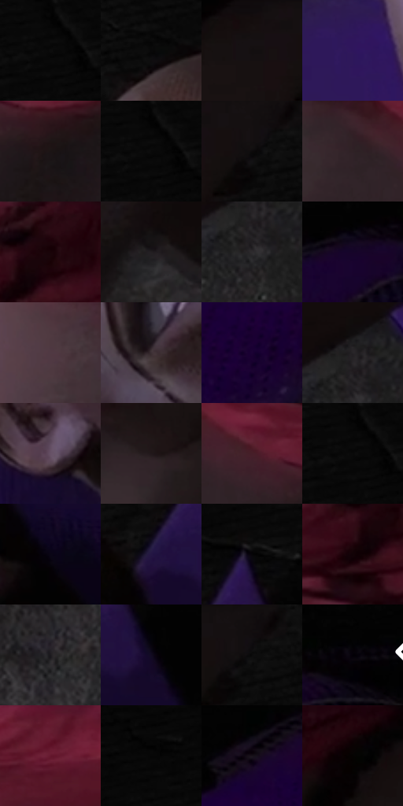

# 电影参考 502

- 状态：常规／活跃；来源世界：miles-home。
- 视角：high-angle；景别：close-up；场景：street。
- 时段：daylight-time-unspecified（外观依据，中置信度；具体时间／晨昏未知）；光照：neutral-day。
- 材质候选：skin, hair, fabric, brick, asphalt, metal（帧级，不是像素分割）。
- 明暗组：very-dark；L* P5/P50/P95：0.54835 / 5.73165 / 26.20289。
- 资格门禁：无附加门禁。
- 原截图 SHA-256：`d4fbdb8679d801cc20ef77135cf5ab0c9bd4f6c52f461115e03df5c64a647c9e`；尺寸：2880 × 1192。
- sRGB 像素 SHA-256：`2a63f19a355f308d386293da26db3a7d1b44682f75a3d858b66d3ae6abada54b`。

## 观察与迁移

阴暗巷道与远端亮口，表情含义和身体关系不得改写。

低位近脸用紫衣、大阴影、颧骨亮面和表情塑形；情绪强不等于必须加放射爆点。

61  /  502  /  屋顶、冲击插帧与巷道：低位近脸用紫衣、大阴影、颧骨亮面和表情塑形；情绪强不等于必须加放射爆点。

本公开版保存32个128×128原像素色卡上下文；图集格子并非原场景相邻位置。原rect、图集tile和像素SHA见 `data/palette-crops.json`。上下文不足时不得批准替色，不能以小样推断完整构图。

## 实测色卡

颜色比例分母为保留采样像素，不是材料面积；全部 32 色参与全库匹配。表内四舍五入仅用于阅读，原精度在 JSON。

| ID | HEX | Lab | 原图 xy | 像素数 | 比例 | 明度角色 |
| --- | --- | --- | --- | ---: | ---: | --- |
| 502-S01 | #030303 | [0.82252, -5.2e-05, 9.9e-05] | [1736, 24] | 12089 | 6.297994% | deep-shadow |
| 502-S02 | #080809 | [2.213175, 0.138905, -0.37816] | [1500, 224] | 11922 | 6.210992% | deep-shadow |
| 502-S03 | #170F10 | [5.069657, 3.451284, 0.646975] | [1280, 36] | 11611 | 6.048971% | deep-shadow |
| 502-S04 | #2E165C | [15.100456, 29.794894, -37.560618] | [1348, 508] | 11336 | 5.905705% | deep-shadow |
| 502-S05 | #1B1415 | [7.113361, 3.646021, 0.576385] | [648, 332] | 11075 | 5.769732% | deep-shadow |
| 502-S06 | #020202 | [0.548347, -3.5e-05, 6.6e-05] | [1740, 24] | 9077 | 4.728836% | deep-shadow |
| 502-S07 | #0D0A0A | [2.931812, 0.85227, 0.300686] | [1384, 72] | 8480 | 4.417817% | deep-shadow |
| 502-S08 | #2F2226 | [14.890397, 7.023002, -0.268284] | [396, 236] | 8453 | 4.403751% | deep-shadow |
| 502-S09 | #290912 | [6.418715, 17.193777, 1.766549] | [720, 32] | 7674 | 3.997916% | deep-shadow |
| 502-S10 | #231F21 | [12.267858, 2.378616, -0.664185] | [556, 612] | 7537 | 3.926543% | deep-shadow |
| 502-S11 | #2F2B2E | [18.050909, 2.503117, -1.285854] | [1052, 652] | 7010 | 3.651993% | deep-shadow |
| 502-S12 | #150529 | [3.866492, 14.615599, -19.71773] | [2640, 640] | 6892 | 3.590518% | deep-shadow |
| 502-S13 | #503943 | [26.840508, 12.01525, -2.143967] | [224, 224] | 6803 | 3.544152% | shadow |
| 502-S14 | #3C2E34 | [20.684005, 7.593127, -1.392194] | [1768, 720] | 6346 | 3.306069% | shadow |
| 502-S15 | #1B0235 | [4.818472, 23.911901, -27.156182] | [2440, 896] | 6272 | 3.267518% | deep-shadow |
| 502-S16 | #272528 | [14.995088, 1.649423, -1.653927] | [1052, 592] | 5899 | 3.073196% | deep-shadow |
| 502-S17 | #675266 | [37.621985, 12.596489, -8.236822] | [1600, 816] | 5687 | 2.962751% | shadow |
| 502-S18 | #22171A | [9.21848, 6.169832, 0.053883] | [864, 312] | 5330 | 2.776765% | deep-shadow |
| 502-S19 | #461E28 | [17.386396, 20.405839, 2.360899] | [536, 256] | 5161 | 2.688721% | deep-shadow |
| 502-S20 | #050505 | [1.370867, -8.7e-05, 0.000165] | [1732, 24] | 4781 | 2.490753% | deep-shadow |
| 502-S21 | #0A0515 | [2.052337, 4.04745, -6.996475] | [2000, 568] | 4613 | 2.403230% | deep-shadow |
| 502-S22 | #241643 | [11.648396, 19.488075, -26.096914] | [1936, 400] | 4573 | 2.382391% | deep-shadow |
| 502-S23 | #060507 | [1.46875, 0.5395, -0.664544] | [2012, 284] | 4283 | 2.231310% | deep-shadow |
| 502-S24 | #120307 | [1.888747, 4.98291, 0.04617] | [668, 116] | 4159 | 2.166710% | deep-shadow |
| 502-S25 | #1D1A1E | [9.74916, 2.464744, -2.241679] | [964, 872] | 3774 | 1.966137% | deep-shadow |
| 502-S26 | #120B21 | [4.3153, 7.761832, -12.88351] | [2060, 416] | 3619 | 1.885387% | deep-shadow |
| 502-S27 | #100D10 | [3.933132, 1.526316, -1.09065] | [1404, 48] | 2955 | 1.539463% | deep-shadow |
| 502-S28 | #020006 | [0.235338, 1.357262, -2.086264] | [2780, 604] | 1824 | 0.950247% | deep-shadow |
| 502-S29 | #641B30 | [22.679389, 34.350948, 5.061253] | [360, 24] | 1066 | 0.555353% | shadow |
| 502-S30 | #010101 | [0.274173, -1.7e-05, 3.3e-05] | [2088, 52] | 659 | 0.343319% | deep-shadow |
| 502-S31 | #18121A | [6.335623, 4.61878, -4.346844] | [2456, 712] | 584 | 0.304246% | deep-shadow |
| 502-S32 | #050301 | [0.899564, 0.244859, 0.941223] | [1112, 68] | 406 | 0.211513% | deep-shadow |

## 色阶与空间分布

- 采样 ROI：`[0.01, 0.02, 0.98, 0.94]`；步长：4；样本数：191950。
- 排除区：`[]`。
- 深暗、暗、中、亮、高光五段计数：`[172913, 17367, 1659, 11, 0]`。
- RGB 各 256 箱、L* 100 箱、13×5 色相明度表和 3×3 空间统计全部保存在 [总数据](../film-library.json)。
- [可视化档案](../../references/library.html)按需绘制直方图，不存 2,094 张重复图表图片。

## 纹理特征占比

**这是分块图像特征的面积占比，不是波点／排线／丝网／错版的精确语义覆盖率。** 窗格、发丝、织物也会产生方向或周期特征。
原图 ROI 像素 3065018；已测块覆盖 3065018（100.0000%）；未测 0。

| 特征 | 块覆盖像素 | 占已测面积 | 阈值敏感范围 |
| --- | ---: | ---: | --- |
| low-contrast | 826112 | 26.9529% | 20.9518% ~ 34.4199% |
| directional-structure | 372096 | 12.1401% | 5.3455% ~ 18.4628% |
| periodic-structure | 1333306 | 43.5008% | 40.1557% ~ 48.4620% |
| mixed-detail | 533504 | 17.4062% | 12.1234% ~ 20.0790% |

阈值敏感范围不是统计置信区间。逐块坐标、尺度、对比、方向一致性、频谱集中度、频率与角度见 [全量特征记录](../texture-features.jsonl)，以帧号定位。
四种印刷层的真实像素覆盖仍标为 `null`，不能填 0，也不能拿上表代替。不得据这些代理测量删除唯一证据。

[测量方法与保留策略](../../references/library-retention.md) · [分类索引](../archive/README.md)
