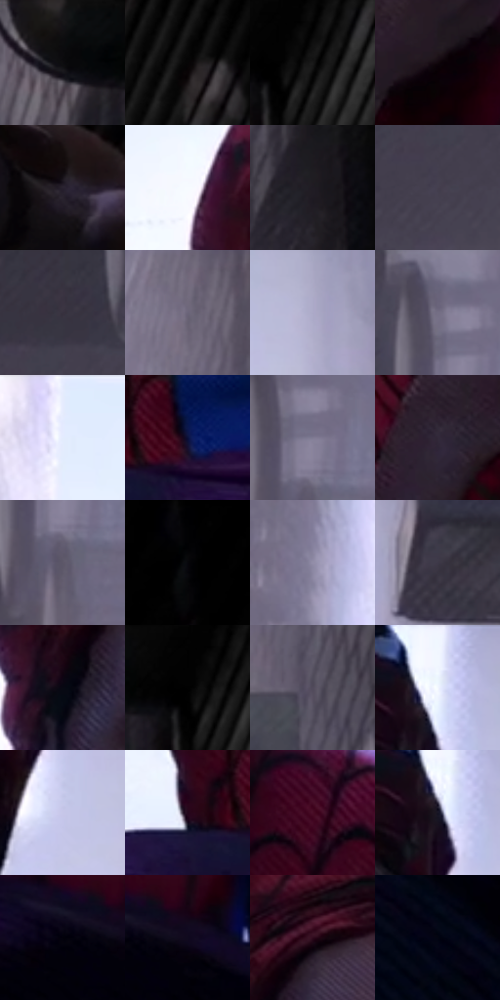

# 电影参考 503

- 状态：常规／活跃；来源世界：miles-home。
- 视角：low-angle；景别：medium；场景：street。
- 时段：daylight-time-unspecified（外观依据，中置信度；具体时间／晨昏未知）；光照：neutral-day。
- 材质候选：skin, hair, fabric, brick, asphalt, metal（帧级，不是像素分割）。
- 明暗组：very-dark；L* P5/P50/P95：0.19608 / 15.18413 / 96.79456。
- 资格门禁：无附加门禁。
- 原截图 SHA-256：`9198ab312a1b69cce5f020b7c826f70c34bf20d7476d20815eaa802a2b3cfcb1`；尺寸：2874 × 1208。
- sRGB 像素 SHA-256：`8d6e6c8d9f96d2d1d1a44239f2328df59a0e199da03b2d20b5d4912ccc10c70a`。

## 观察与迁移

阴暗巷道与远端亮口，表情含义和身体关系不得改写。

巷道逆光后方亮，近墙与前景人体深暗，中心手脸仍可读；不以全局HDR抹掉层级。

62  /  503  /  屋顶、冲击插帧与巷道：巷道逆光后方亮，近墙与前景人体深暗，中心手脸仍可读；不以全局HDR抹掉层级。

本公开版保存32个128×128原像素色卡上下文；图集格子并非原场景相邻位置。原rect、图集tile和像素SHA见 `data/palette-crops.json`。上下文不足时不得批准替色，不能以小样推断完整构图。

## 实测色卡

颜色比例分母为保留采样像素，不是材料面积；全部 32 色参与全库匹配。表内四舍五入仅用于阅读，原精度在 JSON。

| ID | HEX | Lab | 原图 xy | 像素数 | 比例 | 明度角色 |
| --- | --- | --- | --- | ---: | ---: | --- |
| 503-S01 | #121113 | [5.2076, 0.797072, -0.995211] | [2064, 32] | 10000 | 5.179495% | deep-shadow |
| 503-S02 | #060506 | [1.448963, 0.400456, -0.28612] | [2372, 92] | 8586 | 4.447115% | deep-shadow |
| 503-S03 | #000000 | [0.0, 0.0, 0.0] | [2220, 28] | 8580 | 4.444007% | deep-shadow |
| 503-S04 | #11080C | [2.885112, 3.308945, -0.591587] | [1396, 632] | 7997 | 4.142042% | deep-shadow |
| 503-S05 | #28212F | [14.082392, 6.787817, -8.021876] | [2324, 1020] | 7860 | 4.071083% | deep-shadow |
| 503-S06 | #F7FBFF | [98.427537, -0.601926, -2.365443] | [1080, 96] | 7813 | 4.046740% | highlight |
| 503-S07 | #201B23 | [10.647784, 4.433488, -4.582388] | [2100, 700] | 7787 | 4.033273% | deep-shadow |
| 503-S08 | #453F4F | [27.80385, 6.242791, -8.719019] | [332, 176] | 6745 | 3.493570% | shadow |
| 503-S09 | #37313F | [21.460213, 5.994418, -7.804151] | [356, 72] | 6709 | 3.474923% | shadow |
| 503-S10 | #6B657A | [44.000022, 6.869248, -10.860175] | [1920, 72] | 6500 | 3.366672% | midtone |
| 503-S11 | #ABA9C7 | [70.285721, 6.753484, -15.005036] | [1704, 132] | 6490 | 3.361493% | light |
| 503-S12 | #746E84 | [47.663202, 6.982336, -11.252802] | [496, 68] | 6467 | 3.349580% | midtone |
| 503-S13 | #E6ECFD | [93.409209, 1.187581, -8.871706] | [788, 40] | 6454 | 3.342846% | highlight |
| 503-S14 | #0A0F3A | [6.427259, 15.019815, -28.27691] | [1012, 912] | 6445 | 3.338185% | deep-shadow |
| 503-S15 | #7F7A92 | [52.404829, 6.936404, -12.265298] | [524, 112] | 6265 | 3.244954% | midtone |
| 503-S16 | #322839 | [17.878379, 8.624484, -9.178262] | [1256, 680] | 6126 | 3.172959% | deep-shadow |
| 503-S17 | #5D5769 | [38.134154, 6.358789, -9.430232] | [520, 184] | 6083 | 3.150687% | shadow |
| 503-S18 | #020203 | [0.568134, 0.139009, -0.378358] | [2708, 28] | 5816 | 3.012395% | deep-shadow |
| 503-S19 | #928DA8 | [59.877588, 7.386505, -13.528177] | [684, 420] | 5693 | 2.948687% | midtone |
| 503-S20 | #3D3848 | [24.60252, 5.978126, -9.03065] | [1804, 396] | 5608 | 2.904661% | shadow |
| 503-S21 | #070813 | [2.401306, 1.609159, -5.183463] | [1168, 252] | 5519 | 2.858564% | deep-shadow |
| 503-S22 | #010101 | [0.274173, -1.7e-05, 3.3e-05] | [2184, 28] | 5456 | 2.825933% | deep-shadow |
| 503-S23 | #514A5B | [32.705542, 6.69097, -8.936035] | [1992, 280] | 5424 | 2.809358% | shadow |
| 503-S24 | #F1F6FF | [96.751493, -0.012667, -4.878827] | [1568, 28] | 5251 | 2.719753% | highlight |
| 503-S25 | #C7C7E9 | [81.220856, 6.694337, -16.778197] | [1588, 228] | 5024 | 2.602178% | highlight |
| 503-S26 | #23061A | [5.07863, 16.647912, -6.03462] | [908, 924] | 4773 | 2.472173% | deep-shadow |
| 503-S27 | #480D26 | [14.433722, 29.704836, -0.42984] | [1548, 664] | 4686 | 2.427112% | deep-shadow |
| 503-S28 | #171424 | [7.315068, 6.133043, -10.526137] | [1556, 100] | 3694 | 1.913306% | deep-shadow |
| 503-S29 | #02010A | [0.510564, 1.512876, -3.31364] | [1444, 968] | 3599 | 1.864100% | deep-shadow |
| 503-S30 | #10091E | [3.606451, 6.806463, -11.627213] | [1512, 964] | 3443 | 1.783300% | deep-shadow |
| 503-S31 | #2F0A1D | [8.220495, 21.091577, -3.461816] | [1232, 152] | 3192 | 1.653295% | deep-shadow |
| 503-S32 | #030411 | [1.324652, 1.750051, -5.566858] | [1272, 1088] | 2984 | 1.545561% | deep-shadow |

## 色阶与空间分布

- 采样 ROI：`[0.01, 0.02, 0.98, 0.94]`；步长：4；样本数：193069。
- 排除区：`[]`。
- 深暗、暗、中、亮、高光五段计数：`[106145, 29763, 23374, 11416, 22371]`。
- RGB 各 256 箱、L* 100 箱、13×5 色相明度表和 3×3 空间统计全部保存在 [总数据](../film-library.json)。
- [可视化档案](../../references/library.html)按需绘制直方图，不存 2,094 张重复图表图片。

## 纹理特征占比

**这是分块图像特征的面积占比，不是波点／排线／丝网／错版的精确语义覆盖率。** 窗格、发丝、织物也会产生方向或周期特征。
原图 ROI 像素 3097468；已测块覆盖 3097468（100.0000%）；未测 0。

| 特征 | 块覆盖像素 | 占已测面积 | 阈值敏感范围 |
| --- | ---: | ---: | --- |
| low-contrast | 404480 | 13.0584% | 8.6987% ~ 18.0090% |
| directional-structure | 1141632 | 36.8569% | 21.6869% ~ 53.4444% |
| periodic-structure | 1534972 | 49.5557% | 37.8569% ~ 56.9403% |
| mixed-detail | 16384 | 0.5289% | 0.0000% ~ 3.3638% |

阈值敏感范围不是统计置信区间。逐块坐标、尺度、对比、方向一致性、频谱集中度、频率与角度见 [全量特征记录](../texture-features.jsonl)，以帧号定位。
四种印刷层的真实像素覆盖仍标为 `null`，不能填 0，也不能拿上表代替。不得据这些代理测量删除唯一证据。

[测量方法与保留策略](../../references/library-retention.md) · [分类索引](../archive/README.md)
