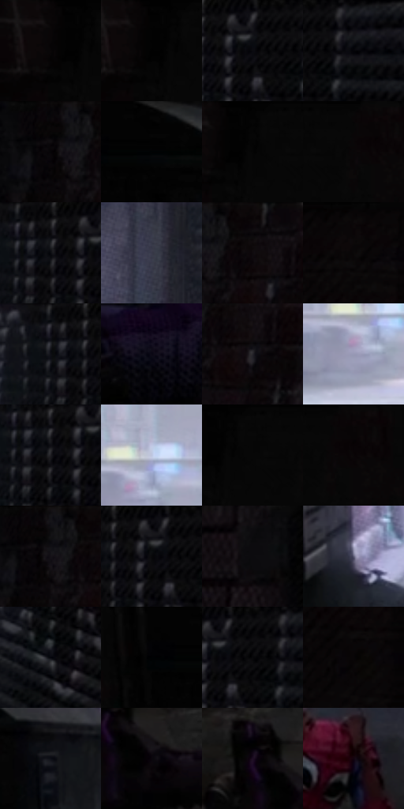

# 电影参考 504

- 状态：常规／活跃；来源世界：miles-home。
- 视角：near-level；景别：environment-wide；场景：street。
- 时段：daylight-time-unspecified（外观依据，中置信度；具体时间／晨昏未知）；光照：neutral-day。
- 材质候选：skin, hair, fabric, brick, asphalt, metal（帧级，不是像素分割）。
- 明暗组：very-dark；L* P5/P50/P95：0.46889 / 2.90457 / 65.00977。
- 资格门禁：无附加门禁。
- 原截图 SHA-256：`412f484a8bed16e1b18227478a4d615381f3295ff93a51e09d4878b01900be5a`；尺寸：2874 × 1198。
- sRGB 像素 SHA-256：`dc9546dd3997bcebb3fc8e3cb5a66a3e48c746244beea727e58d2c4b854570d3`。

## 观察与迁移

阴暗巷道与远端亮口，表情含义和身体关系不得改写。

巷口亮区建立纵深，地面灰纹与零散浅斑，紫衣和红衣局部辨识；原有杂物不清空。

63  /  504  /  屋顶、冲击插帧与巷道：巷口亮区建立纵深，地面灰纹与零散浅斑，紫衣和红衣局部辨识；原有杂物不清空。

本公开版保存32个128×128原像素色卡上下文；图集格子并非原场景相邻位置。原rect、图集tile和像素SHA见 `data/palette-crops.json`。上下文不足时不得批准替色，不能以小样推断完整构图。

## 实测色卡

颜色比例分母为保留采样像素，不是材料面积；全部 32 色参与全库匹配。表内四舍五入仅用于阅读，原精度在 JSON。

| ID | HEX | Lab | 原图 xy | 像素数 | 比例 | 明度角色 |
| --- | --- | --- | --- | ---: | ---: | --- |
| 504-S01 | #100D0E | [3.881627, 1.164388, -0.105621] | [32, 24] | 10222 | 5.313663% | deep-shadow |
| 504-S02 | #020202 | [0.548347, -3.5e-05, 6.6e-05] | [84, 24] | 9470 | 4.922754% | deep-shadow |
| 504-S03 | #151418 | [6.555064, 1.413189, -2.512784] | [1824, 32] | 8596 | 4.468426% | deep-shadow |
| 504-S04 | #030409 | [1.137319, 0.43365, -1.984124] | [1912, 60] | 8050 | 4.184601% | deep-shadow |
| 504-S05 | #080707 | [1.977523, 0.261377, 0.092369] | [2100, 40] | 7745 | 4.026054% | deep-shadow |
| 504-S06 | #010101 | [0.274173, -1.7e-05, 3.3e-05] | [444, 28] | 7714 | 4.009939% | deep-shadow |
| 504-S07 | #050505 | [1.370867, -8.7e-05, 0.000165] | [112, 24] | 7503 | 3.900256% | deep-shadow |
| 504-S08 | #090607 | [1.839754, 0.923437, -0.10181] | [208, 24] | 7492 | 3.894538% | deep-shadow |
| 504-S09 | #19191B | [8.832678, 0.526983, -1.395752] | [1756, 32] | 7443 | 3.869066% | deep-shadow |
| 504-S10 | #383A4A | [24.831238, 3.256823, -10.055072] | [1532, 68] | 7384 | 3.838396% | shadow |
| 504-S11 | #0C0B0C | [3.107799, 0.435248, -0.310864] | [2184, 44] | 7108 | 3.694924% | deep-shadow |
| 504-S12 | #0C0808 | [2.43319, 1.075308, 0.379195] | [2804, 28] | 7055 | 3.667374% | deep-shadow |
| 504-S13 | #2E2D34 | [18.823744, 2.171654, -4.320452] | [1716, 28] | 6581 | 3.420976% | deep-shadow |
| 504-S14 | #0A0814 | [2.607739, 2.615063, -5.509628] | [1452, 816] | 6497 | 3.377311% | deep-shadow |
| 504-S15 | #24232A | [14.083646, 2.267324, -4.475781] | [2208, 108] | 6482 | 3.369513% | deep-shadow |
| 504-S16 | #9799B5 | [63.91519, 5.14584, -14.749648] | [1008, 188] | 6476 | 3.366394% | light |
| 504-S17 | #1E1D21 | [11.025269, 1.508743, -2.56185] | [1760, 80] | 6403 | 3.328447% | deep-shadow |
| 504-S18 | #BEC5DF | [79.731201, 2.797856, -13.723261] | [1036, 132] | 6381 | 3.317011% | light |
| 504-S19 | #060606 | [1.645041, -0.000104, 0.000198] | [140, 24] | 6331 | 3.291019% | deep-shadow |
| 504-S20 | #080405 | [1.349716, 1.184971, -0.009737] | [236, 44] | 6171 | 3.207847% | deep-shadow |
| 504-S21 | #111012 | [4.818391, 0.762198, -0.952096] | [2120, 36] | 6019 | 3.128834% | deep-shadow |
| 504-S22 | #07070B | [1.998866, 0.559599, -1.523112] | [1808, 24] | 5734 | 2.980683% | deep-shadow |
| 504-S23 | #141113 | [5.389441, 1.612582, -0.707868] | [2492, 24] | 5568 | 2.894392% | deep-shadow |
| 504-S24 | #5C5C75 | [39.938154, 5.832452, -14.099888] | [712, 384] | 4400 | 2.287235% | shadow |
| 504-S25 | #04050D | [1.475995, 0.886892, -3.217689] | [1752, 364] | 4053 | 2.106855% | deep-shadow |
| 504-S26 | #020205 | [0.607707, 0.417097, -1.135205] | [360, 52] | 3681 | 1.913480% | deep-shadow |
| 504-S27 | #030305 | [0.862094, 0.278035, -0.756748] | [1856, 28] | 3202 | 1.664483% | deep-shadow |
| 504-S28 | #050302 | [0.919351, 0.383903, 0.5628] | [2816, 196] | 3198 | 1.662404% | deep-shadow |
| 504-S29 | #0D0E16 | [4.133058, 1.347484, -4.638746] | [600, 120] | 3029 | 1.574553% | deep-shadow |
| 504-S30 | #0A050C | [1.803147, 2.296376, -2.230726] | [676, 848] | 2356 | 1.224710% | deep-shadow |
| 504-S31 | #1E0F23 | [6.675664, 12.168935, -10.685838] | [616, 800] | 2306 | 1.198719% | deep-shadow |
| 504-S32 | #13040F | [2.346719, 6.196449, -2.833607] | [1412, 504] | 1722 | 0.895141% | deep-shadow |

## 色阶与空间分布

- 采样 ROI：`[0.01, 0.02, 0.98, 0.94]`；步长：4；样本数：192372。
- 排除区：`[]`。
- 深暗、暗、中、亮、高光五段计数：`[166221, 11212, 3987, 8189, 2763]`。
- RGB 各 256 箱、L* 100 箱、13×5 色相明度表和 3×3 空间统计全部保存在 [总数据](../film-library.json)。
- [可视化档案](../../references/library.html)按需绘制直方图，不存 2,094 张重复图表图片。

## 纹理特征占比

**这是分块图像特征的面积占比，不是波点／排线／丝网／错版的精确语义覆盖率。** 窗格、发丝、织物也会产生方向或周期特征。
原图 ROI 像素 3075164；已测块覆盖 3075164（100.0000%）；未测 0。

| 特征 | 块覆盖像素 | 占已测面积 | 阈值敏感范围 |
| --- | ---: | ---: | --- |
| low-contrast | 867676 | 28.2156% | 19.3539% ~ 34.8213% |
| directional-structure | 235904 | 7.6713% | 2.6639% ~ 19.8462% |
| periodic-structure | 1693056 | 55.0558% | 48.2087% ~ 59.2015% |
| mixed-detail | 278528 | 9.0573% | 1.5984% ~ 14.3061% |

阈值敏感范围不是统计置信区间。逐块坐标、尺度、对比、方向一致性、频谱集中度、频率与角度见 [全量特征记录](../texture-features.jsonl)，以帧号定位。
四种印刷层的真实像素覆盖仍标为 `null`，不能填 0，也不能拿上表代替。不得据这些代理测量删除唯一证据。

[测量方法与保留策略](../../references/library-retention.md) · [分类索引](../archive/README.md)
