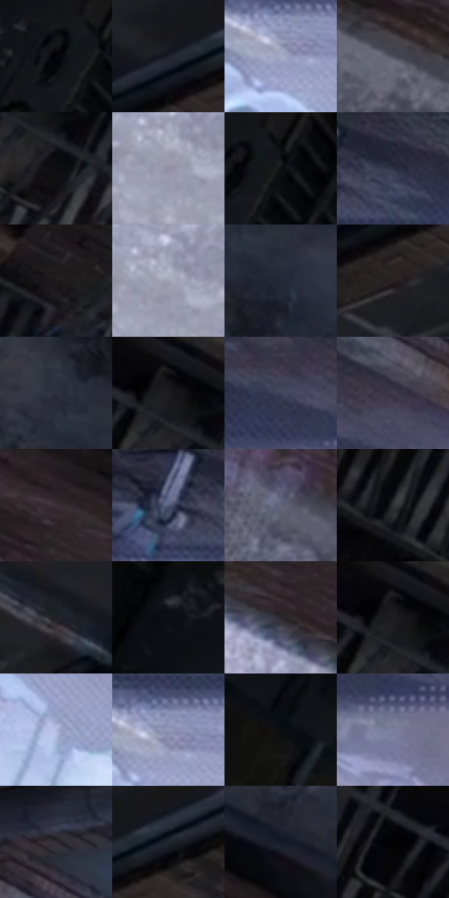

# 电影参考 505

- 状态：常规／活跃；来源世界：miles-home。
- 视角：overhead；景别：environment-wide；场景：street。
- 时段：daylight-time-unspecified（外观依据，中置信度；具体时间／晨昏未知）；光照：neutral-day。
- 材质候选：skin, hair, fabric, brick, asphalt, metal（帧级，不是像素分割）。
- 明暗组：very-dark；L* P5/P50/P95：2.37073 / 16.55019 / 69.5507。
- 资格门禁：无附加门禁。
- 原截图 SHA-256：`985d47b3fc567c063a1cbed7b95c6b09d49148fd784e12cc9b2832104f734ff6`；尺寸：2880 × 1208。
- sRGB 像素 SHA-256：`4759d5a36e0208c7b379c80fc9b83ca85dd531ecd9f83ebcd80753a1313bfc63`。

## 观察与迁移

阴暗巷道与远端亮口，表情含义和身体关系不得改写。

俯视巷道中远处两人仍是叙事焦点，近白色边沿纹理与暗砖分层；不按距离机械模糊主角。

64  /  505  /  屋顶、冲击插帧与巷道：俯视巷道中远处两人仍是叙事焦点，近白色边沿纹理与暗砖分层；不按距离机械模糊主角。

本公开版保存32个128×128原像素色卡上下文；图集格子并非原场景相邻位置。原rect、图集tile和像素SHA见 `data/palette-crops.json`。上下文不足时不得批准替色，不能以小样推断完整构图。

## 实测色卡

颜色比例分母为保留采样像素，不是材料面积；全部 32 色参与全库匹配。表内四舍五入仅用于阅读，原精度在 JSON。

| ID | HEX | Lab | 原图 xy | 像素数 | 比例 | 明度角色 |
| --- | --- | --- | --- | ---: | ---: | --- |
| 505-S01 | #17171B | [7.895451, 1.091444, -2.810599] | [640, 28] | 9779 | 5.057772% | deep-shadow |
| 505-S02 | #1F222C | [13.334328, 1.477185, -7.093588] | [2436, 76] | 9298 | 4.808995% | deep-shadow |
| 505-S03 | #A6AAC6 | [70.128961, 4.353826, -14.728119] | [2432, 756] | 7993 | 4.134039% | light |
| 505-S04 | #4D4D5B | [33.223263, 3.259609, -8.19286] | [744, 712] | 7518 | 3.888366% | shadow |
| 505-S05 | #0F0E10 | [4.092317, 0.693808, -0.867526] | [1680, 144] | 7500 | 3.879056% | deep-shadow |
| 505-S06 | #9291A7 | [60.915121, 4.892437, -11.399389] | [240, 672] | 7374 | 3.813888% | light |
| 505-S07 | #090A0D | [2.747928, 0.191586, -1.325406] | [688, 40] | 7156 | 3.701137% | deep-shadow |
| 505-S08 | #303449 | [22.178775, 4.111812, -13.514401] | [2456, 612] | 6797 | 3.515459% | shadow |
| 505-S09 | #1E1C1F | [10.597583, 1.714742, -1.716562] | [1812, 28] | 6763 | 3.497874% | deep-shadow |
| 505-S10 | #A0A0B5 | [66.482505, 4.235026, -10.821079] | [248, 652] | 6710 | 3.470462% | light |
| 505-S11 | #242938 | [16.730491, 2.1461, -10.36399] | [1756, 684] | 6677 | 3.453394% | deep-shadow |
| 505-S12 | #282022 | [13.228198, 4.268327, 0.082876] | [2404, 188] | 6620 | 3.423914% | deep-shadow |
| 505-S13 | #2C303D | [19.988606, 1.789585, -8.775015] | [1700, 608] | 6486 | 3.354608% | deep-shadow |
| 505-S14 | #151417 | [6.518171, 1.153938, -1.80715] | [1652, 52] | 6359 | 3.288922% | deep-shadow |
| 505-S15 | #41455A | [29.708404, 3.744431, -12.985291] | [2644, 632] | 6148 | 3.179792% | shadow |
| 505-S16 | #3E3A4A | [25.39588, 5.550981, -9.144602] | [2748, 600] | 5885 | 3.043766% | shadow |
| 505-S17 | #3A3034 | [21.061964, 5.345185, -0.863937] | [532, 480] | 5832 | 3.016354% | shadow |
| 505-S18 | #4F5875 | [37.708712, 3.939388, -17.605584] | [2364, 624] | 5760 | 2.979115% | shadow |
| 505-S19 | #62667B | [43.550028, 3.305959, -12.218623] | [1472, 1076] | 5653 | 2.923774% | midtone |
| 505-S20 | #06070A | [1.920266, 0.15551, -1.227178] | [1380, 28] | 5601 | 2.896879% | deep-shadow |
| 505-S21 | #1B1C23 | [10.445119, 1.477584, -4.941764] | [2308, 28] | 5414 | 2.800161% | deep-shadow |
| 505-S22 | #0F1218 | [5.420654, 0.317206, -4.231952] | [436, 36] | 5411 | 2.798610% | deep-shadow |
| 505-S23 | #2B262C | [15.910198, 3.728719, -3.09509] | [192, 412] | 5279 | 2.730338% | deep-shadow |
| 505-S24 | #121214 | [5.52557, 0.433274, -1.179492] | [1648, 40] | 5185 | 2.681721% | deep-shadow |
| 505-S25 | #B0BADC | [75.770062, 3.652632, -18.16896] | [2808, 1036] | 5027 | 2.600002% | light |
| 505-S26 | #959ABA | [64.197534, 5.067303, -17.142691] | [2444, 732] | 5009 | 2.590692% | light |
| 505-S27 | #090C12 | [3.294118, 0.272589, -3.2441] | [268, 36] | 4646 | 2.402946% | deep-shadow |
| 505-S28 | #7A7F9C | [53.7245, 4.653372, -16.128829] | [2720, 724] | 4609 | 2.383809% | midtone |
| 505-S29 | #302B30 | [18.23029, 3.421898, -2.402965] | [2728, 448] | 4551 | 2.353811% | deep-shadow |
| 505-S30 | #13161F | [7.327202, 1.299136, -6.749181] | [2524, 28] | 4105 | 2.123137% | deep-shadow |
| 505-S31 | #151A28 | [9.41222, 2.227821, -10.276103] | [1560, 828] | 3221 | 1.665925% | deep-shadow |
| 505-S32 | #040406 | [1.136268, 0.278018, -0.756715] | [1532, 52] | 2980 | 1.541278% | deep-shadow |

## 色阶与空间分布

- 采样 ROI：`[0.01, 0.02, 0.98, 0.94]`；步长：4；样本数：193346。
- 排除区：`[]`。
- 深暗、暗、中、亮、高光五段计数：`[111534, 39161, 12877, 29332, 442]`。
- RGB 各 256 箱、L* 100 箱、13×5 色相明度表和 3×3 空间统计全部保存在 [总数据](../film-library.json)。
- [可视化档案](../../references/library.html)按需绘制直方图，不存 2,094 张重复图表图片。

## 纹理特征占比

**这是分块图像特征的面积占比，不是波点／排线／丝网／错版的精确语义覆盖率。** 窗格、发丝、织物也会产生方向或周期特征。
原图 ROI 像素 3104134；已测块覆盖 3104134（100.0000%）；未测 0。

| 特征 | 块覆盖像素 | 占已测面积 | 阈值敏感范围 |
| --- | ---: | ---: | --- |
| low-contrast | 0 | 0.0000% | 0.0000% ~ 1.5834% |
| directional-structure | 453120 | 14.5973% | 1.5834% ~ 29.4626% |
| periodic-structure | 2467718 | 79.4978% | 70.1786% ~ 81.2379% |
| mixed-detail | 183296 | 5.9049% | 0.3587% ~ 15.5952% |

阈值敏感范围不是统计置信区间。逐块坐标、尺度、对比、方向一致性、频谱集中度、频率与角度见 [全量特征记录](../texture-features.jsonl)，以帧号定位。
四种印刷层的真实像素覆盖仍标为 `null`，不能填 0，也不能拿上表代替。不得据这些代理测量删除唯一证据。

[测量方法与保留策略](../../references/library-retention.md) · [分类索引](../archive/README.md)
