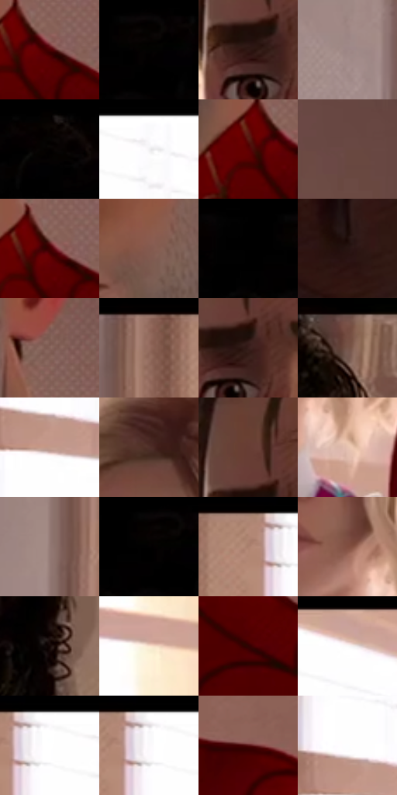

# 电影参考 506

- 状态：常规／活跃；来源世界：miles-home。
- 视角：near-level；景别：medium；场景：interior。
- 时段：daylight-time-unspecified（外观依据，中置信度；具体时间／晨昏未知）；光照：warm-day。
- 材质候选：skin, hair, fabric, paint, wood, paper, glass, metal（帧级，不是像素分割）。
- 明暗组：dark；L* P5/P50/P95：0.1364 / 21.72965 / 99.65492。
- 资格门禁：无附加门禁。
- 原截图 SHA-256：`3be7d3e38bb00d07ecd955faa30fd3ecf535fc585141be9bd8c7c1b538149f63`；尺寸：2880 × 1226。
- sRGB 像素 SHA-256：`6a4e388537e413fcaa16f4481a9a6305fed30622868c05649f9273da936a5ef6`。

## 观察与迁移

暖窗宿舍，墙影、脸部、黑白衣料和远楼层次分开。

三人过肩画面用暖窗逆光、浅色发缘和前景暗脸分层；不要所有肤色统一橙化。

65  /  506  /  宿舍暖窗与焦点：三人过肩画面用暖窗逆光、浅色发缘和前景暗脸分层；不要所有肤色统一橙化。

本公开版保存32个128×128原像素色卡上下文；图集格子并非原场景相邻位置。原rect、图集tile和像素SHA见 `data/palette-crops.json`。上下文不足时不得批准替色，不能以小样推断完整构图。

## 实测色卡

颜色比例分母为保留采样像素，不是材料面积；全部 32 色参与全库匹配。表内四舍五入仅用于阅读，原精度在 JSON。

| ID | HEX | Lab | 原图 xy | 像素数 | 比例 | 明度角色 |
| --- | --- | --- | --- | ---: | ---: | --- |
| 506-S01 | #490001 | [12.084422, 32.508781, 18.580181] | [2396, 572] | 14387 | 7.309130% | deep-shadow |
| 506-S02 | #020101 | [0.332482, 0.261482, 0.092172] | [160, 28] | 13094 | 6.652238% | deep-shadow |
| 506-S03 | #301814 | [11.499566, 11.502744, 7.944416] | [1976, 232] | 11323 | 5.752505% | deep-shadow |
| 506-S04 | #9E8786 | [58.338609, 8.5309, 3.769614] | [1068, 844] | 9516 | 4.834481% | midtone |
| 506-S05 | #060201 | [0.761795, 0.906919, 0.747044] | [696, 28] | 9186 | 4.666829% | deep-shadow |
| 506-S06 | #FEFEFE | [99.654922, -0.002448, 0.00464] | [1440, 28] | 9071 | 4.608405% | highlight |
| 506-S07 | #5C0002 | [16.895132, 38.083901, 25.344818] | [2340, 576] | 9042 | 4.593672% | deep-shadow |
| 506-S08 | #694842 | [34.049252, 13.231038, 9.255458] | [2776, 136] | 7834 | 3.979963% | shadow |
| 506-S09 | #3D0001 | [8.946557, 28.885238, 13.722072] | [2380, 560] | 7754 | 3.939320% | deep-shadow |
| 506-S10 | #84594E | [42.156335, 16.26808, 13.549675] | [2204, 448] | 7716 | 3.920015% | midtone |
| 506-S11 | #000000 | [0.0, 0.0, 0.0] | [76, 28] | 7322 | 3.719848% | deep-shadow |
| 506-S12 | #261310 | [8.26511, 9.383588, 5.561501] | [392, 856] | 6828 | 3.468878% | deep-shadow |
| 506-S13 | #846058 | [44.199533, 13.456614, 10.325342] | [2352, 388] | 6740 | 3.424170% | midtone |
| 506-S14 | #91685B | [47.850239, 14.633794, 13.830065] | [1192, 40] | 6700 | 3.403849% | midtone |
| 506-S15 | #371E1B | [14.513276, 11.782022, 7.251231] | [2004, 224] | 6514 | 3.309354% | deep-shadow |
| 506-S16 | #73514A | [37.886877, 13.215316, 9.777214] | [928, 28] | 6400 | 3.251438% | shadow |
| 506-S17 | #C29B8B | [67.110009, 12.133715, 13.902959] | [1404, 344] | 5952 | 3.023837% | light |
| 506-S18 | #51302A | [23.772994, 14.253688, 10.169763] | [1332, 576] | 5683 | 2.887175% | shadow |
| 506-S19 | #673D34 | [30.567726, 17.321174, 13.354647] | [1976, 144] | 5189 | 2.636205% | shadow |
| 506-S20 | #E7C3B0 | [81.377198, 9.917529, 14.310677] | [1520, 1028] | 5159 | 2.620964% | highlight |
| 506-S21 | #947A75 | [53.492528, 9.229467, 6.513743] | [1116, 604] | 5048 | 2.564572% | midtone |
| 506-S22 | #050101 | [0.507409, 1.04598, 0.368587] | [136, 32] | 4583 | 2.328334% | deep-shadow |
| 506-S23 | #AF8573 | [59.092984, 13.554929, 15.941973] | [1296, 48] | 4348 | 2.208946% | midtone |
| 506-S24 | #814E40 | [38.702944, 19.854333, 17.353917] | [1440, 936] | 4330 | 2.199801% | shadow |
| 506-S25 | #120604 | [2.41762, 3.364097, 2.040395] | [944, 256] | 4120 | 2.093113% | deep-shadow |
| 506-S26 | #FCE6D0 | [92.506375, 4.042134, 13.444544] | [1836, 408] | 4117 | 2.091589% | highlight |
| 506-S27 | #2E0402 | [6.072338, 20.676485, 8.681943] | [2484, 716] | 2872 | 1.459083% | deep-shadow |
| 506-S28 | #FBF9F9 | [98.073624, 0.659491, 0.238376] | [1652, 68] | 2727 | 1.385417% | highlight |
| 506-S29 | #FEFCFE | [99.161642, 1.007512, -0.716125] | [1364, 40] | 1486 | 0.754943% | highlight |
| 506-S30 | #FFFFFF | [100.0, -0.002455, 0.004653] | [1348, 28] | 1204 | 0.611677% | highlight |
| 506-S31 | #531013 | [16.782814, 30.715176, 16.809492] | [2788, 756] | 401 | 0.203723% | deep-shadow |
| 506-S32 | #FDFEFF | [99.606657, -0.15549, -0.587536] | [1384, 284] | 190 | 0.096527% | highlight |

## 色阶与空间分布

- 采样 ROI：`[0.01, 0.02, 0.98, 0.94]`；步长：4；样本数：196836。
- 排除区：`[]`。
- 深暗、暗、中、亮、高光五段计数：`[96638, 28775, 37913, 11513, 21997]`。
- RGB 各 256 箱、L* 100 箱、13×5 色相明度表和 3×3 空间统计全部保存在 [总数据](../film-library.json)。
- [可视化档案](../../references/library.html)按需绘制直方图，不存 2,094 张重复图表图片。

## 纹理特征占比

**这是分块图像特征的面积占比，不是波点／排线／丝网／错版的精确语义覆盖率。** 窗格、发丝、织物也会产生方向或周期特征。
原图 ROI 像素 3151632；已测块覆盖 3151632（100.0000%）；未测 0。

| 特征 | 块覆盖像素 | 占已测面积 | 阈值敏感范围 |
| --- | ---: | ---: | --- |
| low-contrast | 1133072 | 35.9519% | 29.2344% ~ 41.5729% |
| directional-structure | 761088 | 24.1490% | 17.9107% ~ 33.4090% |
| periodic-structure | 1195008 | 37.9171% | 37.3566% ~ 37.9171% |
| mixed-detail | 62464 | 1.9820% | 0.0000% ~ 3.0217% |

阈值敏感范围不是统计置信区间。逐块坐标、尺度、对比、方向一致性、频谱集中度、频率与角度见 [全量特征记录](../texture-features.jsonl)，以帧号定位。
四种印刷层的真实像素覆盖仍标为 `null`，不能填 0，也不能拿上表代替。不得据这些代理测量删除唯一证据。

[测量方法与保留策略](../../references/library-retention.md) · [分类索引](../archive/README.md)
