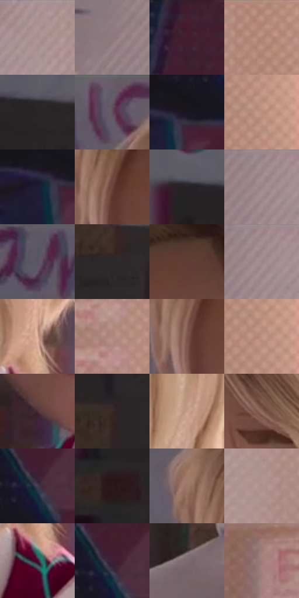

# 电影参考 507

- 状态：常规／活跃；来源世界：miles-home。
- 视角：near-level；景别：close-up；场景：interior。
- 时段：daylight-time-unspecified（外观依据，中置信度；具体时间／晨昏未知）；光照：warm-day。
- 材质候选：skin, hair, fabric, paint, wood, paper, glass, metal（帧级，不是像素分割）。
- 明暗组：dark；L* P5/P50/P95：10.56856 / 39.8614 / 66.84675。
- 资格门禁：无附加门禁。
- 原截图 SHA-256：`6b78167c3ec2de19ba5a798c2aa2e7daa6b8bc60d9c6d99de93b8ba9bbb451f8`；尺寸：2880 × 1208。
- sRGB 像素 SHA-256：`bb123b0db1af725c0972c525120645068fad4623259d870f8affe9ea9f15c5ff`。

## 观察与迁移

暖窗宿舍，墙影、脸部、黑白衣料和远楼层次分开。

女孩脸部较干净，右侧暖窗漫亮带网点，左后公告框有青粉错版；人物、空气亮区与建筑边分别设计。

66  /  507  /  宿舍暖窗与焦点：女孩脸部较干净，右侧暖窗漫亮带网点，左后公告框有青粉错版；人物、空气亮区与建筑边分别设计。

本公开版保存32个128×128原像素色卡上下文；图集格子并非原场景相邻位置。原rect、图集tile和像素SHA见 `data/palette-crops.json`。上下文不足时不得批准替色，不能以小样推断完整构图。

## 实测色卡

颜色比例分母为保留采样像素，不是材料面积；全部 32 色参与全库匹配。表内四舍五入仅用于阅读，原精度在 JSON。

| ID | HEX | Lab | 原图 xy | 像素数 | 比例 | 明度角色 |
| --- | --- | --- | --- | ---: | ---: | --- |
| 507-S01 | #AE9495 | [63.630528, 9.84577, 3.078024] | [2252, 44] | 12294 | 6.358549% | light |
| 507-S02 | #8E7A7E | [53.142346, 8.409459, 0.675767] | [1968, 344] | 10610 | 5.487572% | midtone |
| 507-S03 | #451F2F | [17.694154, 20.435081, -2.175212] | [200, 32] | 10574 | 5.468952% | deep-shadow |
| 507-S04 | #AF8677 | [59.432093, 13.523917, 14.136758] | [2652, 40] | 9301 | 4.810547% | midtone |
| 507-S05 | #2A2525 | [15.217193, 2.328351, 0.84941] | [764, 352] | 8305 | 4.295408% | deep-shadow |
| 507-S06 | #615C67 | [39.873586, 4.32821, -5.552081] | [1088, 28] | 8256 | 4.270065% | shadow |
| 507-S07 | #1B1720 | [8.568529, 4.353152, -5.540453] | [132, 324] | 7294 | 3.772511% | deep-shadow |
| 507-S08 | #B98E7C | [62.606499, 13.729802, 15.876713] | [2744, 140] | 6982 | 3.611143% | light |
| 507-S09 | #1E1D35 | [12.035469, 7.757598, -15.582777] | [88, 348] | 6925 | 3.581662% | deep-shadow |
| 507-S10 | #6E463C | [34.029244, 15.879999, 13.117294] | [1136, 308] | 6765 | 3.498909% | shadow |
| 507-S11 | #262325 | [14.103364, 1.875142, -0.830159] | [528, 320] | 6739 | 3.485461% | deep-shadow |
| 507-S12 | #9B8488 | [57.317526, 9.431519, 1.10316] | [2088, 36] | 6632 | 3.430120% | midtone |
| 507-S13 | #5A5561 | [36.992217, 4.615992, -6.196942] | [832, 68] | 6420 | 3.320472% | shadow |
| 507-S14 | #2E282C | [16.89443, 3.669591, -1.600548] | [920, 728] | 6326 | 3.271855% | deep-shadow |
| 507-S15 | #603C34 | [29.329031, 14.79488, 11.513867] | [1312, 216] | 6179 | 3.195825% | shadow |
| 507-S16 | #A28A8E | [59.718551, 9.732499, 1.234961] | [2104, 36] | 6170 | 3.191170% | midtone |
| 507-S17 | #DEB29F | [75.993037, 13.209609, 15.771801] | [1740, 892] | 6002 | 3.104279% | light |
| 507-S18 | #B08A7F | [60.729327, 12.790954, 11.41948] | [2544, 1040] | 5951 | 3.077902% | light |
| 507-S19 | #7D5549 | [40.145499, 15.00591, 13.703125] | [1124, 340] | 5899 | 3.051007% | midtone |
| 507-S20 | #BD9483 | [64.675043, 12.928414, 14.88711] | [2744, 180] | 5787 | 2.993080% | light |
| 507-S21 | #482E33 | [22.199131, 12.775647, 1.68905] | [1316, 912] | 5269 | 2.725166% | shadow |
| 507-S22 | #382A26 | [18.526111, 5.762885, 5.102369] | [808, 544] | 5222 | 2.700858% | deep-shadow |
| 507-S23 | #C59C8A | [67.638632, 12.622221, 15.241253] | [1824, 664] | 4888 | 2.528110% | light |
| 507-S24 | #8F695E | [47.945999, 13.61367, 12.147366] | [1468, 368] | 4791 | 2.477941% | midtone |
| 507-S25 | #3F3E4F | [26.923224, 4.596133, -10.108597] | [204, 244] | 4361 | 2.255542% | shadow |
| 507-S26 | #2E1A1D | [12.013813, 10.467944, 2.084682] | [552, 1032] | 4166 | 2.154686% | deep-shadow |
| 507-S27 | #9D7667 | [53.06475, 13.1227, 14.202242] | [1068, 244] | 4027 | 2.082795% | midtone |
| 507-S28 | #AD8E8A | [61.711397, 11.028473, 6.526672] | [2440, 104] | 3412 | 1.764712% | light |
| 507-S29 | #440829 | [13.003321, 30.70407, -4.858733] | [1732, 1000] | 2167 | 1.120789% | deep-shadow |
| 507-S30 | #3E1F34 | [16.758821, 18.487452, -7.228785] | [200, 220] | 2054 | 1.062344% | deep-shadow |
| 507-S31 | #7C6A6E | [46.604063, 7.834749, 0.404086] | [1172, 1112] | 1996 | 1.032346% | midtone |
| 507-S32 | #A07E79 | [55.863663, 12.340561, 7.738239] | [2332, 876] | 1582 | 0.818222% | midtone |

## 色阶与空间分布

- 采样 ROI：`[0.01, 0.02, 0.98, 0.94]`；步长：4；样本数：193346。
- 排除区：`[]`。
- 深暗、暗、中、亮、高光五段计数：`[58846, 38561, 47366, 47568, 1005]`。
- RGB 各 256 箱、L* 100 箱、13×5 色相明度表和 3×3 空间统计全部保存在 [总数据](../film-library.json)。
- [可视化档案](../../references/library.html)按需绘制直方图，不存 2,094 张重复图表图片。

## 纹理特征占比

**这是分块图像特征的面积占比，不是波点／排线／丝网／错版的精确语义覆盖率。** 窗格、发丝、织物也会产生方向或周期特征。
原图 ROI 像素 3104134；已测块覆盖 3104134（100.0000%）；未测 0。

| 特征 | 块覆盖像素 | 占已测面积 | 阈值敏感范围 |
| --- | ---: | ---: | --- |
| low-contrast | 323072 | 10.4078% | 4.7503% ~ 20.0981% |
| directional-structure | 933888 | 30.0853% | 12.1397% ~ 44.6249% |
| periodic-structure | 1819654 | 58.6203% | 50.6248% ~ 65.6510% |
| mixed-detail | 27520 | 0.8866% | 0.0000% ~ 2.1112% |

阈值敏感范围不是统计置信区间。逐块坐标、尺度、对比、方向一致性、频谱集中度、频率与角度见 [全量特征记录](../texture-features.jsonl)，以帧号定位。
四种印刷层的真实像素覆盖仍标为 `null`，不能填 0，也不能拿上表代替。不得据这些代理测量删除唯一证据。

[测量方法与保留策略](../../references/library-retention.md) · [分类索引](../archive/README.md)
