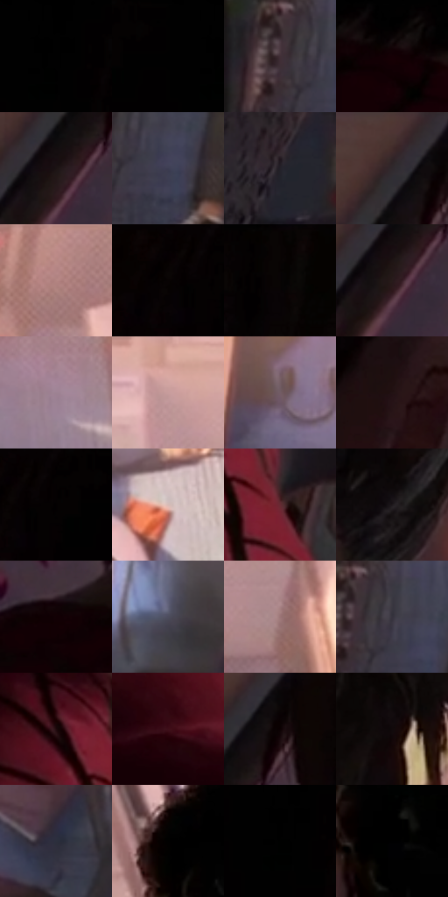

# 电影参考 508

- 状态：常规／活跃；来源世界：miles-home。
- 视角：high-angle；景别：environment-wide；场景：interior。
- 时段：daylight-time-unspecified（外观依据，中置信度；具体时间／晨昏未知）；光照：warm-day。
- 材质候选：skin, hair, fabric, paint, wood, paper, glass, metal（帧级，不是像素分割）。
- 明暗组：very-dark；L* P5/P50/P95：0.0 / 10.04787 / 68.95236。
- 资格门禁：无附加门禁。
- 原截图 SHA-256：`ac0a2f69087af9a699f8a39d256606b10e9b47d7efe00f9ad4d4070ca66f65b4`；尺寸：2880 × 1200。
- sRGB 像素 SHA-256：`9151dcf522c181962ccd57cf2f0b744c201ad215a9fbe2d886a27db25d2d054b`。

## 观察与迁移

暖窗宿舍，墙影、脸部、黑白衣料和远楼层次分开。

俯视室内近处两头遮挡，远处地上人物和书仍承担叙事；远处焦点不为浅景深而消失。

67  /  508  /  宿舍暖窗与焦点：俯视室内近处两头遮挡，远处地上人物和书仍承担叙事；远处焦点不为浅景深而消失。

本公开版保存32个128×128原像素色卡上下文；图集格子并非原场景相邻位置。原rect、图集tile和像素SHA见 `data/palette-crops.json`。上下文不足时不得批准替色，不能以小样推断完整构图。

## 实测色卡

颜色比例分母为保留采样像素，不是材料面积；全部 32 色参与全库匹配。表内四舍五入仅用于阅读，原精度在 JSON。

| ID | HEX | Lab | 原图 xy | 像素数 | 比例 | 明度角色 |
| --- | --- | --- | --- | ---: | ---: | --- |
| 508-S01 | #000000 | [0.0, 0.0, 0.0] | [572, 24] | 19253 | 9.993875% | deep-shadow |
| 508-S02 | #010101 | [0.274173, -1.7e-05, 3.3e-05] | [504, 24] | 9798 | 5.085960% | deep-shadow |
| 508-S03 | #403037 | [21.871435, 8.637657, -1.640017] | [1216, 900] | 9165 | 4.757381% | shadow |
| 508-S04 | #160005 | [1.640222, 7.607486, 0.543399] | [416, 604] | 8834 | 4.585565% | deep-shadow |
| 508-S05 | #1B1313 | [6.736799, 3.83174, 1.350942] | [92, 180] | 8802 | 4.568955% | deep-shadow |
| 508-S06 | #3D3D52 | [26.559307, 5.336058, -12.645496] | [1292, 944] | 8278 | 4.296956% | shadow |
| 508-S07 | #242129 | [13.368792, 3.4362, -4.829622] | [920, 672] | 7887 | 4.093995% | deep-shadow |
| 508-S08 | #332528 | [16.406047, 7.205773, 0.57955] | [116, 52] | 7357 | 3.818882% | deep-shadow |
| 508-S09 | #BC8A87 | [62.185016, 18.629716, 9.114243] | [1820, 32] | 7098 | 3.684440% | light |
| 508-S10 | #050101 | [0.507409, 1.04598, 0.368587] | [372, 28] | 7057 | 3.663158% | deep-shadow |
| 508-S11 | #080404 | [1.329929, 1.045928, 0.368686] | [812, 56] | 6912 | 3.587891% | deep-shadow |
| 508-S12 | #271B1B | [11.236253, 5.934844, 2.311645] | [88, 208] | 6695 | 3.475250% | deep-shadow |
| 508-S13 | #9E8393 | [57.663943, 13.112964, -4.694173] | [1484, 368] | 6637 | 3.445143% | midtone |
| 508-S14 | #D29F96 | [69.966746, 17.650129, 12.055953] | [1284, 32] | 6497 | 3.372472% | light |
| 508-S15 | #735C65 | [41.593636, 10.981898, -1.581022] | [1236, 388] | 6479 | 3.363129% | midtone |
| 508-S16 | #221213 | [7.405009, 8.441918, 2.442736] | [812, 400] | 5986 | 3.107221% | deep-shadow |
| 508-S17 | #020001 | [0.136404, 0.662042, -0.194147] | [424, 24] | 5680 | 2.948383% | deep-shadow |
| 508-S18 | #D7BAB5 | [77.817404, 9.532957, 6.356659] | [1636, 580] | 5641 | 2.928138% | light |
| 508-S19 | #642B32 | [25.767391, 26.467384, 8.028896] | [684, 856] | 5490 | 2.849757% | shadow |
| 508-S20 | #1F191D | [9.603582, 3.905721, -1.682524] | [960, 308] | 5227 | 2.713239% | deep-shadow |
| 508-S21 | #120004 | [1.241152, 5.76746, 0.322487] | [208, 576] | 4967 | 2.578277% | deep-shadow |
| 508-S22 | #4D4C5E | [33.037748, 4.648605, -10.375681] | [1948, 608] | 4775 | 2.478614% | shadow |
| 508-S23 | #9B7476 | [52.695105, 15.626987, 4.883009] | [1764, 340] | 4772 | 2.477057% | midtone |
| 508-S24 | #36323E | [21.628285, 4.648035, -6.881284] | [1260, 896] | 4483 | 2.327042% | shadow |
| 508-S25 | #1D080B | [4.147067, 8.91379, 1.847918] | [588, 772] | 4303 | 2.233607% | deep-shadow |
| 508-S26 | #3E0F19 | [12.196968, 23.772754, 5.725822] | [544, 972] | 4268 | 2.215440% | deep-shadow |
| 508-S27 | #0D0103 | [1.028603, 3.484008, 0.372789] | [168, 88] | 3705 | 1.923197% | deep-shadow |
| 508-S28 | #110A0B | [3.255757, 2.356666, 0.392443] | [1060, 96] | 3526 | 1.830281% | deep-shadow |
| 508-S29 | #2C2F3D | [19.660759, 2.479463, -9.274401] | [1856, 824] | 2437 | 1.265001% | deep-shadow |
| 508-S30 | #010100 | [0.254387, -0.139061, 0.378457] | [2052, 88] | 493 | 0.255907% | deep-shadow |
| 508-S31 | #000100 | [0.196078, -0.400561, 0.286318] | [560, 80] | 121 | 0.062809% | deep-shadow |
| 508-S32 | #000001 | [0.019787, 0.139044, -0.378424] | [2200, 436] | 25 | 0.012977% | deep-shadow |

## 色阶与空间分布

- 采样 ROI：`[0.01, 0.02, 0.98, 0.94]`；步长：4；样本数：192648。
- 排除区：`[]`。
- 深暗、暗、中、亮、高光五段计数：`[125775, 31979, 15598, 18095, 1201]`。
- RGB 各 256 箱、L* 100 箱、13×5 色相明度表和 3×3 空间统计全部保存在 [总数据](../film-library.json)。
- [可视化档案](../../references/library.html)按需绘制直方图，不存 2,094 张重复图表图片。

## 纹理特征占比

**这是分块图像特征的面积占比，不是波点／排线／丝网／错版的精确语义覆盖率。** 窗格、发丝、织物也会产生方向或周期特征。
原图 ROI 像素 3084576；已测块覆盖 3084576（100.0000%）；未测 0。

| 特征 | 块覆盖像素 | 占已测面积 | 阈值敏感范围 |
| --- | ---: | ---: | --- |
| low-contrast | 900608 | 29.1971% | 28.3340% ~ 31.3218% |
| directional-structure | 497952 | 16.1433% | 6.2505% ~ 24.9738% |
| periodic-structure | 1620480 | 52.5349% | 45.6299% ~ 56.0539% |
| mixed-detail | 65536 | 2.1246% | 1.0623% ~ 6.3739% |

阈值敏感范围不是统计置信区间。逐块坐标、尺度、对比、方向一致性、频谱集中度、频率与角度见 [全量特征记录](../texture-features.jsonl)，以帧号定位。
四种印刷层的真实像素覆盖仍标为 `null`，不能填 0，也不能拿上表代替。不得据这些代理测量删除唯一证据。

[测量方法与保留策略](../../references/library-retention.md) · [分类索引](../archive/README.md)
