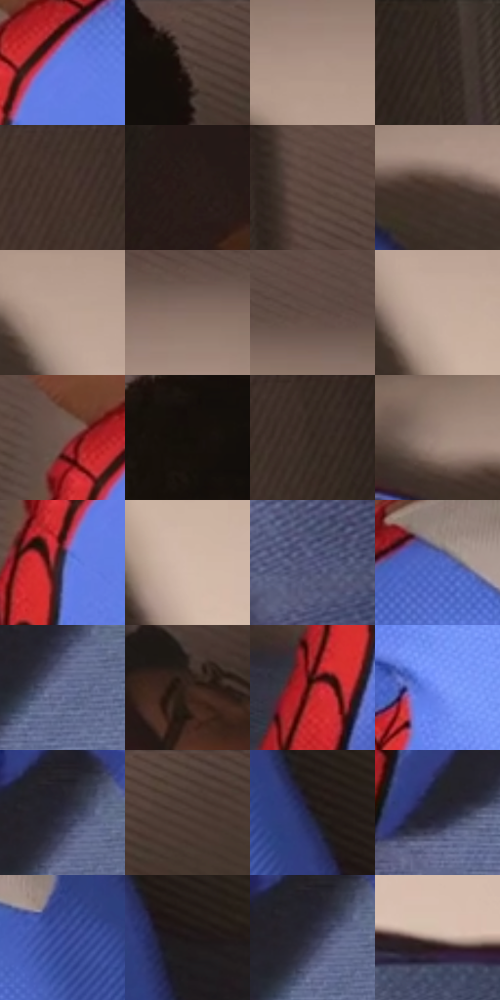

# 电影参考 509

- 状态：常规／活跃；来源世界：miles-home。
- 视角：near-level；景别：medium；场景：interior。
- 时段：daylight-time-unspecified（外观依据，中置信度；具体时间／晨昏未知）；光照：warm-day。
- 材质候选：skin, hair, fabric, paint, wood, paper, glass, metal（帧级，不是像素分割）。
- 明暗组：dark；L* P5/P50/P95：8.77342 / 32.77533 / 72.81554。
- 资格门禁：无附加门禁。
- 原截图 SHA-256：`de45b5a4b16463a1e2459670c6231d0ae42f404b4a53148e46c2f32270f87727`；尺寸：2878 × 1206。
- sRGB 像素 SHA-256：`ad9673bacac1783cad25d6b3bf3facb25e9cc758ff9113c41a730cc4d203a578`。

## 观察与迁移

暖窗宿舍，墙影、脸部、黑白衣料和远楼层次分开。

人物俯身，墙上大块连贯投影和蓝毯细纹分工；投影轮廓不是另一人的错版。

68  /  509  /  宿舍暖窗与焦点：人物俯身，墙上大块连贯投影和蓝毯细纹分工；投影轮廓不是另一人的错版。

本公开版保存32个128×128原像素色卡上下文；图集格子并非原场景相邻位置。原rect、图集tile和像素SHA见 `data/palette-crops.json`。上下文不足时不得批准替色，不能以小样推断完整构图。

## 实测色卡

颜色比例分母为保留采样像素，不是材料面积；全部 32 色参与全库匹配。表内四舍五入仅用于阅读，原精度在 JSON。

| ID | HEX | Lab | 原图 xy | 像素数 | 比例 | 明度角色 |
| --- | --- | --- | --- | ---: | ---: | --- |
| 509-S01 | #627FE6 | [55.569602, 19.801932, -55.525322] | [1008, 552] | 9240 | 4.778997% | midtone |
| 509-S02 | #5D4942 | [32.88849, 7.296523, 7.418578] | [1156, 28] | 9153 | 4.734000% | shadow |
| 509-S03 | #AC9386 | [62.810655, 7.225515, 10.340866] | [1696, 300] | 8920 | 4.613491% | light |
| 509-S04 | #2E241E | [15.14996, 3.585916, 5.796433] | [392, 28] | 8507 | 4.399884% | deep-shadow |
| 509-S05 | #3F3029 | [21.323274, 5.582923, 7.08878] | [144, 28] | 8426 | 4.357990% | shadow |
| 509-S06 | #281C17 | [11.576811, 4.998936, 5.752222] | [472, 796] | 8233 | 4.258169% | deep-shadow |
| 509-S07 | #58423A | [30.100748, 8.209849, 8.545883] | [564, 552] | 8203 | 4.242653% | shadow |
| 509-S08 | #47332B | [23.277116, 7.730411, 8.602271] | [1540, 348] | 8180 | 4.230757% | shadow |
| 509-S09 | #BBA293 | [68.397179, 6.745537, 11.180191] | [1720, 380] | 8149 | 4.214724% | light |
| 509-S10 | #877066 | [49.129227, 7.377767, 8.940263] | [1728, 220] | 7379 | 3.816474% | midtone |
| 509-S11 | #644F47 | [35.511413, 7.447959, 8.065168] | [1824, 172] | 6893 | 3.565111% | shadow |
| 509-S12 | #C7AE9F | [72.838335, 6.62027, 11.019578] | [1784, 476] | 6767 | 3.499943% | light |
| 509-S13 | #6F554C | [38.548955, 9.337011, 9.393338] | [928, 516] | 6569 | 3.397536% | shadow |
| 509-S14 | #16100C | [5.128209, 1.758473, 2.739558] | [844, 28] | 6556 | 3.390812% | deep-shadow |
| 509-S15 | #392C25 | [19.245074, 4.714425, 6.816867] | [260, 28] | 6268 | 3.241857% | deep-shadow |
| 509-S16 | #9B8378 | [56.642264, 7.347925, 9.351203] | [1464, 304] | 6208 | 3.210824% | midtone |
| 509-S17 | #36385D | [24.960398, 9.669836, -22.36852] | [952, 624] | 6098 | 3.153931% | shadow |
| 509-S18 | #D2B9AA | [76.862326, 6.515433, 10.883555] | [1860, 596] | 6049 | 3.128588% | light |
| 509-S19 | #4A4D73 | [33.985098, 8.766375, -22.159164] | [2128, 1132] | 6024 | 3.115658% | shadow |
| 509-S20 | #4F68C4 | [46.374075, 18.991245, -51.016919] | [1184, 448] | 5731 | 2.964116% | midtone |
| 509-S21 | #646D92 | [46.606737, 5.7056, -21.300204] | [1076, 948] | 5705 | 2.950669% | midtone |
| 509-S22 | #372620 | [17.002644, 7.025918, 7.136502] | [604, 744] | 5587 | 2.889638% | deep-shadow |
| 509-S23 | #932E29 | [34.638648, 42.033156, 26.923142] | [872, 788] | 4614 | 2.386395% | shadow |
| 509-S24 | #7290F4 | [61.699799, 17.34161, -53.462405] | [1368, 1072] | 4431 | 2.291746% | light |
| 509-S25 | #29293A | [17.286031, 4.643248, -10.864501] | [1072, 892] | 4339 | 2.244163% | deep-shadow |
| 509-S26 | #4E3C35 | [27.04226, 6.693127, 7.345711] | [1260, 28] | 4242 | 2.193994% | shadow |
| 509-S27 | #1D1B24 | [10.352484, 3.384295, -5.802248] | [1664, 720] | 4109 | 2.125206% | deep-shadow |
| 509-S28 | #22212F | [13.429728, 4.328197, -9.078127] | [912, 1052] | 3737 | 1.932804% | deep-shadow |
| 509-S29 | #4154A2 | [37.971344, 17.283014, -44.587788] | [1508, 628] | 2806 | 1.451284% | shadow |
| 509-S30 | #1B1516 | [7.472869, 3.213096, 0.397954] | [1728, 796] | 2657 | 1.374220% | deep-shadow |
| 509-S31 | #313246 | [21.491862, 4.93879, -12.547336] | [1064, 912] | 2337 | 1.208714% | shadow |
| 509-S32 | #B09A90 | [65.244049, 6.455759, 8.232303] | [2084, 788] | 1229 | 0.635648% | light |

## 色阶与空间分布

- 采样 ROI：`[0.01, 0.02, 0.98, 0.94]`；步长：4；样本数：193346。
- 排除区：`[]`。
- 深暗、暗、中、亮、高光五段计数：`[51003, 68410, 39641, 34261, 31]`。
- RGB 各 256 箱、L* 100 箱、13×5 色相明度表和 3×3 空间统计全部保存在 [总数据](../film-library.json)。
- [可视化档案](../../references/library.html)按需绘制直方图，不存 2,094 张重复图表图片。

## 纹理特征占比

**这是分块图像特征的面积占比，不是波点／排线／丝网／错版的精确语义覆盖率。** 窗格、发丝、织物也会产生方向或周期特征。
原图 ROI 像素 3096328；已测块覆盖 3096328（100.0000%）；未测 0。

| 特征 | 块覆盖像素 | 占已测面积 | 阈值敏感范围 |
| --- | ---: | ---: | --- |
| low-contrast | 573704 | 18.5285% | 10.3059% ~ 25.8373% |
| directional-structure | 903424 | 29.1773% | 9.4254% ~ 49.3384% |
| periodic-structure | 1460864 | 47.1805% | 38.2391% ~ 56.2752% |
| mixed-detail | 158336 | 5.1137% | 2.1166% ~ 8.4622% |

阈值敏感范围不是统计置信区间。逐块坐标、尺度、对比、方向一致性、频谱集中度、频率与角度见 [全量特征记录](../texture-features.jsonl)，以帧号定位。
四种印刷层的真实像素覆盖仍标为 `null`，不能填 0，也不能拿上表代替。不得据这些代理测量删除唯一证据。

[测量方法与保留策略](../../references/library-retention.md) · [分类索引](../archive/README.md)
