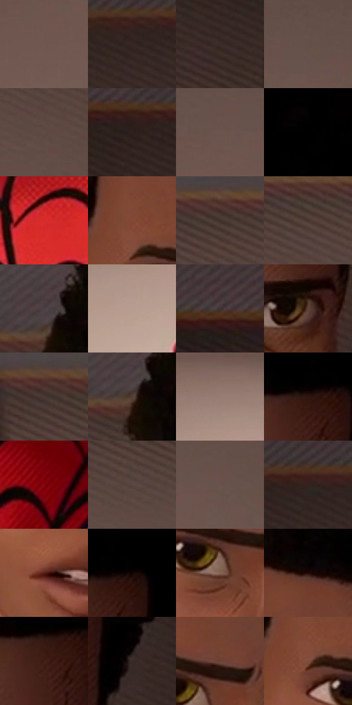

# 电影参考 510

- 状态：常规／活跃；来源世界：miles-home。
- 视角：near-level；景别：medium；场景：interior。
- 时段：daylight-time-unspecified（外观依据，中置信度；具体时间／晨昏未知）；光照：warm-day。
- 材质候选：skin, hair, fabric, paint, wood, paper, glass, metal（帧级，不是像素分割）。
- 明暗组：dark；L* P5/P50/P95：1.77934 / 28.23272 / 54.59274。
- 资格门禁：无附加门禁。
- 原截图 SHA-256：`c52a54958806122b024a85b1a637552a7c25bf68b8ad66470ed3b4949b3754e5`；尺寸：2880 × 1202。
- sRGB 像素 SHA-256：`262eb1ae7a9bf6215c7c417cfb8c6122219b6c75b108cdbf0c72060f1d03fa4b`。

## 观察与迁移

暖窗宿舍，墙影、脸部、黑白衣料和远楼层次分开。

面部清楚而墙影成为较大的低细节面，红蓝衣料保持体积；表情线选择性使用。

69  /  510  /  宿舍暖窗与焦点：面部清楚而墙影成为较大的低细节面，红蓝衣料保持体积；表情线选择性使用。

本公开版保存32个128×128原像素色卡上下文；图集格子并非原场景相邻位置。原rect、图集tile和像素SHA见 `data/palette-crops.json`。上下文不足时不得批准替色，不能以小样推断完整构图。

## 实测色卡

颜色比例分母为保留采样像素，不是材料面积；全部 32 色参与全库匹配。表内四舍五入仅用于阅读，原精度在 JSON。

| ID | HEX | Lab | 原图 xy | 像素数 | 比例 | 明度角色 |
| --- | --- | --- | --- | ---: | ---: | --- |
| 510-S01 | #715952 | [40.023552, 8.691402, 7.800742] | [736, 520] | 11811 | 6.130871% | midtone |
| 510-S02 | #362723 | [17.258145, 6.332947, 5.373329] | [2732, 196] | 10712 | 5.560400% | deep-shadow |
| 510-S03 | #3C2B26 | [19.343613, 7.016396, 6.323379] | [2820, 260] | 9826 | 5.100494% | deep-shadow |
| 510-S04 | #655048 | [35.930918, 7.426746, 8.044675] | [832, 388] | 9123 | 4.735580% | shadow |
| 510-S05 | #624D46 | [34.695354, 7.6506, 7.513188] | [1092, 324] | 8635 | 4.482268% | shadow |
| 510-S06 | #2C211C | [13.868379, 4.338435, 5.397668] | [2420, 188] | 8209 | 4.261139% | deep-shadow |
| 510-S07 | #6C554D | [38.236957, 8.190203, 8.288168] | [768, 432] | 8111 | 4.210270% | shadow |
| 510-S08 | #020101 | [0.332482, 0.261482, 0.092172] | [1656, 28] | 7875 | 4.087766% | deep-shadow |
| 510-S09 | #D52B2C | [47.053484, 63.902809, 42.40624] | [1216, 928] | 7779 | 4.037934% | midtone |
| 510-S10 | #854A36 | [38.113369, 22.962116, 22.769773] | [1408, 416] | 7342 | 3.811096% | shadow |
| 510-S11 | #42302B | [21.751016, 7.341979, 6.385892] | [236, 184] | 7306 | 3.792409% | shadow |
| 510-S12 | #4A342E | [24.029702, 8.944273, 7.699095] | [348, 208] | 7049 | 3.659005% | shadow |
| 510-S13 | #4B3D44 | [27.437753, 7.485713, -1.989383] | [1200, 108] | 6981 | 3.623707% | shadow |
| 510-S14 | #B89D92 | [66.809845, 8.183367, 9.446055] | [1004, 904] | 6696 | 3.475769% | light |
| 510-S15 | #403232 | [22.3081, 6.306576, 2.3955] | [2156, 140] | 6256 | 3.247373% | shadow |
| 510-S16 | #60453B | [31.941446, 10.093115, 10.604515] | [1724, 516] | 6241 | 3.239587% | shadow |
| 510-S17 | #4A3A37 | [26.033855, 6.499284, 4.538631] | [68, 180] | 6152 | 3.193389% | shadow |
| 510-S18 | #543F37 | [28.684291, 7.836217, 8.440137] | [1204, 140] | 5933 | 3.079710% | shadow |
| 510-S19 | #977D72 | [54.514117, 8.238445, 9.751003] | [1040, 792] | 5710 | 2.963955% | midtone |
| 510-S20 | #2F1612 | [10.718537, 12.130203, 8.105015] | [1716, 272] | 5427 | 2.817055% | deep-shadow |
| 510-S21 | #890510 | [28.023349, 49.894875, 34.10123] | [1944, 964] | 5416 | 2.811345% | shadow |
| 510-S22 | #564541 | [30.91763, 6.550354, 5.158037] | [872, 256] | 5079 | 2.636415% | shadow |
| 510-S23 | #69524A | [36.990349, 8.256538, 8.349985] | [884, 432] | 4850 | 2.517545% | shadow |
| 510-S24 | #322420 | [15.717812, 5.930818, 5.249195] | [2592, 172] | 4711 | 2.445393% | deep-shadow |
| 510-S25 | #561F16 | [20.111513, 24.865641, 18.952121] | [1496, 752] | 4208 | 2.184295% | shadow |
| 510-S26 | #0E0401 | [1.647712, 2.320185, 2.099913] | [1756, 260] | 4050 | 2.102280% | deep-shadow |
| 510-S27 | #856355 | [45.035322, 11.6919, 13.307269] | [1508, 532] | 3536 | 1.835472% | midtone |
| 510-S28 | #210A08 | [5.04069, 10.209422, 4.452482] | [1496, 248] | 2367 | 1.228666% | deep-shadow |
| 510-S29 | #3F1E17 | [15.734283, 15.189696, 11.942016] | [1704, 304] | 2019 | 1.048025% | deep-shadow |
| 510-S30 | #382B29 | [18.922945, 5.619242, 3.584697] | [1820, 392] | 1971 | 1.023110% | deep-shadow |
| 510-S31 | #6D4437 | [33.268862, 16.068045, 15.214283] | [1536, 464] | 1070 | 0.555417% | shadow |
| 510-S32 | #814F3F | [38.931325, 19.16066, 18.266568] | [1408, 460] | 197 | 0.102259% | shadow |

## 色阶与空间分布

- 采样 ROI：`[0.01, 0.02, 0.98, 0.94]`；步长：4；样本数：192648。
- 排除区：`[]`。
- 深暗、暗、中、亮、高光五段计数：`[56763, 105346, 23570, 6961, 8]`。
- RGB 各 256 箱、L* 100 箱、13×5 色相明度表和 3×3 空间统计全部保存在 [总数据](../film-library.json)。
- [可视化档案](../../references/library.html)按需绘制直方图，不存 2,094 张重复图表图片。

## 纹理特征占比

**这是分块图像特征的面积占比，不是波点／排线／丝网／错版的精确语义覆盖率。** 窗格、发丝、织物也会产生方向或周期特征。
原图 ROI 像素 3087370；已测块覆盖 3087370（100.0000%）；未测 0。

| 特征 | 块覆盖像素 | 占已测面积 | 阈值敏感范围 |
| --- | ---: | ---: | --- |
| low-contrast | 866688 | 28.0720% | 18.0431% ~ 36.3680% |
| directional-structure | 1076352 | 34.8631% | 18.3789% ~ 49.4653% |
| periodic-structure | 1041674 | 33.7398% | 29.1666% ~ 43.1843% |
| mixed-detail | 102656 | 3.3250% | 2.0688% ~ 3.3250% |

阈值敏感范围不是统计置信区间。逐块坐标、尺度、对比、方向一致性、频谱集中度、频率与角度见 [全量特征记录](../texture-features.jsonl)，以帧号定位。
四种印刷层的真实像素覆盖仍标为 `null`，不能填 0，也不能拿上表代替。不得据这些代理测量删除唯一证据。

[测量方法与保留策略](../../references/library-retention.md) · [分类索引](../archive/README.md)
