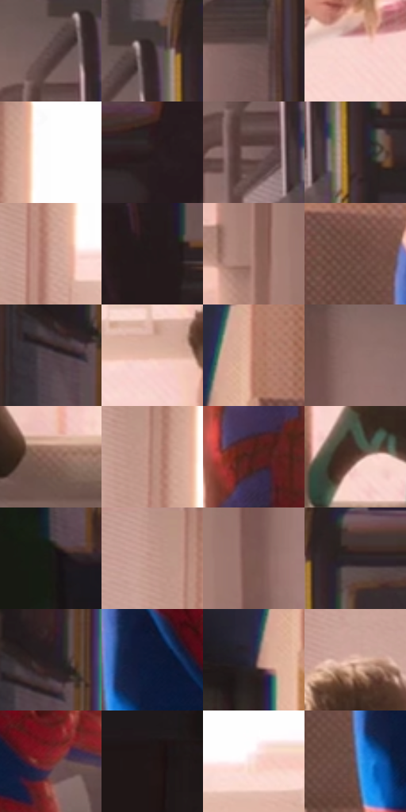

# 电影参考 511

- 状态：常规／活跃；来源世界：miles-home。
- 视角：near-level；景别：environment-wide；场景：interior。
- 时段：daylight-time-unspecified（外观依据，中置信度；具体时间／晨昏未知）；光照：warm-day。
- 材质候选：skin, hair, fabric, paint, wood, paper, glass, metal（帧级，不是像素分割）。
- 明暗组：dark；L* P5/P50/P95：8.9834 / 38.2169 / 91.30378。
- 资格门禁：无附加门禁。
- 原截图 SHA-256：`08983f236820de11f9fd1bfe6f90aa45ca2f7cc94e793bdc81a06ccabddb279c`；尺寸：2880 × 1198。
- sRGB 像素 SHA-256：`4bfe187b1349b268d09bcef86eb1764ea9d7d68eea12786079bbbe54041b90aa`。

## 观察与迁移

暖窗宿舍，墙影、脸部、黑白衣料和远楼层次分开。

宿舍宽景暖白窗为光源，家具暗锚点与浅墙网点并存，窗框局部彩边；不刷成全图暖色滤镜。

70  /  511  /  宿舍暖窗与焦点：宿舍宽景暖白窗为光源，家具暗锚点与浅墙网点并存，窗框局部彩边；不刷成全图暖色滤镜。

本公开版保存32个128×128原像素色卡上下文；图集格子并非原场景相邻位置。原rect、图集tile和像素SHA见 `data/palette-crops.json`。上下文不足时不得批准替色，不能以小样推断完整构图。

## 实测色卡

颜色比例分母为保留采样像素，不是材料面积；全部 32 色参与全库匹配。表内四舍五入仅用于阅读，原精度在 JSON。

| ID | HEX | Lab | 原图 xy | 像素数 | 比例 | 明度角色 |
| --- | --- | --- | --- | ---: | ---: | --- |
| 511-S01 | #614C4C | [34.46229, 8.845688, 3.376687] | [2036, 100] | 10385 | 5.390661% | shadow |
| 511-S02 | #302424 | [15.579287, 5.687481, 2.175985] | [2088, 60] | 10045 | 5.214173% | deep-shadow |
| 511-S03 | #705856 | [39.74261, 9.523754, 4.922682] | [2092, 412] | 9233 | 4.792679% | shadow |
| 511-S04 | #F9D5CD | [88.035062, 11.298646, 8.606758] | [1332, 628] | 9231 | 4.791641% | highlight |
| 511-S05 | #FEFEFE | [99.654922, -0.002448, 0.00464] | [1044, 24] | 8680 | 4.505627% | highlight |
| 511-S06 | #281B1D | [11.440646, 6.82403, 1.14565] | [2488, 76] | 8087 | 4.197812% | deep-shadow |
| 511-S07 | #7C625F | [44.013086, 9.986629, 5.702219] | [2040, 192] | 7920 | 4.111125% | midtone |
| 511-S08 | #3D2E2E | [20.609608, 6.859245, 2.633252] | [2136, 204] | 7489 | 3.887401% | shadow |
| 511-S09 | #CCA092 | [69.509607, 14.250331, 13.535615] | [988, 268] | 7378 | 3.829783% | light |
| 511-S10 | #241B1C | [10.869569, 4.64206, 0.991586] | [2812, 24] | 7024 | 3.646028% | deep-shadow |
| 511-S11 | #A1776C | [53.872558, 14.863044, 12.486081] | [1724, 324] | 6773 | 3.515739% | midtone |
| 511-S12 | #714F46 | [37.014114, 13.006001, 11.013466] | [512, 608] | 6404 | 3.324198% | shadow |
| 511-S13 | #524148 | [29.519431, 8.678435, -1.451061] | [176, 148] | 6135 | 3.184565% | shadow |
| 511-S14 | #E3B7A4 | [77.804458, 13.116134, 15.676722] | [1372, 340] | 5991 | 3.109817% | light |
| 511-S15 | #B77B67 | [57.283937, 20.962492, 20.451007] | [432, 500] | 5775 | 2.997695% | midtone |
| 511-S16 | #93726D | [51.085788, 12.195456, 7.75748] | [1868, 148] | 5755 | 2.987314% | midtone |
| 511-S17 | #8F675D | [47.406459, 14.645027, 11.991404] | [1352, 1004] | 5675 | 2.945787% | midtone |
| 511-S18 | #B38678 | [59.881177, 15.26224, 14.257406] | [964, 104] | 5631 | 2.922948% | midtone |
| 511-S19 | #4D201C | [18.77884, 20.864756, 12.897067] | [1528, 864] | 5350 | 2.777086% | deep-shadow |
| 511-S20 | #5D3E34 | [29.464922, 12.175524, 11.63217] | [1052, 920] | 5296 | 2.749055% | shadow |
| 511-S21 | #191815 | [8.254267, -0.239127, 2.213114] | [188, 420] | 5184 | 2.690918% | deep-shadow |
| 511-S22 | #BD9489 | [64.808626, 13.757339, 11.713068] | [920, 24] | 5163 | 2.680017% | light |
| 511-S23 | #7C5B54 | [41.857493, 12.477003, 9.336044] | [1820, 328] | 4875 | 2.530522% | midtone |
| 511-S24 | #473536 | [24.168782, 8.241083, 2.486429] | [2180, 36] | 4676 | 2.427225% | shadow |
| 511-S25 | #271F21 | [12.741925, 4.287128, 0.085722] | [204, 104] | 4602 | 2.388813% | deep-shadow |
| 511-S26 | #0D1934 | [9.227815, 5.483315, -19.401659] | [628, 720] | 4546 | 2.359744% | deep-shadow |
| 511-S27 | #312A3B | [18.47323, 7.355878, -9.666348] | [368, 568] | 4328 | 2.246584% | deep-shadow |
| 511-S28 | #F0C6B5 | [83.047316, 12.386591, 14.116995] | [816, 252] | 3780 | 1.962128% | highlight |
| 511-S29 | #792D2A | [29.688476, 32.99023, 19.165607] | [804, 820] | 3512 | 1.823014% | shadow |
| 511-S30 | #211616 | [8.611922, 5.58664, 2.154987] | [112, 676] | 3384 | 1.756572% | deep-shadow |
| 511-S31 | #FCE0D9 | [91.242566, 8.497962, 6.946451] | [1252, 260] | 2314 | 1.201154% | highlight |
| 511-S32 | #5E5D79 | [40.55469, 6.926871, -15.590122] | [568, 792] | 2027 | 1.052178% | midtone |

## 色阶与空间分布

- 采样 ROI：`[0.01, 0.02, 0.98, 0.94]`；步长：4；样本数：192648。
- 排除区：`[]`。
- 深暗、暗、中、亮、高光五段计数：`[53272, 48902, 44737, 20823, 24914]`。
- RGB 各 256 箱、L* 100 箱、13×5 色相明度表和 3×3 空间统计全部保存在 [总数据](../film-library.json)。
- [可视化档案](../../references/library.html)按需绘制直方图，不存 2,094 张重复图表图片。

## 纹理特征占比

**这是分块图像特征的面积占比，不是波点／排线／丝网／错版的精确语义覆盖率。** 窗格、发丝、织物也会产生方向或周期特征。
原图 ROI 像素 3081782；已测块覆盖 3081782（100.0000%）；未测 0。

| 特征 | 块覆盖像素 | 占已测面积 | 阈值敏感范围 |
| --- | ---: | ---: | --- |
| low-contrast | 263808 | 8.5602% | 6.6372% ~ 11.4552% |
| directional-structure | 1106358 | 35.8999% | 23.3340% ~ 49.5648% |
| periodic-structure | 1652352 | 53.6168% | 43.2664% ~ 62.8350% |
| mixed-detail | 59264 | 1.9230% | 0.5316% ~ 2.3758% |

阈值敏感范围不是统计置信区间。逐块坐标、尺度、对比、方向一致性、频谱集中度、频率与角度见 [全量特征记录](../texture-features.jsonl)，以帧号定位。
四种印刷层的真实像素覆盖仍标为 `null`，不能填 0，也不能拿上表代替。不得据这些代理测量删除唯一证据。

[测量方法与保留策略](../../references/library-retention.md) · [分类索引](../archive/README.md)
