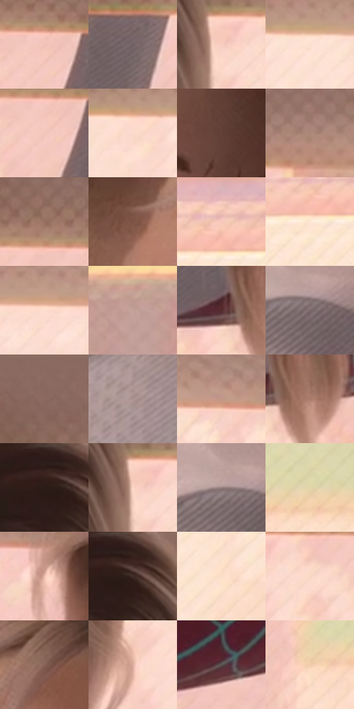

# 电影参考 512

- 状态：常规／活跃；来源世界：miles-home。
- 视角：near-level；景别：close-up；场景：interior。
- 时段：daylight-time-unspecified（外观依据，中置信度；具体时间／晨昏未知）；光照：warm-day。
- 材质候选：skin, hair, fabric, paint, wood, paper, glass, metal（帧级，不是像素分割）。
- 明暗组：light；L* P5/P50/P95：19.98519 / 67.64957 / 91.52495。
- 资格门禁：无附加门禁。
- 原截图 SHA-256：`1eb876a2804f3c8abf6c6eb3970eb1dce2537a3032b160a0605a7038f363dd25`；尺寸：2880 × 1202。
- sRGB 像素 SHA-256：`111a354a3f262081eb0028fd7a8646698caf819caaa56fd1a07ad7bf8d61d21d`。

## 观察与迁移

暖窗宿舍，墙影、脸部、黑白衣料和远楼层次分开。

窗前女孩面部体块稳定，白衣偏冷灰，窗外砖楼成为柔和大色面；不要求每块砖清楚。

71  /  512  /  宿舍暖窗与焦点：窗前女孩面部体块稳定，白衣偏冷灰，窗外砖楼成为柔和大色面；不要求每块砖清楚。

本公开版保存32个128×128原像素色卡上下文；图集格子并非原场景相邻位置。原rect、图集tile和像素SHA见 `data/palette-crops.json`。上下文不足时不得批准替色，不能以小样推断完整构图。

## 实测色卡

颜色比例分母为保留采样像素，不是材料面积；全部 32 色参与全库匹配。表内四舍五入仅用于阅读，原精度在 JSON。

| ID | HEX | Lab | 原图 xy | 像素数 | 比例 | 明度角色 |
| --- | --- | --- | --- | ---: | ---: | --- |
| 512-S01 | #F0C2B7 | [82.125584, 14.773895, 11.745612] | [2000, 220] | 9816 | 5.095303% | highlight |
| 512-S02 | #716063 | [42.42625, 7.384575, 0.834802] | [2128, 248] | 8738 | 4.535734% | midtone |
| 512-S03 | #F9CFC2 | [86.33689, 12.815115, 11.991695] | [1772, 240] | 8433 | 4.377414% | highlight |
| 512-S04 | #FDE1D1 | [91.387237, 7.116285, 11.344751] | [264, 192] | 8388 | 4.354055% | highlight |
| 512-S05 | #F3C6BA | [83.437436, 14.196373, 12.045146] | [1992, 252] | 8368 | 4.343673% | highlight |
| 512-S06 | #FCD9CB | [89.221857, 10.002718, 11.389475] | [144, 200] | 7927 | 4.114759% | highlight |
| 512-S07 | #624037 | [30.735518, 13.585441, 11.545618] | [1472, 356] | 7736 | 4.015614% | shadow |
| 512-S08 | #AB8678 | [59.034945, 12.055097, 12.950319] | [2316, 156] | 7726 | 4.010423% | midtone |
| 512-S09 | #997062 | [50.971139, 14.254079, 14.155546] | [1944, 164] | 7467 | 3.875981% | midtone |
| 512-S10 | #7E5447 | [39.96872, 15.790086, 14.705394] | [1124, 284] | 7373 | 3.827187% | shadow |
| 512-S11 | #F7C9BD | [84.599164, 14.51406, 12.149346] | [2596, 328] | 7154 | 3.713509% | highlight |
| 512-S12 | #FEE6D3 | [92.73768, 5.203702, 12.236675] | [2564, 380] | 6944 | 3.604501% | highlight |
| 512-S13 | #FDDDCE | [90.34644, 8.733976, 11.430186] | [516, 188] | 6918 | 3.591005% | highlight |
| 512-S14 | #C4A199 | [69.13124, 11.641091, 9.015774] | [2420, 680] | 6747 | 3.502242% | light |
| 512-S15 | #552B2D | [23.165749, 19.573554, 7.410055] | [1560, 880] | 6618 | 3.435281% | shadow |
| 512-S16 | #7B696B | [46.144977, 7.48101, 1.523939] | [840, 612] | 6181 | 3.208442% | midtone |
| 512-S17 | #8C6C62 | [48.490167, 11.17678, 10.484609] | [1860, 28] | 6174 | 3.204809% | midtone |
| 512-S18 | #AA9290 | [62.607349, 8.611293, 4.377098] | [708, 756] | 5919 | 3.072443% | light |
| 512-S19 | #C39688 | [65.899629, 14.862023, 13.894536] | [824, 172] | 5859 | 3.041298% | light |
| 512-S20 | #A97B6A | [55.728692, 15.596081, 16.349998] | [1632, 892] | 5654 | 2.934886% | midtone |
| 512-S21 | #2D1D18 | [12.625054, 7.027816, 6.579854] | [1596, 32] | 5585 | 2.899070% | deep-shadow |
| 512-S22 | #FCD6C6 | [88.384851, 10.8347, 12.826738] | [1760, 240] | 5147 | 2.671712% | highlight |
| 512-S23 | #98827F | [56.261236, 7.867968, 4.731718] | [808, 592] | 4923 | 2.555438% | midtone |
| 512-S24 | #E1D6AA | [85.506155, -3.07299, 23.147714] | [2420, 908] | 4880 | 2.533117% | highlight |
| 512-S25 | #EEBDAF | [80.555075, 15.562516, 13.781141] | [968, 228] | 4428 | 2.298493% | highlight |
| 512-S26 | #442B28 | [20.479729, 11.154115, 6.695385] | [1632, 48] | 4409 | 2.288630% | shadow |
| 512-S27 | #FADDC7 | [89.934755, 6.628587, 14.471874] | [2792, 488] | 4136 | 2.146921% | highlight |
| 512-S28 | #F8D6C2 | [87.943043, 8.805284, 14.254256] | [1852, 260] | 3822 | 1.983929% | highlight |
| 512-S29 | #886256 | [45.140552, 13.69207, 12.907434] | [1284, 196] | 3191 | 1.656389% | midtone |
| 512-S30 | #DEAD9F | [74.775945, 15.889041, 14.065279] | [1760, 520] | 2649 | 1.375047% | light |
| 512-S31 | #595351 | [35.799866, 2.043343, 2.050668] | [1868, 832] | 2153 | 1.117582% | shadow |
| 512-S32 | #F2CCAD | [84.526334, 8.909409, 20.451242] | [2300, 944] | 1185 | 0.615111% | highlight |

## 色阶与空间分布

- 采样 ROI：`[0.01, 0.02, 0.98, 0.94]`；步长：4；样本数：192648。
- 排除区：`[]`。
- 深暗、暗、中、亮、高光五段计数：`[9659, 20436, 52158, 24282, 86113]`。
- RGB 各 256 箱、L* 100 箱、13×5 色相明度表和 3×3 空间统计全部保存在 [总数据](../film-library.json)。
- [可视化档案](../../references/library.html)按需绘制直方图，不存 2,094 张重复图表图片。

## 纹理特征占比

**这是分块图像特征的面积占比，不是波点／排线／丝网／错版的精确语义覆盖率。** 窗格、发丝、织物也会产生方向或周期特征。
原图 ROI 像素 3087370；已测块覆盖 3087370（100.0000%）；未测 0。

| 特征 | 块覆盖像素 | 占已测面积 | 阈值敏感范围 |
| --- | ---: | ---: | --- |
| low-contrast | 257034 | 8.3253% | 3.4083% ~ 11.5592% |
| directional-structure | 996608 | 32.2802% | 22.7280% ~ 42.9559% |
| periodic-structure | 1800960 | 58.3331% | 53.1051% ~ 63.7850% |
| mixed-detail | 32768 | 1.0614% | 0.5307% ~ 1.9279% |

阈值敏感范围不是统计置信区间。逐块坐标、尺度、对比、方向一致性、频谱集中度、频率与角度见 [全量特征记录](../texture-features.jsonl)，以帧号定位。
四种印刷层的真实像素覆盖仍标为 `null`，不能填 0，也不能拿上表代替。不得据这些代理测量删除唯一证据。

[测量方法与保留策略](../../references/library-retention.md) · [分类索引](../archive/README.md)
