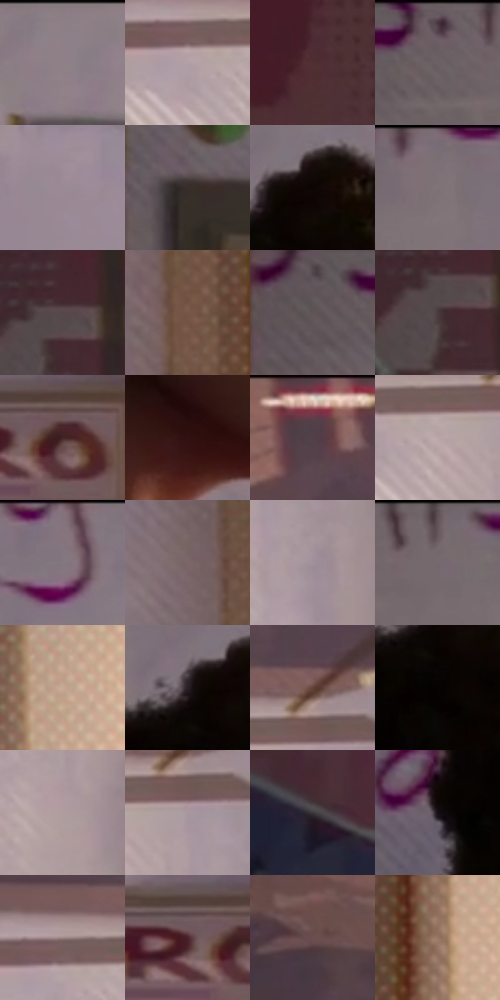

# 电影参考 513

- 状态：常规／活跃；来源世界：miles-home。
- 视角：near-level；景别：medium；场景：interior。
- 时段：daylight-time-unspecified（外观依据，中置信度；具体时间／晨昏未知）；光照：warm-day。
- 材质候选：skin, hair, fabric, paint, wood, paper, glass, metal（帧级，不是像素分割）。
- 明暗组：middle；L* P5/P50/P95：1.81892 / 40.6301 / 71.59044。
- 资格门禁：无附加门禁。
- 原截图 SHA-256：`cc53a46d55de8f15e918c899d9bbf6677dbc5f53fec6c3105005b1f6e0a7e3e2`；尺寸：2880 × 1210。
- sRGB 像素 SHA-256：`c52f46915f41c7be9a32164c18d9bfb40201186ee6fee1cccb5e0a49b689f922`。

## 观察与迁移

暖窗宿舍，墙影、脸部、黑白衣料和远楼层次分开。

侧脸受右侧暖光，墙面笔记和投影保持位置，小字可以不可读；排线不能淹没脸。

72  /  513  /  宿舍暖窗与焦点：侧脸受右侧暖光，墙面笔记和投影保持位置，小字可以不可读；排线不能淹没脸。

本公开版保存32个128×128原像素色卡上下文；图集格子并非原场景相邻位置。原rect、图集tile和像素SHA见 `data/palette-crops.json`。上下文不足时不得批准替色，不能以小样推断完整构图。

## 实测色卡

颜色比例分母为保留采样像素，不是材料面积；全部 32 色参与全库匹配。表内四舍五入仅用于阅读，原精度在 JSON。

| ID | HEX | Lab | 原图 xy | 像素数 | 比例 | 明度角色 |
| --- | --- | --- | --- | ---: | ---: | --- |
| 513-S01 | #8E7E86 | [54.442646, 7.576955, -2.088487] | [1396, 28] | 9786 | 5.043186% | midtone |
| 513-S02 | #B2A0A6 | [67.546497, 7.621567, -0.712171] | [2116, 320] | 9152 | 4.716456% | light |
| 513-S03 | #4F3031 | [23.665696, 14.301928, 5.273919] | [160, 164] | 8116 | 4.182557% | shadow |
| 513-S04 | #685D61 | [40.630028, 5.199256, -0.67022] | [524, 52] | 7984 | 4.114531% | midtone |
| 513-S05 | #9B8A95 | [59.265525, 8.390182, -3.509913] | [1516, 772] | 7619 | 3.926429% | midtone |
| 513-S06 | #372E2A | [19.775469, 3.289278, 4.092014] | [392, 672] | 7030 | 3.622890% | deep-shadow |
| 513-S07 | #0D0503 | [1.812914, 1.881766, 1.518061] | [992, 196] | 6997 | 3.605883% | deep-shadow |
| 513-S08 | #7E7076 | [48.675958, 6.57856, -1.318768] | [856, 44] | 6983 | 3.598668% | midtone |
| 513-S09 | #56474A | [31.760238, 6.932767, 0.587767] | [248, 560] | 6851 | 3.530643% | shadow |
| 513-S10 | #785647 | [39.755661, 11.969459, 14.293269] | [2608, 476] | 6806 | 3.507452% | shadow |
| 513-S11 | #5D5558 | [36.983191, 3.858966, -0.560406] | [392, 68] | 6796 | 3.502298% | shadow |
| 513-S12 | #4A3B3C | [26.477353, 6.763635, 1.869006] | [228, 592] | 6602 | 3.402321% | shadow |
| 513-S13 | #402223 | [17.252758, 14.50572, 5.576737] | [2508, 1124] | 6576 | 3.388922% | deep-shadow |
| 513-S14 | #311211 | [10.0016, 15.644981, 7.744965] | [1092, 876] | 6079 | 3.132795% | deep-shadow |
| 513-S15 | #D5B8AA | [76.879051, 8.168312, 10.944363] | [2228, 28] | 5978 | 3.080745% | light |
| 513-S16 | #B9A6A8 | [69.763801, 7.228267, 1.485803] | [2180, 328] | 5891 | 3.035909% | light |
| 513-S17 | #86757D | [51.00384, 8.058186, -1.95687] | [1080, 44] | 5821 | 2.999835% | midtone |
| 513-S18 | #7B6667 | [45.211401, 8.549048, 2.577392] | [2548, 216] | 5742 | 2.959123% | midtone |
| 513-S19 | #A19099 | [61.501998, 7.952876, -2.436966] | [2316, 416] | 5657 | 2.915318% | light |
| 513-S20 | #716268 | [43.131304, 7.129017, -1.180426] | [688, 44] | 5623 | 2.897796% | midtone |
| 513-S21 | #C9A997 | [71.574926, 8.904285, 13.6427] | [2760, 76] | 5324 | 2.743708% | light |
| 513-S22 | #2B2025 | [13.710869, 6.352451, -1.339539] | [940, 208] | 5305 | 2.733916% | deep-shadow |
| 513-S23 | #624238 | [31.298758, 12.46773, 11.675056] | [2252, 244] | 5303 | 2.732885% | shadow |
| 513-S24 | #050201 | [0.703486, 0.645419, 0.654905] | [960, 284] | 5196 | 2.677743% | deep-shadow |
| 513-S25 | #B09C9F | [66.144528, 7.859418, 1.130614] | [2332, 696] | 5188 | 2.673620% | light |
| 513-S26 | #A8969F | [63.869338, 8.259888, -2.281984] | [2260, 312] | 5172 | 2.665375% | light |
| 513-S27 | #3A373A | [23.463474, 1.980579, -1.402102] | [216, 1060] | 5026 | 2.590134% | shadow |
| 513-S28 | #170F17 | [5.290429, 5.002668, -3.575294] | [652, 512] | 4923 | 2.537053% | deep-shadow |
| 513-S29 | #9D8787 | [58.269807, 8.316712, 3.084103] | [2124, 276] | 4314 | 2.223207% | midtone |
| 513-S30 | #4A232C | [19.391788, 19.607538, 2.511508] | [2452, 1120] | 3936 | 2.028406% | deep-shadow |
| 513-S31 | #694F4E | [36.263383, 10.744548, 4.819001] | [1924, 140] | 3208 | 1.653233% | shadow |
| 513-S32 | #997765 | [52.84719, 10.62543, 14.995455] | [2712, 288] | 3060 | 1.576962% | midtone |

## 色阶与空间分布

- 采样 ROI：`[0.01, 0.02, 0.98, 0.94]`；步长：4；样本数：194044。
- 排除区：`[]`。
- 深暗、暗、中、亮、高光五段计数：`[39779, 54599, 55145, 44408, 113]`。
- RGB 各 256 箱、L* 100 箱、13×5 色相明度表和 3×3 空间统计全部保存在 [总数据](../film-library.json)。
- [可视化档案](../../references/library.html)按需绘制直方图，不存 2,094 张重复图表图片。

## 纹理特征占比

**这是分块图像特征的面积占比，不是波点／排线／丝网／错版的精确语义覆盖率。** 窗格、发丝、织物也会产生方向或周期特征。
原图 ROI 像素 3109722；已测块覆盖 3109722（100.0000%）；未测 0。

| 特征 | 块覆盖像素 | 占已测面积 | 阈值敏感范围 |
| --- | ---: | ---: | --- |
| low-contrast | 181632 | 5.8408% | 4.9476% ~ 9.0020% |
| directional-structure | 820608 | 26.3885% | 16.0117% ~ 37.1316% |
| periodic-structure | 2091098 | 67.2439% | 57.9209% ~ 73.4057% |
| mixed-detail | 16384 | 0.5269% | 0.0000% ~ 1.5806% |

阈值敏感范围不是统计置信区间。逐块坐标、尺度、对比、方向一致性、频谱集中度、频率与角度见 [全量特征记录](../texture-features.jsonl)，以帧号定位。
四种印刷层的真实像素覆盖仍标为 `null`，不能填 0，也不能拿上表代替。不得据这些代理测量删除唯一证据。

[测量方法与保留策略](../../references/library-retention.md) · [分类索引](../archive/README.md)
