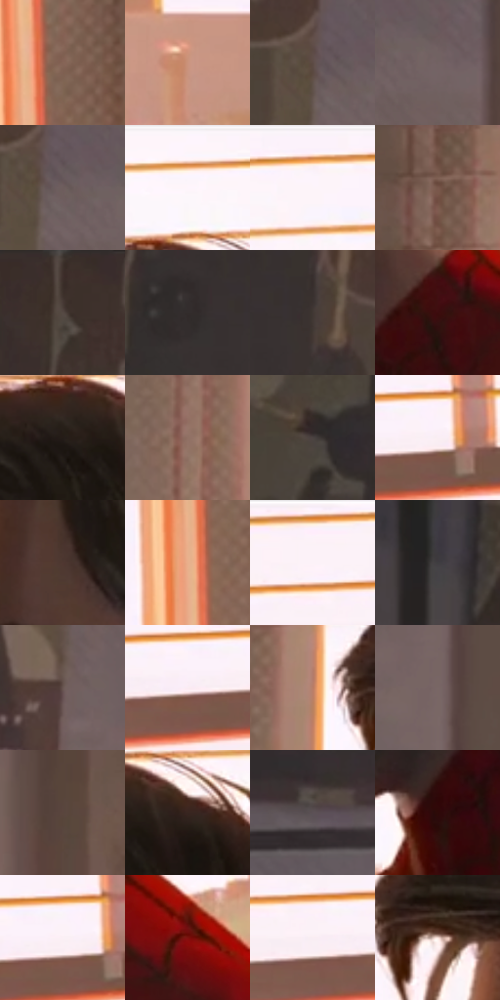

# 电影参考 514

- 状态：常规／活跃；来源世界：miles-home。
- 视角：near-level；景别：medium；场景：interior。
- 时段：daylight-time-unspecified（外观依据，中置信度；具体时间／晨昏未知）；光照：warm-day。
- 材质候选：skin, hair, fabric, paint, wood, paper, glass, metal（帧级，不是像素分割）。
- 明暗组：middle；L* P5/P50/P95：10.39509 / 40.73733 / 96.67512。
- 资格门禁：无附加门禁。
- 原截图 SHA-256：`592aef37db529b41f7f3872cd2ec100d3fa1fb1a27f0177a41a5e0beca4f5527`；尺寸：2880 × 1206。
- sRGB 像素 SHA-256：`a47929c3c8a803047b9a46ccca08bbf379f7c8ed3574736a35fc2dbe5d14e145`。

## 观察与迁移

暖窗宿舍，墙影、脸部、黑白衣料和远楼层次分开。

侧脸后是大亮窗和简化的远屋顶剪影，局部暖轮廓；不要在远楼强补砖缝。

73  /  514  /  宿舍暖窗与焦点：侧脸后是大亮窗和简化的远屋顶剪影，局部暖轮廓；不要在远楼强补砖缝。

本公开版保存32个128×128原像素色卡上下文；图集格子并非原场景相邻位置。原rect、图集tile和像素SHA见 `data/palette-crops.json`。上下文不足时不得批准替色，不能以小样推断完整构图。

## 实测色卡

颜色比例分母为保留采样像素，不是材料面积；全部 32 色参与全库匹配。表内四舍五入仅用于阅读，原精度在 JSON。

| ID | HEX | Lab | 原图 xy | 像素数 | 比例 | 明度角色 |
| --- | --- | --- | --- | ---: | ---: | --- |
| 514-S01 | #856456 | [45.322592, 11.23719, 13.105152] | [2700, 288] | 9334 | 4.827615% | midtone |
| 514-S02 | #CA937C | [65.656404, 17.759069, 20.357642] | [2432, 796] | 9156 | 4.735552% | light |
| 514-S03 | #5D4B45 | [33.540151, 6.53688, 6.434664] | [768, 268] | 8696 | 4.497636% | shadow |
| 514-S04 | #736263 | [43.184218, 6.988775, 1.96087] | [868, 312] | 7958 | 4.115937% | midtone |
| 514-S05 | #6E5D5D | [41.111576, 6.874382, 2.558849] | [792, 288] | 7868 | 4.069389% | midtone |
| 514-S06 | #FCF6FC | [97.484908, 3.039696, -2.159416] | [1636, 32] | 7859 | 4.064734% | highlight |
| 514-S07 | #FDF2F9 | [96.503414, 4.884612, -2.040276] | [1800, 28] | 7663 | 3.963361% | highlight |
| 514-S08 | #78574A | [40.088851, 11.760507, 12.916525] | [1228, 68] | 7597 | 3.929225% | midtone |
| 514-S09 | #3E2F2C | [20.977332, 6.289193, 4.543757] | [488, 28] | 7520 | 3.889400% | shadow |
| 514-S10 | #332C2C | [18.74439, 3.185962, 1.170902] | [532, 248] | 7199 | 3.723377% | deep-shadow |
| 514-S11 | #413734 | [24.013115, 3.81981, 3.511193] | [620, 256] | 7198 | 3.722860% | shadow |
| 514-S12 | #3C0C0D | [10.94241, 23.450015, 11.519642] | [1860, 764] | 7128 | 3.686655% | deep-shadow |
| 514-S13 | #241C17 | [11.046194, 2.918298, 4.934557] | [1600, 180] | 6996 | 3.618384% | deep-shadow |
| 514-S14 | #907064 | [50.023902, 10.794226, 11.513941] | [1200, 760] | 6805 | 3.519597% | midtone |
| 514-S15 | #4B4341 | [29.13816, 2.995801, 2.451262] | [412, 324] | 6579 | 3.402708% | shadow |
| 514-S16 | #FAEEF4 | [95.163164, 5.059883, -1.442398] | [2452, 124] | 5914 | 3.058765% | highlight |
| 514-S17 | #4F3731 | [25.61359, 9.773497, 8.004916] | [1544, 436] | 5741 | 2.969288% | shadow |
| 514-S18 | #E9AF8C | [75.995725, 16.735428, 26.190949] | [2668, 552] | 5660 | 2.927394% | light |
| 514-S19 | #FBF0F9 | [95.859461, 5.242919, -3.002991] | [2240, 28] | 5616 | 2.904637% | highlight |
| 514-S20 | #403D40 | [26.150345, 1.948072, -1.379958] | [152, 116] | 5573 | 2.882397% | shadow |
| 514-S21 | #675450 | [37.487898, 7.145714, 5.287943] | [756, 500] | 5492 | 2.840504% | shadow |
| 514-S22 | #FBECF3 | [94.726354, 6.247845, -1.553943] | [2376, 136] | 5156 | 2.666722% | highlight |
| 514-S23 | #B97D66 | [57.982945, 20.556443, 21.999567] | [1296, 344] | 4987 | 2.579314% | midtone |
| 514-S24 | #796666 | [44.98, 7.56374, 2.820109] | [904, 588] | 4926 | 2.547764% | midtone |
| 514-S25 | #5A453D | [31.270875, 7.678782, 8.288053] | [1092, 184] | 4712 | 2.437082% | shadow |
| 514-S26 | #382520 | [16.836768, 8.207678, 6.928958] | [1692, 172] | 4711 | 2.436565% | deep-shadow |
| 514-S27 | #5B5055 | [35.237136, 5.538228, -1.260711] | [444, 740] | 3921 | 2.027971% | shadow |
| 514-S28 | #2D0A08 | [7.160118, 17.708878, 7.801566] | [1744, 892] | 3832 | 1.981939% | deep-shadow |
| 514-S29 | #FBEFF5 | [95.511579, 5.055882, -1.441388] | [2428, 120] | 3700 | 1.913668% | highlight |
| 514-S30 | #7E110D | [26.352505, 44.311277, 33.239818] | [2132, 876] | 3231 | 1.671097% | shadow |
| 514-S31 | #F9EDF3 | [94.814478, 5.063904, -1.443412] | [2288, 128] | 2537 | 1.312155% | highlight |
| 514-S32 | #F9E3DC | [91.795415, 6.370035, 6.1428] | [1396, 364] | 2081 | 1.076309% | highlight |

## 色阶与空间分布

- 采样 ROI：`[0.01, 0.02, 0.98, 0.94]`；步长：4；样本数：193346。
- 排除区：`[]`。
- 深暗、暗、中、亮、高光五段计数：`[29002, 65032, 43378, 14162, 41772]`。
- RGB 各 256 箱、L* 100 箱、13×5 色相明度表和 3×3 空间统计全部保存在 [总数据](../film-library.json)。
- [可视化档案](../../references/library.html)按需绘制直方图，不存 2,094 张重复图表图片。

## 纹理特征占比

**这是分块图像特征的面积占比，不是波点／排线／丝网／错版的精确语义覆盖率。** 窗格、发丝、织物也会产生方向或周期特征。
原图 ROI 像素 3098546；已测块覆盖 3098546（100.0000%）；未测 0。

| 特征 | 块覆盖像素 | 占已测面积 | 阈值敏感范围 |
| --- | ---: | ---: | --- |
| low-contrast | 409344 | 13.2108% | 10.7447% ~ 17.6145% |
| directional-structure | 1176576 | 37.9719% | 31.8952% ~ 48.7207% |
| periodic-structure | 1463474 | 47.2310% | 39.4772% ~ 47.9374% |
| mixed-detail | 49152 | 1.5863% | 1.0575% ~ 2.5529% |

阈值敏感范围不是统计置信区间。逐块坐标、尺度、对比、方向一致性、频谱集中度、频率与角度见 [全量特征记录](../texture-features.jsonl)，以帧号定位。
四种印刷层的真实像素覆盖仍标为 `null`，不能填 0，也不能拿上表代替。不得据这些代理测量删除唯一证据。

[测量方法与保留策略](../../references/library-retention.md) · [分类索引](../archive/README.md)
