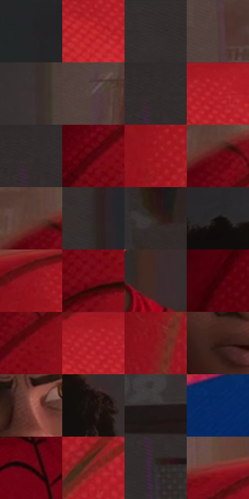

# 电影参考 515

- 状态：常规／活跃；来源世界：miles-home。
- 视角：near-level；景别：medium；场景：interior。
- 时段：daylight-time-unspecified（外观依据，中置信度；具体时间／晨昏未知）；光照：warm-day。
- 材质候选：skin, hair, fabric, paint, wood, paper, glass, metal（帧级，不是像素分割）。
- 明暗组：dark；L* P5/P50/P95：6.03868 / 20.48552 / 43.91555。
- 资格门禁：无附加门禁。
- 原截图 SHA-256：`48a8b72b3c861243971dbe031601a0d0df159ea9d87053ed96fdefe5c1c4affd`；尺寸：2880 × 1202。
- sRGB 像素 SHA-256：`7a04d2722491f9ef777ef3622fca87e0ee5528f03a09898cae2ddbe173c15232`。

## 观察与迁移

暖窗宿舍，墙影、脸部、黑白衣料和远楼层次分开。

巨大近处红肩有细布纹，中景少年面部是焦点，墙上照片退后；体积大小不决定清晰优先级。

74  /  515  /  宿舍暖窗与焦点：巨大近处红肩有细布纹，中景少年面部是焦点，墙上照片退后；体积大小不决定清晰优先级。

本公开版保存32个128×128原像素色卡上下文；图集格子并非原场景相邻位置。原rect、图集tile和像素SHA见 `data/palette-crops.json`。上下文不足时不得批准替色，不能以小样推断完整构图。

## 实测色卡

颜色比例分母为保留采样像素，不是材料面积；全部 32 色参与全库匹配。表内四舍五入仅用于阅读，原精度在 JSON。

| ID | HEX | Lab | 原图 xy | 像素数 | 比例 | 明度角色 |
| --- | --- | --- | --- | ---: | ---: | --- |
| 515-S01 | #252426 | [14.372474, 0.951945, -1.164883] | [756, 332] | 14362 | 7.455048% | deep-shadow |
| 515-S02 | #C82E34 | [44.920834, 59.549181, 34.851264] | [2608, 128] | 11953 | 6.204580% | midtone |
| 515-S03 | #352F2F | [20.024668, 2.695899, 0.9836] | [300, 28] | 10388 | 5.392218% | shadow |
| 515-S04 | #4F3B37 | [26.922799, 8.124934, 5.88215] | [1656, 320] | 9829 | 5.102051% | shadow |
| 515-S05 | #3B3232 | [21.731354, 4.025545, 1.489284] | [1460, 264] | 9328 | 4.841992% | shadow |
| 515-S06 | #574445 | [30.855676, 8.332378, 2.50745] | [1624, 916] | 8956 | 4.648893% | shadow |
| 515-S07 | #332D2D | [19.098558, 2.715103, 0.991674] | [80, 28] | 8288 | 4.302147% | deep-shadow |
| 515-S08 | #B7242C | [40.433189, 57.172133, 33.591424] | [2696, 44] | 7733 | 4.014057% | midtone |
| 515-S09 | #312B2B | [18.166371, 2.735137, 1.000148] | [76, 28] | 7711 | 4.002637% | deep-shadow |
| 515-S10 | #4F030D | [14.156492, 33.624044, 16.620094] | [2084, 248] | 7294 | 3.786180% | deep-shadow |
| 515-S11 | #A11B23 | [34.972637, 52.842935, 31.677016] | [2324, 288] | 7044 | 3.656410% | shadow |
| 515-S12 | #620612 | [19.104232, 38.645988, 21.028919] | [2108, 128] | 6359 | 3.300839% | deep-shadow |
| 515-S13 | #5D3B33 | [28.628514, 13.933596, 11.139128] | [2088, 96] | 6285 | 3.262427% | shadow |
| 515-S14 | #302928 | [17.30852, 3.010958, 1.841288] | [608, 88] | 6141 | 3.187679% | deep-shadow |
| 515-S15 | #33231E | [15.485858, 6.793794, 6.362395] | [296, 484] | 6102 | 3.167435% | deep-shadow |
| 515-S16 | #100C0B | [3.588567, 1.14525, 0.868653] | [1112, 104] | 5982 | 3.105145% | deep-shadow |
| 515-S17 | #93111D | [31.10144, 50.94904, 30.275499] | [2320, 116] | 5896 | 3.060504% | shadow |
| 515-S18 | #730515 | [23.028688, 43.92638, 24.557248] | [2120, 428] | 5589 | 2.901146% | shadow |
| 515-S19 | #412B27 | [20.036969, 9.578502, 6.7022] | [1292, 836] | 5562 | 2.887131% | shadow |
| 515-S20 | #390308 | [8.591829, 26.379316, 10.226467] | [1940, 428] | 5416 | 2.811345% | deep-shadow |
| 515-S21 | #7E0B18 | [25.987747, 45.980671, 26.550265] | [2160, 212] | 5380 | 2.792658% | shadow |
| 515-S22 | #AF1D26 | [38.084644, 56.488724, 34.096716] | [2656, 48] | 5371 | 2.787986% | shadow |
| 515-S23 | #85151B | [28.389536, 45.80494, 27.706946] | [2148, 1100] | 4595 | 2.385179% | shadow |
| 515-S24 | #321915 | [12.140693, 11.940997, 8.200518] | [1064, 700] | 3914 | 2.031685% | deep-shadow |
| 515-S25 | #97594F | [44.646177, 24.374285, 16.741296] | [1140, 552] | 3832 | 1.989120% | midtone |
| 515-S26 | #1B1210 | [6.350795, 3.833567, 2.572848] | [1296, 212] | 3364 | 1.746190% | deep-shadow |
| 515-S27 | #221C1C | [10.953199, 2.920152, 1.08113] | [356, 680] | 2805 | 1.456023% | deep-shadow |
| 515-S28 | #072964 | [18.146267, 13.928232, -38.012606] | [2804, 1056] | 2226 | 1.155475% | deep-shadow |
| 515-S29 | #200404 | [3.638179, 11.397819, 4.016145] | [916, 984] | 1584 | 0.822225% | deep-shadow |
| 515-S30 | #7C2822 | [29.208352, 36.037095, 23.782388] | [2440, 512] | 1540 | 0.799385% | shadow |
| 515-S31 | #332E30 | [19.520637, 2.694068, -0.466182] | [76, 160] | 1279 | 0.663905% | deep-shadow |
| 515-S32 | #8B2E30 | [33.26021, 39.607568, 20.542075] | [2232, 72] | 540 | 0.280304% | shadow |

## 色阶与空间分布

- 采样 ROI：`[0.01, 0.02, 0.98, 0.94]`；步长：4；样本数：192648。
- 排除区：`[]`。
- 深暗、暗、中、亮、高光五段计数：`[89563, 82725, 20229, 131, 0]`。
- RGB 各 256 箱、L* 100 箱、13×5 色相明度表和 3×3 空间统计全部保存在 [总数据](../film-library.json)。
- [可视化档案](../../references/library.html)按需绘制直方图，不存 2,094 张重复图表图片。

## 纹理特征占比

**这是分块图像特征的面积占比，不是波点／排线／丝网／错版的精确语义覆盖率。** 窗格、发丝、织物也会产生方向或周期特征。
原图 ROI 像素 3087370；已测块覆盖 3087370（100.0000%）；未测 0。

| 特征 | 块覆盖像素 | 占已测面积 | 阈值敏感范围 |
| --- | ---: | ---: | --- |
| low-contrast | 510474 | 16.5343% | 11.9530% ~ 21.3974% |
| directional-structure | 272512 | 8.8267% | 4.7761% ~ 18.0389% |
| periodic-structure | 2115456 | 68.5197% | 66.2560% ~ 68.5197% |
| mixed-detail | 188928 | 6.1194% | 1.9279% ~ 7.5705% |

阈值敏感范围不是统计置信区间。逐块坐标、尺度、对比、方向一致性、频谱集中度、频率与角度见 [全量特征记录](../texture-features.jsonl)，以帧号定位。
四种印刷层的真实像素覆盖仍标为 `null`，不能填 0，也不能拿上表代替。不得据这些代理测量删除唯一证据。

[测量方法与保留策略](../../references/library-retention.md) · [分类索引](../archive/README.md)
