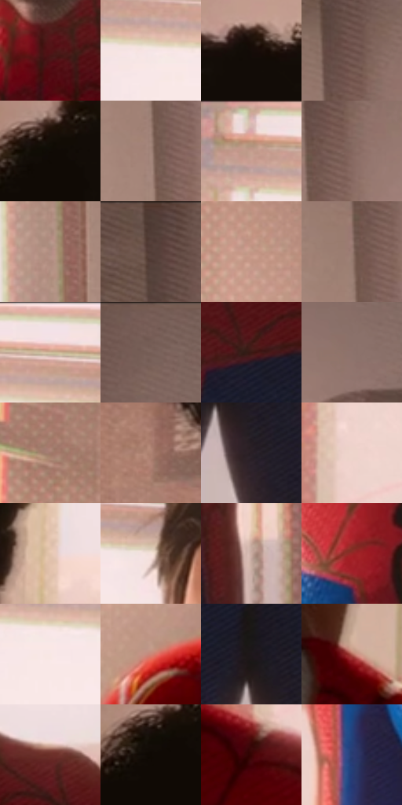

# 电影参考 516

- 状态：常规／活跃；来源世界：miles-home。
- 视角：near-level；景别：medium；场景：interior。
- 时段：daylight-time-unspecified（外观依据，中置信度；具体时间／晨昏未知）；光照：warm-day。
- 材质候选：skin, hair, fabric, paint, wood, paper, glass, metal（帧级，不是像素分割）。
- 明暗组：middle；L* P5/P50/P95：3.0551 / 50.90658 / 92.15548。
- 资格门禁：无附加门禁。
- 原截图 SHA-256：`6f3d525b41510dc626582bfb140d0ffbb4c34ee6a774d269cb7f3bcb60ea8b2b`；尺寸：2880 × 1206。
- sRGB 像素 SHA-256：`03e38c70ec1e6565aae79102154b121ce1b992ad368b765b443178ce8f6fe316`。

## 观察与迁移

暖窗宿舍，墙影、脸部、黑白衣料和远楼层次分开。

逆光胸像保留颈胸阴影和衣纹，窗框轻彩边，前景发形稳定；轮廓光不替代体块设计。

75  /  516  /  宿舍暖窗与焦点：逆光胸像保留颈胸阴影和衣纹，窗框轻彩边，前景发形稳定；轮廓光不替代体块设计。

本公开版保存32个128×128原像素色卡上下文；图集格子并非原场景相邻位置。原rect、图集tile和像素SHA见 `data/palette-crops.json`。上下文不足时不得批准替色，不能以小样推断完整构图。

## 实测色卡

颜色比例分母为保留采样像素，不是材料面积；全部 32 色参与全库匹配。表内四舍五入仅用于阅读，原精度在 JSON。

| ID | HEX | Lab | 原图 xy | 像素数 | 比例 | 明度角色 |
| --- | --- | --- | --- | ---: | ---: | --- |
| 516-S01 | #531215 | [17.114226, 30.006912, 15.891623] | [1692, 544] | 11891 | 6.150114% | deep-shadow |
| 516-S02 | #F5E4E5 | [91.93437, 5.943846, 1.602688] | [1284, 128] | 11853 | 6.130460% | highlight |
| 516-S03 | #140D08 | [4.102101, 1.82778, 2.892664] | [864, 144] | 10485 | 5.422921% | deep-shadow |
| 516-S04 | #6A4E47 | [35.923393, 10.696206, 8.743911] | [2344, 208] | 8558 | 4.426262% | shadow |
| 516-S05 | #100A05 | [3.055103, 1.153675, 2.543961] | [688, 212] | 8230 | 4.256618% | deep-shadow |
| 516-S06 | #A18379 | [57.261215, 9.894468, 9.735689] | [2312, 448] | 8020 | 4.148004% | midtone |
| 516-S07 | #C69F8F | [68.59668, 12.056631, 13.826222] | [1204, 64] | 7591 | 3.926122% | light |
| 516-S08 | #84665E | [45.930244, 10.780644, 9.144995] | [2368, 280] | 7567 | 3.913709% | midtone |
| 516-S09 | #B08F83 | [62.096059, 10.574537, 11.079303] | [2180, 448] | 7540 | 3.899744% | light |
| 516-S10 | #4E3A34 | [26.430648, 7.828004, 7.146441] | [2308, 28] | 7405 | 3.829921% | shadow |
| 516-S11 | #C39887 | [66.374274, 13.627859, 15.114908] | [292, 316] | 7123 | 3.684069% | light |
| 516-S12 | #987A70 | [53.777059, 10.059041, 9.886205] | [2308, 332] | 6858 | 3.547009% | midtone |
| 516-S13 | #DCAA96 | [73.65547, 15.54833, 17.371684] | [1416, 60] | 6747 | 3.489599% | light |
| 516-S14 | #775D57 | [41.906021, 9.611866, 7.493455] | [2436, 32] | 6259 | 3.237202% | midtone |
| 516-S15 | #3A1813 | [13.230591, 16.268218, 11.233128] | [1876, 832] | 5783 | 2.991011% | deep-shadow |
| 516-S16 | #8D726C | [50.429773, 9.608058, 7.327176] | [2548, 268] | 5596 | 2.894293% | midtone |
| 516-S17 | #A2796B | [54.468786, 13.995642, 13.912477] | [196, 124] | 5544 | 2.867398% | midtone |
| 516-S18 | #AD8171 | [57.826282, 14.733074, 15.297925] | [504, 740] | 5295 | 2.738614% | midtone |
| 516-S19 | #291F26 | [13.177538, 6.370208, -2.882276] | [2024, 1016] | 5184 | 2.681204% | deep-shadow |
| 516-S20 | #EED5CC | [87.059023, 7.209765, 7.608751] | [1180, 972] | 5039 | 2.606209% | highlight |
| 516-S21 | #E4C5AE | [81.557153, 7.459867, 15.591723] | [1160, 560] | 4971 | 2.571038% | highlight |
| 516-S22 | #F4E1D9 | [90.823026, 5.171549, 6.256476] | [1524, 140] | 4968 | 2.569487% | highlight |
| 516-S23 | #C9ACA1 | [72.559551, 8.760606, 9.553641] | [2156, 972] | 4442 | 2.297436% | light |
| 516-S24 | #992627 | [34.614516, 47.129372, 28.411053] | [1492, 812] | 3993 | 2.065210% | shadow |
| 516-S25 | #F8E8E4 | [93.133459, 4.748797, 3.895314] | [1324, 160] | 3836 | 1.984008% | highlight |
| 516-S26 | #CC8576 | [62.442765, 25.516647, 19.367392] | [300, 1068] | 3600 | 1.861947% | light |
| 516-S27 | #1E171B | [8.721695, 4.430283, -1.493711] | [1984, 920] | 3554 | 1.838155% | deep-shadow |
| 516-S28 | #B16254 | [50.36382, 30.420285, 22.040292] | [980, 972] | 3378 | 1.747127% | midtone |
| 516-S29 | #6C3028 | [27.99665, 26.001924, 17.834684] | [2032, 584] | 3220 | 1.665408% | shadow |
| 516-S30 | #0F0904 | [2.76152, 1.066646, 2.513258] | [664, 232] | 3023 | 1.563518% | deep-shadow |
| 516-S31 | #380503 | [8.620596, 24.682271, 12.273122] | [1132, 1096] | 2909 | 1.504557% | deep-shadow |
| 516-S32 | #293D71 | [26.736523, 9.916402, -32.490904] | [1348, 900] | 2884 | 1.491626% | shadow |

## 色阶与空间分布

- 采样 ROI：`[0.01, 0.02, 0.98, 0.94]`；步长：4；样本数：193346。
- 排除区：`[]`。
- 深暗、暗、中、亮、高光五段计数：`[50288, 26178, 49455, 38229, 29196]`。
- RGB 各 256 箱、L* 100 箱、13×5 色相明度表和 3×3 空间统计全部保存在 [总数据](../film-library.json)。
- [可视化档案](../../references/library.html)按需绘制直方图，不存 2,094 张重复图表图片。

## 纹理特征占比

**这是分块图像特征的面积占比，不是波点／排线／丝网／错版的精确语义覆盖率。** 窗格、发丝、织物也会产生方向或周期特征。
原图 ROI 像素 3098546；已测块覆盖 3098546（100.0000%）；未测 0。

| 特征 | 块覆盖像素 | 占已测面积 | 阈值敏感范围 |
| --- | ---: | ---: | --- |
| low-contrast | 414976 | 13.3926% | 10.3977% ~ 15.5077% |
| directional-structure | 725888 | 23.4267% | 15.1483% ~ 38.4841% |
| periodic-structure | 1739314 | 56.1332% | 48.4744% ~ 59.3017% |
| mixed-detail | 218368 | 7.0474% | 2.6438% ~ 10.0424% |

阈值敏感范围不是统计置信区间。逐块坐标、尺度、对比、方向一致性、频谱集中度、频率与角度见 [全量特征记录](../texture-features.jsonl)，以帧号定位。
四种印刷层的真实像素覆盖仍标为 `null`，不能填 0，也不能拿上表代替。不得据这些代理测量删除唯一证据。

[测量方法与保留策略](../../references/library-retention.md) · [分类索引](../archive/README.md)
