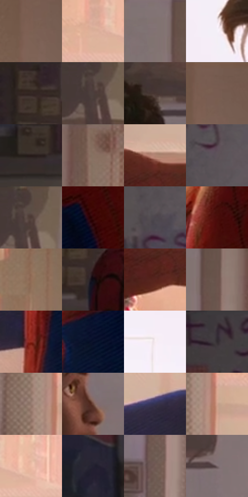

# 电影参考 517

- 状态：常规／活跃；来源世界：miles-home。
- 视角：near-level；景别：medium；场景：interior。
- 时段：daylight-time-unspecified（外观依据，中置信度；具体时间／晨昏未知）；光照：warm-day。
- 材质候选：skin, hair, fabric, paint, wood, paper, glass, metal（帧级，不是像素分割）。
- 明暗组：dark；L* P5/P50/P95：6.50865 / 36.70439 / 94.7797。
- 资格门禁：无附加门禁。
- 原截图 SHA-256：`8168aef343acfff4c24146e2c6a291fe7df22a214c4d82543ca3a2866a47d84b`；尺寸：2880 × 1202。
- sRGB 像素 SHA-256：`0a41d4d372a28d67f3e87366e010d0795bbf4aeb4789fd1c59a7e3413197d809`。

## 观察与迁移

暖窗宿舍，墙影、脸部、黑白衣料和远楼层次分开。

双人侧面对话与手势，暖窗后景、肤色中间调、随形衣纹相互独立；递手不误画成打击。

76  /  517  /  宿舍暖窗与焦点：双人侧面对话与手势，暖窗后景、肤色中间调、随形衣纹相互独立；递手不误画成打击。

本公开版保存32个128×128原像素色卡上下文；图集格子并非原场景相邻位置。原rect、图集tile和像素SHA见 `data/palette-crops.json`。上下文不足时不得批准替色，不能以小样推断完整构图。

## 实测色卡

颜色比例分母为保留采样像素，不是材料面积；全部 32 色参与全库匹配。表内四舍五入仅用于阅读，原精度在 JSON。

| ID | HEX | Lab | 原图 xy | 像素数 | 比例 | 明度角色 |
| --- | --- | --- | --- | ---: | ---: | --- |
| 517-S01 | #7C6053 | [43.176283, 9.34322, 11.7825] | [2560, 116] | 10452 | 5.425439% | midtone |
| 517-S02 | #DCB09A | [75.202894, 12.848824, 17.349408] | [1588, 696] | 9705 | 5.037685% | light |
| 517-S03 | #837273 | [49.614917, 6.794149, 1.888585] | [1184, 68] | 9613 | 4.989930% | midtone |
| 517-S04 | #F5F0F9 | [95.401382, 3.258825, -3.729087] | [1764, 140] | 9404 | 4.881442% | highlight |
| 517-S05 | #342623 | [16.688534, 6.046796, 4.534289] | [464, 752] | 9383 | 4.870541% | deep-shadow |
| 517-S06 | #4C3F3D | [27.922535, 5.241202, 3.322638] | [1040, 80] | 9211 | 4.781259% | shadow |
| 517-S07 | #473532 | [24.052239, 7.534921, 5.001008] | [892, 272] | 8200 | 4.256468% | shadow |
| 517-S08 | #74594D | [40.236616, 9.229153, 11.214091] | [2588, 28] | 7399 | 3.840684% | midtone |
| 517-S09 | #261B19 | [11.036915, 5.048074, 3.486918] | [152, 872] | 7386 | 3.833935% | deep-shadow |
| 517-S10 | #836A5C | [46.851939, 7.705204, 11.614558] | [1360, 44] | 7167 | 3.720257% | midtone |
| 517-S11 | #B38674 | [59.795172, 14.741569, 16.410267] | [1504, 1024] | 7100 | 3.685478% | midtone |
| 517-S12 | #5D5359 | [36.432981, 5.304055, -1.993229] | [504, 232] | 6885 | 3.573876% | shadow |
| 517-S13 | #594843 | [32.177605, 6.32191, 5.713475] | [1056, 56] | 6582 | 3.416594% | shadow |
| 517-S14 | #390909 | [9.682147, 23.422668, 11.383304] | [2184, 764] | 6154 | 3.194427% | deep-shadow |
| 517-S15 | #4D464D | [30.625997, 4.434457, -3.116466] | [440, 332] | 5904 | 3.064657% | shadow |
| 517-S16 | #4C0F0C | [14.981532, 28.212342, 18.020271] | [2008, 656] | 5686 | 2.951497% | deep-shadow |
| 517-S17 | #936D58 | [49.308861, 12.193636, 17.626728] | [2428, 456] | 5471 | 2.839895% | midtone |
| 517-S18 | #0F0C14 | [3.748718, 2.468231, -3.803406] | [536, 840] | 5250 | 2.725178% | deep-shadow |
| 517-S19 | #57241E | [21.514145, 23.065813, 15.405855] | [1480, 1120] | 5161 | 2.678979% | shadow |
| 517-S20 | #6C544C | [37.933953, 8.645669, 8.481768] | [1252, 84] | 5114 | 2.654582% | shadow |
| 517-S21 | #8C281D | [32.221008, 41.561364, 31.015708] | [1892, 1096] | 5078 | 2.635896% | shadow |
| 517-S22 | #0A112A | [5.713522, 5.824045, -17.630414] | [2012, 840] | 4897 | 2.541942% | deep-shadow |
| 517-S23 | #F7ECF2 | [94.387706, 4.732859, -1.567561] | [1568, 324] | 4378 | 2.272539% | highlight |
| 517-S24 | #332B34 | [18.711817, 5.694558, -4.432611] | [144, 48] | 4340 | 2.252813% | deep-shadow |
| 517-S25 | #967B6F | [53.812581, 8.523945, 10.48812] | [1356, 796] | 4219 | 2.190005% | midtone |
| 517-S26 | #6D463B | [33.874353, 15.314905, 13.514119] | [932, 548] | 3917 | 2.033242% | shadow |
| 517-S27 | #353351 | [22.718031, 8.988962, -17.985243] | [1728, 1012] | 3595 | 1.866098% | shadow |
| 517-S28 | #D1A18D | [70.155187, 14.984215, 17.268228] | [1412, 796] | 3378 | 1.753457% | light |
| 517-S29 | #EEBDA7 | [80.384561, 14.496822, 17.827666] | [1688, 696] | 3331 | 1.729060% | highlight |
| 517-S30 | #232231 | [13.961305, 4.607402, -9.685132] | [76, 736] | 3167 | 1.643931% | deep-shadow |
| 517-S31 | #745D56 | [41.554401, 8.184781, 7.560309] | [1236, 700] | 2880 | 1.494955% | midtone |
| 517-S32 | #766568 | [44.459708, 7.31764, 0.819861] | [1104, 312] | 2241 | 1.163261% | midtone |

## 色阶与空间分布

- 采样 ROI：`[0.01, 0.02, 0.98, 0.94]`；步长：4；样本数：192648。
- 排除区：`[]`。
- 深暗、暗、中、亮、高光五段计数：`[47289, 59934, 51788, 18574, 15063]`。
- RGB 各 256 箱、L* 100 箱、13×5 色相明度表和 3×3 空间统计全部保存在 [总数据](../film-library.json)。
- [可视化档案](../../references/library.html)按需绘制直方图，不存 2,094 张重复图表图片。

## 纹理特征占比

**这是分块图像特征的面积占比，不是波点／排线／丝网／错版的精确语义覆盖率。** 窗格、发丝、织物也会产生方向或周期特征。
原图 ROI 像素 3087370；已测块覆盖 3087370（100.0000%）；未测 0。

| 特征 | 块覆盖像素 | 占已测面积 | 阈值敏感范围 |
| --- | ---: | ---: | --- |
| low-contrast | 469514 | 15.2076% | 8.5451% ~ 19.8925% |
| directional-structure | 641664 | 20.7835% | 12.8772% ~ 36.1193% |
| periodic-structure | 1870336 | 60.5802% | 53.9385% ~ 60.5802% |
| mixed-detail | 105856 | 3.4287% | 1.3972% ~ 7.2844% |

阈值敏感范围不是统计置信区间。逐块坐标、尺度、对比、方向一致性、频谱集中度、频率与角度见 [全量特征记录](../texture-features.jsonl)，以帧号定位。
四种印刷层的真实像素覆盖仍标为 `null`，不能填 0，也不能拿上表代替。不得据这些代理测量删除唯一证据。

[测量方法与保留策略](../../references/library-retention.md) · [分类索引](../archive/README.md)
