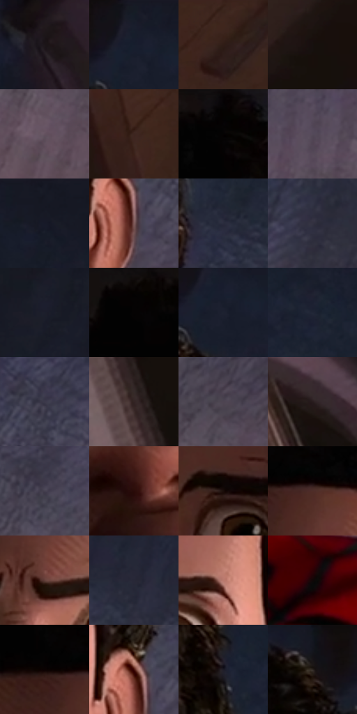

# 电影参考 518

- 状态：常规／活跃；来源世界：miles-home。
- 视角：high-angle；景别：close-up；场景：interior。
- 时段：daylight-time-unspecified（外观依据，中置信度；具体时间／晨昏未知）；光照：warm-day。
- 材质候选：skin, hair, fabric, paint, wood, paper, glass, metal（帧级，不是像素分割）。
- 明暗组：very-dark；L* P5/P50/P95：0.88083 / 13.83977 / 40.85499。
- 资格门禁：无附加门禁。
- 原截图 SHA-256：`ccf3a3b5bfe13627b4e0f44aa86930a488e85d44008e0ab3edaf61e23ca31aef`；尺寸：2880 × 1198。
- sRGB 像素 SHA-256：`3eff40f8de89737912111768aa446dafe08247f4d68fdd7dac64053b85758fb6`。

## 观察与迁移

暖窗宿舍，墙影、脸部、黑白衣料和远楼层次分开。

俯视惊讶面部位于安静蓝地毯上，眉眼表达表情；不能把此眼睛尺度套到所有人。

77  /  518  /  宿舍暖窗与焦点：俯视惊讶面部位于安静蓝地毯上，眉眼表达表情；不能把此眼睛尺度套到所有人。

本公开版保存32个128×128原像素色卡上下文；图集格子并非原场景相邻位置。原rect、图集tile和像素SHA见 `data/palette-crops.json`。上下文不足时不得批准替色，不能以小样推断完整构图。

## 实测色卡

颜色比例分母为保留采样像素，不是材料面积；全部 32 色参与全库匹配。表内四舍五入仅用于阅读，原精度在 JSON。

| ID | HEX | Lab | 原图 xy | 像素数 | 比例 | 明度角色 |
| --- | --- | --- | --- | ---: | ---: | --- |
| 518-S01 | #1C1619 | [8.047396, 3.719223, -0.998384] | [980, 488] | 9507 | 4.934907% | deep-shadow |
| 518-S02 | #171C29 | [10.354484, 1.807938, -9.541567] | [1832, 32] | 8795 | 4.565321% | deep-shadow |
| 518-S03 | #2F1C16 | [12.562873, 8.469942, 7.989565] | [572, 64] | 8567 | 4.446971% | deep-shadow |
| 518-S04 | #17110F | [5.578453, 2.172677, 1.932834] | [116, 136] | 8038 | 4.172377% | deep-shadow |
| 518-S05 | #63525E | [36.921477, 9.363204, -4.33293] | [2552, 1048] | 7864 | 4.082056% | shadow |
| 518-S06 | #3D2620 | [17.84073, 9.984885, 8.420231] | [412, 180] | 7810 | 4.054026% | deep-shadow |
| 518-S07 | #050303 | [0.939138, 0.522946, 0.184376] | [1476, 28] | 7489 | 3.887401% | deep-shadow |
| 518-S08 | #544A59 | [32.927118, 7.383626, -7.30027] | [1948, 928] | 7313 | 3.796043% | shadow |
| 518-S09 | #151823 | [8.429168, 1.994586, -8.067701] | [2040, 24] | 7243 | 3.759707% | deep-shadow |
| 518-S10 | #7C5958 | [41.430122, 14.270857, 6.284893] | [1784, 776] | 7232 | 3.753997% | midtone |
| 518-S11 | #2A2C3D | [18.498571, 3.814567, -11.069468] | [1912, 456] | 7231 | 3.753478% | deep-shadow |
| 518-S12 | #343241 | [21.553227, 4.64707, -9.048016] | [2588, 652] | 7042 | 3.655371% | shadow |
| 518-S13 | #1B1F2C | [11.922851, 2.10394, -9.285754] | [2748, 108] | 6679 | 3.466945% | deep-shadow |
| 518-S14 | #030202 | [0.606656, 0.261464, 0.092205] | [1312, 40] | 6421 | 3.333022% | deep-shadow |
| 518-S15 | #1D2230 | [13.342985, 1.98562, -9.969063] | [1844, 96] | 6397 | 3.320564% | deep-shadow |
| 518-S16 | #212636 | [15.359822, 2.542364, -11.093328] | [1944, 260] | 6088 | 3.160168% | deep-shadow |
| 518-S17 | #3D3A4B | [25.339747, 5.427095, -9.900529] | [1904, 652] | 6062 | 3.146672% | shadow |
| 518-S18 | #332424 | [15.968149, 7.13235, 2.785021] | [76, 388] | 5901 | 3.063100% | deep-shadow |
| 518-S19 | #4E4451 | [30.274189, 7.024596, -6.210495] | [2552, 900] | 5870 | 3.047008% | shadow |
| 518-S20 | #281C1D | [11.7592, 6.100758, 1.60573] | [272, 736] | 5688 | 2.952535% | deep-shadow |
| 518-S21 | #454050 | [28.144056, 5.837074, -8.856961] | [2176, 756] | 5501 | 2.855467% | shadow |
| 518-S22 | #2A0A08 | [6.566928, 16.076804, 6.864218] | [1420, 788] | 5399 | 2.802521% | deep-shadow |
| 518-S23 | #190D0A | [4.665314, 4.454248, 2.963262] | [1276, 572] | 5066 | 2.629667% | deep-shadow |
| 518-S24 | #4E2D27 | [22.455414, 14.408311, 10.320028] | [1484, 332] | 4939 | 2.563743% | shadow |
| 518-S25 | #63403B | [30.96288, 14.563227, 9.311755] | [1476, 560] | 4387 | 2.277210% | shadow |
| 518-S26 | #282837 | [16.721264, 4.066895, -9.64747] | [2272, 496] | 4374 | 2.270462% | deep-shadow |
| 518-S27 | #B97A6E | [57.425793, 23.117526, 16.679565] | [1648, 556] | 4187 | 2.173394% | midtone |
| 518-S28 | #100707 | [2.506443, 2.633444, 0.92816] | [1800, 1092] | 3980 | 2.065944% | deep-shadow |
| 518-S29 | #0B0202 | [1.074612, 2.360126, 0.831662] | [1412, 320] | 3145 | 1.632511% | deep-shadow |
| 518-S30 | #44100B | [13.375997, 24.608246, 16.031674] | [1768, 720] | 2918 | 1.514680% | deep-shadow |
| 518-S31 | #1D1B25 | [10.39881, 3.678657, -6.472169] | [1836, 244] | 2771 | 1.438375% | deep-shadow |
| 518-S32 | #141318 | [6.146092, 1.617131, -3.121525] | [1716, 44] | 2744 | 1.424359% | deep-shadow |

## 色阶与空间分布

- 采样 ROI：`[0.01, 0.02, 0.98, 0.94]`；步长：4；样本数：192648。
- 排除区：`[]`。
- 深暗、暗、中、亮、高光五段计数：`[132059, 49776, 9273, 1540, 0]`。
- RGB 各 256 箱、L* 100 箱、13×5 色相明度表和 3×3 空间统计全部保存在 [总数据](../film-library.json)。
- [可视化档案](../../references/library.html)按需绘制直方图，不存 2,094 张重复图表图片。

## 纹理特征占比

**这是分块图像特征的面积占比，不是波点／排线／丝网／错版的精确语义覆盖率。** 窗格、发丝、织物也会产生方向或周期特征。
原图 ROI 像素 3081782；已测块覆盖 3081782（100.0000%）；未测 0。

| 特征 | 块覆盖像素 | 占已测面积 | 阈值敏感范围 |
| --- | ---: | ---: | --- |
| low-contrast | 755328 | 24.5095% | 20.9915% ~ 31.3419% |
| directional-structure | 436096 | 14.1508% | 5.1129% ~ 26.8312% |
| periodic-structure | 1765558 | 57.2902% | 50.0507% ~ 57.2902% |
| mixed-detail | 124800 | 4.0496% | 2.1266% ~ 8.0428% |

阈值敏感范围不是统计置信区间。逐块坐标、尺度、对比、方向一致性、频谱集中度、频率与角度见 [全量特征记录](../texture-features.jsonl)，以帧号定位。
四种印刷层的真实像素覆盖仍标为 `null`，不能填 0，也不能拿上表代替。不得据这些代理测量删除唯一证据。

[测量方法与保留策略](../../references/library-retention.md) · [分类索引](../archive/README.md)
