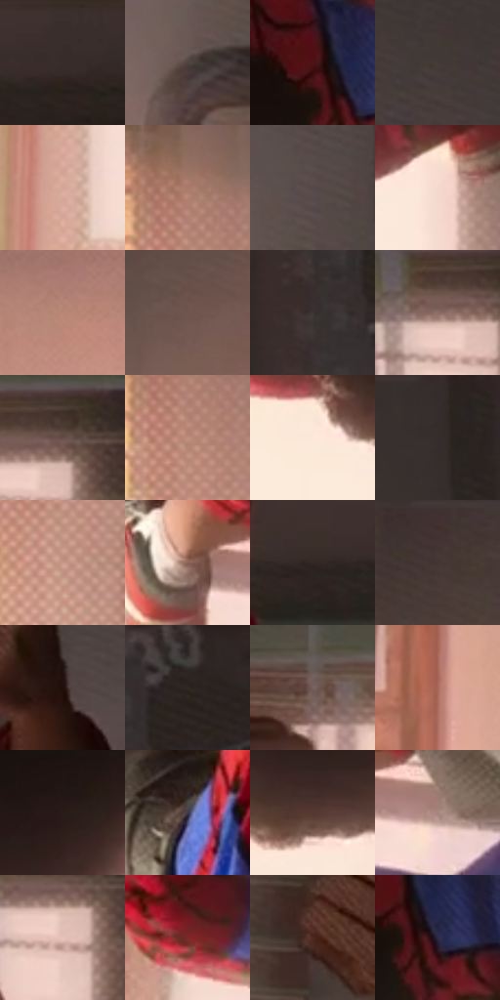

# 电影参考 519

- 状态：常规／活跃；来源世界：miles-home。
- 视角：low-angle；景别：full-body；场景：interior。
- 时段：daylight-time-unspecified（外观依据，中置信度；具体时间／晨昏未知）；光照：warm-day。
- 材质候选：skin, hair, fabric, paint, wood, paper, glass, metal（帧级，不是像素分割）。
- 明暗组：dark；L* P5/P50/P95：12.28229 / 32.46647 / 89.61924。
- 资格门禁：无附加门禁。
- 原截图 SHA-256：`211473bf4ced338f7fb49defa2453c6bdbcd24d4840171b19174d9159f86e491`；尺寸：2880 × 1204。
- sRGB 像素 SHA-256：`f7f2cd81cc2cbde89b62a0ba253bb170d5f23dd75d86f27f3929ecb7ba2e6bf3`。

## 观察与迁移

暖窗宿舍，墙影、脸部、黑白衣料和远楼层次分开。

倒挂人物与连接上方的细丝属于真实剧情物件，窗体结构稳定；不新增蛛丝或旋转原照。

78  /  519  /  宿舍暖窗与焦点：倒挂人物与连接上方的细丝属于真实剧情物件，窗体结构稳定；不新增蛛丝或旋转原照。

本公开版保存32个128×128原像素色卡上下文；图集格子并非原场景相邻位置。原rect、图集tile和像素SHA见 `data/palette-crops.json`。上下文不足时不得批准替色，不能以小样推断完整构图。

## 实测色卡

颜色比例分母为保留采样像素，不是材料面积；全部 32 色参与全库匹配。表内四舍五入仅用于阅读，原精度在 JSON。

| ID | HEX | Lab | 原图 xy | 像素数 | 比例 | 明度角色 |
| --- | --- | --- | --- | ---: | ---: | --- |
| 519-S01 | #382E2B | [19.920356, 3.95259, 3.62689] | [1704, 44] | 11265 | 5.847452% | deep-shadow |
| 519-S02 | #4F433E | [29.474333, 4.187334, 4.93401] | [2204, 868] | 9108 | 4.727794% | shadow |
| 519-S03 | #4D1315 | [15.994099, 27.310146, 14.221175] | [1700, 624] | 8649 | 4.489535% | deep-shadow |
| 519-S04 | #433B37 | [25.554805, 2.675512, 3.749364] | [2216, 288] | 8357 | 4.337964% | shadow |
| 519-S05 | #D3A598 | [71.574172, 15.051201, 13.233158] | [880, 1028] | 8165 | 4.238300% | light |
| 519-S06 | #AA7A6B | [55.612362, 16.69609, 15.632211] | [72, 396] | 8034 | 4.170300% | midtone |
| 519-S07 | #574949 | [32.419529, 5.90159, 2.198249] | [2296, 656] | 7590 | 3.939828% | shadow |
| 519-S08 | #F5D9CF | [88.706975, 8.092307, 8.470869] | [1824, 812] | 7464 | 3.874424% | highlight |
| 519-S09 | #B78675 | [60.251704, 16.48087, 16.541064] | [564, 520] | 7210 | 3.742577% | light |
| 519-S10 | #6F564F | [38.898625, 9.186774, 8.030952] | [380, 256] | 7184 | 3.729081% | shadow |
| 519-S11 | #3C3534 | [22.843912, 2.881132, 1.758386] | [2460, 140] | 7015 | 3.641356% | shadow |
| 519-S12 | #8D6F66 | [49.486102, 10.430605, 9.532708] | [1784, 320] | 6905 | 3.584257% | midtone |
| 519-S13 | #644D46 | [34.92248, 8.529403, 7.865494] | [1836, 304] | 6634 | 3.443586% | shadow |
| 519-S14 | #C18E7F | [63.522495, 17.300405, 15.59088] | [76, 472] | 6364 | 3.303434% | light |
| 519-S15 | #FCE8D9 | [93.197991, 4.383431, 9.752316] | [1368, 904] | 6364 | 3.303434% | highlight |
| 519-S16 | #322C2A | [18.569463, 2.300613, 2.29194] | [2328, 52] | 6363 | 3.302915% | deep-shadow |
| 519-S17 | #C89889 | [66.933538, 15.854364, 14.859076] | [84, 708] | 5848 | 3.035588% | light |
| 519-S18 | #896055 | [44.718064, 15.161337, 12.942666] | [1072, 568] | 5838 | 3.030397% | midtone |
| 519-S19 | #332723 | [16.875139, 4.86519, 4.779416] | [1564, 84] | 5758 | 2.988871% | deep-shadow |
| 519-S20 | #433430 | [23.212729, 5.995252, 5.085903] | [204, 32] | 5727 | 2.972779% | shadow |
| 519-S21 | #220F0C | [6.398526, 9.114055, 4.778243] | [2116, 460] | 5659 | 2.937482% | deep-shadow |
| 519-S22 | #292424 | [14.737874, 2.338185, 0.853537] | [2552, 28] | 5278 | 2.739712% | deep-shadow |
| 519-S23 | #745F5B | [42.236004, 7.800479, 5.479148] | [940, 300] | 5125 | 2.660292% | midtone |
| 519-S24 | #A9685A | [50.775744, 24.467643, 18.889923] | [708, 1088] | 4639 | 2.408019% | midtone |
| 519-S25 | #281C19 | [11.633629, 5.345647, 4.367145] | [1644, 784] | 4567 | 2.370645% | deep-shadow |
| 519-S26 | #3E384D | [24.915572, 7.680863, -11.862372] | [1292, 416] | 4422 | 2.295378% | shadow |
| 519-S27 | #553931 | [26.960596, 11.265667, 9.986929] | [1548, 908] | 3552 | 1.843777% | shadow |
| 519-S28 | #A6847F | [58.172491, 12.220816, 7.653545] | [1180, 592] | 3470 | 1.801213% | midtone |
| 519-S29 | #E5C1B6 | [80.837275, 11.101046, 10.308794] | [1816, 360] | 3311 | 1.718679% | highlight |
| 519-S30 | #7D2728 | [29.325313, 37.216477, 20.153901] | [928, 712] | 2650 | 1.375566% | shadow |
| 519-S31 | #4F2A23 | [21.726121, 16.319127, 12.062917] | [1964, 432] | 2347 | 1.218284% | shadow |
| 519-S32 | #2C2B45 | [18.769019, 7.732628, -16.125129] | [1744, 664] | 1786 | 0.927079% | deep-shadow |

## 色阶与空间分布

- 采样 ROI：`[0.01, 0.02, 0.98, 0.94]`；步长：4；样本数：192648。
- 排除区：`[]`。
- 深暗、暗、中、亮、高光五段计数：`[40356, 72235, 36974, 27237, 15846]`。
- RGB 各 256 箱、L* 100 箱、13×5 色相明度表和 3×3 空间统计全部保存在 [总数据](../film-library.json)。
- [可视化档案](../../references/library.html)按需绘制直方图，不存 2,094 张重复图表图片。

## 纹理特征占比

**这是分块图像特征的面积占比，不是波点／排线／丝网／错版的精确语义覆盖率。** 窗格、发丝、织物也会产生方向或周期特征。
原图 ROI 像素 3092958；已测块覆盖 3092958（100.0000%）；未测 0。

| 特征 | 块覆盖像素 | 占已测面积 | 阈值敏感范围 |
| --- | ---: | ---: | --- |
| low-contrast | 111872 | 3.6170% | 3.0873% ~ 7.2340% |
| directional-structure | 716416 | 23.1628% | 12.4070% ~ 34.0417% |
| periodic-structure | 2100830 | 67.9230% | 61.8116% ~ 69.7646% |
| mixed-detail | 163840 | 5.2972% | 1.0594% ~ 10.5944% |

阈值敏感范围不是统计置信区间。逐块坐标、尺度、对比、方向一致性、频谱集中度、频率与角度见 [全量特征记录](../texture-features.jsonl)，以帧号定位。
四种印刷层的真实像素覆盖仍标为 `null`，不能填 0，也不能拿上表代替。不得据这些代理测量删除唯一证据。

[测量方法与保留策略](../../references/library-retention.md) · [分类索引](../archive/README.md)
