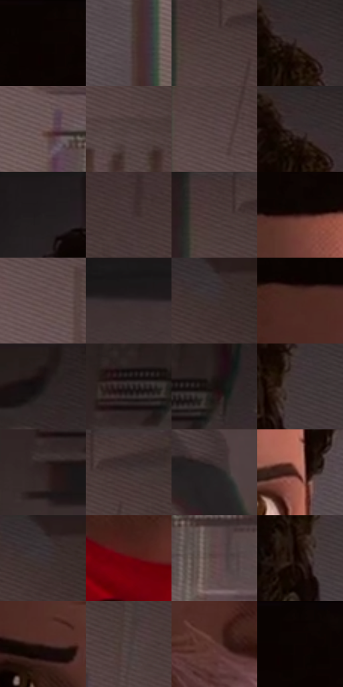

# 电影参考 520

- 状态：常规／活跃；来源世界：miles-home。
- 视角：near-level；景别：close-up；场景：interior。
- 时段：daylight-time-unspecified（外观依据，中置信度；具体时间／晨昏未知）；光照：warm-day。
- 材质候选：skin, hair, fabric, paint, wood, paper, glass, metal（帧级，不是像素分割）。
- 明暗组：dark；L* P5/P50/P95：1.46677 / 22.339 / 39.39327。
- 资格门禁：无附加门禁。
- 原截图 SHA-256：`1d7b50a98a6946159990cc03e7379b93ce7856991813a6e860ec0f5237570f39`；尺寸：2880 × 1202。
- sRGB 像素 SHA-256：`684719ed0a69213743981a171efc705e05e969a0fedb7bb631f1fc0db331fed1`。

## 观察与迁移

暖窗宿舍，墙影、脸部、黑白衣料和远楼层次分开。

嘴部交叉白丝是实体蛛丝，面部表情仍清楚，后方衣物低对比；不能当作皮肤排线或默认封嘴效果。

79  /  520  /  宿舍暖窗与焦点：嘴部交叉白丝是实体蛛丝，面部表情仍清楚，后方衣物低对比；不能当作皮肤排线或默认封嘴效果。

本公开版保存32个128×128原像素色卡上下文；图集格子并非原场景相邻位置。原rect、图集tile和像素SHA见 `data/palette-crops.json`。上下文不足时不得批准替色，不能以小样推断完整构图。

## 实测色卡

颜色比例分母为保留采样像素，不是材料面积；全部 32 色参与全库匹配。表内四舍五入仅用于阅读，原精度在 JSON。

| ID | HEX | Lab | 原图 xy | 像素数 | 比例 | 明度角色 |
| --- | --- | --- | --- | ---: | ---: | --- |
| 520-S01 | #0A0301 | [1.191108, 1.552355, 1.401916] | [1440, 28] | 11223 | 5.825651% | deep-shadow |
| 520-S02 | #574A4D | [32.831514, 6.042109, 0.242524] | [1980, 728] | 9369 | 4.863274% | shadow |
| 520-S03 | #4D3C3C | [27.118622, 7.444755, 2.838411] | [2080, 84] | 9136 | 4.742328% | shadow |
| 520-S04 | #3D2E2E | [20.609608, 6.859245, 2.633252] | [1848, 76] | 9061 | 4.703397% | shadow |
| 520-S05 | #705857 | [39.769769, 9.691384, 4.344469] | [2164, 476] | 8881 | 4.609962% | shadow |
| 520-S06 | #544344 | [30.197832, 7.484703, 2.160284] | [2264, 296] | 8684 | 4.507703% | shadow |
| 520-S07 | #504041 | [28.783457, 7.106985, 2.007574] | [2088, 176] | 7772 | 4.034301% | shadow |
| 520-S08 | #322829 | [17.253797, 4.852514, 1.089927] | [1832, 28] | 7672 | 3.982393% | deep-shadow |
| 520-S09 | #241F20 | [12.347271, 2.619529, 0.196247] | [1148, 64] | 7119 | 3.695341% | deep-shadow |
| 520-S10 | #493A3B | [26.035394, 6.783302, 1.877159] | [2540, 252] | 6850 | 3.555708% | shadow |
| 520-S11 | #443434 | [23.448783, 7.175025, 2.7474] | [2060, 44] | 6796 | 3.527677% | shadow |
| 520-S12 | #331714 | [11.738166, 13.664566, 8.354164] | [1616, 340] | 6615 | 3.433724% | deep-shadow |
| 520-S13 | #624D4D | [34.884113, 8.824619, 3.365709] | [2104, 332] | 6607 | 3.429571% | shadow |
| 520-S14 | #342C2E | [18.923056, 4.073971, 0.057006] | [648, 288] | 5815 | 3.018459% | deep-shadow |
| 520-S15 | #3F3334 | [22.557638, 5.571183, 1.38607] | [2296, 72] | 5811 | 3.016382% | shadow |
| 520-S16 | #4D2923 | [21.152416, 16.025685, 11.243201] | [1428, 356] | 5678 | 2.947344% | shadow |
| 520-S17 | #191717 | [7.961033, 0.986611, 0.350963] | [648, 68] | 5459 | 2.833666% | deep-shadow |
| 520-S18 | #201919 | [9.581831, 3.470263, 1.300706] | [356, 144] | 5352 | 2.778124% | deep-shadow |
| 520-S19 | #18100F | [5.413348, 3.219631, 1.704786] | [424, 128] | 5350 | 2.777086% | deep-shadow |
| 520-S20 | #433839 | [24.693405, 5.040394, 1.178413] | [1884, 236] | 5236 | 2.717910% | shadow |
| 520-S21 | #312323 | [15.363324, 6.679463, 2.595548] | [316, 232] | 5096 | 2.645239% | deep-shadow |
| 520-S22 | #483735 | [24.85044, 7.19914, 4.148158] | [2144, 28] | 4986 | 2.588140% | shadow |
| 520-S23 | #262222 | [13.660082, 1.881637, 0.683233] | [612, 848] | 4877 | 2.531560% | deep-shadow |
| 520-S24 | #A76D62 | [51.8783, 21.731186, 15.665386] | [1764, 552] | 4708 | 2.443835% | midtone |
| 520-S25 | #3A3336 | [22.065365, 3.75497, -0.75462] | [2292, 48] | 4593 | 2.384141% | shadow |
| 520-S26 | #6F020D | [21.774107, 43.218193, 27.571932] | [1424, 1096] | 4371 | 2.268905% | shadow |
| 520-S27 | #5D4544 | [31.809447, 10.139644, 4.611801] | [2276, 552] | 4185 | 2.172356% | shadow |
| 520-S28 | #150603 | [2.676422, 4.474452, 2.85904] | [1840, 272] | 3896 | 2.022341% | deep-shadow |
| 520-S29 | #3D221E | [16.651315, 12.403942, 8.195964] | [1504, 548] | 3658 | 1.898800% | deep-shadow |
| 520-S30 | #4C4040 | [28.310169, 5.166473, 1.91986] | [2416, 336] | 3343 | 1.735289% | shadow |
| 520-S31 | #5B3631 | [26.974812, 15.909712, 10.139031] | [1472, 792] | 3152 | 1.636145% | shadow |
| 520-S32 | #0B0201 | [1.054826, 2.221083, 1.210085] | [1468, 28] | 1297 | 0.673249% | deep-shadow |

## 色阶与空间分布

- 采样 ROI：`[0.01, 0.02, 0.98, 0.94]`；步长：4；样本数：192648。
- 排除区：`[]`。
- 深暗、暗、中、亮、高光五段计数：`[79807, 104016, 8037, 788, 0]`。
- RGB 各 256 箱、L* 100 箱、13×5 色相明度表和 3×3 空间统计全部保存在 [总数据](../film-library.json)。
- [可视化档案](../../references/library.html)按需绘制直方图，不存 2,094 张重复图表图片。

## 纹理特征占比

**这是分块图像特征的面积占比，不是波点／排线／丝网／错版的精确语义覆盖率。** 窗格、发丝、织物也会产生方向或周期特征。
原图 ROI 像素 3087370；已测块覆盖 3087370（100.0000%）；未测 0。

| 特征 | 块覆盖像素 | 占已测面积 | 阈值敏感范围 |
| --- | ---: | ---: | --- |
| low-contrast | 401920 | 13.0182% | 10.7545% ~ 20.5887% |
| directional-structure | 1202058 | 38.9347% | 15.8212% ~ 53.9346% |
| periodic-structure | 1341952 | 43.4659% | 34.2495% ~ 57.7527% |
| mixed-detail | 141440 | 4.5812% | 1.0614% ~ 5.8375% |

阈值敏感范围不是统计置信区间。逐块坐标、尺度、对比、方向一致性、频谱集中度、频率与角度见 [全量特征记录](../texture-features.jsonl)，以帧号定位。
四种印刷层的真实像素覆盖仍标为 `null`，不能填 0，也不能拿上表代替。不得据这些代理测量删除唯一证据。

[测量方法与保留策略](../../references/library-retention.md) · [分类索引](../archive/README.md)
