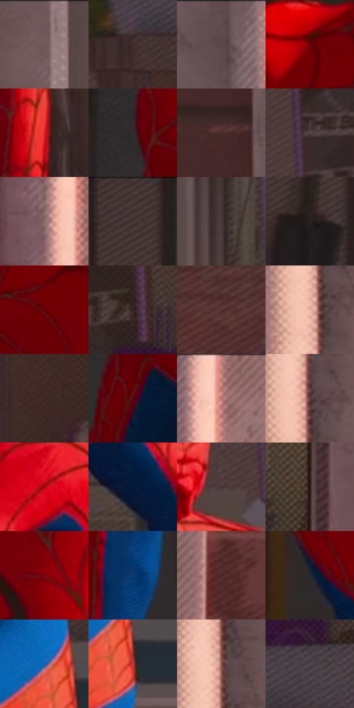

# 电影参考 521

- 状态：常规／活跃；来源世界：miles-home。
- 视角：near-level；景别：medium；场景：interior。
- 时段：daylight-time-unspecified（外观依据，中置信度；具体时间／晨昏未知）；光照：warm-day。
- 材质候选：skin, hair, fabric, paint, wood, paper, glass, metal（帧级，不是像素分割）。
- 明暗组：dark；L* P5/P50/P95：12.45729 / 24.5866 / 56.9889。
- 资格门禁：无附加门禁。
- 原截图 SHA-256：`e4a10a889bebb2434ce676838e2fe0b3ee3b647e59ade0ea41da2c805ea3d992`；尺寸：2880 × 1210。
- sRGB 像素 SHA-256：`14f89cd97d40c0c433edce15a38c49ad4a0716a4523af465061611864577888e`。

## 观察与迁移

暖窗宿舍，墙影、脸部、黑白衣料和远楼层次分开。

窗台人物红衣局部亮面，砖墙暖、室内较暗软，双手和体块明确；窗内景物不涂成统一灰板。

80  /  521  /  宿舍暖窗与焦点：窗台人物红衣局部亮面，砖墙暖、室内较暗软，双手和体块明确；窗内景物不涂成统一灰板。

本公开版保存32个128×128原像素色卡上下文；图集格子并非原场景相邻位置。原rect、图集tile和像素SHA见 `data/palette-crops.json`。上下文不足时不得批准替色，不能以小样推断完整构图。

## 实测色卡

颜色比例分母为保留采样像素，不是材料面积；全部 32 色参与全库匹配。表内四舍五入仅用于阅读，原精度在 JSON。

| ID | HEX | Lab | 原图 xy | 像素数 | 比例 | 明度角色 |
| --- | --- | --- | --- | ---: | ---: | --- |
| 521-S01 | #6F5558 | [38.866562, 11.273591, 2.410163] | [544, 48] | 14392 | 7.416875% | shadow |
| 521-S02 | #3F2B2B | [19.879408, 9.280104, 3.686694] | [2096, 352] | 10796 | 5.563687% | deep-shadow |
| 521-S03 | #614C4F | [34.549369, 9.379866, 1.602917] | [308, 28] | 10012 | 5.159655% | shadow |
| 521-S04 | #700006 | [21.795762, 43.79492, 30.622867] | [1108, 308] | 9411 | 4.849931% | shadow |
| 521-S05 | #DE2424 | [48.163859, 67.890926, 48.277594] | [2084, 912] | 9409 | 4.848900% | midtone |
| 521-S06 | #30292A | [17.37386, 3.43795, 0.533664] | [916, 448] | 9353 | 4.820041% | deep-shadow |
| 521-S07 | #4A2C2B | [21.696801, 13.73279, 6.470809] | [188, 164] | 9007 | 4.641731% | shadow |
| 521-S08 | #544343 | [30.16831, 7.300786, 2.764815] | [1720, 100] | 8917 | 4.595350% | shadow |
| 521-S09 | #8A696A | [47.685167, 13.33906, 4.547381] | [2568, 388] | 8311 | 4.283049% | midtone |
| 521-S10 | #433433 | [23.299179, 6.534011, 3.190315] | [800, 32] | 7564 | 3.898085% | shadow |
| 521-S11 | #4C3B3C | [26.708742, 7.650504, 2.232702] | [664, 160] | 7523 | 3.876956% | shadow |
| 521-S12 | #272120 | [13.3718, 2.63258, 1.725366] | [788, 584] | 7257 | 3.739873% | deep-shadow |
| 521-S13 | #64030A | [19.212923, 39.763297, 25.320906] | [1064, 448] | 7136 | 3.677516% | deep-shadow |
| 521-S14 | #352320 | [15.816365, 8.10786, 5.447026] | [2128, 140] | 6687 | 3.446126% | deep-shadow |
| 521-S15 | #573432 | [25.900794, 15.497, 7.906433] | [2808, 860] | 6513 | 3.356455% | shadow |
| 521-S16 | #EFB7A7 | [79.04746, 18.0498, 15.975008] | [428, 416] | 6239 | 3.215250% | light |
| 521-S17 | #3F2825 | [18.834883, 10.33106, 6.365782] | [2172, 484] | 6227 | 3.209066% | deep-shadow |
| 521-S18 | #55060E | [15.972373, 34.513616, 18.747302] | [964, 576] | 5980 | 3.081775% | deep-shadow |
| 521-S19 | #BE7B71 | [58.327947, 24.900849, 16.296103] | [2624, 36] | 5416 | 2.791120% | midtone |
| 521-S20 | #643E3E | [30.647443, 16.658128, 6.954878] | [444, 392] | 5292 | 2.727217% | shadow |
| 521-S21 | #A8050C | [34.928468, 58.108607, 44.253439] | [1864, 500] | 5186 | 2.672590% | shadow |
| 521-S22 | #071A3A | [9.714175, 6.245419, -22.960053] | [1908, 632] | 4889 | 2.519532% | deep-shadow |
| 521-S23 | #4A3534 | [24.481993, 9.252412, 4.324355] | [1644, 168] | 4166 | 2.146936% | shadow |
| 521-S24 | #2C1717 | [10.632733, 10.614754, 4.529589] | [2348, 200] | 3647 | 1.879471% | deep-shadow |
| 521-S25 | #78020C | [23.88305, 45.693781, 30.88321] | [1584, 636] | 3466 | 1.786193% | shadow |
| 521-S26 | #0B3A71 | [24.604281, 7.593389, -35.975015] | [980, 808] | 2235 | 1.151801% | shadow |
| 521-S27 | #4C2525 | [20.018202, 18.321115, 8.31083] | [2720, 1020] | 2113 | 1.088928% | shadow |
| 521-S28 | #272A31 | [17.031691, 0.522702, -4.984639] | [1116, 720] | 1725 | 0.888974% | deep-shadow |
| 521-S29 | #1360AB | [40.316436, 6.679591, -46.266233] | [1692, 1012] | 1659 | 0.854961% | midtone |
| 521-S30 | #BC433E | [45.711721, 48.344455, 29.378358] | [1736, 1068] | 1651 | 0.850838% | midtone |
| 521-S31 | #88514D | [40.664258, 22.528407, 12.190671] | [440, 336] | 1003 | 0.516893% | midtone |
| 521-S32 | #524950 | [32.119468, 5.219866, -2.779698] | [2176, 268] | 862 | 0.444229% | shadow |

## 色阶与空间分布

- 采样 ROI：`[0.01, 0.02, 0.98, 0.94]`；步长：4；样本数：194044。
- 排除区：`[]`。
- 深暗、暗、中、亮、高光五段计数：`[58899, 99487, 27623, 4879, 3156]`。
- RGB 各 256 箱、L* 100 箱、13×5 色相明度表和 3×3 空间统计全部保存在 [总数据](../film-library.json)。
- [可视化档案](../../references/library.html)按需绘制直方图，不存 2,094 张重复图表图片。

## 纹理特征占比

**这是分块图像特征的面积占比，不是波点／排线／丝网／错版的精确语义覆盖率。** 窗格、发丝、织物也会产生方向或周期特征。
原图 ROI 像素 3109722；已测块覆盖 3109722（100.0000%）；未测 0。

| 特征 | 块覆盖像素 | 占已测面积 | 阈值敏感范围 |
| --- | ---: | ---: | --- |
| low-contrast | 208000 | 6.6887% | 4.5812% ~ 9.3230% |
| directional-structure | 810624 | 26.0674% | 9.8952% ~ 34.7524% |
| periodic-structure | 1953626 | 62.8232% | 58.3531% ~ 70.5656% |
| mixed-detail | 137472 | 4.4207% | 2.3133% ~ 10.2162% |

阈值敏感范围不是统计置信区间。逐块坐标、尺度、对比、方向一致性、频谱集中度、频率与角度见 [全量特征记录](../texture-features.jsonl)，以帧号定位。
四种印刷层的真实像素覆盖仍标为 `null`，不能填 0，也不能拿上表代替。不得据这些代理测量删除唯一证据。

[测量方法与保留策略](../../references/library-retention.md) · [分类索引](../archive/README.md)
