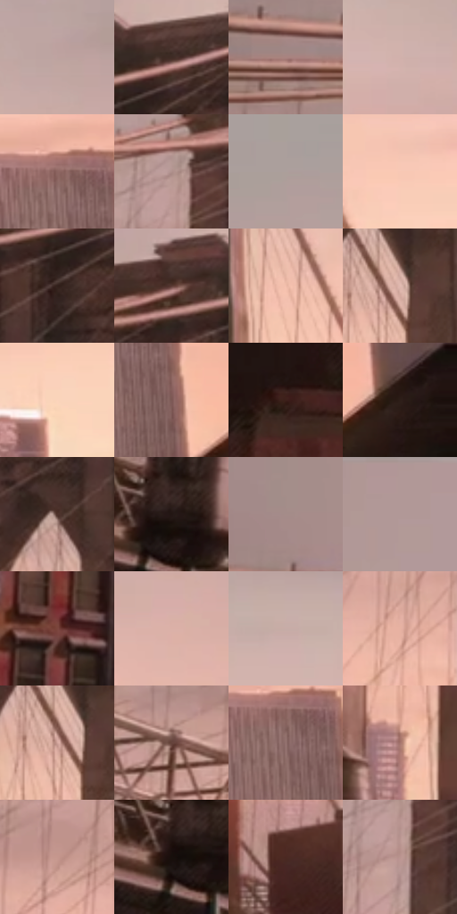

# 电影参考 522

- 状态：常规／活跃；来源世界：miles-home。
- 视角：near-level；景别：environment-wide；场景：city。
- 时段：twilight-appearance（外观依据，中置信度；具体时间／晨昏未知）；光照：dusk。
- 材质候选：brick, metal, glass, sky（帧级，不是像素分割）。
- 明暗组：light；L* P5/P50/P95：9.9458 / 60.22911 / 84.20948。
- 资格门禁：无附加门禁。
- 原截图 SHA-256：`4d9aaa8ef41bbf349d34b9645c04899cfa63ec7341857d2f210fd168c5b1f4e1`；尺寸：2878 × 1210。
- sRGB 像素 SHA-256：`5349e07c863cece046ecf8bbb8a23e6d9318ce33bb6813753a3cd28920af5702`。

## 观察与迁移

桥梁同视点的暖粉至紫暮变化，云形改变不算曝光变化。

灰桃天空较平缓，近砖楼偏暖深暗、远高楼偏浅灰粉；桥塔双拱与缆索为稳定锚点。

522／1  /  天空灰桃较平缓，近砖楼暖而深暗，远高楼浅灰粉；双拱桥塔与密缆索构成主体  /  先锁桥塔双拱、桥面走向、缆索疏密和楼群遮挡。暖天空不要求把所有建筑提成橙亮

本公开版保存32个128×128原像素色卡上下文；图集格子并非原场景相邻位置。原rect、图集tile和像素SHA见 `data/palette-crops.json`。上下文不足时不得批准替色，不能以小样推断完整构图。

## 实测色卡

颜色比例分母为保留采样像素，不是材料面积；全部 32 色参与全库匹配。表内四舍五入仅用于阅读，原精度在 JSON。

| ID | HEX | Lab | 原图 xy | 像素数 | 比例 | 明度角色 |
| --- | --- | --- | --- | ---: | ---: | --- |
| 522-S01 | #BDA3A0 | [69.14948, 9.002074, 5.074117] | [2236, 220] | 8385 | 4.321185% | light |
| 522-S02 | #3F2B25 | [19.713625, 8.312424, 7.584948] | [1244, 232] | 7445 | 3.836759% | deep-shadow |
| 522-S03 | #A9847F | [58.481528, 13.401758, 8.135848] | [252, 328] | 7412 | 3.819752% | midtone |
| 522-S04 | #D1B1AB | [74.787935, 10.588596, 7.368084] | [2064, 276] | 7170 | 3.695038% | light |
| 522-S05 | #8D6662 | [47.037774, 15.101574, 8.455519] | [2596, 748] | 7023 | 3.619282% | midtone |
| 522-S06 | #B0918D | [62.848141, 10.980475, 6.494947] | [900, 328] | 6756 | 3.481685% | light |
| 522-S07 | #AC9F9C | [66.49527, 4.196856, 3.273493] | [2696, 112] | 6728 | 3.467255% | light |
| 522-S08 | #F8C8B4 | [84.258167, 14.174866, 16.459423] | [1656, 564] | 6654 | 3.429119% | highlight |
| 522-S09 | #31201B | [14.203692, 7.412064, 6.682627] | [1192, 320] | 6640 | 3.421904% | deep-shadow |
| 522-S10 | #5A3A32 | [27.927696, 13.065104, 10.765854] | [1120, 240] | 6624 | 3.413659% | shadow |
| 522-S11 | #F1BDAB | [80.760572, 16.150612, 16.255798] | [1500, 516] | 6581 | 3.391499% | highlight |
| 522-S12 | #E1BBB1 | [78.882323, 12.071453, 10.162833] | [1328, 484] | 6511 | 3.355425% | light |
| 522-S13 | #FBD5BB | [87.818308, 9.4531, 17.79319] | [1992, 720] | 6471 | 3.334811% | highlight |
| 522-S14 | #7C5955 | [41.353221, 13.821643, 8.015025] | [2664, 840] | 6462 | 3.330173% | midtone |
| 522-S15 | #3D201B | [16.026338, 13.358242, 9.461465] | [532, 1008] | 6436 | 3.316774% | deep-shadow |
| 522-S16 | #2A1A16 | [11.198721, 7.313293, 6.002028] | [2820, 840] | 6250 | 3.220919% | deep-shadow |
| 522-S17 | #4E322B | [23.920016, 11.696574, 9.633273] | [1100, 428] | 6245 | 3.218342% | shadow |
| 522-S18 | #231613 | [8.808738, 6.08183, 4.503926] | [140, 608] | 6224 | 3.207520% | deep-shadow |
| 522-S19 | #A58C89 | [60.393547, 8.903535, 5.101764] | [308, 224] | 6060 | 3.123003% | light |
| 522-S20 | #B19897 | [64.993402, 9.084748, 3.958566] | [828, 28] | 5919 | 3.050339% | light |
| 522-S21 | #7B453D | [35.606388, 22.245638, 14.926154] | [252, 992] | 5859 | 3.019418% | shadow |
| 522-S22 | #DBB0A7 | [75.390851, 14.260861, 10.536122] | [2288, 384] | 5760 | 2.968399% | light |
| 522-S23 | #C6ACA7 | [72.429891, 8.579205, 6.040005] | [1952, 200] | 5686 | 2.930263% | light |
| 522-S24 | #E7B2A2 | [76.945449, 17.03096, 15.611744] | [844, 624] | 5646 | 2.909649% | light |
| 522-S25 | #D1A59C | [71.465198, 14.847054, 10.850709] | [1308, 500] | 5620 | 2.896250% | light |
| 522-S26 | #65433B | [32.027491, 13.591553, 10.823061] | [400, 576] | 5256 | 2.708664% | shadow |
| 522-S27 | #957370 | [51.635164, 12.883315, 6.803778] | [2604, 784] | 5092 | 2.624147% | midtone |
| 522-S28 | #A5756D | [53.843526, 17.760552, 11.930602] | [1080, 708] | 5023 | 2.588588% | midtone |
| 522-S29 | #C6978E | [66.591617, 16.301742, 11.561471] | [688, 568] | 4708 | 2.426254% | light |
| 522-S30 | #170F0C | [4.971546, 2.761848, 2.523352] | [112, 628] | 4175 | 2.151574% | deep-shadow |
| 522-S31 | #4B2822 | [20.554452, 15.618717, 11.068127] | [1692, 972] | 3866 | 1.992332% | shadow |
| 522-S32 | #BA9590 | [64.922095, 13.065274, 7.90221] | [908, 396] | 3357 | 1.730020% | light |

## 色阶与空间分布

- 采样 ROI：`[0.01, 0.02, 0.98, 0.94]`；步长：4；样本数：194044。
- 排除区：`[]`。
- 深暗、暗、中、亮、高光五段计数：`[35781, 30870, 29588, 79168, 18637]`。
- RGB 各 256 箱、L* 100 箱、13×5 色相明度表和 3×3 空间统计全部保存在 [总数据](../film-library.json)。
- [可视化档案](../../references/library.html)按需绘制直方图，不存 2,094 张重复图表图片。

## 纹理特征占比

**这是分块图像特征的面积占比，不是波点／排线／丝网／错版的精确语义覆盖率。** 窗格、发丝、织物也会产生方向或周期特征。
原图 ROI 像素 3107496；已测块覆盖 3107496（100.0000%）；未测 0。

| 特征 | 块覆盖像素 | 占已测面积 | 阈值敏感范围 |
| --- | ---: | ---: | --- |
| low-contrast | 370688 | 11.9288% | 8.7654% ~ 16.5134% |
| directional-structure | 888064 | 28.5781% | 19.5079% ~ 39.9179% |
| periodic-structure | 1739048 | 55.9630% | 50.7894% ~ 57.8125% |
| mixed-detail | 109696 | 3.5300% | 0.5272% ~ 6.1663% |

阈值敏感范围不是统计置信区间。逐块坐标、尺度、对比、方向一致性、频谱集中度、频率与角度见 [全量特征记录](../texture-features.jsonl)，以帧号定位。
四种印刷层的真实像素覆盖仍标为 `null`，不能填 0，也不能拿上表代替。不得据这些代理测量删除唯一证据。

[测量方法与保留策略](../../references/library-retention.md) · [分类索引](../archive/README.md)
