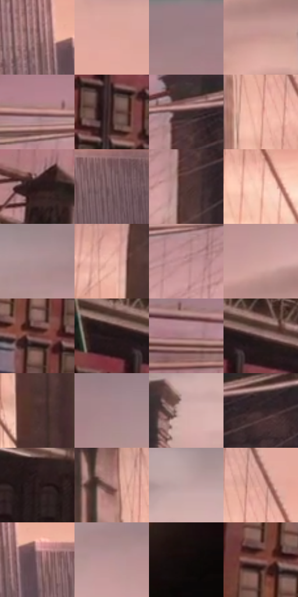

# 电影参考 523

- 状态：常规／活跃；来源世界：miles-home。
- 视角：near-level；景别：environment-wide；场景：city。
- 时段：twilight-appearance（外观依据，中置信度；具体时间／晨昏未知）；光照：dusk。
- 材质候选：brick, metal, glass, sky（帧级，不是像素分割）。
- 明暗组：middle；L* P5/P50/P95：8.78481 / 55.2325 / 79.8397。
- 资格门禁：无附加门禁。
- 原截图 SHA-256：`c6c06eb02e5d56a217084db1f93f04d57a6ca9074fe926e159eab78b492c6258`；尺寸：2880 × 1210。
- sRGB 像素 SHA-256：`5d051ad49c76bedadeebdca74ee24685f872cfa5c963931411653e22607bf396`。

## 观察与迁移

桥梁同视点的暖粉至紫暮变化，云形改变不算曝光变化。

相近构图中云带更分明，天空灰粉与暖亮区并置；云形本身变化，不全归因于调色。

523／2  /  云带更可辨，灰粉上空与较暖低空分层，桥塔仍是沉稳大暗形  /  云形改变是额外变量；不能只用一层粉色滤镜解释，也不据此给原照添云

本公开版保存32个128×128原像素色卡上下文；图集格子并非原场景相邻位置。原rect、图集tile和像素SHA见 `data/palette-crops.json`。上下文不足时不得批准替色，不能以小样推断完整构图。

## 实测色卡

颜色比例分母为保留采样像素，不是材料面积；全部 32 色参与全库匹配。表内四舍五入仅用于阅读，原精度在 JSON。

| ID | HEX | Lab | 原图 xy | 像素数 | 比例 | 明度角色 |
| --- | --- | --- | --- | ---: | ---: | --- |
| 523-S01 | #8B6465 | [46.370209, 15.9018, 5.674819] | [2416, 728] | 8181 | 4.216054% | midtone |
| 523-S02 | #DEA89D | [73.527203, 18.306867, 13.40056] | [1660, 436] | 7573 | 3.902723% | light |
| 523-S03 | #9C7D85 | [55.511929, 13.297404, 0.219279] | [2416, 32] | 7390 | 3.808415% | midtone |
| 523-S04 | #C99791 | [66.973646, 17.875416, 10.470223] | [2684, 388] | 7148 | 3.683701% | light |
| 523-S05 | #BD8D8C | [63.147147, 18.064782, 7.665248] | [508, 312] | 7048 | 3.632166% | light |
| 523-S06 | #371D1C | [14.259093, 12.596579, 6.182912] | [344, 860] | 6921 | 3.566717% | deep-shadow |
| 523-S07 | #402929 | [19.375446, 10.760002, 4.372351] | [952, 308] | 6906 | 3.558987% | deep-shadow |
| 523-S08 | #EBAFA0 | [76.596112, 19.887868, 16.266328] | [1508, 612] | 6790 | 3.499206% | light |
| 523-S09 | #271819 | [10.220161, 7.734966, 2.343856] | [152, 492] | 6697 | 3.451279% | deep-shadow |
| 523-S10 | #73575D | [40.001766, 12.570637, 1.016135] | [2596, 796] | 6630 | 3.416751% | midtone |
| 523-S11 | #523836 | [26.415735, 11.266577, 5.878733] | [940, 408] | 6604 | 3.403352% | shadow |
| 523-S12 | #F9C9B6 | [84.63468, 14.290557, 15.941075] | [1608, 724] | 6568 | 3.384799% | highlight |
| 523-S13 | #AC8F94 | [62.129833, 11.721254, 1.442468] | [2100, 104] | 6372 | 3.283791% | light |
| 523-S14 | #EFB9AC | [79.630954, 17.648604, 14.104128] | [892, 604] | 6294 | 3.243594% | light |
| 523-S15 | #B58588 | [60.228683, 18.855827, 5.648349] | [828, 372] | 6252 | 3.221950% | light |
| 523-S16 | #CEA19D | [70.209387, 16.028469, 8.471286] | [2648, 292] | 6215 | 3.202882% | light |
| 523-S17 | #6B3E39 | [31.502611, 19.061361, 11.513589] | [244, 888] | 6207 | 3.198759% | shadow |
| 523-S18 | #201415 | [7.782603, 6.3585, 1.633911] | [292, 736] | 5825 | 3.001896% | deep-shadow |
| 523-S19 | #AA7E82 | [57.154053, 17.641287, 4.521655] | [164, 328] | 5817 | 2.997774% | midtone |
| 523-S20 | #694B4C | [35.118395, 12.888625, 4.440662] | [372, 736] | 5774 | 2.975614% | shadow |
| 523-S21 | #4A2F2D | [22.579209, 12.069054, 6.347059] | [1376, 720] | 5600 | 2.885943% | shadow |
| 523-S22 | #A6868C | [59.022036, 13.17479, 1.41485] | [2700, 96] | 5500 | 2.834409% | midtone |
| 523-S23 | #D4AEAB | [74.324625, 13.319551, 6.740283] | [1484, 228] | 5411 | 2.788543% | light |
| 523-S24 | #372627 | [17.202923, 8.20895, 2.50398] | [1056, 324] | 5387 | 2.776174% | deep-shadow |
| 523-S25 | #2D1E1F | [13.14133, 7.512211, 2.219302] | [912, 920] | 5318 | 2.740616% | deep-shadow |
| 523-S26 | #A27473 | [53.396734, 17.957498, 7.748373] | [1224, 568] | 5240 | 2.700418% | midtone |
| 523-S27 | #C0A2A4 | [69.275796, 11.321365, 3.072966] | [1552, 132] | 5219 | 2.689596% | light |
| 523-S28 | #DAA195 | [71.260579, 19.499407, 14.547683] | [1540, 544] | 4996 | 2.574674% | light |
| 523-S29 | #95737A | [51.901612, 14.49128, 1.302881] | [2480, 760] | 4893 | 2.521593% | midtone |
| 523-S30 | #BB9495 | [64.895796, 14.768251, 5.066164] | [2164, 164] | 4890 | 2.520047% | light |
| 523-S31 | #120B0B | [3.542021, 2.327933, 0.820672] | [2820, 908] | 4806 | 2.476758% | deep-shadow |
| 523-S32 | #84524D | [40.372541, 20.272675, 11.704261] | [68, 864] | 3572 | 1.840820% | midtone |

## 色阶与空间分布

- 采样 ROI：`[0.01, 0.02, 0.98, 0.94]`；步长：4；样本数：194044。
- 排除区：`[]`。
- 深暗、暗、中、亮、高光五段计数：`[39258, 31868, 43808, 69733, 9377]`。
- RGB 各 256 箱、L* 100 箱、13×5 色相明度表和 3×3 空间统计全部保存在 [总数据](../film-library.json)。
- [可视化档案](../../references/library.html)按需绘制直方图，不存 2,094 张重复图表图片。

## 纹理特征占比

**这是分块图像特征的面积占比，不是波点／排线／丝网／错版的精确语义覆盖率。** 窗格、发丝、织物也会产生方向或周期特征。
原图 ROI 像素 3109722；已测块覆盖 3109722（100.0000%）；未测 0。

| 特征 | 块覆盖像素 | 占已测面积 | 阈值敏感范围 |
| --- | ---: | ---: | --- |
| low-contrast | 144640 | 4.6512% | 3.5975% ~ 9.5811% |
| directional-structure | 1117696 | 35.9420% | 25.0384% ~ 48.7020% |
| periodic-structure | 1786842 | 57.4599% | 46.8073% ~ 60.4329% |
| mixed-detail | 60544 | 1.9469% | 0.8932% ~ 4.9476% |

阈值敏感范围不是统计置信区间。逐块坐标、尺度、对比、方向一致性、频谱集中度、频率与角度见 [全量特征记录](../texture-features.jsonl)，以帧号定位。
四种印刷层的真实像素覆盖仍标为 `null`，不能填 0，也不能拿上表代替。不得据这些代理测量删除唯一证据。

[测量方法与保留策略](../../references/library-retention.md) · [分类索引](../archive/README.md)
