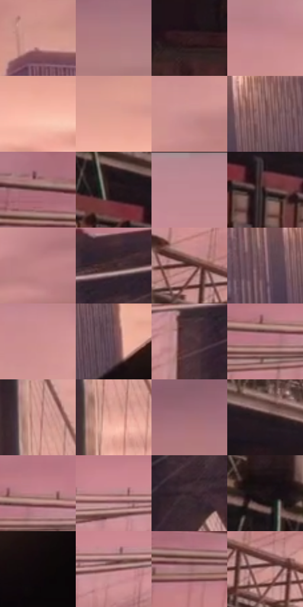

# 电影参考 524

- 状态：常规／活跃；来源世界：miles-home。
- 视角：near-level；景别：environment-wide；场景：city。
- 时段：twilight-appearance（外观依据，中置信度；具体时间／晨昏未知）；光照：dusk。
- 材质候选：brick, metal, glass, sky（帧级，不是像素分割）。
- 明暗组：middle；L* P5/P50/P95：7.39758 / 53.75818 / 75.40835。
- 资格门禁：无附加门禁。
- 原截图 SHA-256：`e0b0dd0377b6c0983d841251e947a138a5ac179ccfb4f944f7f68530a06b1fe1`；尺寸：2880 × 1206。
- sRGB 像素 SHA-256：`fdd81baaf9317a7f7d0d7f21e346fe73c38b672d69a1b9b41dfc2c080e288bbb`。

## 观察与迁移

桥梁同视点的暖粉至紫暮变化，云形改变不算曝光变化。

天空粉色更强、桥塔及前景趋冷暗，桥塔右缘和桥面局部窄亮线更突出；成因未测。

524／3  /  天空更粉，桥塔和前景偏冷暗；塔右缘及桥面局部窄亮线比前两张突出  /  亮线集中在少量真实结构，保持长度、位置和断续。不把全桥均匀勾亮，也不武断判断每条线是反光、灯带或套色

本公开版保存32个128×128原像素色卡上下文；图集格子并非原场景相邻位置。原rect、图集tile和像素SHA见 `data/palette-crops.json`。上下文不足时不得批准替色，不能以小样推断完整构图。

## 实测色卡

颜色比例分母为保留采样像素，不是材料面积；全部 32 色参与全库匹配。表内四舍五入仅用于阅读，原精度在 JSON。

| ID | HEX | Lab | 原图 xy | 像素数 | 比例 | 明度角色 |
| --- | --- | --- | --- | ---: | ---: | --- |
| 524-S01 | #D1958E | [67.281293, 21.640471, 12.701177] | [2252, 480] | 8324 | 4.305235% | light |
| 524-S02 | #AF7A82 | [56.729165, 21.830423, 3.980595] | [2580, 208] | 7567 | 3.913709% | midtone |
| 524-S03 | #321B1E | [12.958834, 11.861894, 2.786245] | [584, 1004] | 7226 | 3.737341% | deep-shadow |
| 524-S04 | #C68890 | [63.035782, 24.829174, 5.368158] | [1876, 136] | 7144 | 3.694930% | light |
| 524-S05 | #F7BDAA | [81.332776, 18.277591, 17.678342] | [1924, 612] | 6982 | 3.611143% | highlight |
| 524-S06 | #DE9F93 | [71.17004, 21.857011, 15.58548] | [1896, 536] | 6769 | 3.500978% | light |
| 524-S07 | #C88E8D | [64.604311, 21.878771, 9.338193] | [1872, 276] | 6700 | 3.465290% | light |
| 524-S08 | #815A5F | [42.470191, 16.817281, 3.563457] | [2532, 812] | 6465 | 3.343746% | midtone |
| 524-S09 | #92676D | [48.154829, 18.188413, 3.546455] | [40, 296] | 6442 | 3.331851% | midtone |
| 524-S10 | #221519 | [8.538887, 7.440404, -0.181237] | [272, 748] | 6433 | 3.327196% | deep-shadow |
| 524-S11 | #BD8791 | [61.820274, 22.132834, 2.916661] | [1584, 48] | 6323 | 3.270303% | light |
| 524-S12 | #472D30 | [21.689761, 12.477315, 2.985932] | [356, 816] | 6278 | 3.247029% | shadow |
| 524-S13 | #C18487 | [61.30003, 23.881354, 7.930874] | [2052, 280] | 6270 | 3.242891% | light |
| 524-S14 | #3C262A | [17.982812, 11.088709, 1.606615] | [1036, 280] | 6247 | 3.230995% | deep-shadow |
| 524-S15 | #633A38 | [29.323683, 17.878275, 8.978957] | [312, 548] | 6204 | 3.208755% | shadow |
| 524-S16 | #6D4E59 | [36.783905, 14.914347, -1.276412] | [2448, 844] | 6136 | 3.173585% | shadow |
| 524-S17 | #CC8E90 | [65.120481, 23.81351, 8.442517] | [1892, 188] | 6092 | 3.150828% | light |
| 524-S18 | #60434D | [31.891682, 14.238848, -1.010284] | [2664, 844] | 6057 | 3.132726% | shadow |
| 524-S19 | #4C3438 | [24.570812, 11.497505, 1.805442] | [948, 364] | 6045 | 3.126519% | shadow |
| 524-S20 | #B67780 | [56.781119, 25.905372, 5.321389] | [344, 332] | 6023 | 3.115141% | midtone |
| 524-S21 | #D49B94 | [69.169551, 20.318847, 12.068819] | [1472, 468] | 5946 | 3.075316% | light |
| 524-S22 | #E9AB9D | [75.380906, 20.880576, 16.166611] | [1492, 592] | 5864 | 3.032905% | light |
| 524-S23 | #A26D75 | [51.728971, 22.240157, 4.185286] | [2492, 156] | 5822 | 3.011182% | midtone |
| 524-S24 | #27191D | [10.670288, 7.784509, 0.008596] | [680, 824] | 5697 | 2.946531% | deep-shadow |
| 524-S25 | #BE7E86 | [59.518487, 25.909549, 5.909268] | [388, 296] | 5697 | 2.946531% | midtone |
| 524-S26 | #B68387 | [59.824191, 20.211872, 5.654404] | [624, 308] | 5567 | 2.879294% | midtone |
| 524-S27 | #342228 | [15.630564, 9.759957, -0.536659] | [1252, 376] | 5383 | 2.784128% | deep-shadow |
| 524-S28 | #1D1216 | [6.790849, 6.267419, -0.567384] | [168, 648] | 5379 | 2.782059% | deep-shadow |
| 524-S29 | #0F090B | [2.900533, 2.043498, -0.145355] | [2796, 916] | 4986 | 2.578797% | deep-shadow |
| 524-S30 | #7C4A4A | [37.258209, 21.253372, 9.071796] | [716, 336] | 4918 | 2.543626% | shadow |
| 524-S31 | #A5777A | [54.657345, 18.457189, 5.505346] | [132, 368] | 3479 | 1.799365% | midtone |
| 524-S32 | #C18F8D | [64.085801, 18.640045, 8.496464] | [380, 584] | 2881 | 1.490075% | light |

## 色阶与空间分布

- 采样 ROI：`[0.01, 0.02, 0.98, 0.94]`；步长：4；样本数：193346。
- 排除区：`[]`。
- 深暗、暗、中、亮、高光五段计数：`[41983, 34614, 43827, 67913, 5009]`。
- RGB 各 256 箱、L* 100 箱、13×5 色相明度表和 3×3 空间统计全部保存在 [总数据](../film-library.json)。
- [可视化档案](../../references/library.html)按需绘制直方图，不存 2,094 张重复图表图片。

## 纹理特征占比

**这是分块图像特征的面积占比，不是波点／排线／丝网／错版的精确语义覆盖率。** 窗格、发丝、织物也会产生方向或周期特征。
原图 ROI 像素 3098546；已测块覆盖 3098546（100.0000%）；未测 0。

| 特征 | 块覆盖像素 | 占已测面积 | 阈值敏感范围 |
| --- | ---: | ---: | --- |
| low-contrast | 246322 | 7.9496% | 3.7840% ~ 10.7669% |
| directional-structure | 944384 | 30.4783% | 19.2958% ~ 48.7429% |
| periodic-structure | 1869696 | 60.3411% | 47.4731% ~ 64.8314% |
| mixed-detail | 38144 | 1.2310% | 0.0000% ~ 5.1059% |

阈值敏感范围不是统计置信区间。逐块坐标、尺度、对比、方向一致性、频谱集中度、频率与角度见 [全量特征记录](../texture-features.jsonl)，以帧号定位。
四种印刷层的真实像素覆盖仍标为 `null`，不能填 0，也不能拿上表代替。不得据这些代理测量删除唯一证据。

[测量方法与保留策略](../../references/library-retention.md) · [分类索引](../archive/README.md)
