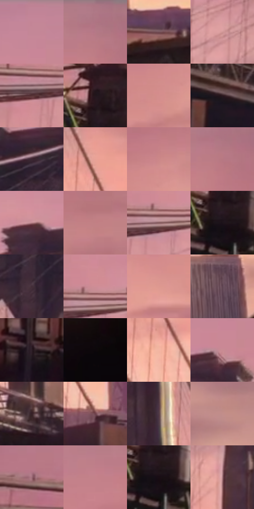

# 电影参考 525

- 状态：常规／活跃；来源世界：miles-home。
- 视角：near-level；景别：environment-wide；场景：city。
- 时段：twilight-appearance（外观依据，中置信度；具体时间／晨昏未知）；光照：dusk。
- 材质候选：brick, metal, glass, sky（帧级，不是像素分割）。
- 明暗组：middle；L* P5/P50/P95：5.71441 / 53.78255 / 72.26611。
- 资格门禁：无附加门禁。
- 原截图 SHA-256：`505d47cef06836f9b889970fe18cf62c05d84eb099d71f6e37fa676977b4be4c`；尺寸：2880 × 1210。
- sRGB 像素 SHA-256：`03a91d44f08a7ad2006e1edd95bac67a0139b56ed008ece5c3df90dced242202`。

## 观察与迁移

桥梁同视点的暖粉至紫暮变化，云形改变不算曝光变化。

粉紫上空与暖桃近地平线对照，近砖楼仍深暗，局部青绿／黄白细亮边；远楼保体量与竖纹节奏。

525／4  /  粉紫上空接暖桃低空，前景楼群保深暗；局部青绿／黄白亮边，远楼仍有较浅体量和竖纹节奏  /  同框容纳暖天、冷暗建筑、少量异色亮边；远楼细纹可概括，但桥梁这个主角不能按距离糊掉

本公开版保存32个128×128原像素色卡上下文；图集格子并非原场景相邻位置。原rect、图集tile和像素SHA见 `data/palette-crops.json`。上下文不足时不得批准替色，不能以小样推断完整构图。

## 实测色卡

颜色比例分母为保留采样像素，不是材料面积；全部 32 色参与全库匹配。表内四舍五入仅用于阅读，原精度在 JSON。

| ID | HEX | Lab | 原图 xy | 像素数 | 比例 | 明度角色 |
| --- | --- | --- | --- | ---: | ---: | --- |
| 525-S01 | #C38596 | [62.152457, 26.228707, 0.631791] | [1412, 48] | 8149 | 4.199563% | light |
| 525-S02 | #AE7784 | [55.947166, 23.434141, 1.672283] | [1980, 36] | 8095 | 4.171734% | midtone |
| 525-S03 | #734F58 | [37.738106, 16.581436, 0.831133] | [2080, 1008] | 7596 | 3.914576% | shadow |
| 525-S04 | #D19797 | [67.965466, 21.760168, 8.646788] | [824, 424] | 7509 | 3.869741% | light |
| 525-S05 | #553133 | [24.850514, 16.636677, 5.724982] | [476, 360] | 7263 | 3.742966% | shadow |
| 525-S06 | #22161D | [9.013514, 7.576406, -2.514835] | [164, 540] | 7100 | 3.658964% | deep-shadow |
| 525-S07 | #D48E8C | [65.934536, 26.334083, 11.973394] | [2004, 316] | 7065 | 3.640927% | light |
| 525-S08 | #2B181D | [10.961819, 10.434758, 0.505652] | [532, 776] | 6961 | 3.587331% | deep-shadow |
| 525-S09 | #3C2630 | [18.189758, 12.210844, -2.299019] | [1244, 260] | 6870 | 3.540434% | deep-shadow |
| 525-S10 | #E8A296 | [73.024581, 24.438078, 16.686244] | [1616, 636] | 6730 | 3.468286% | light |
| 525-S11 | #CC8789 | [63.32139, 26.704499, 9.841978] | [2052, 240] | 6596 | 3.399229% | light |
| 525-S12 | #B77881 | [57.160217, 25.870905, 5.301486] | [1996, 92] | 6426 | 3.311620% | midtone |
| 525-S13 | #B88189 | [59.615599, 22.387221, 4.235862] | [968, 216] | 6370 | 3.282761% | midtone |
| 525-S14 | #C38084 | [60.523663, 26.446023, 8.571849] | [2268, 232] | 6294 | 3.243594% | light |
| 525-S15 | #895F62 | [44.780877, 17.57509, 5.180055] | [576, 336] | 6285 | 3.238956% | midtone |
| 525-S16 | #1D1219 | [6.901543, 7.005861, -2.669831] | [176, 612] | 6142 | 3.165261% | deep-shadow |
| 525-S17 | #422D37 | [21.248776, 11.527132, -2.530976] | [1160, 404] | 5998 | 3.091052% | shadow |
| 525-S18 | #CF8D96 | [65.372904, 26.314864, 5.465989] | [588, 296] | 5795 | 2.986436% | light |
| 525-S19 | #DD9890 | [69.359172, 24.869428, 14.69712] | [1820, 500] | 5761 | 2.968914% | light |
| 525-S20 | #5F4351 | [31.90147, 14.565301, -3.583193] | [2628, 792] | 5554 | 2.862237% | shadow |
| 525-S21 | #2C1D25 | [12.909057, 8.961478, -2.510843] | [356, 912] | 5525 | 2.847292% | deep-shadow |
| 525-S22 | #0D070A | [2.343578, 2.053952, -0.558268] | [2760, 932] | 5492 | 2.830286% | deep-shadow |
| 525-S23 | #F4B6A3 | [79.234846, 19.96174, 18.463095] | [1624, 780] | 5426 | 2.796273% | light |
| 525-S24 | #C98B93 | [64.154058, 24.737123, 5.319741] | [1412, 156] | 5379 | 2.772052% | light |
| 525-S25 | #362127 | [15.584576, 11.184331, 0.144465] | [1176, 852] | 5334 | 2.748861% | deep-shadow |
| 525-S26 | #6E414A | [33.115473, 20.799135, 2.922273] | [1744, 912] | 5286 | 2.724124% | shadow |
| 525-S27 | #513843 | [26.686783, 13.086523, -2.356709] | [1436, 484] | 5129 | 2.643215% | shadow |
| 525-S28 | #C28E8A | [63.878359, 19.157, 9.909384] | [2628, 384] | 4645 | 2.393787% | light |
| 525-S29 | #9D6C77 | [50.950985, 21.165557, 1.802863] | [64, 272] | 4422 | 2.278865% | midtone |
| 525-S30 | #C4818A | [61.022258, 27.081963, 5.865644] | [1872, 120] | 4406 | 2.270619% | light |
| 525-S31 | #190D14 | [4.923474, 6.268363, -1.97406] | [188, 620] | 4343 | 2.238152% | deep-shadow |
| 525-S32 | #A6777E | [54.874354, 19.450514, 3.499443] | [920, 596] | 4098 | 2.111892% | midtone |

## 色阶与空间分布

- 采样 ROI：`[0.01, 0.02, 0.98, 0.94]`；步长：4；样本数：194044。
- 排除区：`[]`。
- 深暗、暗、中、亮、高光五段计数：`[48141, 34861, 38253, 70844, 1945]`。
- RGB 各 256 箱、L* 100 箱、13×5 色相明度表和 3×3 空间统计全部保存在 [总数据](../film-library.json)。
- [可视化档案](../../references/library.html)按需绘制直方图，不存 2,094 张重复图表图片。

## 纹理特征占比

**这是分块图像特征的面积占比，不是波点／排线／丝网／错版的精确语义覆盖率。** 窗格、发丝、织物也会产生方向或周期特征。
原图 ROI 像素 3109722；已测块覆盖 3109722（100.0000%）；未测 0。

| 特征 | 块覆盖像素 | 占已测面积 | 阈值敏感范围 |
| --- | ---: | ---: | --- |
| low-contrast | 397658 | 12.7876% | 8.0005% ~ 15.7882% |
| directional-structure | 874112 | 28.1090% | 20.8235% ~ 42.3590% |
| periodic-structure | 1803776 | 58.0044% | 48.3809% ~ 60.1818% |
| mixed-detail | 34176 | 1.0990% | 1.0990% ~ 3.2065% |

阈值敏感范围不是统计置信区间。逐块坐标、尺度、对比、方向一致性、频谱集中度、频率与角度见 [全量特征记录](../texture-features.jsonl)，以帧号定位。
四种印刷层的真实像素覆盖仍标为 `null`，不能填 0，也不能拿上表代替。不得据这些代理测量删除唯一证据。

[测量方法与保留策略](../../references/library-retention.md) · [分类索引](../archive/README.md)
