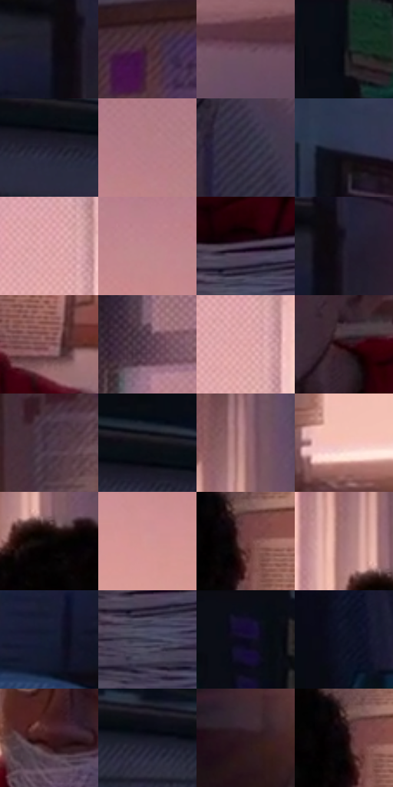

# 电影参考 526

- 状态：常规／活跃；来源世界：miles-home。
- 视角：near-level；景别：medium；场景：interior。
- 时段：daylight-time-unspecified（外观依据，中置信度；具体时间／晨昏未知）；光照：warm-day。
- 材质候选：skin, hair, fabric, paint, wood, paper, glass（帧级，不是像素分割）。
- 明暗组：dark；L* P5/P50/P95：2.69942 / 22.25519 / 74.80156。
- 资格门禁：无附加门禁。
- 原截图 SHA-256：`20e64bbbbcefec3335a7ecfde858f189333d2aa0f00b44370b00bb4579060f94`；尺寸：2880 × 1208。
- sRGB 像素 SHA-256：`f50e95318feb950c32b50b261c78b82c42d93ed113c0c68f3c9cb63f451e3634`。

## 观察与迁移

暖粉窗光与室内暗部，墙影方向、脸部体块与布纹分别表达。

暖窗宿舍：黄橙亮窗包围较暗紫色人物，红衣不是最亮面；窗框与家具大暗形分隔颜色，实体蛛丝区别细丝网。

本公开版保存32个128×128原像素色卡上下文；图集格子并非原场景相邻位置。原rect、图集tile和像素SHA见 `data/palette-crops.json`。上下文不足时不得批准替色，不能以小样推断完整构图。

## 实测色卡

颜色比例分母为保留采样像素，不是材料面积；全部 32 色参与全库匹配。表内四舍五入仅用于阅读，原精度在 JSON。

| ID | HEX | Lab | 原图 xy | 像素数 | 比例 | 明度角色 |
| --- | --- | --- | --- | ---: | ---: | --- |
| 526-S01 | #1D1A26 | [10.106595, 4.727464, -7.658501] | [836, 404] | 9994 | 5.168972% | deep-shadow |
| 526-S02 | #452931 | [20.334208, 14.380337, 0.302419] | [1964, 136] | 8112 | 4.195587% | shadow |
| 526-S03 | #6E4F60 | [37.393458, 15.984739, -4.7505] | [2620, 828] | 7790 | 4.029046% | shadow |
| 526-S04 | #0B0C12 | [3.412222, 0.802255, -3.057473] | [108, 68] | 7765 | 4.016116% | deep-shadow |
| 526-S05 | #242234 | [14.213735, 5.922739, -11.425128] | [152, 312] | 7456 | 3.856299% | deep-shadow |
| 526-S06 | #B27D85 | [57.872738, 21.740995, 3.938199] | [2792, 368] | 7281 | 3.765788% | midtone |
| 526-S07 | #2E2A3E | [18.296633, 7.030187, -12.037067] | [2228, 988] | 7056 | 3.649416% | deep-shadow |
| 526-S08 | #2F334A | [21.822047, 4.760581, -14.743676] | [876, 108] | 7000 | 3.620452% | shadow |
| 526-S09 | #E4ABAE | [75.250791, 21.298524, 6.636587] | [1400, 260] | 6960 | 3.599764% | light |
| 526-S10 | #BF878F | [61.988729, 22.591944, 4.327679] | [2628, 404] | 6753 | 3.492702% | light |
| 526-S11 | #4E3F54 | [28.940523, 10.961863, -10.163779] | [1764, 1016] | 6727 | 3.479255% | shadow |
| 526-S12 | #211D2A | [11.75122, 5.361642, -8.041529] | [880, 384] | 6579 | 3.402708% | deep-shadow |
| 526-S13 | #875659 | [42.04448, 20.746009, 6.730617] | [2048, 744] | 6534 | 3.379434% | midtone |
| 526-S14 | #5C4152 | [31.032687, 14.801994, -5.558821] | [2320, 128] | 6478 | 3.350470% | shadow |
| 526-S15 | #DBA0A1 | [71.403632, 22.033063, 8.145079] | [1412, 296] | 6382 | 3.300818% | light |
| 526-S16 | #270A11 | [6.223707, 15.441194, 2.033422] | [1780, 768] | 6334 | 3.275992% | deep-shadow |
| 526-S17 | #493446 | [24.685966, 12.982287, -7.443296] | [1852, 256] | 6291 | 3.253752% | shadow |
| 526-S18 | #111116 | [5.220921, 1.107258, -3.013795] | [160, 260] | 5927 | 3.065489% | deep-shadow |
| 526-S19 | #95676B | [48.451901, 19.082295, 5.214548] | [1616, 172] | 5826 | 3.013251% | midtone |
| 526-S20 | #F5C4BA | [83.146993, 15.984213, 11.659015] | [1132, 740] | 5820 | 3.010148% | highlight |
| 526-S21 | #050406 | [1.194576, 0.539517, -0.664577] | [1628, 364] | 5758 | 2.978081% | deep-shadow |
| 526-S22 | #D19595 | [67.443642, 22.574129, 9.020562] | [2544, 540] | 5451 | 2.819298% | light |
| 526-S23 | #704243 | [33.450711, 20.056038, 7.920437] | [1896, 492] | 5088 | 2.631552% | shadow |
| 526-S24 | #A27478 | [53.524211, 18.69139, 5.003223] | [1572, 296] | 5085 | 2.630000% | midtone |
| 526-S25 | #151D34 | [11.177147, 4.487309, -16.27077] | [700, 492] | 5039 | 2.606209% | deep-shadow |
| 526-S26 | #37384F | [24.337761, 5.669309, -14.131179] | [1756, 1084] | 4545 | 2.350708% | shadow |
| 526-S27 | #0C0D19 | [3.939955, 2.309305, -7.206436] | [252, 28] | 4495 | 2.324848% | deep-shadow |
| 526-S28 | #0F1223 | [5.920875, 3.832305, -11.980222] | [644, 732] | 4391 | 2.271058% | deep-shadow |
| 526-S29 | #3C161A | [13.286786, 19.156534, 6.429087] | [1596, 728] | 3944 | 2.039866% | deep-shadow |
| 526-S30 | #161724 | [8.224292, 3.500118, -9.126357] | [520, 328] | 3723 | 1.925563% | deep-shadow |
| 526-S31 | #2D1920 | [11.672085, 11.240312, -0.64718] | [988, 796] | 3389 | 1.752816% | deep-shadow |
| 526-S32 | #130509 | [2.40947, 4.85899, 0.002586] | [1876, 480] | 3373 | 1.744541% | deep-shadow |

## 色阶与空间分布

- 采样 ROI：`[0.01, 0.02, 0.98, 0.94]`；步长：4；样本数：193346。
- 排除区：`[]`。
- 深暗、暗、中、亮、高光五段计数：`[89181, 47713, 25249, 26217, 4986]`。
- RGB 各 256 箱、L* 100 箱、13×5 色相明度表和 3×3 空间统计全部保存在 [总数据](../film-library.json)。
- [可视化档案](../../references/library.html)按需绘制直方图，不存 2,094 张重复图表图片。

## 纹理特征占比

**这是分块图像特征的面积占比，不是波点／排线／丝网／错版的精确语义覆盖率。** 窗格、发丝、织物也会产生方向或周期特征。
原图 ROI 像素 3104134；已测块覆盖 3104134（100.0000%）；未测 0。

| 特征 | 块覆盖像素 | 占已测面积 | 阈值敏感范围 |
| --- | ---: | ---: | --- |
| low-contrast | 326662 | 10.5234% | 6.5607% ~ 15.9913% |
| directional-structure | 768128 | 24.7453% | 16.8982% ~ 38.6581% |
| periodic-structure | 1864704 | 60.0716% | 52.1421% ~ 60.0716% |
| mixed-detail | 144640 | 4.6596% | 2.6391% ~ 8.4532% |

阈值敏感范围不是统计置信区间。逐块坐标、尺度、对比、方向一致性、频谱集中度、频率与角度见 [全量特征记录](../texture-features.jsonl)，以帧号定位。
四种印刷层的真实像素覆盖仍标为 `null`，不能填 0，也不能拿上表代替。不得据这些代理测量删除唯一证据。

[测量方法与保留策略](../../references/library-retention.md) · [分类索引](../archive/README.md)
