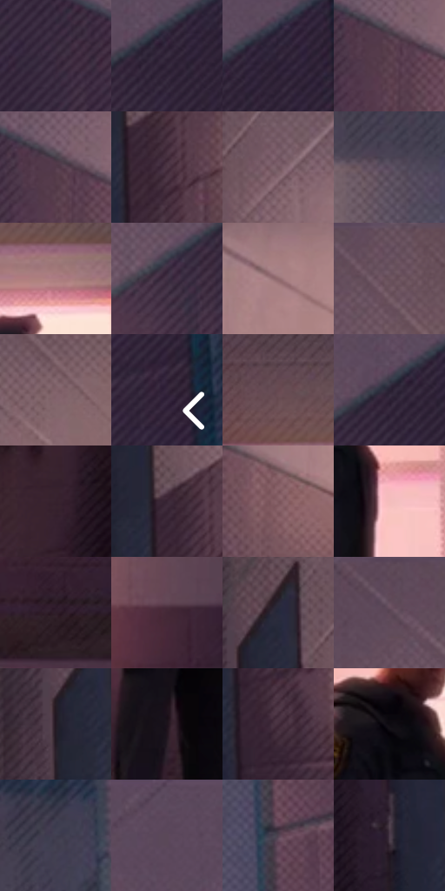

# 电影参考 527

- 状态：常规／活跃；来源世界：miles-home。
- 视角：near-level；景别：environment-wide；场景：interior。
- 时段：daylight-time-unspecified（外观依据，中置信度；具体时间／晨昏未知）；光照：warm-day。
- 材质候选：skin, hair, fabric, paint, wood, paper, glass（帧级，不是像素分割）。
- 明暗组：dark；L* P5/P50/P95：9.64302 / 25.89031 / 55.92882。
- 资格门禁：无附加门禁。
- 原截图 SHA-256：`0b0aa0933cdd2963bb37df3bb429409128fb6493deac65b02ed5369d6e19e85d`；尺寸：2880 × 1206。
- sRGB 像素 SHA-256：`9e7a25814d6b5edf7ab614c9bc19b7dc59303b29faab307804eba417482dc931`。

## 观察与迁移

暖粉窗光与室内暗部，墙影方向、脸部体块与布纹分别表达。

走廊：灰粉上墙、灰紫下墙、蓝门与暖窗分区；深黑制服压住亮地面，墙面细排线不抹掉墙裙和透视轴。

本公开版保存32个128×128原像素色卡上下文；图集格子并非原场景相邻位置。原rect、图集tile和像素SHA见 `data/palette-crops.json`。上下文不足时不得批准替色，不能以小样推断完整构图。

## 实测色卡

颜色比例分母为保留采样像素，不是材料面积；全部 32 色参与全库匹配。表内四舍五入仅用于阅读，原精度在 JSON。

| ID | HEX | Lab | 原图 xy | 像素数 | 比例 | 明度角色 |
| --- | --- | --- | --- | ---: | ---: | --- |
| 527-S01 | #36273B | [18.148236, 11.454934, -10.112604] | [216, 384] | 8822 | 4.562805% | deep-shadow |
| 527-S02 | #392C40 | [20.209012, 10.48202, -10.369786] | [2696, 180] | 8614 | 4.455225% | shadow |
| 527-S03 | #302338 | [16.084521, 11.065101, -11.252305] | [2756, 144] | 8298 | 4.291788% | deep-shadow |
| 527-S04 | #5B404D | [30.465322, 14.055517, -3.181759] | [388, 416] | 8273 | 4.278858% | shadow |
| 527-S05 | #523A4A | [27.612834, 13.596666, -5.585838] | [380, 396] | 8127 | 4.203345% | shadow |
| 527-S06 | #4D3544 | [25.386553, 13.551151, -5.006906] | [2056, 628] | 8000 | 4.137660% | shadow |
| 527-S07 | #71555F | [39.300124, 13.330651, -1.273882] | [2088, 304] | 7952 | 4.112834% | shadow |
| 527-S08 | #5C4D60 | [34.858191, 10.175895, -8.749356] | [2264, 324] | 7546 | 3.902848% | shadow |
| 527-S09 | #AC7D81 | [57.099084, 18.831352, 5.049019] | [1524, 280] | 7496 | 3.876987% | midtone |
| 527-S10 | #423144 | [22.903978, 11.682295, -8.880115] | [2536, 272] | 7268 | 3.759064% | shadow |
| 527-S11 | #906A6F | [48.742721, 15.957624, 3.171944] | [624, 380] | 7201 | 3.724411% | midtone |
| 527-S12 | #68515F | [37.214949, 12.176578, -4.46424] | [692, 40] | 6635 | 3.431672% | shadow |
| 527-S13 | #806169 | [44.460269, 13.889891, 0.342574] | [760, 188] | 6513 | 3.368572% | midtone |
| 527-S14 | #2F2033 | [14.824871, 11.466148, -9.665462] | [2820, 576] | 6454 | 3.338057% | deep-shadow |
| 527-S15 | #674851 | [34.216758, 14.740124, -0.064908] | [1424, 180] | 6367 | 3.293060% | shadow |
| 527-S16 | #282032 | [13.910982, 8.351901, -10.431247] | [2664, 176] | 5512 | 2.850848% | deep-shadow |
| 527-S17 | #36212E | [15.847087, 12.572144, -4.464681] | [944, 960] | 5489 | 2.838952% | deep-shadow |
| 527-S18 | #382534 | [17.515505, 11.994487, -6.167683] | [2024, 584] | 5410 | 2.798093% | deep-shadow |
| 527-S19 | #7E585E | [41.569881, 16.629196, 2.832236] | [528, 488] | 5307 | 2.744820% | midtone |
| 527-S20 | #F3BDBC | [81.337465, 19.226806, 7.980372] | [1532, 588] | 5164 | 2.670859% | highlight |
| 527-S21 | #2E1D29 | [13.349907, 10.749885, -4.733593] | [1568, 1060] | 5144 | 2.660515% | deep-shadow |
| 527-S22 | #432836 | [19.953225, 15.084234, -3.751133] | [1752, 676] | 4828 | 2.497078% | deep-shadow |
| 527-S23 | #262A3C | [17.432968, 3.443345, -12.049728] | [1976, 256] | 4816 | 2.490871% | deep-shadow |
| 527-S24 | #5F4858 | [33.504434, 12.796368, -5.677945] | [524, 36] | 4815 | 2.490354% | shadow |
| 527-S25 | #241924 | [10.540658, 7.977423, -5.436615] | [1932, 324] | 4712 | 2.437082% | deep-shadow |
| 527-S26 | #1D131B | [7.281568, 6.87275, -3.648943] | [1404, 1004] | 4691 | 2.426220% | deep-shadow |
| 527-S27 | #442E3C | [21.978088, 12.739061, -4.832845] | [2060, 808] | 4644 | 2.401912% | shadow |
| 527-S28 | #0F0B12 | [3.47385, 2.470069, -2.93452] | [1424, 476] | 4520 | 2.337778% | deep-shadow |
| 527-S29 | #3F3E4F | [26.923224, 4.596133, -10.108597] | [2308, 168] | 4401 | 2.276230% | shadow |
| 527-S30 | #5A4858 | [32.947633, 10.801716, -6.568216] | [2608, 64] | 4370 | 2.260197% | shadow |
| 527-S31 | #514251 | [30.009948, 9.517927, -6.573765] | [2400, 660] | 3440 | 1.779194% | shadow |
| 527-S32 | #4D3C4C | [27.658857, 10.687457, -6.890462] | [1940, 740] | 2517 | 1.301811% | shadow |

## 色阶与空间分布

- 采样 ROI：`[0.01, 0.02, 0.98, 0.94]`；步长：4；样本数：193346。
- 排除区：`[]`。
- 深暗、暗、中、亮、高光五段计数：`[69573, 90998, 26431, 2982, 3362]`。
- RGB 各 256 箱、L* 100 箱、13×5 色相明度表和 3×3 空间统计全部保存在 [总数据](../film-library.json)。
- [可视化档案](../../references/library.html)按需绘制直方图，不存 2,094 张重复图表图片。

## 纹理特征占比

**这是分块图像特征的面积占比，不是波点／排线／丝网／错版的精确语义覆盖率。** 窗格、发丝、织物也会产生方向或周期特征。
原图 ROI 像素 3098546；已测块覆盖 3098546（100.0000%）；未测 0。

| 特征 | 块覆盖像素 | 占已测面积 | 阈值敏感范围 |
| --- | ---: | ---: | --- |
| low-contrast | 59904 | 1.9333% | 0.0000% ~ 6.4501% |
| directional-structure | 791808 | 25.5542% | 11.6328% ~ 44.2179% |
| periodic-structure | 2001074 | 64.5811% | 52.0807% ~ 72.3994% |
| mixed-detail | 245760 | 7.9315% | 3.7013% ~ 9.5178% |

阈值敏感范围不是统计置信区间。逐块坐标、尺度、对比、方向一致性、频谱集中度、频率与角度见 [全量特征记录](../texture-features.jsonl)，以帧号定位。
四种印刷层的真实像素覆盖仍标为 `null`，不能填 0，也不能拿上表代替。不得据这些代理测量删除唯一证据。

[测量方法与保留策略](../../references/library-retention.md) · [分类索引](../archive/README.md)
