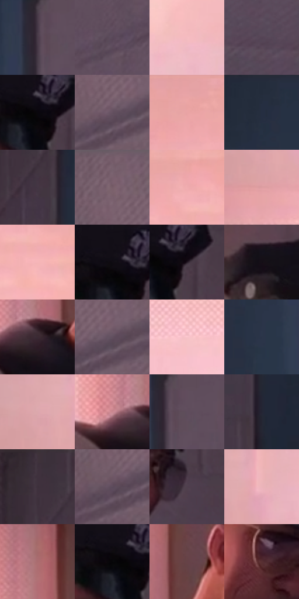

# 电影参考 528

- 状态：常规／活跃；来源世界：miles-home。
- 视角：near-level；景别：medium；场景：interior。
- 时段：daylight-time-unspecified（外观依据，中置信度；具体时间／晨昏未知）；光照：warm-day。
- 材质候选：skin, hair, fabric, paint, wood, paper, glass（帧级，不是像素分割）。
- 明暗组：dark；L* P5/P50/P95：2.35996 / 32.87554 / 81.44512。
- 资格门禁：无附加门禁。
- 原截图 SHA-256：`3551517eed875f1aaabf8cdca8f57eb5c01ee91a4a2d5c9e06409919f4f9ab0d`；尺寸：2880 × 1198。
- sRGB 像素 SHA-256：`2b3ce5ff30a8227b7275420fa0532085aecd70e16f271ea8e61e7047b18915ed`。

## 观察与迁移

暖粉窗光与室内暗部，墙影方向、脸部体块与布纹分别表达。

窗边侧脸：暖亮左面与紫色右暗面塑形，黑制服低细节；金徽章和眼镜窄亮点是小面积对比，墙纹较均匀但低对比。

本公开版保存32个128×128原像素色卡上下文；图集格子并非原场景相邻位置。原rect、图集tile和像素SHA见 `data/palette-crops.json`。上下文不足时不得批准替色，不能以小样推断完整构图。

## 实测色卡

颜色比例分母为保留采样像素，不是材料面积；全部 32 色参与全库匹配。表内四舍五入仅用于阅读，原精度在 JSON。

| ID | HEX | Lab | 原图 xy | 像素数 | 比例 | 明度角色 |
| --- | --- | --- | --- | ---: | ---: | --- |
| 528-S01 | #493B48 | [26.769988, 8.819421, -5.639186] | [2140, 156] | 11903 | 6.178626% | shadow |
| 528-S02 | #594859 | [32.875541, 10.621767, -7.324827] | [2444, 308] | 9561 | 4.962938% | shadow |
| 528-S03 | #F5BCC1 | [81.418947, 21.204039, 5.435446] | [756, 464] | 9153 | 4.751152% | highlight |
| 528-S04 | #534454 | [30.910196, 9.6968, -7.137565] | [2500, 816] | 8647 | 4.488497% | shadow |
| 528-S05 | #09070D | [2.159694, 1.393268, -2.18436] | [1408, 284] | 8422 | 4.371704% | deep-shadow |
| 528-S06 | #655161 | [36.95724, 11.393774, -6.133365] | [2732, 172] | 7375 | 3.828226% | shadow |
| 528-S07 | #EBA5A6 | [74.399608, 25.98974, 9.897846] | [608, 40] | 7354 | 3.817325% | light |
| 528-S08 | #242D3E | [18.362803, 1.274945, -12.010354] | [1984, 44] | 7326 | 3.802791% | deep-shadow |
| 528-S09 | #433643 | [24.439809, 8.518336, -5.880084] | [1852, 132] | 7147 | 3.709875% | shadow |
| 528-S10 | #745966 | [40.924581, 13.387227, -3.16797] | [2700, 60] | 6919 | 3.591524% | midtone |
| 528-S11 | #F0ADB0 | [77.011077, 24.925678, 8.233625] | [736, 84] | 6902 | 3.582700% | light |
| 528-S12 | #DD9EA1 | [71.147023, 23.858805, 7.80669] | [224, 568] | 6866 | 3.564013% | light |
| 528-S13 | #F6B5B8 | [79.673244, 23.985222, 7.790072] | [792, 160] | 6798 | 3.528716% | light |
| 528-S14 | #0F0C12 | [3.687011, 2.03461, -2.623256] | [1384, 260] | 6304 | 3.272289% | deep-shadow |
| 528-S15 | #251924 | [10.674801, 8.426781, -5.220836] | [1448, 288] | 5989 | 3.108779% | deep-shadow |
| 528-S16 | #150F16 | [5.049527, 3.831976, -3.220431] | [1228, 216] | 5808 | 3.014825% | deep-shadow |
| 528-S17 | #3A2A33 | [19.201735, 9.219125, -2.919965] | [1048, 484] | 5709 | 2.963436% | deep-shadow |
| 528-S18 | #614F5F | [35.906696, 10.650113, -6.493536] | [2772, 160] | 5619 | 2.916719% | shadow |
| 528-S19 | #F9C5CA | [84.14205, 19.225998, 4.595076] | [504, 692] | 5470 | 2.839375% | highlight |
| 528-S20 | #2B3548 | [22.043507, 1.387551, -13.086163] | [2044, 276] | 5174 | 2.685727% | shadow |
| 528-S21 | #DCA8AD | [73.701162, 19.817932, 4.848403] | [212, 484] | 5032 | 2.612018% | light |
| 528-S22 | #CB8992 | [63.889144, 26.441714, 5.534557] | [992, 464] | 4930 | 2.559071% | light |
| 528-S23 | #5F4D5D | [35.065433, 10.692209, -6.514413] | [2176, 152] | 4826 | 2.505087% | shadow |
| 528-S24 | #222533 | [14.96524, 2.668749, -9.574039] | [1900, 792] | 4664 | 2.420996% | deep-shadow |
| 528-S25 | #3E313C | [22.113754, 8.178283, -4.706823] | [1804, 28] | 4549 | 2.361301% | shadow |
| 528-S26 | #5C4B5C | [34.149601, 10.555962, -7.286793] | [2700, 192] | 4520 | 2.346248% | shadow |
| 528-S27 | #503F4D | [28.893005, 10.176461, -5.659734] | [1440, 440] | 4109 | 2.132906% | shadow |
| 528-S28 | #ECB4BA | [78.475237, 21.162752, 4.852641] | [292, 468] | 3890 | 2.019227% | light |
| 528-S29 | #AB6C70 | [52.458648, 25.63036, 8.32473] | [1052, 116] | 3849 | 1.997944% | midtone |
| 528-S30 | #060508 | [1.488537, 0.678544, -1.042967] | [1376, 284] | 3030 | 1.572817% | deep-shadow |
| 528-S31 | #664247 | [32.20577, 16.382008, 3.400959] | [1120, 364] | 2998 | 1.556206% | shadow |
| 528-S32 | #572F31 | [24.581008, 18.49522, 6.731637] | [1308, 408] | 1805 | 0.936942% | shadow |

## 色阶与空间分布

- 采样 ROI：`[0.01, 0.02, 0.98, 0.94]`；步长：4；样本数：192648。
- 排除区：`[]`。
- 深暗、暗、中、亮、高光五段计数：`[47128, 80651, 9291, 39302, 16276]`。
- RGB 各 256 箱、L* 100 箱、13×5 色相明度表和 3×3 空间统计全部保存在 [总数据](../film-library.json)。
- [可视化档案](../../references/library.html)按需绘制直方图，不存 2,094 张重复图表图片。

## 纹理特征占比

**这是分块图像特征的面积占比，不是波点／排线／丝网／错版的精确语义覆盖率。** 窗格、发丝、织物也会产生方向或周期特征。
原图 ROI 像素 3081782；已测块覆盖 3081782（100.0000%）；未测 0。

| 特征 | 块覆盖像素 | 占已测面积 | 阈值敏感范围 |
| --- | ---: | ---: | --- |
| low-contrast | 1016118 | 32.9718% | 24.6690% ~ 46.0011% |
| directional-structure | 554624 | 17.9969% | 10.5539% ~ 24.0817% |
| periodic-structure | 1402624 | 45.5134% | 39.1919% ~ 49.6544% |
| mixed-detail | 108416 | 3.5180% | 1.5949% ~ 4.2531% |

阈值敏感范围不是统计置信区间。逐块坐标、尺度、对比、方向一致性、频谱集中度、频率与角度见 [全量特征记录](../texture-features.jsonl)，以帧号定位。
四种印刷层的真实像素覆盖仍标为 `null`，不能填 0，也不能拿上表代替。不得据这些代理测量删除唯一证据。

[测量方法与保留策略](../../references/library-retention.md) · [分类索引](../archive/README.md)
