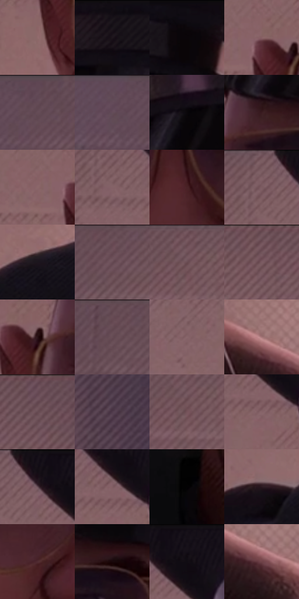

# 电影参考 529

- 状态：常规／活跃；来源世界：miles-home。
- 视角：near-level；景别：close-up；场景：interior。
- 时段：daylight-time-unspecified（外观依据，中置信度；具体时间／晨昏未知）；光照：warm-day。
- 材质候选：skin, hair, fabric, paint, wood, paper, glass（帧级，不是像素分割）。
- 明暗组：dark；L* P5/P50/P95：2.22709 / 35.26951 / 48.64019。
- 资格门禁：无附加门禁。
- 原截图 SHA-256：`aa8c608e1568d200c17678d891b6354a09f0ecf99cacede3e0bc3a06675d9ccf`；尺寸：2880 × 1208。
- sRGB 像素 SHA-256：`1d6e23ce1face4b390da58151b2e14a083783c9794e3b39d0e0be2d387f4d342`。

## 观察与迁移

暖粉窗光与室内暗部，墙影方向、脸部体块与布纹分别表达。

正面警官：暖肤中间调、紫眼窝与黑衣帽分层，浅粉墙退后；帽檐连续亮带区别皮肤排线及细金属眼镜。

本公开版保存32个128×128原像素色卡上下文；图集格子并非原场景相邻位置。原rect、图集tile和像素SHA见 `data/palette-crops.json`。上下文不足时不得批准替色，不能以小样推断完整构图。

## 实测色卡

颜色比例分母为保留采样像素，不是材料面积；全部 32 色参与全库匹配。表内四舍五入仅用于阅读，原精度在 JSON。

| ID | HEX | Lab | 原图 xy | 像素数 | 比例 | 明度角色 |
| --- | --- | --- | --- | ---: | ---: | --- |
| 529-S01 | #906A6C | [48.661988, 15.485382, 4.843731] | [1028, 424] | 9912 | 5.126561% | midtone |
| 529-S02 | #160F17 | [5.185745, 4.533189, -3.740713] | [1408, 56] | 8011 | 4.143349% | deep-shadow |
| 529-S03 | #0F0C12 | [3.687011, 2.03461, -2.623256] | [1620, 36] | 7929 | 4.100938% | deep-shadow |
| 529-S04 | #896265 | [45.626252, 16.266137, 4.578181] | [1044, 296] | 7922 | 4.097318% | midtone |
| 529-S05 | #604754 | [33.208007, 13.034943, -3.556526] | [356, 28] | 7808 | 4.038356% | shadow |
| 529-S06 | #634B59 | [34.815253, 12.721259, -4.313035] | [260, 44] | 7514 | 3.886297% | shadow |
| 529-S07 | #0A070B | [2.173793, 1.344097, -1.246696] | [1256, 128] | 7183 | 3.715101% | deep-shadow |
| 529-S08 | #391B20 | [14.163486, 15.441609, 3.200711] | [1192, 272] | 7141 | 3.693379% | deep-shadow |
| 529-S09 | #8C6769 | [47.361429, 15.162502, 4.709742] | [984, 308] | 7077 | 3.660277% | midtone |
| 529-S10 | #846267 | [45.110527, 14.563489, 2.553222] | [920, 120] | 6937 | 3.587868% | midtone |
| 529-S11 | #492125 | [18.532031, 19.468148, 6.176372] | [1432, 456] | 6828 | 3.531493% | deep-shadow |
| 529-S12 | #806066 | [44.110638, 13.974112, 1.654049] | [912, 48] | 6741 | 3.486496% | midtone |
| 529-S13 | #1C151D | [7.876073, 5.494858, -4.302176] | [848, 756] | 6640 | 3.434258% | deep-shadow |
| 529-S14 | #6C5059 | [37.201592, 13.277325, -0.677901] | [584, 28] | 6447 | 3.334437% | shadow |
| 529-S15 | #765860 | [40.696568, 13.709066, 0.21819] | [776, 56] | 6347 | 3.282716% | midtone |
| 529-S16 | #7B5B62 | [42.116656, 14.270107, 1.126908] | [2204, 64] | 6316 | 3.266683% | midtone |
| 529-S17 | #281215 | [8.463677, 11.839045, 2.782193] | [1096, 320] | 6027 | 3.117210% | deep-shadow |
| 529-S18 | #684C55 | [35.534168, 13.383854, -0.658942] | [472, 28] | 5938 | 3.071178% | shadow |
| 529-S19 | #88666A | [46.682351, 14.299054, 3.074198] | [812, 276] | 5816 | 3.008079% | midtone |
| 529-S20 | #A57677 | [54.332814, 18.584755, 6.790991] | [2492, 1016] | 5623 | 2.908258% | midtone |
| 529-S21 | #70545E | [38.88806, 13.355585, -1.271015] | [2356, 40] | 5320 | 2.751544% | shadow |
| 529-S22 | #4F3B4B | [27.568409, 11.932869, -6.346562] | [2688, 88] | 5257 | 2.718960% | shadow |
| 529-S23 | #76545A | [39.464012, 15.112047, 2.135632] | [776, 88] | 5189 | 2.683790% | shadow |
| 529-S24 | #866468 | [45.883702, 14.349079, 3.095618] | [1024, 160] | 5143 | 2.659998% | midtone |
| 529-S25 | #140D14 | [4.399835, 3.919983, -2.801504] | [980, 40] | 5136 | 2.656378% | deep-shadow |
| 529-S26 | #815E63 | [43.615856, 15.07382, 2.775262] | [1024, 120] | 4989 | 2.580348% | midtone |
| 529-S27 | #030203 | [0.626443, 0.400508, -0.286219] | [1116, 820] | 4742 | 2.452598% | deep-shadow |
| 529-S28 | #2B1920 | [11.367663, 10.302308, -1.129818] | [696, 788] | 4485 | 2.319676% | deep-shadow |
| 529-S29 | #512C32 | [22.935073, 17.884185, 3.597657] | [1288, 512] | 4469 | 2.311400% | shadow |
| 529-S30 | #18070A | [3.325103, 6.455831, 0.992722] | [1312, 292] | 4022 | 2.080209% | deep-shadow |
| 529-S31 | #100A10 | [3.293951, 2.832076, -2.023999] | [1044, 52] | 2700 | 1.396460% | deep-shadow |
| 529-S32 | #6F4247 | [33.417506, 20.179781, 5.296187] | [2532, 1060] | 1737 | 0.898389% | shadow |

## 色阶与空间分布

- 采样 ROI：`[0.01, 0.02, 0.98, 0.94]`；步长：4；样本数：193346。
- 排除区：`[]`。
- 深暗、暗、中、亮、高光五段计数：`[69988, 49212, 73529, 608, 9]`。
- RGB 各 256 箱、L* 100 箱、13×5 色相明度表和 3×3 空间统计全部保存在 [总数据](../film-library.json)。
- [可视化档案](../../references/library.html)按需绘制直方图，不存 2,094 张重复图表图片。

## 纹理特征占比

**这是分块图像特征的面积占比，不是波点／排线／丝网／错版的精确语义覆盖率。** 窗格、发丝、织物也会产生方向或周期特征。
原图 ROI 像素 3104134；已测块覆盖 3104134（100.0000%）；未测 0。

| 特征 | 块覆盖像素 | 占已测面积 | 阈值敏感范围 |
| --- | ---: | ---: | --- |
| low-contrast | 600064 | 19.3311% | 8.3172% ~ 24.0814% |
| directional-structure | 1116800 | 35.9778% | 23.6608% ~ 51.1029% |
| periodic-structure | 1338118 | 43.1076% | 38.6377% ~ 46.7899% |
| mixed-detail | 49152 | 1.5834% | 1.5834% ~ 5.4678% |

阈值敏感范围不是统计置信区间。逐块坐标、尺度、对比、方向一致性、频谱集中度、频率与角度见 [全量特征记录](../texture-features.jsonl)，以帧号定位。
四种印刷层的真实像素覆盖仍标为 `null`，不能填 0，也不能拿上表代替。不得据这些代理测量删除唯一证据。

[测量方法与保留策略](../../references/library-retention.md) · [分类索引](../archive/README.md)
