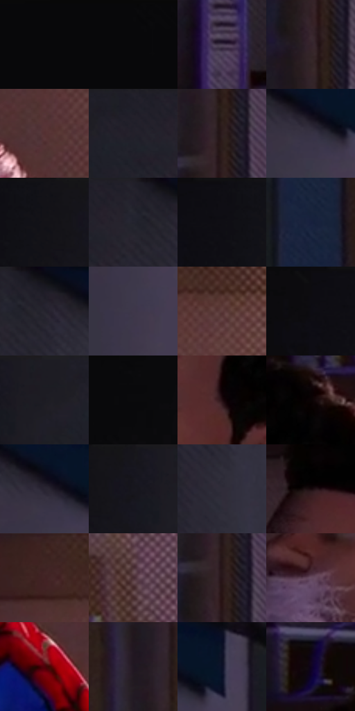

# 电影参考 530

- 状态：常规／活跃；来源世界：miles-home。
- 视角：near-level；景别：medium；场景：interior。
- 时段：daylight-time-unspecified（外观依据，中置信度；具体时间／晨昏未知）；光照：warm-day。
- 材质候选：skin, hair, fabric, paint, wood, paper, glass（帧级，不是像素分割）。
- 明暗组：very-dark；L* P5/P50/P95：2.23296 / 11.77698 / 28.10665。
- 资格门禁：无附加门禁。
- 原截图 SHA-256：`b3faf814be8d6227802d81788be6a4c84916f7957266a1796b0b4c08dbd1180a`；尺寸：2880 × 1208。
- sRGB 像素 SHA-256：`ca566498729e67eb0bf118d08605786622894425acc12324e9d70a5e06ca363a`。

## 观察与迁移

暖粉窗光与室内暗部，墙影方向、脸部体块与布纹分别表达。

人物在右：左门大暗留净，右侧暖面与红衣吸引视线；墙蓝紫，皮肤转折有纹，白蛛丝是实体而非装饰排线。

本公开版保存32个128×128原像素色卡上下文；图集格子并非原场景相邻位置。原rect、图集tile和像素SHA见 `data/palette-crops.json`。上下文不足时不得批准替色，不能以小样推断完整构图。

## 实测色卡

颜色比例分母为保留采样像素，不是材料面积；全部 32 色参与全库匹配。表内四舍五入仅用于阅读，原精度在 JSON。

| ID | HEX | Lab | 原图 xy | 像素数 | 比例 | 明度角色 |
| --- | --- | --- | --- | ---: | ---: | --- |
| 530-S01 | #08080A | [2.232962, 0.277948, -0.756583] | [32, 28] | 9076 | 4.694175% | deep-shadow |
| 530-S02 | #09090B | [2.50764, 0.281476, -0.766199] | [144, 28] | 8894 | 4.600043% | deep-shadow |
| 530-S03 | #473C4F | [27.11834, 8.997674, -9.738025] | [1896, 132] | 8664 | 4.481086% | shadow |
| 530-S04 | #34222A | [15.702996, 10.161042, -1.857735] | [1624, 284] | 8480 | 4.385920% | deep-shadow |
| 530-S05 | #543032 | [24.415852, 16.683069, 5.762292] | [2776, 992] | 8178 | 4.229723% | shadow |
| 530-S06 | #201E28 | [11.882955, 3.617142, -6.390736] | [860, 36] | 7979 | 4.126799% | deep-shadow |
| 530-S07 | #2D1D1F | [12.832876, 8.222745, 1.77581] | [1640, 156] | 7829 | 4.049217% | deep-shadow |
| 530-S08 | #363143 | [21.528245, 6.659138, -10.422219] | [1196, 148] | 7644 | 3.953534% | shadow |
| 530-S09 | #131217 | [5.717088, 1.552838, -2.999655] | [604, 28] | 7602 | 3.931811% | deep-shadow |
| 530-S10 | #24212C | [13.499378, 4.267862, -6.795965] | [956, 32] | 7437 | 3.846472% | deep-shadow |
| 530-S11 | #0F0E14 | [4.210565, 1.524742, -3.129005] | [532, 28] | 7087 | 3.665450% | deep-shadow |
| 530-S12 | #17203E | [13.002081, 6.743196, -20.481784] | [1436, 948] | 6939 | 3.588903% | deep-shadow |
| 530-S13 | #191821 | [8.736706, 3.009354, -6.058815] | [1008, 28] | 6909 | 3.573387% | deep-shadow |
| 530-S14 | #3F374A | [24.587492, 7.946819, -10.364275] | [1184, 364] | 6838 | 3.536665% | shadow |
| 530-S15 | #5D3A3B | [28.562864, 15.657712, 5.830225] | [2768, 404] | 6748 | 3.490116% | shadow |
| 530-S16 | #0D0C10 | [3.485963, 0.98922, -1.770275] | [468, 40] | 6724 | 3.477703% | deep-shadow |
| 530-S17 | #1C1C23 | [10.547904, 1.912299, -4.776636] | [760, 36] | 6261 | 3.238236% | deep-shadow |
| 530-S18 | #0A0A0C | [2.783537, 0.293573, -0.799136] | [344, 28] | 5903 | 3.053076% | deep-shadow |
| 530-S19 | #220D11 | [6.038326, 10.976068, 1.663811] | [2216, 564] | 5697 | 2.946531% | deep-shadow |
| 530-S20 | #090303 | [1.172373, 1.568944, 0.55293] | [2260, 324] | 5297 | 2.739648% | deep-shadow |
| 530-S21 | #292431 | [15.248828, 5.598695, -7.659842] | [1180, 128] | 5260 | 2.720511% | deep-shadow |
| 530-S22 | #17161D | [7.629893, 2.415653, -4.730914] | [680, 28] | 5111 | 2.643447% | deep-shadow |
| 530-S23 | #302C39 | [18.907643, 5.015726, -7.632196] | [1008, 368] | 4871 | 2.519318% | deep-shadow |
| 530-S24 | #18090D | [3.781761, 6.10797, 0.33176] | [2096, 428] | 4752 | 2.457770% | deep-shadow |
| 530-S25 | #422424 | [18.132701, 14.263238, 6.150012] | [2596, 348] | 4748 | 2.455701% | deep-shadow |
| 530-S26 | #482D32 | [21.890213, 13.261857, 1.92524] | [2816, 192] | 4472 | 2.312952% | shadow |
| 530-S27 | #271619 | [9.604583, 9.182072, 1.459749] | [1636, 212] | 4382 | 2.266403% | deep-shadow |
| 530-S28 | #684D62 | [36.239038, 15.254213, -7.800412] | [2052, 648] | 4283 | 2.215200% | shadow |
| 530-S29 | #4E0109 | [13.600955, 33.901446, 17.578476] | [2612, 948] | 4068 | 2.104000% | deep-shadow |
| 530-S30 | #21171E | [9.238052, 6.594108, -2.949424] | [1580, 28] | 3693 | 1.910047% | deep-shadow |
| 530-S31 | #0B1027 | [5.312739, 5.339245, -15.989558] | [1272, 112] | 1184 | 0.612374% | deep-shadow |
| 530-S32 | #0D031E | [2.207758, 8.213202, -13.752849] | [2076, 240] | 336 | 0.173782% | deep-shadow |

## 色阶与空间分布

- 采样 ROI：`[0.01, 0.02, 0.98, 0.94]`；步长：4；样本数：193346。
- 排除区：`[]`。
- 深暗、暗、中、亮、高光五段计数：`[144881, 47771, 552, 120, 22]`。
- RGB 各 256 箱、L* 100 箱、13×5 色相明度表和 3×3 空间统计全部保存在 [总数据](../film-library.json)。
- [可视化档案](../../references/library.html)按需绘制直方图，不存 2,094 张重复图表图片。

## 纹理特征占比

**这是分块图像特征的面积占比，不是波点／排线／丝网／错版的精确语义覆盖率。** 窗格、发丝、织物也会产生方向或周期特征。
原图 ROI 像素 3104134；已测块覆盖 3104134（100.0000%）；未测 0。

| 特征 | 块覆盖像素 | 占已测面积 | 阈值敏感范围 |
| --- | ---: | ---: | --- |
| low-contrast | 1186816 | 38.2334% | 30.6543% ~ 43.8703% |
| directional-structure | 498688 | 16.0653% | 4.0741% ~ 35.2562% |
| periodic-structure | 1407494 | 45.3426% | 34.0894% ~ 49.5857% |
| mixed-detail | 11136 | 0.3587% | 0.0000% ~ 2.4700% |

阈值敏感范围不是统计置信区间。逐块坐标、尺度、对比、方向一致性、频谱集中度、频率与角度见 [全量特征记录](../texture-features.jsonl)，以帧号定位。
四种印刷层的真实像素覆盖仍标为 `null`，不能填 0，也不能拿上表代替。不得据这些代理测量删除唯一证据。

[测量方法与保留策略](../../references/library-retention.md) · [分类索引](../archive/README.md)
