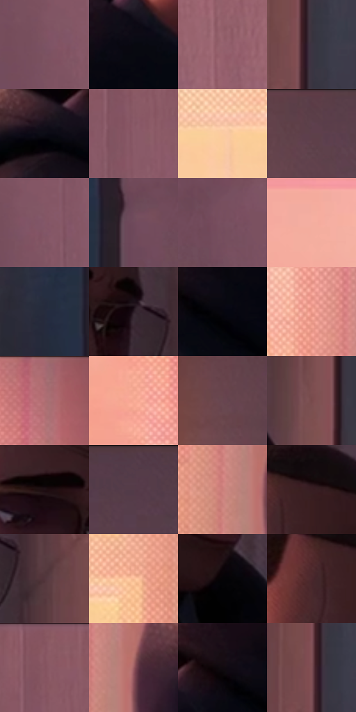

# 电影参考 531

- 状态：常规／活跃；来源世界：miles-home。
- 视角：near-level；景别：medium；场景：interior。
- 时段：daylight-time-unspecified（外观依据，中置信度；具体时间／晨昏未知）；光照：warm-day。
- 材质候选：skin, hair, fabric, paint, wood, paper, glass（帧级，不是像素分割）。
- 明暗组：dark；L* P5/P50/P95：2.28272 / 36.62934 / 81.06509。
- 资格门禁：无附加门禁。
- 原截图 SHA-256：`c4ce8e7cce3d5ae7e88705bc6bfd8aad6676b89071a45944d686dacbd1445fc9`；尺寸：2880 × 1210。
- sRGB 像素 SHA-256：`dde151e4bf30867d2be2daef2e32664fb6c451377f8baa162252bd3f04207322`。

## 观察与迁移

暖粉窗光与室内暗部，墙影方向、脸部体块与布纹分别表达。

脱帽警官：暖窗与粉灰墙较亮，黑制服保持重量；脸和金属眼镜局部受光，不把所有材料统一染金。

本公开版保存32个128×128原像素色卡上下文；图集格子并非原场景相邻位置。原rect、图集tile和像素SHA见 `data/palette-crops.json`。上下文不足时不得批准替色，不能以小样推断完整构图。

## 实测色卡

颜色比例分母为保留采样像素，不是材料面积；全部 32 色参与全库匹配。表内四舍五入仅用于阅读，原精度在 JSON。

| ID | HEX | Lab | 原图 xy | 像素数 | 比例 | 明度角色 |
| --- | --- | --- | --- | ---: | ---: | --- |
| 531-S01 | #7C5263 | [39.950611, 20.234369, -2.646786] | [2084, 364] | 9577 | 4.935479% | shadow |
| 531-S02 | #080910 | [2.568953, 0.86057, -3.146107] | [1028, 596] | 8716 | 4.491765% | deep-shadow |
| 531-S03 | #97626F | [47.576919, 23.35469, 1.586261] | [2448, 124] | 8490 | 4.375296% | midtone |
| 531-S04 | #3B3542 | [23.234762, 5.665442, -7.10874] | [1728, 264] | 8286 | 4.270166% | shadow |
| 531-S05 | #0C0C15 | [3.570149, 1.750864, -4.765349] | [768, 708] | 8245 | 4.249036% | deep-shadow |
| 531-S06 | #8B5B69 | [44.221508, 21.796937, 0.149249] | [2188, 160] | 7796 | 4.017645% | midtone |
| 531-S07 | #FBCBA3 | [84.929435, 11.60551, 26.393295] | [228, 828] | 7781 | 4.009915% | highlight |
| 531-S08 | #5D404B | [30.645923, 14.513452, -1.591328] | [776, 52] | 7747 | 3.992393% | shadow |
| 531-S09 | #835768 | [42.218742, 20.851773, -2.290598] | [2124, 352] | 7443 | 3.835728% | midtone |
| 531-S10 | #6F4A5B | [36.047615, 18.523033, -3.592548] | [1980, 588] | 7056 | 3.636289% | shadow |
| 531-S11 | #764E5F | [38.069726, 19.579722, -3.016786] | [2088, 568] | 7050 | 3.633197% | shadow |
| 531-S12 | #F4AEA0 | [77.308877, 23.823343, 17.402104] | [144, 328] | 7029 | 3.622374% | light |
| 531-S13 | #272C3D | [18.230137, 2.71142, -11.50502] | [1876, 624] | 6779 | 3.493538% | deep-shadow |
| 531-S14 | #291C24 | [12.151709, 8.071572, -2.949768] | [1536, 352] | 6441 | 3.319350% | deep-shadow |
| 531-S15 | #06060D | [1.78869, 1.00933, -2.747094] | [936, 684] | 6407 | 3.301828% | deep-shadow |
| 531-S16 | #ED9B8C | [71.788204, 28.914441, 20.549581] | [460, 540] | 6116 | 3.151862% | light |
| 531-S17 | #A6686F | [50.870359, 25.789577, 6.569984] | [540, 32] | 6095 | 3.141040% | midtone |
| 531-S18 | #F8AB95 | [76.834007, 25.653389, 22.758808] | [384, 192] | 5939 | 3.060646% | light |
| 531-S19 | #684550 | [33.518285, 16.836489, -0.433546] | [700, 116] | 5848 | 3.013749% | shadow |
| 531-S20 | #78494B | [36.493371, 20.30587, 7.290088] | [1680, 796] | 5695 | 2.934901% | shadow |
| 531-S21 | #1F1015 | [6.468336, 8.371835, -0.302309] | [1420, 308] | 5567 | 2.868937% | deep-shadow |
| 531-S22 | #553C48 | [28.462153, 13.154691, -2.970082] | [1004, 28] | 5402 | 2.783905% | shadow |
| 531-S23 | #CA7F7B | [60.929692, 28.564472, 14.408579] | [508, 756] | 5132 | 2.644761% | light |
| 531-S24 | #381E22 | [14.871634, 13.292857, 2.742609] | [1416, 140] | 5032 | 2.593226% | deep-shadow |
| 531-S25 | #53353C | [25.897333, 14.614645, 1.168854] | [1624, 404] | 4624 | 2.382965% | shadow |
| 531-S26 | #F9BE98 | [81.42188, 16.373253, 27.398582] | [404, 788] | 4358 | 2.245882% | highlight |
| 531-S27 | #040306 | [0.94019, 0.678579, -1.043033] | [1412, 660] | 4314 | 2.223207% | deep-shadow |
| 531-S28 | #4B272C | [20.553617, 17.538454, 4.193541] | [1356, 176] | 4235 | 2.182495% | shadow |
| 531-S29 | #84535E | [41.058571, 22.01634, 2.186762] | [2180, 28] | 3527 | 1.817629% | midtone |
| 531-S30 | #9C5C62 | [46.452748, 26.921222, 7.888261] | [568, 732] | 3014 | 1.553256% | midtone |
| 531-S31 | #10090F | [3.071499, 3.047309, -1.805926] | [876, 648] | 2187 | 1.127064% | deep-shadow |
| 531-S32 | #7F5057 | [39.476455, 20.729534, 4.159334] | [1708, 264] | 2116 | 1.090474% | shadow |

## 色阶与空间分布

- 采样 ROI：`[0.01, 0.02, 0.98, 0.94]`；步长：4；样本数：194044。
- 排除区：`[]`。
- 深暗、暗、中、亮、高光五段计数：`[53820, 62898, 42864, 23169, 11293]`。
- RGB 各 256 箱、L* 100 箱、13×5 色相明度表和 3×3 空间统计全部保存在 [总数据](../film-library.json)。
- [可视化档案](../../references/library.html)按需绘制直方图，不存 2,094 张重复图表图片。

## 纹理特征占比

**这是分块图像特征的面积占比，不是波点／排线／丝网／错版的精确语义覆盖率。** 窗格、发丝、织物也会产生方向或周期特征。
原图 ROI 像素 3109722；已测块覆盖 3109722（100.0000%）；未测 0。

| 特征 | 块覆盖像素 | 占已测面积 | 阈值敏感范围 |
| --- | ---: | ---: | --- |
| low-contrast | 1038170 | 33.3847% | 26.2596% ~ 41.8392% |
| directional-structure | 843392 | 27.1211% | 15.3243% ~ 36.8105% |
| periodic-structure | 1162624 | 37.3867% | 35.8761% ~ 38.6216% |
| mixed-detail | 65536 | 2.1075% | 1.0537% ~ 4.2149% |

阈值敏感范围不是统计置信区间。逐块坐标、尺度、对比、方向一致性、频谱集中度、频率与角度见 [全量特征记录](../texture-features.jsonl)，以帧号定位。
四种印刷层的真实像素覆盖仍标为 `null`，不能填 0，也不能拿上表代替。不得据这些代理测量删除唯一证据。

[测量方法与保留策略](../../references/library-retention.md) · [分类索引](../archive/README.md)
