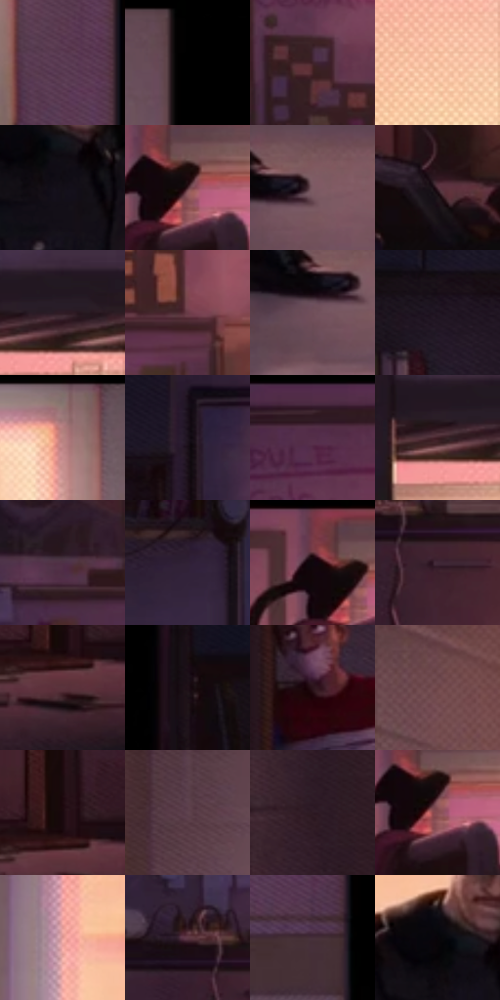

# 电影参考 532

- 状态：条件／活跃；来源世界：miles-home。
- 视角：mixed-panels；景别：graphic-or-multipanel；场景：interior。
- 时段：daylight-time-unspecified（外观依据，中置信度；具体时间／晨昏未知）；光照：warm-day。
- 材质候选：skin, fabric, wood, paint, glass（帧级，不是像素分割）。
- 明暗组：dark；L* P5/P50/P95：1.96091 / 20.52725 / 73.06934。
- 资格门禁：panel。
- 原截图 SHA-256：`950d7d5b00beb28a7c3eea1ea31de28d0adc9f19073cf2329dc7e6807c6c3fc2`；尺寸：2880 × 1246。
- sRGB 像素 SHA-256：`0c39d89a7c8f619041447d06c1f7588b0ece512fdf79ce90a446865a02ac0dc1`。

## 观察与迁移

左右分画面，同场人物不因分格混算位置，沟槽排除。

双分镜：左走廊浅暖与右宿舍深暖冷暗形成不同明暗组织；中央黑沟槽属于版式，不计建筑阴影；分镜仅条件使用。

本公开版保存32个128×128原像素色卡上下文；图集格子并非原场景相邻位置。原rect、图集tile和像素SHA见 `data/palette-crops.json`。上下文不足时不得批准替色，不能以小样推断完整构图。

## 实测色卡

颜色比例分母为保留采样像素，不是材料面积；全部 32 色参与全库匹配。表内四舍五入仅用于阅读，原精度在 JSON。

| ID | HEX | Lab | 原图 xy | 像素数 | 比例 | 明度角色 |
| --- | --- | --- | --- | ---: | ---: | --- |
| 532-S01 | #57384F | [27.897622, 17.902886, -8.37787] | [1244, 676] | 10233 | 5.208111% | shadow |
| 532-S02 | #000000 | [0.0, 0.0, 0.0] | [1316, 28] | 8886 | 4.522552% | deep-shadow |
| 532-S03 | #3F222A | [17.311754, 15.127006, 0.689107] | [2196, 424] | 8471 | 4.311336% | deep-shadow |
| 532-S04 | #F9C5A6 | [83.352181, 14.335863, 22.629934] | [2816, 520] | 8145 | 4.145418% | highlight |
| 532-S05 | #130E17 | [4.646416, 3.740075, -4.563077] | [952, 364] | 8137 | 4.141346% | deep-shadow |
| 532-S06 | #49272E | [20.302631, 16.952783, 2.408268] | [2652, 88] | 8083 | 4.113863% | shadow |
| 532-S07 | #7D5B64 | [42.403782, 15.416636, 0.348262] | [1200, 1112] | 7914 | 4.027850% | midtone |
| 532-S08 | #502D39 | [23.263914, 17.921513, -0.704867] | [2252, 1060] | 7562 | 3.848699% | shadow |
| 532-S09 | #2E1A24 | [12.26775, 11.788787, -2.700369] | [2820, 308] | 7163 | 3.645627% | deep-shadow |
| 532-S10 | #6A3C47 | [31.234291, 21.715899, 2.070555] | [2392, 544] | 7116 | 3.621706% | shadow |
| 532-S11 | #704E59 | [37.142994, 16.135355, -0.707881] | [1148, 1140] | 6863 | 3.492941% | shadow |
| 532-S12 | #211623 | [9.14482, 8.603983, -6.850001] | [1692, 144] | 6635 | 3.376900% | deep-shadow |
| 532-S13 | #A67A7C | [55.565994, 17.441801, 5.659195] | [1148, 48] | 6351 | 3.232357% | midtone |
| 532-S14 | #1B131D | [7.11323, 6.411772, -5.462597] | [1892, 84] | 6030 | 3.068983% | deep-shadow |
| 532-S15 | #3D252F | [18.011697, 13.134007, -1.845087] | [2232, 36] | 5876 | 2.990605% | deep-shadow |
| 532-S16 | #3D1E25 | [15.770384, 16.047529, 1.980983] | [2760, 324] | 5704 | 2.903065% | deep-shadow |
| 532-S17 | #4E3145 | [24.469317, 16.756057, -7.03779] | [2072, 524] | 5698 | 2.900011% | shadow |
| 532-S18 | #302235 | [15.641355, 10.980196, -9.81964] | [1852, 332] | 5680 | 2.890850% | deep-shadow |
| 532-S19 | #0F080D | [2.748665, 2.754729, -1.277199] | [2608, 64] | 5514 | 2.806364% | deep-shadow |
| 532-S20 | #402938 | [19.889212, 13.547069, -5.272912] | [2020, 692] | 5445 | 2.771246% | deep-shadow |
| 532-S21 | #5A333C | [26.35537, 18.880936, 1.955288] | [1868, 1084] | 5390 | 2.743254% | shadow |
| 532-S22 | #1E1017 | [6.399897, 8.254646, -1.853481] | [1476, 132] | 5364 | 2.730021% | deep-shadow |
| 532-S23 | #2B131A | [9.433673, 13.391315, 0.538544] | [1532, 672] | 5223 | 2.658259% | deep-shadow |
| 532-S24 | #6D484D | [34.847455, 16.586683, 3.484028] | [52, 92] | 5220 | 2.656732% | shadow |
| 532-S25 | #1A090E | [4.035378, 7.306158, 0.23753] | [1872, 1028] | 5117 | 2.604310% | deep-shadow |
| 532-S26 | #60424F | [31.688486, 15.229513, -2.597161] | [456, 172] | 5097 | 2.594131% | shadow |
| 532-S27 | #341F27 | [14.716219, 11.642587, -1.162025] | [40, 684] | 5046 | 2.568174% | deep-shadow |
| 532-S28 | #884F54 | [40.356894, 24.554424, 7.439173] | [2652, 104] | 4889 | 2.488269% | midtone |
| 532-S29 | #E19C97 | [70.886021, 25.114465, 13.028525] | [752, 184] | 4138 | 2.106045% | light |
| 532-S30 | #5F3946 | [28.90683, 18.854928, -0.854663] | [1952, 636] | 4060 | 2.066347% | shadow |
| 532-S31 | #452F3A | [22.316201, 12.094778, -2.954511] | [1264, 976] | 3933 | 2.001710% | shadow |
| 532-S32 | #08050A | [1.644728, 1.47963, -1.615537] | [920, 312] | 1499 | 0.762920% | deep-shadow |

## 色阶与空间分布

- 采样 ROI：`[0.01, 0.02, 0.98, 0.94]`；步长：4；样本数：196482。
- 排除区：`[{"label": "central panel gutter", "rect": [0.495, 0, 0.511, 1]}]`。
- 深暗、暗、中、亮、高光五段计数：`[95711, 72609, 14938, 6113, 7111]`。
- RGB 各 256 箱、L* 100 箱、13×5 色相明度表和 3×3 空间统计全部保存在 [总数据](../film-library.json)。
- [可视化档案](../../references/library.html)按需绘制直方图，不存 2,094 张重复图表图片。

## 纹理特征占比

**这是分块图像特征的面积占比，不是波点／排线／丝网／错版的精确语义覆盖率。** 窗格、发丝、织物也会产生方向或周期特征。
原图 ROI 像素 3151956；已测块覆盖 3045285（96.6157%）；未测 106671。

| 特征 | 块覆盖像素 | 占已测面积 | 阈值敏感范围 |
| --- | ---: | ---: | --- |
| low-contrast | 183351 | 6.0208% | 4.4068% ~ 9.2489% |
| directional-structure | 654574 | 21.4947% | 9.8313% ~ 41.3171% |
| periodic-structure | 2092672 | 68.7184% | 53.2001% ~ 71.2356% |
| mixed-detail | 114688 | 3.7661% | 1.0760% ~ 9.6842% |

阈值敏感范围不是统计置信区间。逐块坐标、尺度、对比、方向一致性、频谱集中度、频率与角度见 [全量特征记录](../texture-features.jsonl)，以帧号定位。
四种印刷层的真实像素覆盖仍标为 `null`，不能填 0，也不能拿上表代替。不得据这些代理测量删除唯一证据。

[测量方法与保留策略](../../references/library-retention.md) · [分类索引](../archive/README.md)
