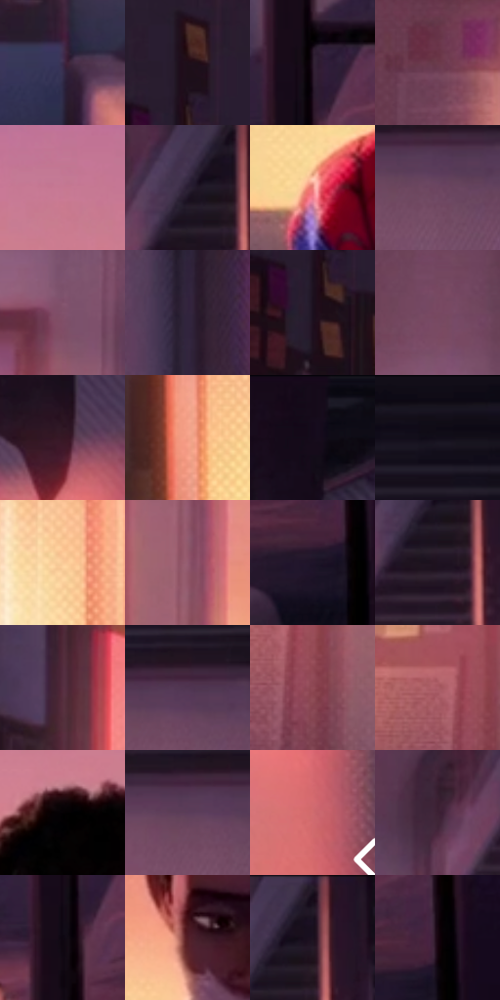

# 电影参考 533

- 状态：常规／活跃；来源世界：miles-home。
- 视角：near-level；景别：environment-wide；场景：interior。
- 时段：daylight-time-unspecified（外观依据，中置信度；具体时间／晨昏未知）；光照：warm-day。
- 材质候选：skin, hair, fabric, paint, wood, paper, glass（帧级，不是像素分割）。
- 明暗组：dark；L* P5/P50/P95：2.73919 / 20.78197 / 71.97504。
- 资格门禁：无附加门禁。
- 原截图 SHA-256：`9ec218191ccaca3a747cac9cf2e489df53fa974c834bfef9a3c2e86a30a7781e`；尺寸：2880 × 1214。
- sRGB 像素 SHA-256：`0a3dd3513f4985abf1be457b5245ac85e79885a00ac2208d8ded974bec31c6d0`。

## 观察与迁移

暖粉窗光与室内暗部，墙影方向、脸部体块与布纹分别表达。

宿舍全景：上粉下黄的亮窗居后，左右家具暗框，紫暗脸仍可读；右墙矩形橙色受光区与墙面纹理分层。

本公开版保存32个128×128原像素色卡上下文；图集格子并非原场景相邻位置。原rect、图集tile和像素SHA见 `data/palette-crops.json`。上下文不足时不得批准替色，不能以小样推断完整构图。

## 实测色卡

颜色比例分母为保留采样像素，不是材料面积；全部 32 色参与全库匹配。表内四舍五入仅用于阅读，原精度在 JSON。

| ID | HEX | Lab | 原图 xy | 像素数 | 比例 | 明度角色 |
| --- | --- | --- | --- | ---: | ---: | --- |
| 533-S01 | #3C2B4B | [20.81396, 15.193454, -16.88045] | [1856, 868] | 9731 | 4.996868% | shadow |
| 533-S02 | #1E0F19 | [6.21372, 9.309477, -3.664496] | [76, 120] | 8390 | 4.308264% | deep-shadow |
| 533-S03 | #271828 | [10.833675, 11.030332, -7.912857] | [2072, 800] | 7934 | 4.074108% | deep-shadow |
| 533-S04 | #6B3A4B | [31.021349, 23.916367, -0.819534] | [856, 328] | 7825 | 4.018137% | shadow |
| 533-S05 | #C67892 | [59.449295, 33.830361, -0.981406] | [1496, 140] | 7638 | 3.922112% | midtone |
| 533-S06 | #2A1E33 | [13.589962, 10.874246, -11.622779] | [1964, 76] | 7603 | 3.904140% | deep-shadow |
| 533-S07 | #EA837B | [65.872583, 38.596156, 21.846578] | [1236, 688] | 7302 | 3.749576% | light |
| 533-S08 | #6B455F | [34.413839, 20.745616, -8.61485] | [2184, 300] | 6980 | 3.584229% | shadow |
| 533-S09 | #82526B | [40.965084, 23.921313, -6.006677] | [1076, 240] | 6942 | 3.564716% | midtone |
| 533-S10 | #32243D | [16.877541, 12.494208, -13.503165] | [2472, 460] | 6626 | 3.402450% | deep-shadow |
| 533-S11 | #29121F | [9.016817, 14.090865, -3.910842] | [32, 216] | 6442 | 3.307966% | deep-shadow |
| 533-S12 | #784961 | [37.155138, 23.692099, -5.598075] | [1012, 80] | 6388 | 3.280237% | shadow |
| 533-S13 | #361724 | [12.763666, 17.341966, -1.822205] | [2756, 272] | 6349 | 3.260211% | deep-shadow |
| 533-S14 | #F39F86 | [73.269839, 28.475364, 25.95019] | [420, 548] | 6281 | 3.225293% | light |
| 533-S15 | #15091B | [3.91978, 7.876389, -8.740113] | [2756, 52] | 6138 | 3.151862% | deep-shadow |
| 533-S16 | #130E19 | [4.721586, 4.268299, -5.997875] | [2216, 44] | 6134 | 3.149808% | deep-shadow |
| 533-S17 | #FACA98 | [84.398899, 10.487316, 31.40137] | [572, 488] | 6039 | 3.101026% | highlight |
| 533-S18 | #935B70 | [45.436633, 25.985466, -2.205593] | [1124, 436] | 5970 | 3.065594% | midtone |
| 533-S19 | #1E1429 | [8.450168, 10.573247, -12.445567] | [2192, 984] | 5737 | 2.945949% | deep-shadow |
| 533-S20 | #1E1221 | [7.393067, 9.676996, -8.058869] | [1980, 132] | 5723 | 2.938760% | deep-shadow |
| 533-S21 | #572E41 | [24.834695, 21.532414, -3.674093] | [364, 216] | 5246 | 2.693821% | shadow |
| 533-S22 | #503551 | [26.291243, 17.52679, -12.218403] | [2192, 264] | 5193 | 2.666605% | shadow |
| 533-S23 | #914A56 | [40.557959, 31.173663, 6.661893] | [1032, 620] | 5134 | 2.636309% | midtone |
| 533-S24 | #AC5E68 | [49.225232, 32.745379, 8.511463] | [988, 560] | 5055 | 2.595742% | midtone |
| 533-S25 | #040103 | [0.488673, 1.062568, -0.480399] | [1388, 248] | 4934 | 2.533609% | deep-shadow |
| 533-S26 | #5B3D59 | [30.115873, 18.375687, -11.474326] | [2152, 284] | 4848 | 2.489448% | shadow |
| 533-S27 | #D06C6F | [57.353126, 39.612965, 16.478194] | [2792, 556] | 4663 | 2.394450% | midtone |
| 533-S28 | #3D2134 | [17.121759, 16.780617, -6.693667] | [1852, 132] | 4410 | 2.264535% | deep-shadow |
| 533-S29 | #0D0712 | [2.540031, 3.434446, -4.315441] | [2056, 872] | 4305 | 2.210617% | deep-shadow |
| 533-S30 | #511D25 | [19.06482, 25.162314, 7.134204] | [1360, 524] | 4277 | 2.196239% | deep-shadow |
| 533-S31 | #19101E | [6.061096, 7.484642, -7.841292] | [2008, 52] | 4256 | 2.185456% | deep-shadow |
| 533-S32 | #180610 | [3.268938, 7.839574, -1.969439] | [2228, 936] | 4249 | 2.181861% | deep-shadow |

## 色阶与空间分布

- 采样 ROI：`[0.01, 0.02, 0.98, 0.94]`；步长：4；样本数：194742。
- 排除区：`[]`。
- 深暗、暗、中、亮、高光五段计数：`[95050, 48595, 27058, 18738, 5301]`。
- RGB 各 256 箱、L* 100 箱、13×5 色相明度表和 3×3 空间统计全部保存在 [总数据](../film-library.json)。
- [可视化档案](../../references/library.html)按需绘制直方图，不存 2,094 张重复图表图片。

## 纹理特征占比

**这是分块图像特征的面积占比，不是波点／排线／丝网／错版的精确语义覆盖率。** 窗格、发丝、织物也会产生方向或周期特征。
原图 ROI 像素 3120898；已测块覆盖 3120898（100.0000%）；未测 0。

| 特征 | 块覆盖像素 | 占已测面积 | 阈值敏感范围 |
| --- | ---: | ---: | --- |
| low-contrast | 295938 | 9.4825% | 7.6697% ~ 14.5395% |
| directional-structure | 968448 | 31.0311% | 21.2001% ~ 44.9758% |
| periodic-structure | 1713536 | 54.9052% | 46.3046% ~ 55.4794% |
| mixed-detail | 142976 | 4.5812% | 1.0500% ~ 8.7811% |

阈值敏感范围不是统计置信区间。逐块坐标、尺度、对比、方向一致性、频谱集中度、频率与角度见 [全量特征记录](../texture-features.jsonl)，以帧号定位。
四种印刷层的真实像素覆盖仍标为 `null`，不能填 0，也不能拿上表代替。不得据这些代理测量删除唯一证据。

[测量方法与保留策略](../../references/library-retention.md) · [分类索引](../archive/README.md)
