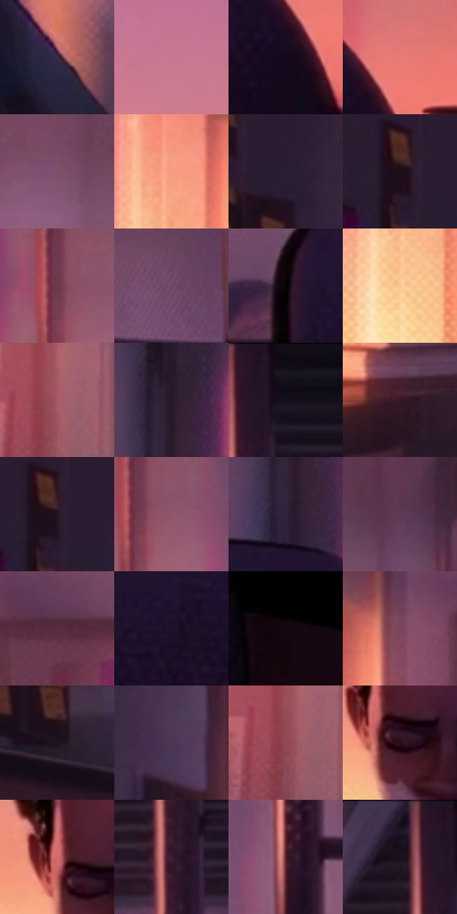

# 电影参考 534

- 状态：常规／活跃；来源世界：miles-home。
- 视角：near-level；景别：environment-wide；场景：interior。
- 时段：daylight-time-unspecified（外观依据，中置信度；具体时间／晨昏未知）；光照：warm-day。
- 材质候选：skin, hair, fabric, paint, wood, paper, glass（帧级，不是像素分割）。
- 明暗组：dark；L* P5/P50/P95：2.92847 / 21.06601 / 72.03142。
- 资格门禁：无附加门禁。
- 原截图 SHA-256：`d68a9b8317c188846f1fff19e99a23e8d84083d4a067341d3f6d9dd5795954cf`；尺寸：2880 × 1214。
- sRGB 像素 SHA-256：`57364b1332f185c12ef62bcce564bcb525462cf81df0835922aa41ca077836e7`。

## 观察与迁移

暖粉窗光与室内暗部，墙影方向、脸部体块与布纹分别表达。

同宿舍低头：维持亮窗与暗家具框架，头部姿态改变不能归因于曝光；墙上光块、衣纹、实体蛛丝分别处理。

本公开版保存32个128×128原像素色卡上下文；图集格子并非原场景相邻位置。原rect、图集tile和像素SHA见 `data/palette-crops.json`。上下文不足时不得批准替色，不能以小样推断完整构图。

## 实测色卡

颜色比例分母为保留采样像素，不是材料面积；全部 32 色参与全库匹配。表内四舍五入仅用于阅读，原精度在 JSON。

| ID | HEX | Lab | 原图 xy | 像素数 | 比例 | 明度角色 |
| --- | --- | --- | --- | ---: | ---: | --- |
| 534-S01 | #3C2B4A | [20.761745, 14.924769, -16.286345] | [1932, 1044] | 8941 | 4.591203% | shadow |
| 534-S02 | #C87792 | [59.480731, 35.087598, -0.90582] | [1528, 152] | 7798 | 4.004272% | midtone |
| 534-S03 | #14091B | [3.823033, 7.442501, -8.894069] | [2600, 736] | 7511 | 3.856898% | deep-shadow |
| 534-S04 | #E87B74 | [63.825155, 41.293914, 22.969852] | [2640, 664] | 7308 | 3.752657% | light |
| 534-S05 | #7E506D | [40.044397, 23.944064, -8.671404] | [1040, 132] | 7122 | 3.657146% | midtone |
| 534-S06 | #F49A80 | [72.166475, 30.900265, 27.752881] | [556, 288] | 7105 | 3.648417% | light |
| 534-S07 | #2A1E34 | [13.642833, 11.154337, -12.25573] | [148, 168] | 7081 | 3.636093% | deep-shadow |
| 534-S08 | #1F0F1A | [6.391527, 10.132958, -4.16591] | [80, 124] | 7077 | 3.634039% | deep-shadow |
| 534-S09 | #6D394B | [31.081516, 25.296163, -0.696668] | [1852, 372] | 6769 | 3.475881% | shadow |
| 534-S10 | #6D4561 | [34.743888, 21.889711, -9.359441] | [2280, 372] | 6716 | 3.448665% | shadow |
| 534-S11 | #060206 | [0.860729, 1.602138, -1.145074] | [2236, 696] | 6648 | 3.413747% | deep-shadow |
| 534-S12 | #FAC992 | [84.057407, 10.362881, 34.058443] | [544, 444] | 6477 | 3.325939% | highlight |
| 534-S13 | #A65A66 | [47.469807, 32.396811, 7.10694] | [1064, 536] | 6473 | 3.323885% | midtone |
| 534-S14 | #28192A | [11.370162, 11.241996, -8.549501] | [2488, 400] | 6454 | 3.314128% | deep-shadow |
| 534-S15 | #150E19 | [4.911181, 5.118585, -5.697812] | [2084, 40] | 6418 | 3.295642% | deep-shadow |
| 534-S16 | #361724 | [12.763666, 17.341966, -1.822205] | [752, 772] | 6220 | 3.193969% | deep-shadow |
| 534-S17 | #261425 | [9.368952, 12.728555, -7.942087] | [92, 124] | 6219 | 3.193456% | deep-shadow |
| 534-S18 | #90566C | [43.754042, 27.084227, -2.290918] | [1888, 388] | 6175 | 3.170862% | midtone |
| 534-S19 | #32233E | [16.64089, 13.465243, -14.567349] | [2476, 568] | 6029 | 3.095891% | deep-shadow |
| 534-S20 | #5D3A55 | [29.436348, 20.190384, -9.891392] | [1788, 152] | 6015 | 3.088702% | shadow |
| 534-S21 | #572D41 | [24.59233, 22.142434, -4.034485] | [832, 248] | 5980 | 3.070729% | shadow |
| 534-S22 | #1F142B | [8.705194, 11.569541, -13.523261] | [2448, 700] | 5459 | 2.803196% | deep-shadow |
| 534-S23 | #150610 | [2.954843, 6.430941, -2.465767] | [2728, 904] | 5353 | 2.748765% | deep-shadow |
| 534-S24 | #79455C | [36.165963, 25.596498, -3.903394] | [704, 256] | 5166 | 2.652741% | shadow |
| 534-S25 | #1D141F | [7.772541, 7.243672, -5.969293] | [144, 364] | 5085 | 2.611147% | deep-shadow |
| 534-S26 | #4A3655 | [26.010642, 15.570335, -15.342826] | [304, 200] | 5060 | 2.598310% | shadow |
| 534-S27 | #934956 | [40.640627, 32.485182, 6.820473] | [1052, 568] | 4870 | 2.500745% | midtone |
| 534-S28 | #2D0E1A | [8.539144, 17.539151, -0.724553] | [1392, 512] | 4516 | 2.318966% | deep-shadow |
| 534-S29 | #D26A6D | [57.189589, 41.176694, 17.458471] | [1364, 476] | 4507 | 2.314344% | midtone |
| 534-S30 | #3C2034 | [16.708088, 17.027579, -7.334768] | [2036, 200] | 4387 | 2.252724% | deep-shadow |
| 534-S31 | #541F27 | [20.091037, 25.486087, 7.240714] | [2032, 448] | 4309 | 2.212671% | shadow |
| 534-S32 | #190F20 | [5.894978, 8.687728, -9.636623] | [2004, 44] | 3494 | 1.794169% | deep-shadow |

## 色阶与空间分布

- 采样 ROI：`[0.01, 0.02, 0.98, 0.94]`；步长：4；样本数：194742。
- 排除区：`[]`。
- 深暗、暗、中、亮、高光五段计数：`[94470, 48472, 27491, 19123, 5186]`。
- RGB 各 256 箱、L* 100 箱、13×5 色相明度表和 3×3 空间统计全部保存在 [总数据](../film-library.json)。
- [可视化档案](../../references/library.html)按需绘制直方图，不存 2,094 张重复图表图片。

## 纹理特征占比

**这是分块图像特征的面积占比，不是波点／排线／丝网／错版的精确语义覆盖率。** 窗格、发丝、织物也会产生方向或周期特征。
原图 ROI 像素 3120898；已测块覆盖 3120898（100.0000%）；未测 0。

| 特征 | 块覆盖像素 | 占已测面积 | 阈值敏感范围 |
| --- | ---: | ---: | --- |
| low-contrast | 361474 | 11.5824% | 8.5761% ~ 14.0145% |
| directional-structure | 1017600 | 32.6060% | 21.7250% ~ 44.1596% |
| periodic-structure | 1594368 | 51.0868% | 46.7394% ~ 55.0980% |
| mixed-detail | 147456 | 4.7248% | 0.5250% ~ 9.1625% |

阈值敏感范围不是统计置信区间。逐块坐标、尺度、对比、方向一致性、频谱集中度、频率与角度见 [全量特征记录](../texture-features.jsonl)，以帧号定位。
四种印刷层的真实像素覆盖仍标为 `null`，不能填 0，也不能拿上表代替。不得据这些代理测量删除唯一证据。

[测量方法与保留策略](../../references/library-retention.md) · [分类索引](../archive/README.md)
