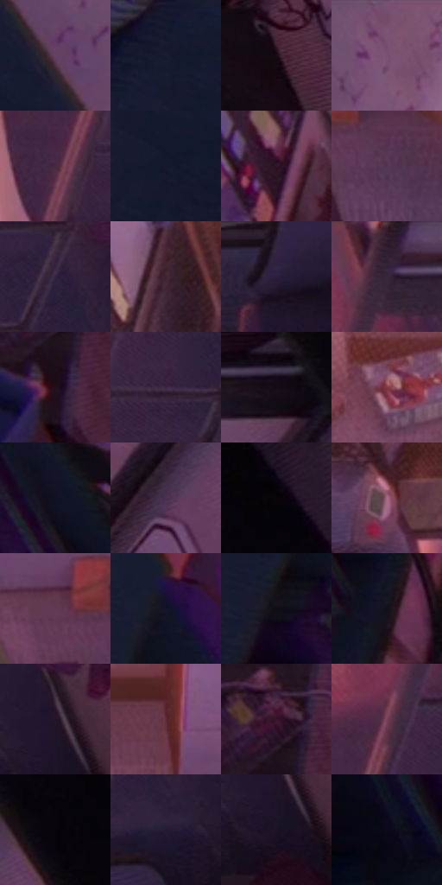

# 电影参考 535

- 状态：常规／活跃；来源世界：miles-home。
- 视角：overhead；景别：environment-wide；场景：interior。
- 时段：daylight-time-unspecified（外观依据，中置信度；具体时间／晨昏未知）；光照：warm-day。
- 材质候选：skin, hair, fabric, paint, wood, paper, glass（帧级，不是像素分割）。
- 明暗组：very-dark；L* P5/P50/P95：2.98322 / 13.5977 / 38.98469。
- 资格门禁：无附加门禁。
- 原截图 SHA-256：`8b509f1b208b4888d2ed15727076958c4b351f6437df28a71786332d1a08c8dd`；尺寸：2880 × 1212。
- sRGB 像素 SHA-256：`d650092e8e1640c4b101bbacec2a2338d788054167016ad1466d1fa5ca2dff94`。

## 观察与迁移

暖粉窗光与室内暗部，墙影方向、脸部体块与布纹分别表达。

俯视宿舍：紫蓝地毯承载中间调，左上暖光、四周暗家具形成围合；近遮挡软边和色偏不同于清楚的小书本色块。

本公开版保存32个128×128原像素色卡上下文；图集格子并非原场景相邻位置。原rect、图集tile和像素SHA见 `data/palette-crops.json`。上下文不足时不得批准替色，不能以小样推断完整构图。

## 实测色卡

颜色比例分母为保留采样像素，不是材料面积；全部 32 色参与全库匹配。表内四舍五入仅用于阅读，原精度在 JSON。

| ID | HEX | Lab | 原图 xy | 像素数 | 比例 | 明度角色 |
| --- | --- | --- | --- | ---: | ---: | --- |
| 535-S01 | #654161 | [32.724174, 21.324617, -12.518601] | [324, 112] | 8754 | 4.511348% | shadow |
| 535-S02 | #191A30 | [10.249878, 6.538727, -14.813945] | [108, 52] | 8512 | 4.386634% | deep-shadow |
| 535-S03 | #190A14 | [4.284293, 7.574124, -2.907408] | [2448, 512] | 8034 | 4.140298% | deep-shadow |
| 535-S04 | #784E6F | [38.881304, 23.277909, -11.737497] | [504, 52] | 7670 | 3.952712% | shadow |
| 535-S05 | #4A293E | [21.541772, 18.881703, -6.768808] | [1880, 344] | 7448 | 3.838305% | shadow |
| 535-S06 | #15182C | [8.945416, 5.242723, -13.961607] | [160, 164] | 7333 | 3.779040% | deep-shadow |
| 535-S07 | #2E1527 | [11.01962, 15.842874, -6.793679] | [736, 424] | 7300 | 3.762033% | deep-shadow |
| 535-S08 | #553653 | [27.281556, 19.229442, -11.961659] | [1668, 264] | 7117 | 3.667725% | shadow |
| 535-S09 | #322442 | [17.146813, 13.890303, -16.551971] | [2108, 264] | 6976 | 3.595061% | deep-shadow |
| 535-S10 | #402231 | [17.718435, 16.795455, -3.637949] | [840, 188] | 6900 | 3.555895% | deep-shadow |
| 535-S11 | #2A1F3D | [14.451747, 13.088383, -17.366632] | [1956, 600] | 6821 | 3.515182% | deep-shadow |
| 535-S12 | #321F30 | [14.798257, 12.679062, -7.530459] | [2012, 32] | 6556 | 3.378615% | deep-shadow |
| 535-S13 | #230F1C | [7.071667, 12.737297, -4.640712] | [980, 948] | 6362 | 3.278638% | deep-shadow |
| 535-S14 | #3D2845 | [19.799616, 16.016172, -14.375736] | [2004, 316] | 6071 | 3.128672% | deep-shadow |
| 535-S15 | #0F0810 | [2.824077, 3.284652, -2.719444] | [2596, 32] | 5935 | 3.058585% | deep-shadow |
| 535-S16 | #813842 | [33.75285, 32.499135, 9.367364] | [1284, 100] | 5917 | 3.049308% | shadow |
| 535-S17 | #101122 | [5.659257, 4.394503, -11.611472] | [568, 576] | 5867 | 3.023541% | deep-shadow |
| 535-S18 | #4A314F | [24.376575, 17.384289, -13.900426] | [2520, 336] | 5863 | 3.021480% | shadow |
| 535-S19 | #190F1F | [5.846623, 8.347932, -8.938417] | [2812, 32] | 5859 | 3.019418% | deep-shadow |
| 535-S20 | #A87088 | [53.698797, 25.749119, -4.041445] | [984, 368] | 5793 | 2.985405% | midtone |
| 535-S21 | #613853 | [29.399063, 22.567652, -8.594554] | [1572, 212] | 5593 | 2.882336% | shadow |
| 535-S22 | #131525 | [7.301384, 4.17587, -11.333154] | [480, 408] | 5590 | 2.880790% | deep-shadow |
| 535-S23 | #100C17 | [3.928961, 3.537228, -5.641386] | [428, 528] | 5472 | 2.819979% | deep-shadow |
| 535-S24 | #120F1B | [4.962394, 3.927954, -7.225279] | [660, 728] | 5307 | 2.734947% | deep-shadow |
| 535-S25 | #231628 | [9.675367, 10.804705, -9.742789] | [2252, 336] | 5056 | 2.605595% | deep-shadow |
| 535-S26 | #5D2B37 | [24.737809, 24.240333, 3.039809] | [1488, 92] | 4965 | 2.558698% | shadow |
| 535-S27 | #3A162B | [13.519421, 20.819505, -5.743452] | [976, 852] | 4675 | 2.409247% | deep-shadow |
| 535-S28 | #79445A | [35.86501, 25.860241, -3.08324] | [1932, 224] | 4627 | 2.384511% | shadow |
| 535-S29 | #08050C | [1.68653, 1.773377, -2.415003] | [2740, 136] | 4266 | 2.198470% | deep-shadow |
| 535-S30 | #241B34 | [12.003122, 11.052068, -14.870023] | [2148, 376] | 4077 | 2.101070% | deep-shadow |
| 535-S31 | #1B1425 | [7.830525, 8.142108, -10.444805] | [2252, 404] | 4054 | 2.089217% | deep-shadow |
| 535-S32 | #0C081A | [2.948293, 4.694985, -9.458606] | [492, 780] | 3274 | 1.687246% | deep-shadow |

## 色阶与空间分布

- 采样 ROI：`[0.01, 0.02, 0.98, 0.94]`；步长：4；样本数：194044。
- 排除区：`[]`。
- 深暗、暗、中、亮、高光五段计数：`[128128, 57271, 7622, 921, 102]`。
- RGB 各 256 箱、L* 100 箱、13×5 色相明度表和 3×3 空间统计全部保存在 [总数据](../film-library.json)。
- [可视化档案](../../references/library.html)按需绘制直方图，不存 2,094 张重复图表图片。

## 纹理特征占比

**这是分块图像特征的面积占比，不是波点／排线／丝网／错版的精确语义覆盖率。** 窗格、发丝、织物也会产生方向或周期特征。
原图 ROI 像素 3115310；已测块覆盖 3115310（100.0000%）；未测 0。

| 特征 | 块覆盖像素 | 占已测面积 | 阈值敏感范围 |
| --- | ---: | ---: | --- |
| low-contrast | 340782 | 10.9389% | 7.8066% ~ 15.3682% |
| directional-structure | 369280 | 11.8537% | 5.1688% ~ 23.0269% |
| periodic-structure | 2110336 | 67.7408% | 59.2563% ~ 67.7408% |
| mixed-detail | 294912 | 9.4665% | 4.2073% ~ 20.2068% |

阈值敏感范围不是统计置信区间。逐块坐标、尺度、对比、方向一致性、频谱集中度、频率与角度见 [全量特征记录](../texture-features.jsonl)，以帧号定位。
四种印刷层的真实像素覆盖仍标为 `null`，不能填 0，也不能拿上表代替。不得据这些代理测量删除唯一证据。

[测量方法与保留策略](../../references/library-retention.md) · [分类索引](../archive/README.md)
