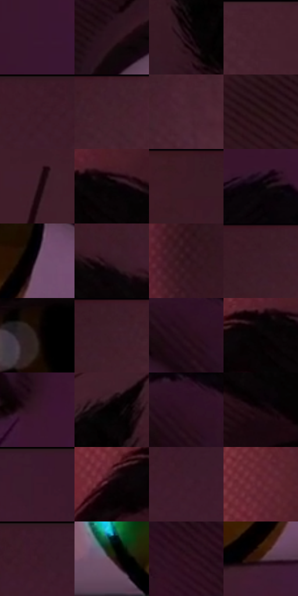

# 电影参考 536

- 状态：常规／活跃；来源世界：miles-home。
- 视角：near-level；景别：detail；场景：detail。
- 时段：interior-time-unknown（外观依据，中置信度；具体时间／晨昏未知）；光照：interior-mixed。
- 材质候选：skin, hair（帧级，不是像素分割）。
- 明暗组：very-dark；L* P5/P50/P95：0.78022 / 12.97358 / 24.07408。
- 资格门禁：无附加门禁。
- 原截图 SHA-256：`9594f0dd8e49e4815d517e2436dcbf0b81327f95c909a0379c677d0f5dd7a538`；尺寸：2880 × 1208。
- sRGB 像素 SHA-256：`5c982752264fea0477d9423c4106c9c7f23fa8ea601937900c3e595696d6bbf1`。

## 观察与迁移

眼眉极近景，虹膜高光和肌肤点纹分开，眼白不能过曝。

眼部特写：琥珀虹膜、紫暗皮肤与粉白眼白建立局部对比，细小青绿映光非新灯；眼下排线不能覆盖瞳孔。

本公开版保存32个128×128原像素色卡上下文；图集格子并非原场景相邻位置。原rect、图集tile和像素SHA见 `data/palette-crops.json`。上下文不足时不得批准替色，不能以小样推断完整构图。

## 实测色卡

颜色比例分母为保留采样像素，不是材料面积；全部 32 色参与全库匹配。表内四舍五入仅用于阅读，原精度在 JSON。

| ID | HEX | Lab | 原图 xy | 像素数 | 比例 | 明度角色 |
| --- | --- | --- | --- | ---: | ---: | --- |
| 536-S01 | #3A162E | [13.655105, 21.367304, -7.717123] | [2752, 92] | 11093 | 5.737383% | deep-shadow |
| 536-S02 | #2A111B | [8.759186, 14.461679, -1.231253] | [200, 612] | 10343 | 5.349477% | deep-shadow |
| 536-S03 | #200B13 | [5.361098, 11.010655, -0.577611] | [1664, 520] | 10305 | 5.329823% | deep-shadow |
| 536-S04 | #441F2B | [17.383872, 19.384417, 0.183535] | [1080, 28] | 10286 | 5.319996% | deep-shadow |
| 536-S05 | #3D1C29 | [15.39735, 17.978119, -1.437378] | [1892, 28] | 8950 | 4.629007% | deep-shadow |
| 536-S06 | #401E2C | [16.506701, 18.482167, -1.893102] | [748, 28] | 8784 | 4.543151% | deep-shadow |
| 536-S07 | #4A2532 | [20.08224, 19.276361, -0.668802] | [836, 84] | 7940 | 4.106627% | shadow |
| 536-S08 | #291315 | [8.9197, 11.629994, 3.463054] | [804, 1080] | 7914 | 4.093180% | deep-shadow |
| 536-S09 | #32161F | [11.62766, 15.404877, 0.126754] | [1540, 112] | 7146 | 3.695965% | deep-shadow |
| 536-S10 | #080305 | [1.153638, 1.585532, -0.296056] | [268, 268] | 6954 | 3.596661% | deep-shadow |
| 536-S11 | #3B1A25 | [14.413988, 17.741938, -0.027934] | [456, 28] | 6737 | 3.484427% | deep-shadow |
| 536-S12 | #090508 | [1.663463, 1.463042, -0.766552] | [2656, 296] | 6703 | 3.466842% | deep-shadow |
| 536-S13 | #6B5166 | [37.789022, 14.757985, -7.941763] | [2520, 656] | 6249 | 3.232030% | shadow |
| 536-S14 | #351823 | [12.807967, 16.090589, -1.040894] | [508, 320] | 6111 | 3.160655% | deep-shadow |
| 536-S15 | #3A1B20 | [14.332343, 15.897308, 3.464105] | [48, 1084] | 6058 | 3.133243% | deep-shadow |
| 536-S16 | #391B26 | [14.365939, 16.392186, -0.864041] | [620, 52] | 5899 | 3.051007% | deep-shadow |
| 536-S17 | #1A0C0E | [4.645695, 6.059365, 1.128729] | [2140, 620] | 5429 | 2.807919% | deep-shadow |
| 536-S18 | #3B1D27 | [15.250459, 16.132669, -0.25172] | [656, 28] | 5428 | 2.807402% | deep-shadow |
| 536-S19 | #260D19 | [6.957113, 14.78354, -2.430105] | [2696, 480] | 5382 | 2.783611% | deep-shadow |
| 536-S20 | #050203 | [0.74306, 0.923507, -0.101942] | [216, 284] | 5220 | 2.699823% | deep-shadow |
| 536-S21 | #361727 | [12.883285, 17.866793, -3.847666] | [2804, 720] | 5053 | 2.613449% | deep-shadow |
| 536-S22 | #000000 | [0.0, 0.0, 0.0] | [1184, 424] | 4896 | 2.532248% | deep-shadow |
| 536-S23 | #2E1021 | [9.492455, 17.901944, -4.620355] | [2704, 452] | 4540 | 2.348122% | deep-shadow |
| 536-S24 | #15050B | [2.639143, 5.990908, -0.464315] | [328, 408] | 4497 | 2.325882% | deep-shadow |
| 536-S25 | #3A182C | [14.029268, 19.778545, -5.699758] | [2276, 48] | 4438 | 2.295367% | deep-shadow |
| 536-S26 | #100408 | [1.937996, 3.97417, -0.309217] | [120, 308] | 4341 | 2.245198% | deep-shadow |
| 536-S27 | #3F1B2D | [15.645546, 20.114247, -3.906004] | [2060, 96] | 4090 | 2.115379% | deep-shadow |
| 536-S28 | #682B36 | [26.557174, 28.506271, 6.552641] | [180, 128] | 4020 | 2.079174% | shadow |
| 536-S29 | #3D1A2A | [14.944085, 19.404363, -2.82906] | [2040, 28] | 2956 | 1.528865% | deep-shadow |
| 536-S30 | #2F1B1E | [12.493544, 10.423124, 2.058068] | [444, 736] | 2799 | 1.447664% | deep-shadow |
| 536-S31 | #321322 | [10.989233, 17.84964, -3.051971] | [1744, 780] | 1466 | 0.758226% | deep-shadow |
| 536-S32 | #432727 | [19.186935, 13.184922, 5.555691] | [2448, 788] | 1319 | 0.682197% | deep-shadow |

## 色阶与空间分布

- 采样 ROI：`[0.01, 0.02, 0.98, 0.94]`；步长：4；样本数：193346。
- 排除区：`[]`。
- 深暗、暗、中、亮、高光五段计数：`[179115, 13287, 690, 254, 0]`。
- RGB 各 256 箱、L* 100 箱、13×5 色相明度表和 3×3 空间统计全部保存在 [总数据](../film-library.json)。
- [可视化档案](../../references/library.html)按需绘制直方图，不存 2,094 张重复图表图片。

## 纹理特征占比

**这是分块图像特征的面积占比，不是波点／排线／丝网／错版的精确语义覆盖率。** 窗格、发丝、织物也会产生方向或周期特征。
原图 ROI 像素 3104134；已测块覆盖 3104134（100.0000%）；未测 0。

| 特征 | 块覆盖像素 | 占已测面积 | 阈值敏感范围 |
| --- | ---: | ---: | --- |
| low-contrast | 1093638 | 35.2317% | 27.1042% ~ 40.5304% |
| directional-structure | 991360 | 31.9368% | 13.1953% ~ 46.0970% |
| periodic-structure | 986368 | 31.7759% | 26.2710% ~ 44.1630% |
| mixed-detail | 32768 | 1.0556% | 0.5278% ~ 2.1112% |

阈值敏感范围不是统计置信区间。逐块坐标、尺度、对比、方向一致性、频谱集中度、频率与角度见 [全量特征记录](../texture-features.jsonl)，以帧号定位。
四种印刷层的真实像素覆盖仍标为 `null`，不能填 0，也不能拿上表代替。不得据这些代理测量删除唯一证据。

[测量方法与保留策略](../../references/library-retention.md) · [分类索引](../archive/README.md)
