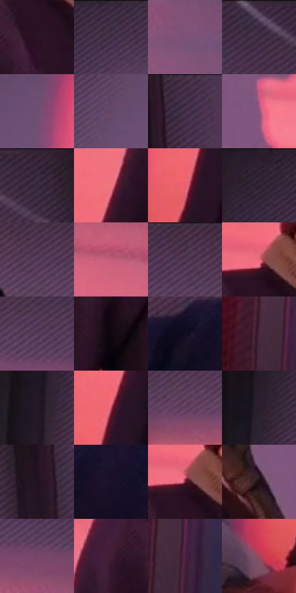

# 电影参考 537

- 状态：常规／活跃；来源世界：miles-home。
- 视角：low-angle；景别：medium；场景：interior。
- 时段：daylight-time-unspecified（外观依据，中置信度；具体时间／晨昏未知）；光照：warm-day。
- 材质候选：skin, hair, fabric, paint, wood, paper, glass（帧级，不是像素分割）。
- 明暗组：dark；L* P5/P50/P95：4.57685 / 24.77069 / 61.64669。
- 资格门禁：无附加门禁。
- 原截图 SHA-256：`d70f03487bb1896f483071a1f4a11676f6a71cc0709e9d3f8642df8d75605bfe`；尺寸：2880 × 1210。
- sRGB 像素 SHA-256：`f7eeabd62dbdff0ba5a2dab199137fc62b8a740c68a1c82589295114a4e21961`。

## 观察与迁移

暖粉窗光与室内暗部，墙影方向、脸部体块与布纹分别表达。

床边人物：红粉矩形墙光被头影切开，紫色衣被与浅暖床边分层；投影、墙纹、衣褶各有边界。

本公开版保存32个128×128原像素色卡上下文；图集格子并非原场景相邻位置。原rect、图集tile和像素SHA见 `data/palette-crops.json`。上下文不足时不得批准替色，不能以小样推断完整构图。

## 实测色卡

颜色比例分母为保留采样像素，不是材料面积；全部 32 色参与全库匹配。表内四舍五入仅用于阅读，原精度在 JSON。

| ID | HEX | Lab | 原图 xy | 像素数 | 比例 | 明度角色 |
| --- | --- | --- | --- | ---: | ---: | --- |
| 537-S01 | #2B1323 | [9.804255, 15.090249, -5.706154] | [1224, 432] | 9238 | 4.760776% | deep-shadow |
| 537-S02 | #39293D | [19.193846, 11.786088, -9.862982] | [812, 28] | 8456 | 4.357775% | deep-shadow |
| 537-S03 | #7C5278 | [40.696874, 24.120988, -14.482581] | [2268, 408] | 8100 | 4.174311% | midtone |
| 537-S04 | #402C44 | [21.240413, 14.238138, -11.441103] | [2420, 40] | 7912 | 4.077426% | shadow |
| 537-S05 | #6F4F73 | [38.215942, 20.209137, -15.326482] | [864, 288] | 7488 | 3.858919% | shadow |
| 537-S06 | #664869 | [34.962544, 19.069197, -14.15491] | [712, 320] | 7340 | 3.782647% | shadow |
| 537-S07 | #46324B | [23.971283, 14.255766, -11.901746] | [2744, 32] | 7298 | 3.761003% | shadow |
| 537-S08 | #925174 | [43.149407, 31.905481, -8.051749] | [1596, 496] | 7207 | 3.714106% | midtone |
| 537-S09 | #342538 | [17.173189, 11.275949, -9.537511] | [2564, 48] | 7040 | 3.628043% | deep-shadow |
| 537-S10 | #EF7482 | [63.719582, 48.585095, 15.041075] | [1004, 664] | 7022 | 3.618767% | light |
| 537-S11 | #E86172 | [58.904683, 53.673191, 17.434157] | [936, 872] | 6713 | 3.459525% | midtone |
| 537-S12 | #312232 | [15.630214, 10.640685, -7.701004] | [596, 28] | 6599 | 3.400775% | deep-shadow |
| 537-S13 | #4F344F | [25.811659, 17.341738, -11.643268] | [1616, 84] | 6398 | 3.297190% | shadow |
| 537-S14 | #C3617B | [53.583169, 41.848747, 3.868019] | [1784, 292] | 6300 | 3.246686% | midtone |
| 537-S15 | #523954 | [27.737668, 16.391918, -11.953162] | [1796, 64] | 6291 | 3.242048% | shadow |
| 537-S16 | #E76C7E | [60.979545, 49.288742, 13.340652] | [1232, 336] | 6138 | 3.163200% | light |
| 537-S17 | #593F5C | [30.524717, 17.009782, -12.806586] | [1928, 116] | 6078 | 3.132279% | shadow |
| 537-S18 | #0D0710 | [2.483491, 3.037134, -3.23411] | [1140, 636] | 5755 | 2.965822% | deep-shadow |
| 537-S19 | #120E1F | [4.892104, 5.692796, -10.451893] | [2532, 916] | 5714 | 2.944693% | deep-shadow |
| 537-S20 | #391729 | [13.489306, 19.45661, -4.348612] | [60, 1092] | 5473 | 2.820494% | deep-shadow |
| 537-S21 | #221927 | [10.422706, 7.893884, -7.862281] | [456, 360] | 5367 | 2.765868% | deep-shadow |
| 537-S22 | #BC5266 | [49.11558, 44.552512, 9.892856] | [964, 796] | 5333 | 2.748346% | midtone |
| 537-S23 | #63405E | [32.09638, 20.576805, -11.582168] | [1008, 140] | 5321 | 2.742162% | shadow |
| 537-S24 | #2A1E2E | [13.339806, 9.522381, -8.416471] | [488, 220] | 5164 | 2.661252% | deep-shadow |
| 537-S25 | #21121F | [7.722387, 10.529793, -5.993112] | [2688, 272] | 5130 | 2.643730% | deep-shadow |
| 537-S26 | #191328 | [7.457545, 9.05605, -13.299059] | [2632, 932] | 4982 | 2.567459% | deep-shadow |
| 537-S27 | #6D2A3C | [27.391943, 31.637023, 3.842606] | [1236, 348] | 4943 | 2.547360% | shadow |
| 537-S28 | #1E0C15 | [5.35797, 9.768767, -1.940264] | [1464, 496] | 4873 | 2.511286% | deep-shadow |
| 537-S29 | #774666 | [36.48433, 25.965579, -9.75849] | [2024, 180] | 4560 | 2.349982% | shadow |
| 537-S30 | #421D36 | [17.005799, 21.70086, -8.205507] | [1124, 472] | 3553 | 1.831028% | deep-shadow |
| 537-S31 | #4D2240 | [20.409839, 24.716248, -9.81421] | [112, 1116] | 3422 | 1.763518% | shadow |
| 537-S32 | #9E485C | [42.274583, 37.80025, 5.653145] | [844, 1000] | 2836 | 1.461524% | midtone |

## 色阶与空间分布

- 采样 ROI：`[0.01, 0.02, 0.98, 0.94]`；步长：4；样本数：194044。
- 排除区：`[]`。
- 深暗、暗、中、亮、高光五段计数：`[77554, 70572, 32724, 13194, 0]`。
- RGB 各 256 箱、L* 100 箱、13×5 色相明度表和 3×3 空间统计全部保存在 [总数据](../film-library.json)。
- [可视化档案](../../references/library.html)按需绘制直方图，不存 2,094 张重复图表图片。

## 纹理特征占比

**这是分块图像特征的面积占比，不是波点／排线／丝网／错版的精确语义覆盖率。** 窗格、发丝、织物也会产生方向或周期特征。
原图 ROI 像素 3109722；已测块覆盖 3109722（100.0000%）；未测 0。

| 特征 | 块覆盖像素 | 占已测面积 | 阈值敏感范围 |
| --- | ---: | ---: | --- |
| low-contrast | 289920 | 9.3230% | 7.7424% ~ 13.0111% |
| directional-structure | 1220224 | 39.2390% | 23.5936% ~ 54.9091% |
| periodic-structure | 1468506 | 47.2231% | 34.7142% ~ 56.8671% |
| mixed-detail | 131072 | 4.2149% | 2.6343% ~ 6.5282% |

阈值敏感范围不是统计置信区间。逐块坐标、尺度、对比、方向一致性、频谱集中度、频率与角度见 [全量特征记录](../texture-features.jsonl)，以帧号定位。
四种印刷层的真实像素覆盖仍标为 `null`，不能填 0，也不能拿上表代替。不得据这些代理测量删除唯一证据。

[测量方法与保留策略](../../references/library-retention.md) · [分类索引](../archive/README.md)
