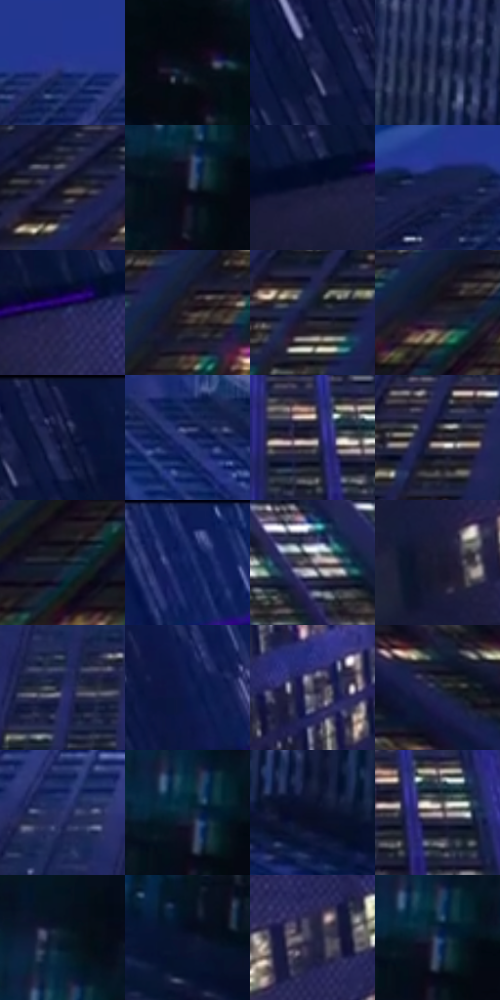

# 电影参考 538

- 状态：常规／活跃；来源世界：miles-home。
- 视角：low-angle；景别：environment-wide；场景：city。
- 时段：night-appearance（外观依据，中置信度；具体时间／晨昏未知）；光照：night-mixed。
- 材质候选：glass, stone, metal, sky, screen（帧级，不是像素分割）。
- 明暗组：very-dark；L* P5/P50/P95：4.38827 / 13.83781 / 36.13192。
- 资格门禁：无附加门禁。
- 原截图 SHA-256：`b386d0e01f9cf5a0f62afc582ebfd2c28a3164d636d722104df1cea7c5dcbd84`；尺寸：2880 × 1210。
- sRGB 像素 SHA-256：`457d8d17b2708606de8ef301dac2c7a6a3af05ba70a4c714b3ffbbec999f29f8`。

## 观察与迁移

蓝色夜城、楼体正侧面与窗组节奏，发光窗不是满铺LED。

仰视高楼：蓝黑体量托住暖白窗点，天空蓝色留空；窗组保留纵向节奏但不逐格同亮，近窗色边更明显。

本公开版保存32个128×128原像素色卡上下文；图集格子并非原场景相邻位置。原rect、图集tile和像素SHA见 `data/palette-crops.json`。上下文不足时不得批准替色，不能以小样推断完整构图。

## 实测色卡

颜色比例分母为保留采样像素，不是材料面积；全部 32 色参与全库匹配。表内四舍五入仅用于阅读，原精度在 JSON。

| ID | HEX | Lab | 原图 xy | 像素数 | 比例 | 明度角色 |
| --- | --- | --- | --- | ---: | ---: | --- |
| 538-S01 | #29388D | [27.358172, 24.026722, -49.043824] | [1116, 236] | 15251 | 7.859558% | shadow |
| 538-S02 | #0B0E18 | [4.075193, 1.272087, -6.229591] | [2744, 372] | 10866 | 5.599761% | deep-shadow |
| 538-S03 | #161D42 | [12.23767, 10.395719, -24.516726] | [60, 80] | 10614 | 5.469893% | deep-shadow |
| 538-S04 | #0C1636 | [8.29056, 8.537695, -22.359171] | [2120, 108] | 9113 | 4.696358% | deep-shadow |
| 538-S05 | #171523 | [7.586001, 5.07888, -9.351464] | [652, 580] | 8999 | 4.637608% | deep-shadow |
| 538-S06 | #161D2A | [10.677851, 1.046108, -9.783026] | [2584, 268] | 8904 | 4.588650% | deep-shadow |
| 538-S07 | #171B38 | [10.931567, 8.173426, -19.521614] | [92, 240] | 7756 | 3.997032% | deep-shadow |
| 538-S08 | #1A234F | [15.413351, 12.050327, -28.365832] | [932, 260] | 6981 | 3.597638% | deep-shadow |
| 538-S09 | #222656 | [17.450618, 14.388173, -29.784203] | [228, 216] | 6641 | 3.422420% | deep-shadow |
| 538-S10 | #342C32 | [19.06335, 4.968588, -2.510238] | [780, 768] | 6612 | 3.407475% | deep-shadow |
| 538-S11 | #202438 | [14.703061, 4.305425, -13.527456] | [956, 640] | 6546 | 3.373462% | deep-shadow |
| 538-S12 | #1A182A | [9.320414, 6.321685, -11.861539] | [540, 796] | 6501 | 3.350271% | deep-shadow |
| 538-S13 | #202549 | [16.059673, 9.699111, -23.207112] | [124, 56] | 6339 | 3.266785% | deep-shadow |
| 538-S14 | #202B66 | [20.018782, 16.563959, -36.232591] | [1808, 284] | 6250 | 3.220919% | shadow |
| 538-S15 | #413A43 | [25.428012, 5.030606, -4.425296] | [1488, 576] | 5773 | 2.975098% | shadow |
| 538-S16 | #28202A | [13.539454, 6.181343, -5.249586] | [1172, 584] | 5772 | 2.974583% | deep-shadow |
| 538-S17 | #0D1421 | [6.283626, 1.202613, -9.908474] | [408, 952] | 5593 | 2.882336% | deep-shadow |
| 538-S18 | #11225E | [15.855552, 17.530202, -37.764167] | [552, 64] | 5560 | 2.865330% | deep-shadow |
| 538-S19 | #6D6672 | [44.188283, 5.219237, -5.725618] | [1944, 664] | 5131 | 2.644246% | midtone |
| 538-S20 | #1B1B31 | [10.838889, 6.824818, -14.600772] | [164, 396] | 4876 | 2.512832% | deep-shadow |
| 538-S21 | #292E5C | [20.819378, 12.601244, -28.344096] | [1340, 488] | 4483 | 2.310301% | shadow |
| 538-S22 | #0D1D4D | [12.607211, 13.438681, -31.576647] | [364, 92] | 4351 | 2.242275% | deep-shadow |
| 538-S23 | #4C4B5D | [32.610284, 4.662329, -10.397032] | [624, 316] | 4096 | 2.110861% | shadow |
| 538-S24 | #1A243B | [14.383694, 3.435837, -16.173964] | [2580, 756] | 3967 | 2.044382% | deep-shadow |
| 538-S25 | #31386D | [25.518211, 13.73138, -31.853131] | [1244, 380] | 3954 | 2.037682% | shadow |
| 538-S26 | #0D2639 | [14.213808, -2.160922, -15.087769] | [2580, 228] | 3850 | 1.984086% | deep-shadow |
| 538-S27 | #0A0E24 | [4.570025, 4.901335, -14.858561] | [2168, 252] | 3836 | 1.976871% | deep-shadow |
| 538-S28 | #A99DA3 | [65.899144, 5.466417, -1.54094] | [1532, 588] | 3836 | 1.976871% | light |
| 538-S29 | #0B1B2A | [9.174114, -0.892885, -12.179366] | [2584, 136] | 3790 | 1.953165% | deep-shadow |
| 538-S30 | #0B122D | [6.261076, 6.921535, -19.00468] | [2456, 352] | 3714 | 1.913999% | deep-shadow |
| 538-S31 | #282946 | [17.823644, 8.134532, -18.316062] | [328, 340] | 2620 | 1.350209% | deep-shadow |
| 538-S32 | #243A63 | [24.644463, 5.580006, -26.852395] | [2592, 236] | 1469 | 0.757045% | shadow |

## 色阶与空间分布

- 采样 ROI：`[0.01, 0.02, 0.98, 0.94]`；步长：4；样本数：194044。
- 排除区：`[]`。
- 深暗、暗、中、亮、高光五段计数：`[145308, 41084, 5185, 2013, 454]`。
- RGB 各 256 箱、L* 100 箱、13×5 色相明度表和 3×3 空间统计全部保存在 [总数据](../film-library.json)。
- [可视化档案](../../references/library.html)按需绘制直方图，不存 2,094 张重复图表图片。

## 纹理特征占比

**这是分块图像特征的面积占比，不是波点／排线／丝网／错版的精确语义覆盖率。** 窗格、发丝、织物也会产生方向或周期特征。
原图 ROI 像素 3109722；已测块覆盖 3109722（100.0000%）；未测 0。

| 特征 | 块覆盖像素 | 占已测面积 | 阈值敏感范围 |
| --- | ---: | ---: | --- |
| low-contrast | 65536 | 2.1075% | 1.5806% ~ 2.6343% |
| directional-structure | 1248986 | 40.1639% | 5.6350% ~ 74.4101% |
| periodic-structure | 1680512 | 54.0406% | 23.4825% ~ 73.6115% |
| mixed-detail | 114688 | 3.6880% | 0.5269% ~ 18.1192% |

阈值敏感范围不是统计置信区间。逐块坐标、尺度、对比、方向一致性、频谱集中度、频率与角度见 [全量特征记录](../texture-features.jsonl)，以帧号定位。
四种印刷层的真实像素覆盖仍标为 `null`，不能填 0，也不能拿上表代替。不得据这些代理测量删除唯一证据。

[测量方法与保留策略](../../references/library-retention.md) · [分类索引](../archive/README.md)
