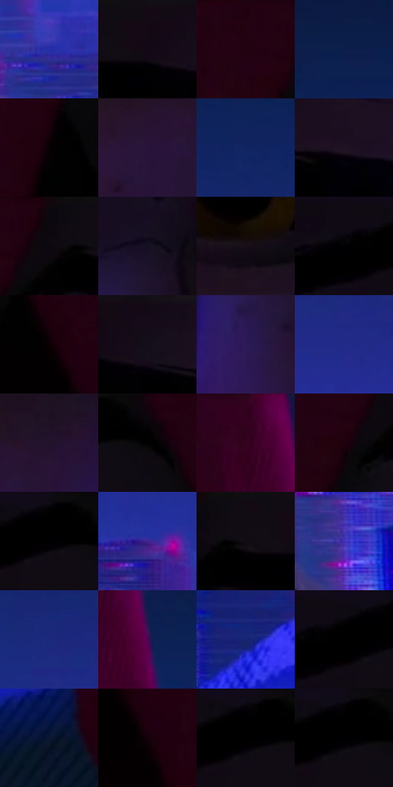

# 电影参考 539

- 状态：常规／活跃；来源世界：miles-home。
- 视角：near-level；景别：close-up；场景：city。
- 时段：night-appearance（外观依据，中置信度；具体时间／晨昏未知）；光照：night-mixed。
- 材质候选：skin, fabric, glass, stone, metal, sky（帧级，不是像素分割）。
- 明暗组：very-dark；L* P5/P50/P95：0.25302 / 5.78198 / 27.62785。
- 资格门禁：无附加门禁。
- 原截图 SHA-256：`f8d69379570751d730c3d5bc531add9a9dff3521d5990261a89961adaada8ae9`；尺寸：2880 × 1202。
- sRGB 像素 SHA-256：`d6be9be436253c2b7b41f2adb2416da498d78bdfdfa3f6201346605ab3cd17e7`。

## 观察与迁移

夜城人物与玻璃立面；倾斜视角不授权更改原照建筑透视。

兜帽近脸：蓝城背景、暗红兜帽、紫色肤面与小琥珀眼点；发面与衣肩暗块低细节，皮肤排线有位置而非满铺。

本公开版保存32个128×128原像素色卡上下文；图集格子并非原场景相邻位置。原rect、图集tile和像素SHA见 `data/palette-crops.json`。上下文不足时不得批准替色，不能以小样推断完整构图。

## 实测色卡

颜色比例分母为保留采样像素，不是材料面积；全部 32 色参与全库匹配。表内四舍五入仅用于阅读，原精度在 JSON。

| ID | HEX | Lab | 原图 xy | 像素数 | 比例 | 明度角色 |
| --- | --- | --- | --- | ---: | ---: | --- |
| 539-S01 | #262FA7 | [27.39114, 39.061978, -64.873337] | [2620, 820] | 11943 | 6.199390% | shadow |
| 539-S02 | #120A14 | [3.578813, 4.410234, -4.022196] | [1008, 44] | 11144 | 5.784643% | deep-shadow |
| 539-S03 | #230212 | [4.015242, 16.449965, -1.866732] | [768, 28] | 10816 | 5.614385% | deep-shadow |
| 539-S04 | #0D1E4C | [12.833036, 12.227495, -30.522466] | [108, 96] | 9270 | 4.811885% | deep-shadow |
| 539-S05 | #070002 | [0.447735, 2.108583, -0.111877] | [728, 380] | 8765 | 4.549749% | deep-shadow |
| 539-S06 | #29143B | [11.187704, 19.778816, -21.13807] | [1120, 500] | 8289 | 4.302666% | deep-shadow |
| 539-S07 | #102463 | [16.856098, 18.056726, -39.444115] | [304, 228] | 8194 | 4.253353% | deep-shadow |
| 539-S08 | #1F1222 | [7.582554, 10.413129, -8.5168] | [1204, 92] | 7881 | 4.090881% | deep-shadow |
| 539-S09 | #0C080F | [2.586303, 2.15125, -2.549104] | [872, 40] | 7734 | 4.014576% | deep-shadow |
| 539-S10 | #161022 | [5.931332, 7.40209, -11.146892] | [1440, 268] | 6814 | 3.537021% | deep-shadow |
| 539-S11 | #190D19 | [5.101168, 7.517038, -5.369198] | [1128, 344] | 6803 | 3.531311% | deep-shadow |
| 539-S12 | #010001 | [0.078096, 0.400543, -0.286285] | [1788, 68] | 6364 | 3.303434% | deep-shadow |
| 539-S13 | #0A0002 | [0.622661, 2.893081, 0.164538] | [2200, 452] | 6320 | 3.280595% | deep-shadow |
| 539-S14 | #160B19 | [4.336867, 6.949117, -6.526643] | [1076, 32] | 6311 | 3.275923% | deep-shadow |
| 539-S15 | #2D1A57 | [15.406465, 25.593541, -33.708826] | [1404, 480] | 6016 | 3.122794% | deep-shadow |
| 539-S16 | #222A88 | [22.905784, 30.608478, -53.231307] | [2820, 468] | 6012 | 3.120718% | shadow |
| 539-S17 | #22132C | [8.888424, 13.722539, -13.947794] | [1208, 444] | 5996 | 3.112412% | deep-shadow |
| 539-S18 | #040001 | [0.253022, 1.185041, -0.009869] | [1984, 72] | 5523 | 2.866887% | deep-shadow |
| 539-S19 | #32021F | [7.412746, 26.811143, -6.161069] | [2336, 28] | 5464 | 2.836261% | deep-shadow |
| 539-S20 | #1F000D | [2.894595, 13.64853, -0.858434] | [812, 108] | 5319 | 2.760994% | deep-shadow |
| 539-S21 | #010101 | [0.274173, -1.7e-05, 3.3e-05] | [1904, 28] | 5189 | 2.693514% | deep-shadow |
| 539-S22 | #3D258E | [24.537242, 39.411153, -54.210529] | [216, 596] | 5146 | 2.671193% | shadow |
| 539-S23 | #120C15 | [4.025882, 3.794707, -4.045207] | [932, 48] | 5091 | 2.642644% | deep-shadow |
| 539-S24 | #4230B2 | [30.605464, 45.235537, -66.109045] | [2812, 984] | 5008 | 2.599560% | shadow |
| 539-S25 | #1A297D | [21.152844, 26.188978, -49.197961] | [2604, 392] | 4764 | 2.472904% | shadow |
| 539-S26 | #4C0553 | [16.843897, 40.587915, -28.436459] | [2412, 152] | 3443 | 1.787197% | deep-shadow |
| 539-S27 | #172472 | [18.619847, 24.986564, -46.323867] | [260, 892] | 3188 | 1.654832% | deep-shadow |
| 539-S28 | #060307 | [1.076594, 1.340621, -1.23718] | [1848, 40] | 2891 | 1.500664% | deep-shadow |
| 539-S29 | #0B1734 | [8.409492, 6.636318, -20.71922] | [408, 1016] | 2638 | 1.369337% | deep-shadow |
| 539-S30 | #160209 | [2.111525, 7.36254, -0.397659] | [2240, 516] | 2169 | 1.125888% | deep-shadow |
| 539-S31 | #010004 | [0.137456, 0.817675, -1.421556] | [1888, 32] | 1533 | 0.795752% | deep-shadow |
| 539-S32 | #030203 | [0.626443, 0.400508, -0.286219] | [1900, 28] | 610 | 0.316640% | deep-shadow |

## 色阶与空间分布

- 采样 ROI：`[0.01, 0.02, 0.98, 0.94]`；步长：4；样本数：192648。
- 排除区：`[]`。
- 深暗、暗、中、亮、高光五段计数：`[159818, 32701, 129, 0, 0]`。
- RGB 各 256 箱、L* 100 箱、13×5 色相明度表和 3×3 空间统计全部保存在 [总数据](../film-library.json)。
- [可视化档案](../../references/library.html)按需绘制直方图，不存 2,094 张重复图表图片。

## 纹理特征占比

**这是分块图像特征的面积占比，不是波点／排线／丝网／错版的精确语义覆盖率。** 窗格、发丝、织物也会产生方向或周期特征。
原图 ROI 像素 3087370；已测块覆盖 3087370（100.0000%）；未测 0。

| 特征 | 块覆盖像素 | 占已测面积 | 阈值敏感范围 |
| --- | ---: | ---: | --- |
| low-contrast | 1404672 | 45.4974% | 35.8042% ~ 49.2121% |
| directional-structure | 338432 | 10.9618% | 3.1841% ~ 22.7777% |
| periodic-structure | 1248778 | 40.4480% | 38.3252% ~ 40.4480% |
| mixed-detail | 95488 | 3.0929% | 3.0929% ~ 7.1559% |

阈值敏感范围不是统计置信区间。逐块坐标、尺度、对比、方向一致性、频谱集中度、频率与角度见 [全量特征记录](../texture-features.jsonl)，以帧号定位。
四种印刷层的真实像素覆盖仍标为 `null`，不能填 0，也不能拿上表代替。不得据这些代理测量删除唯一证据。

[测量方法与保留策略](../../references/library-retention.md) · [分类索引](../archive/README.md)
