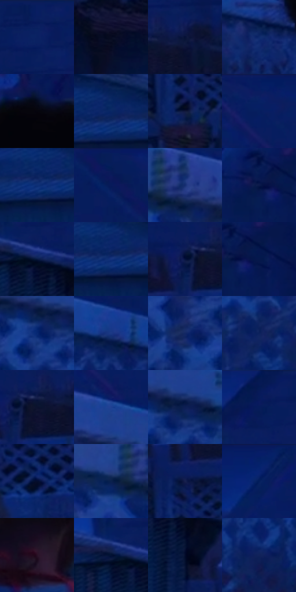

# 电影参考 540

- 状态：常规／活跃；来源世界：miles-home。
- 视角：near-level；景别：medium；场景：city。
- 时段：night-appearance（外观依据，中置信度；具体时间／晨昏未知）；光照：night-mixed。
- 材质候选：skin, fabric, glass, stone, metal, sky（帧级，不是像素分割）。
- 明暗组：very-dark；L* P5/P50/P95：2.99783 / 13.66468 / 25.08278。
- 资格门禁：无附加门禁。
- 原截图 SHA-256：`ad74f4dad171a92733c4a3f18b773f7ff1618528443a058e4d6664c6ebf2d62c`；尺寸：2880 × 1214。
- sRGB 像素 SHA-256：`18b398063d69fc64d96171a82af23ec8f3cec798ae56771f9ef39f6ceeb2e828`。

## 观察与迁移

夜城人物与玻璃立面；倾斜视角不授权更改原照建筑透视。

蓝夜庭院：白围栏受蓝光成为中亮层，棚屋更暗，黑发锚点与低亮红衣分开；同色系靠明暗、板缝和遮挡读结构。

本公开版保存32个128×128原像素色卡上下文；图集格子并非原场景相邻位置。原rect、图集tile和像素SHA见 `data/palette-crops.json`。上下文不足时不得批准替色，不能以小样推断完整构图。

## 实测色卡

颜色比例分母为保留采样像素，不是材料面积；全部 32 色参与全库匹配。表内四舍五入仅用于阅读，原精度在 JSON。

| ID | HEX | Lab | 原图 xy | 像素数 | 比例 | 明度角色 |
| --- | --- | --- | --- | ---: | ---: | --- |
| 540-S01 | #081E5E | [14.332558, 19.5993, -40.269964] | [2148, 32] | 14762 | 7.580286% | deep-shadow |
| 540-S02 | #070B21 | [3.561456, 4.381042, -14.102152] | [2388, 760] | 11968 | 6.145567% | deep-shadow |
| 540-S03 | #061036 | [6.101915, 11.52105, -25.909618] | [2384, 300] | 8568 | 4.399667% | deep-shadow |
| 540-S04 | #0E296B | [18.972124, 17.588379, -41.230899] | [928, 392] | 8497 | 4.363209% | deep-shadow |
| 540-S05 | #05040D | [1.338225, 1.548952, -3.411868] | [1180, 176] | 8006 | 4.111080% | deep-shadow |
| 540-S06 | #0A2764 | [17.623041, 15.677657, -38.860652] | [1652, 228] | 7301 | 3.749063% | deep-shadow |
| 540-S07 | #10183B | [9.633406, 9.980589, -23.778894] | [2100, 540] | 7290 | 3.743414% | deep-shadow |
| 540-S08 | #0A2062 | [15.376549, 20.007523, -41.212991] | [280, 40] | 7257 | 3.726469% | deep-shadow |
| 540-S09 | #0D2E75 | [21.294679, 18.129923, -43.891057] | [1596, 256] | 6958 | 3.572932% | shadow |
| 540-S10 | #081A59 | [12.680021, 20.410048, -39.630688] | [844, 44] | 6871 | 3.528258% | deep-shadow |
| 540-S11 | #152E72 | [21.311389, 17.642514, -41.929601] | [136, 172] | 6681 | 3.430693% | shadow |
| 540-S12 | #0C1A4B | [11.447269, 14.731993, -32.089339] | [2636, 132] | 6652 | 3.415801% | deep-shadow |
| 540-S13 | #071943 | [10.148941, 11.237153, -28.638219] | [1940, 248] | 6600 | 3.389099% | deep-shadow |
| 540-S14 | #15327D | [23.407167, 19.342911, -45.52162] | [1624, 252] | 6480 | 3.327479% | shadow |
| 540-S15 | #03103D | [6.564259, 14.618156, -30.232833] | [2284, 320] | 5924 | 3.041973% | deep-shadow |
| 540-S16 | #05184C | [10.60954, 15.887713, -34.162638] | [2684, 136] | 5538 | 2.843763% | deep-shadow |
| 540-S17 | #082872 | [19.155203, 20.849457, -45.46784] | [344, 288] | 5392 | 2.768792% | deep-shadow |
| 540-S18 | #1B3885 | [26.022114, 19.034133, -46.2786] | [700, 304] | 5275 | 2.708712% | shadow |
| 540-S19 | #132765 | [18.047603, 17.0482, -38.811228] | [184, 336] | 5161 | 2.650173% | deep-shadow |
| 540-S20 | #0C215C | [15.159611, 16.854008, -37.576097] | [468, 404] | 5069 | 2.602931% | deep-shadow |
| 540-S21 | #0B122E | [6.331459, 7.415806, -19.636392] | [2324, 320] | 4980 | 2.557230% | deep-shadow |
| 540-S22 | #1F4092 | [29.494116, 19.166405, -48.670697] | [304, 168] | 4863 | 2.497150% | shadow |
| 540-S23 | #0D1E53 | [13.461887, 15.307195, -34.283452] | [380, 260] | 4836 | 2.483286% | deep-shadow |
| 540-S24 | #061B54 | [12.366813, 17.282838, -36.76425] | [1956, 32] | 4328 | 2.222428% | deep-shadow |
| 540-S25 | #040D2F | [4.68628, 8.756423, -23.023881] | [2352, 504] | 4280 | 2.197780% | deep-shadow |
| 540-S26 | #052153 | [14.083117, 12.111757, -33.285651] | [52, 192] | 4072 | 2.090972% | deep-shadow |
| 540-S27 | #18214F | [14.658378, 13.125335, -29.590596] | [2100, 420] | 3870 | 1.987245% | deep-shadow |
| 540-S28 | #072168 | [16.164682, 21.608482, -43.875869] | [620, 56] | 3801 | 1.951813% | deep-shadow |
| 540-S29 | #281024 | [8.560433, 16.078287, -8.405963] | [1196, 580] | 3679 | 1.889166% | deep-shadow |
| 540-S30 | #021234 | [6.262754, 8.265595, -24.200388] | [1892, 240] | 3493 | 1.793655% | deep-shadow |
| 540-S31 | #030B2A | [3.846143, 6.974532, -20.598257] | [1988, 336] | 3217 | 1.651929% | deep-shadow |
| 540-S32 | #11225A | [15.492857, 15.828196, -35.686319] | [640, 496] | 3073 | 1.577985% | deep-shadow |

## 色阶与空间分布

- 采样 ROI：`[0.01, 0.02, 0.98, 0.94]`；步长：4；样本数：194742。
- 排除区：`[]`。
- 深暗、暗、中、亮、高光五段计数：`[163305, 31437, 0, 0, 0]`。
- RGB 各 256 箱、L* 100 箱、13×5 色相明度表和 3×3 空间统计全部保存在 [总数据](../film-library.json)。
- [可视化档案](../../references/library.html)按需绘制直方图，不存 2,094 张重复图表图片。

## 纹理特征占比

**这是分块图像特征的面积占比，不是波点／排线／丝网／错版的精确语义覆盖率。** 窗格、发丝、织物也会产生方向或周期特征。
原图 ROI 像素 3120898；已测块覆盖 3120898（100.0000%）；未测 0。

| 特征 | 块覆盖像素 | 占已测面积 | 阈值敏感范围 |
| --- | ---: | ---: | --- |
| low-contrast | 487168 | 15.6099% | 13.7437% ~ 20.1009% |
| directional-structure | 327808 | 10.5036% | 2.6249% ~ 24.8257% |
| periodic-structure | 2226818 | 71.3518% | 61.4306% ~ 73.9767% |
| mixed-detail | 79104 | 2.5347% | 0.0000% ~ 3.2975% |

阈值敏感范围不是统计置信区间。逐块坐标、尺度、对比、方向一致性、频谱集中度、频率与角度见 [全量特征记录](../texture-features.jsonl)，以帧号定位。
四种印刷层的真实像素覆盖仍标为 `null`，不能填 0，也不能拿上表代替。不得据这些代理测量删除唯一证据。

[测量方法与保留策略](../../references/library-retention.md) · [分类索引](../archive/README.md)
