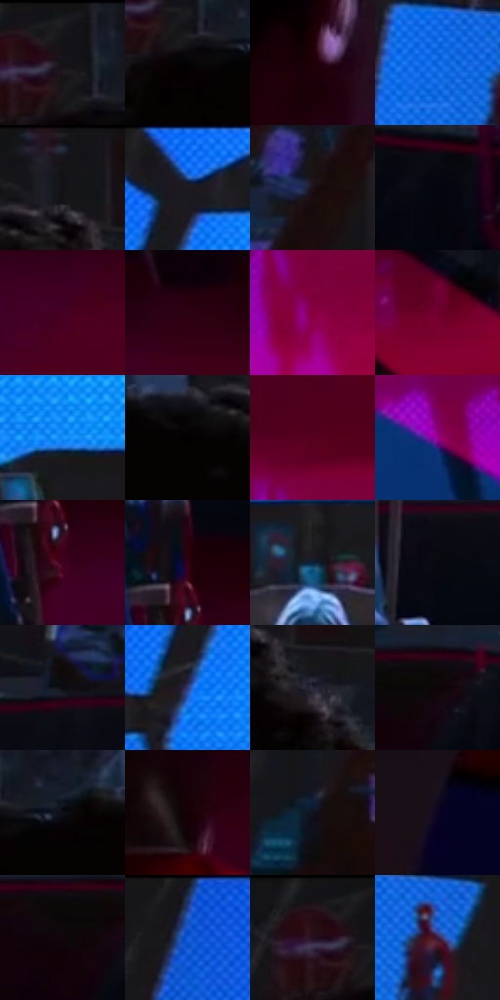

# 电影参考 541

- 状态：常规／活跃；来源世界：miles-home。
- 视角：near-level；景别：environment-wide；场景：interior。
- 时段：interior-time-unknown（外观依据，中置信度；具体时间／晨昏未知）；光照：cool-interior。
- 材质候选：skin, hair, fabric, wood, screen, metal（帧级，不是像素分割）。
- 明暗组：very-dark；L* P5/P50/P95：0.72327 / 7.61106 / 50.96141。
- 资格门禁：无附加门禁。
- 原截图 SHA-256：`933492202762045f090deb0e911f05e9a50e403a234808776b9c62fb0b3d2b61`；尺寸：2880 × 1212。
- sRGB 像素 SHA-256：`5c6ca7ad0f156349685aa1dfb0576acc9893ff9f346590bccc502608532c461c`。

## 观察与迁移

蓝屏和红暗地面，屏幕亮面、皮肤与椅木材质分层。

暗室：上方蓝屏高亮，下方洋红地面较暗但高彩，人物和梁柱深暗；地面映光不是显示内容，屏幕网纹不复制到皮肤。

本公开版保存32个128×128原像素色卡上下文；图集格子并非原场景相邻位置。原rect、图集tile和像素SHA见 `data/palette-crops.json`。上下文不足时不得批准替色，不能以小样推断完整构图。

## 实测色卡

颜色比例分母为保留采样像素，不是材料面积；全部 32 色参与全库匹配。表内四舍五入仅用于阅读，原精度在 JSON。

| ID | HEX | Lab | 原图 xy | 像素数 | 比例 | 明度角色 |
| --- | --- | --- | --- | ---: | ---: | --- |
| 541-S01 | #19181B | [8.473205, 1.274975, -1.927666] | [248, 28] | 13953 | 7.190637% | deep-shadow |
| 541-S02 | #050203 | [0.74306, 0.923507, -0.101942] | [268, 128] | 11322 | 5.834759% | deep-shadow |
| 541-S03 | #1F0007 | [2.770733, 12.778139, 1.510434] | [500, 632] | 11126 | 5.733751% | deep-shadow |
| 541-S04 | #146EE9 | [48.486885, 22.213081, -68.759212] | [1912, 276] | 10298 | 5.307044% | midtone |
| 541-S05 | #151518 | [6.880403, 0.748565, -2.03745] | [560, 36] | 10293 | 5.304467% | deep-shadow |
| 541-S06 | #1B1B24 | [10.139422, 2.522938, -6.145662] | [1204, 60] | 8496 | 4.378388% | deep-shadow |
| 541-S07 | #1C0F18 | [5.912109, 7.884536, -3.356802] | [2568, 316] | 8496 | 4.378388% | deep-shadow |
| 541-S08 | #04050D | [1.475995, 0.886892, -3.217689] | [2596, 604] | 7408 | 3.817691% | deep-shadow |
| 541-S09 | #460124 | [12.29669, 33.463148, -2.146485] | [1936, 804] | 7105 | 3.661541% | deep-shadow |
| 541-S10 | #290110 | [4.793552, 20.620169, 0.557335] | [2008, 716] | 6917 | 3.564655% | deep-shadow |
| 541-S11 | #87003B | [28.029193, 52.261043, 6.133579] | [2008, 1028] | 6875 | 3.543011% | shadow |
| 541-S12 | #70002E | [22.454489, 45.57196, 6.508843] | [1532, 1004] | 6676 | 3.440457% | shadow |
| 541-S13 | #148FF9 | [58.629539, 7.822629, -61.294148] | [1380, 300] | 6399 | 3.297706% | midtone |
| 541-S14 | #020001 | [0.136404, 0.662042, -0.194147] | [464, 136] | 6010 | 3.097236% | deep-shadow |
| 541-S15 | #550020 | [15.675976, 37.490444, 6.161708] | [2004, 904] | 5869 | 3.024572% | deep-shadow |
| 541-S16 | #97008D | [35.01076, 64.951964, -35.983939] | [1812, 1024] | 5869 | 3.024572% | shadow |
| 541-S17 | #3F001D | [10.151244, 31.30804, -0.192329] | [1624, 772] | 5866 | 3.023026% | deep-shadow |
| 541-S18 | #350116 | [7.558263, 27.236914, 1.090488] | [1616, 688] | 5841 | 3.010142% | deep-shadow |
| 541-S19 | #10213B | [12.693497, 3.023595, -18.884503] | [1508, 376] | 5830 | 3.004473% | deep-shadow |
| 541-S20 | #070910 | [2.510644, 0.599071, -3.238246] | [1624, 556] | 5733 | 2.954485% | deep-shadow |
| 541-S21 | #0C0C12 | [3.475611, 1.086537, -2.957307] | [1300, 488] | 5639 | 2.906042% | deep-shadow |
| 541-S22 | #343E7C | [28.459048, 15.683683, -36.642252] | [1176, 176] | 5183 | 2.671044% | shadow |
| 541-S23 | #2A2738 | [16.644696, 5.85466, -10.44699] | [628, 148] | 4748 | 2.446868% | deep-shadow |
| 541-S24 | #100408 | [1.937996, 3.97417, -0.309217] | [2100, 536] | 4380 | 2.257220% | deep-shadow |
| 541-S25 | #0E0F18 | [4.524964, 1.663557, -5.548746] | [348, 108] | 3711 | 1.912453% | deep-shadow |
| 541-S26 | #160106 | [1.856086, 7.345969, 0.451294] | [404, 760] | 3438 | 1.771763% | deep-shadow |
| 541-S27 | #0F141F | [6.329929, 1.160604, -8.294727] | [2388, 408] | 2809 | 1.447610% | deep-shadow |
| 541-S28 | #0B0420 | [2.368784, 7.897552, -15.110969] | [272, 1036] | 2449 | 1.262085% | deep-shadow |
| 541-S29 | #10040C | [2.019372, 4.546004, -1.86553] | [2048, 556] | 1729 | 0.891035% | deep-shadow |
| 541-S30 | #1E56BE | [38.980185, 21.641009, -59.571781] | [924, 44] | 1508 | 0.777143% | shadow |
| 541-S31 | #171217 | [6.112061, 3.324186, -2.375526] | [200, 28] | 1450 | 0.747253% | deep-shadow |
| 541-S32 | #3F1B3E | [16.447356, 23.440575, -14.728547] | [2000, 288] | 618 | 0.318484% | deep-shadow |

## 色阶与空间分布

- 采样 ROI：`[0.01, 0.02, 0.98, 0.94]`；步长：4；样本数：194044。
- 排除区：`[]`。
- 深暗、暗、中、亮、高光五段计数：`[150388, 25285, 16500, 1868, 3]`。
- RGB 各 256 箱、L* 100 箱、13×5 色相明度表和 3×3 空间统计全部保存在 [总数据](../film-library.json)。
- [可视化档案](../../references/library.html)按需绘制直方图，不存 2,094 张重复图表图片。

## 纹理特征占比

**这是分块图像特征的面积占比，不是波点／排线／丝网／错版的精确语义覆盖率。** 窗格、发丝、织物也会产生方向或周期特征。
原图 ROI 像素 3115310；已测块覆盖 3115310（100.0000%）；未测 0。

| 特征 | 块覆盖像素 | 占已测面积 | 阈值敏感范围 |
| --- | ---: | ---: | --- |
| low-contrast | 919296 | 29.5090% | 21.2463% ~ 36.1651% |
| directional-structure | 278528 | 8.9406% | 3.6814% ~ 20.3588% |
| periodic-structure | 1884718 | 60.4986% | 56.9979% ~ 60.4986% |
| mixed-detail | 32768 | 1.0518% | 0.5259% ~ 3.1555% |

阈值敏感范围不是统计置信区间。逐块坐标、尺度、对比、方向一致性、频谱集中度、频率与角度见 [全量特征记录](../texture-features.jsonl)，以帧号定位。
四种印刷层的真实像素覆盖仍标为 `null`，不能填 0，也不能拿上表代替。不得据这些代理测量删除唯一证据。

[测量方法与保留策略](../../references/library-retention.md) · [分类索引](../archive/README.md)
