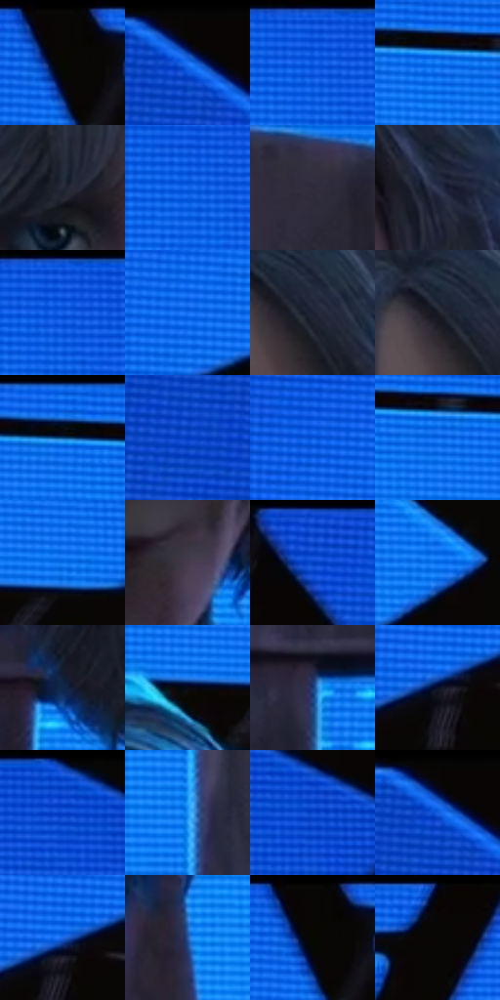

# 电影参考 542

- 状态：常规／活跃；来源世界：miles-home。
- 视角：near-level；景别：close-up；场景：interior。
- 时段：interior-time-unknown（外观依据，中置信度；具体时间／晨昏未知）；光照：cool-interior。
- 材质候选：skin, hair, fabric, wood, screen, metal（帧级，不是像素分割）。
- 明暗组：dark；L* P5/P50/P95：1.56558 / 34.57431 / 53.85863。
- 资格门禁：无附加门禁。
- 原截图 SHA-256：`8895d2d245960d8bff716206fc546919624679d24477b42cf761969204e7355e`；尺寸：2880 × 1220。
- sRGB 像素 SHA-256：`ad0bbaad373a84d41549af23dfdfe32b030309b5a6d15e4e622004e07efb9b71`。

## 观察与迁移

蓝屏和红暗地面，屏幕亮面、皮肤与椅木材质分层。

蓝屏前人物：白灰发有青亮边，脸为冷粉中调、衣服深暗；屏幕亮块被黑梁分隔，发束、木椅纹、屏纹不同。

本公开版保存32个128×128原像素色卡上下文；图集格子并非原场景相邻位置。原rect、图集tile和像素SHA见 `data/palette-crops.json`。上下文不足时不得批准替色，不能以小样推断完整构图。

## 实测色卡

颜色比例分母为保留采样像素，不是材料面积；全部 32 色参与全库匹配。表内四舍五入仅用于阅读，原精度在 JSON。

| ID | HEX | Lab | 原图 xy | 像素数 | 比例 | 明度角色 |
| --- | --- | --- | --- | ---: | ---: | --- |
| 542-S01 | #090705 | [1.996258, 0.244789, 0.941355] | [1108, 28] | 12023 | 6.151760% | deep-shadow |
| 542-S02 | #080504 | [1.526007, 0.645367, 0.655004] | [104, 28] | 10389 | 5.315698% | deep-shadow |
| 542-S03 | #105BE2 | [42.884406, 31.587603, -73.938535] | [2024, 36] | 9475 | 4.848035% | midtone |
| 542-S04 | #1780F9 | [54.507853, 17.14386, -67.925596] | [1532, 80] | 8313 | 4.253479% | midtone |
| 542-S05 | #252838 | [16.485651, 3.228262, -10.732719] | [1320, 576] | 8268 | 4.230454% | deep-shadow |
| 542-S06 | #1467EC | [46.845987, 27.851196, -73.11395] | [2012, 92] | 8245 | 4.218686% | midtone |
| 542-S07 | #2F2B3A | [18.529618, 5.58152, -8.907724] | [1984, 572] | 7969 | 4.077466% | deep-shadow |
| 542-S08 | #2B334D | [21.641567, 4.400749, -17.060444] | [1656, 580] | 7783 | 3.982296% | shadow |
| 542-S09 | #054DD4 | [38.005542, 34.964383, -73.938127] | [2040, 40] | 7705 | 3.942386% | shadow |
| 542-S10 | #1973F3 | [50.612022, 23.105968, -70.901726] | [976, 192] | 7458 | 3.816005% | midtone |
| 542-S11 | #1D2231 | [13.393339, 2.320528, -10.60744] | [1508, 412] | 6678 | 3.416905% | deep-shadow |
| 542-S12 | #191B26 | [10.034012, 2.322857, -7.806171] | [1468, 392] | 6644 | 3.399509% | deep-shadow |
| 542-S13 | #045ADD | [42.086418, 29.961709, -72.405498] | [1488, 28] | 6042 | 3.091486% | midtone |
| 542-S14 | #0540C2 | [33.118807, 36.504116, -71.519623] | [48, 156] | 5970 | 3.054646% | shadow |
| 542-S15 | #0754D8 | [40.149327, 32.009742, -72.718103] | [804, 132] | 5886 | 3.011666% | midtone |
| 542-S16 | #0A69E7 | [46.888018, 24.300625, -70.237278] | [1588, 96] | 5886 | 3.011666% | midtone |
| 542-S17 | #0C75ED | [50.583922, 19.02539, -67.604799] | [1700, 164] | 5833 | 2.984548% | midtone |
| 542-S18 | #453B4C | [26.491114, 8.138823, -8.737605] | [1488, 884] | 5767 | 2.950778% | shadow |
| 542-S19 | #1656DA | [41.033746, 32.002394, -72.406384] | [480, 32] | 5609 | 2.869935% | midtone |
| 542-S20 | #0565E0 | [45.246375, 24.012592, -68.954848] | [1908, 388] | 5571 | 2.850491% | midtone |
| 542-S21 | #0F264A | [15.392186, 5.558704, -25.019669] | [1108, 788] | 5253 | 2.687781% | deep-shadow |
| 542-S22 | #090A12 | [2.879879, 1.118821, -3.848981] | [1592, 192] | 5174 | 2.647360% | deep-shadow |
| 542-S23 | #193D78 | [26.446578, 9.945673, -37.433829] | [888, 816] | 5152 | 2.636103% | shadow |
| 542-S24 | #081127 | [5.410148, 3.988698, -15.850451] | [828, 332] | 5149 | 2.634568% | deep-shadow |
| 542-S25 | #0648CC | [36.043841, 35.168992, -72.53788] | [2368, 28] | 5148 | 2.634056% | shadow |
| 542-S26 | #2297F8 | [60.99863, 3.402811, -56.946447] | [1984, 980] | 4670 | 2.389480% | light |
| 542-S27 | #0F4ED1 | [38.113042, 33.457756, -72.028437] | [2424, 88] | 4268 | 2.183790% | shadow |
| 542-S28 | #090708 | [2.055619, 0.661921, -0.193916] | [96, 32] | 4224 | 2.161277% | deep-shadow |
| 542-S29 | #1B67E3 | [46.280329, 24.728562, -68.9586] | [844, 312] | 3785 | 1.936656% | midtone |
| 542-S30 | #235CA8 | [39.304991, 9.523842, -46.092969] | [1644, 924] | 3399 | 1.739153% | shadow |
| 542-S31 | #090702 | [1.936898, -0.172342, 2.076626] | [1108, 52] | 1349 | 0.690237% | deep-shadow |
| 542-S32 | #090502 | [1.544742, 0.628779, 1.50399] | [1864, 28] | 355 | 0.181641% | deep-shadow |

## 色阶与空间分布

- 采样 ROI：`[0.01, 0.02, 0.98, 0.94]`；步长：4；样本数：195440。
- 排除区：`[]`。
- 深暗、暗、中、亮、高光五段计数：`[74228, 47135, 71856, 2212, 9]`。
- RGB 各 256 箱、L* 100 箱、13×5 色相明度表和 3×3 空间统计全部保存在 [总数据](../film-library.json)。
- [可视化档案](../../references/library.html)按需绘制直方图，不存 2,094 张重复图表图片。

## 纹理特征占比

**这是分块图像特征的面积占比，不是波点／排线／丝网／错版的精确语义覆盖率。** 窗格、发丝、织物也会产生方向或周期特征。
原图 ROI 像素 3134868；已测块覆盖 3134868（100.0000%）；未测 0。

| 特征 | 块覆盖像素 | 占已测面积 | 阈值敏感范围 |
| --- | ---: | ---: | --- |
| low-contrast | 45312 | 1.4454% | 0.9228% ~ 1.4454% |
| directional-structure | 1811348 | 57.7807% | 33.0650% ~ 72.8147% |
| periodic-structure | 1264640 | 40.3411% | 25.8297% ~ 63.0887% |
| mixed-detail | 13568 | 0.4328% | 0.4328% ~ 2.4009% |

阈值敏感范围不是统计置信区间。逐块坐标、尺度、对比、方向一致性、频谱集中度、频率与角度见 [全量特征记录](../texture-features.jsonl)，以帧号定位。
四种印刷层的真实像素覆盖仍标为 `null`，不能填 0，也不能拿上表代替。不得据这些代理测量删除唯一证据。

[测量方法与保留策略](../../references/library-retention.md) · [分类索引](../archive/README.md)
