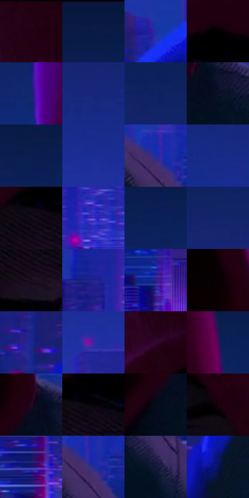

# 电影参考 543

- 状态：常规／活跃；来源世界：miles-home。
- 视角：near-level；景别：medium；场景：city。
- 时段：night-appearance（外观依据，中置信度；具体时间／晨昏未知）；光照：night-mixed。
- 材质候选：skin, fabric, glass, stone, metal, sky（帧级，不是像素分割）。
- 明暗组：very-dark；L* P5/P50/P95：0.31133 / 15.7575 / 28.13019。
- 资格门禁：无附加门禁。
- 原截图 SHA-256：`3699770b7e78af7eff05cb2645c60d7701232f626788e21eabde017dbc52644c`；尺寸：2880 × 1214。
- sRGB 像素 SHA-256：`979dc39128b0c22621a11ef8b3461e84111f47a2bc7469f756e521edd1bbde91`。

## 观察与迁移

夜城人物与玻璃立面；倾斜视角不授权更改原照建筑透视。

夜间中近景：红帽与绿衣在蓝环境里仍保材质身份，脸暗于背景；青肩边、紫鼻面及细排线共同造型而非全身发光。

本公开版保存32个128×128原像素色卡上下文；图集格子并非原场景相邻位置。原rect、图集tile和像素SHA见 `data/palette-crops.json`。上下文不足时不得批准替色，不能以小样推断完整构图。

## 实测色卡

颜色比例分母为保留采样像素，不是材料面积；全部 32 色参与全库匹配。表内四舍五入仅用于阅读，原精度在 JSON。

| ID | HEX | Lab | 原图 xy | 像素数 | 比例 | 明度角色 |
| --- | --- | --- | --- | ---: | ---: | --- |
| 543-S01 | #230012 | [3.623086, 17.251086, -2.439368] | [1320, 60] | 13071 | 6.711957% | deep-shadow |
| 543-S02 | #0A1A45 | [10.797062, 11.786738, -28.98074] | [824, 52] | 11023 | 5.660310% | deep-shadow |
| 543-S03 | #202FA6 | [26.995525, 38.201752, -64.931982] | [780, 848] | 10930 | 5.612554% | shadow |
| 543-S04 | #010001 | [0.078096, 0.400543, -0.286285] | [1428, 200] | 8853 | 4.546015% | deep-shadow |
| 543-S05 | #162472 | [18.569464, 24.878472, -46.408439] | [984, 356] | 8469 | 4.348831% | deep-shadow |
| 543-S06 | #15277C | [20.302557, 26.672074, -49.967231] | [220, 428] | 8252 | 4.237401% | shadow |
| 543-S07 | #102362 | [16.47238, 18.369559, -39.410685] | [576, 248] | 8161 | 4.190673% | deep-shadow |
| 543-S08 | #061224 | [5.407462, 1.668101, -13.582488] | [1976, 876] | 8100 | 4.159349% | deep-shadow |
| 543-S09 | #0B1E50 | [13.09929, 13.743027, -32.834808] | [2232, 132] | 7981 | 4.098243% | deep-shadow |
| 543-S10 | #192D98 | [24.79456, 33.788189, -60.048368] | [2728, 556] | 7665 | 3.935977% | shadow |
| 543-S11 | #1A30A4 | [26.770795, 36.405362, -64.101761] | [2168, 904] | 7434 | 3.817358% | shadow |
| 543-S12 | #152A87 | [22.173673, 28.95298, -53.831848] | [2144, 492] | 7318 | 3.757792% | shadow |
| 543-S13 | #100913 | [3.184613, 3.842165, -3.969215] | [1328, 292] | 7074 | 3.632498% | deep-shadow |
| 543-S14 | #3933BE | [31.70145, 46.344148, -71.439339] | [2788, 864] | 6657 | 3.418369% | shadow |
| 543-S15 | #0C2159 | [14.88161, 15.544889, -36.021382] | [436, 172] | 6519 | 3.347506% | deep-shadow |
| 543-S16 | #12246C | [17.794088, 22.032764, -43.800482] | [2632, 312] | 6383 | 3.277670% | deep-shadow |
| 543-S17 | #180C1B | [4.844192, 8.03823, -7.335746] | [1332, 368] | 6095 | 3.129782% | deep-shadow |
| 543-S18 | #1B2283 | [20.104151, 33.200927, -54.716049] | [44, 844] | 6025 | 3.093837% | shadow |
| 543-S19 | #2E228F | [22.679337, 39.357173, -57.936221] | [308, 1108] | 5756 | 2.955705% | shadow |
| 543-S20 | #090103 | [0.780217, 2.370065, -0.019706] | [1856, 744] | 5619 | 2.885356% | deep-shadow |
| 543-S21 | #1A2990 | [23.061162, 33.455661, -57.970225] | [612, 976] | 5476 | 2.811926% | shadow |
| 543-S22 | #3C26A4 | [26.809601, 45.503032, -63.965369] | [2516, 640] | 5205 | 2.672767% | shadow |
| 543-S23 | #320634 | [9.452758, 28.334222, -18.763492] | [1292, 160] | 4742 | 2.435017% | deep-shadow |
| 543-S24 | #470A5B | [17.046689, 39.702123, -33.554914] | [1868, 176] | 4338 | 2.227563% | deep-shadow |
| 543-S25 | #250A24 | [6.664819, 18.404985, -11.379328] | [1924, 828] | 3830 | 1.966705% | deep-shadow |
| 543-S26 | #050309 | [1.057859, 1.357209, -2.086165] | [1380, 280] | 3349 | 1.719711% | deep-shadow |
| 543-S27 | #040C1B | [3.322738, 1.21491, -9.757747] | [1884, 908] | 2848 | 1.462448% | deep-shadow |
| 543-S28 | #17010A | [2.039918, 8.371623, -0.896981] | [1680, 376] | 2423 | 1.244210% | deep-shadow |
| 543-S29 | #171572 | [15.131117, 34.619342, -52.074809] | [2460, 1092] | 2244 | 1.152294% | deep-shadow |
| 543-S30 | #262C9C | [25.601689, 37.014623, -61.145247] | [2192, 928] | 1047 | 0.537634% | shadow |
| 543-S31 | #101635 | [8.489199, 8.993837, -21.299552] | [2204, 1072] | 1007 | 0.517094% | deep-shadow |
| 543-S32 | #0A145E | [11.774329, 26.865984, -44.479637] | [712, 1064] | 848 | 0.435448% | deep-shadow |

## 色阶与空间分布

- 采样 ROI：`[0.01, 0.02, 0.98, 0.94]`；步长：4；样本数：194742。
- 排除区：`[]`。
- 深暗、暗、中、亮、高光五段计数：`[127304, 67229, 209, 0, 0]`。
- RGB 各 256 箱、L* 100 箱、13×5 色相明度表和 3×3 空间统计全部保存在 [总数据](../film-library.json)。
- [可视化档案](../../references/library.html)按需绘制直方图，不存 2,094 张重复图表图片。

## 纹理特征占比

**这是分块图像特征的面积占比，不是波点／排线／丝网／错版的精确语义覆盖率。** 窗格、发丝、织物也会产生方向或周期特征。
原图 ROI 像素 3120898；已测块覆盖 3120898（100.0000%）；未测 0。

| 特征 | 块覆盖像素 | 占已测面积 | 阈值敏感范围 |
| --- | ---: | ---: | --- |
| low-contrast | 1649536 | 52.8545% | 47.3669% ~ 55.0488% |
| directional-structure | 522498 | 16.7419% | 7.6697% ~ 26.4827% |
| periodic-structure | 852096 | 27.3029% | 23.5748% ~ 28.8778% |
| mixed-detail | 96768 | 3.1006% | 2.5757% ~ 8.4037% |

阈值敏感范围不是统计置信区间。逐块坐标、尺度、对比、方向一致性、频谱集中度、频率与角度见 [全量特征记录](../texture-features.jsonl)，以帧号定位。
四种印刷层的真实像素覆盖仍标为 `null`，不能填 0，也不能拿上表代替。不得据这些代理测量删除唯一证据。

[测量方法与保留策略](../../references/library-retention.md) · [分类索引](../archive/README.md)
