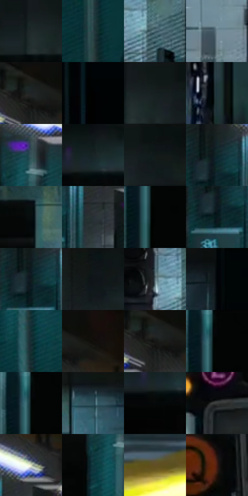

# 电影参考 544

- 状态：常规／活跃；来源世界：miles-home。
- 视角：near-level；景别：environment-wide；场景：vehicle。
- 时段：interior-time-unknown（外观依据，中置信度；具体时间／晨昏未知）；光照：cool-interior。
- 材质候选：fabric, metal, glass, stone（帧级，不是像素分割）。
- 明暗组：very-dark；L* P5/P50/P95：0.64759 / 13.57441 / 55.43028。
- 资格门禁：无附加门禁。
- 原截图 SHA-256：`b7965237ba053e0464189e33e1074704cd0354175d65de928cde38d5181ec217`；尺寸：2880 × 1210。
- sRGB 像素 SHA-256：`73ce98600b0127a0ee98bd8927f6800af8984156c396e0b1dacc5b2ecc7a76db`。

## 观察与迁移

地铁站台与车灯，黄色安全带为实体不是光晕。

地铁：灰青环境中黄站台边、红信号、白灯有不同面积和明度；黑列车留大暗面，圆网点灯晕与金属结构分开。

本公开版保存32个128×128原像素色卡上下文；图集格子并非原场景相邻位置。原rect、图集tile和像素SHA见 `data/palette-crops.json`。上下文不足时不得批准替色，不能以小样推断完整构图。

## 实测色卡

颜色比例分母为保留采样像素，不是材料面积；全部 32 色参与全库匹配。表内四舍五入仅用于阅读，原精度在 JSON。

| ID | HEX | Lab | 原图 xy | 像素数 | 比例 | 明度角色 |
| --- | --- | --- | --- | ---: | ---: | --- |
| 544-S01 | #20292A | [15.799337, -3.634172, -1.959974] | [1604, 80] | 11077 | 5.708499% | deep-shadow |
| 544-S02 | #2D4248 | [26.511278, -6.474069, -6.279085] | [464, 504] | 9258 | 4.771083% | shadow |
| 544-S03 | #46646E | [40.478195, -8.216571, -9.152485] | [1456, 492] | 8936 | 4.605141% | midtone |
| 544-S04 | #748C97 | [56.784661, -5.968753, -8.675541] | [1240, 636] | 8579 | 4.421162% | midtone |
| 544-S05 | #1B2020 | [11.758502, -2.28772, -0.776693] | [844, 48] | 7220 | 3.720806% | deep-shadow |
| 544-S06 | #010101 | [0.274173, -1.7e-05, 3.3e-05] | [2776, 108] | 7137 | 3.678032% | deep-shadow |
| 544-S07 | #161F20 | [10.955544, -3.72811, -2.010307] | [1656, 64] | 7093 | 3.655357% | deep-shadow |
| 544-S08 | #20363B | [21.060227, -7.107111, -5.877835] | [2260, 824] | 7073 | 3.645050% | shadow |
| 544-S09 | #3D5158 | [33.09509, -5.817229, -6.611649] | [448, 40] | 7047 | 3.631651% | shadow |
| 544-S10 | #192426 | [13.280653, -4.187019, -2.901873] | [2024, 88] | 6953 | 3.583208% | deep-shadow |
| 544-S11 | #0D1213 | [5.105221, -1.531979, -1.191351] | [1728, 40] | 6548 | 3.374492% | deep-shadow |
| 544-S12 | #0D272B | [13.890444, -8.431303, -5.649468] | [820, 260] | 6412 | 3.304405% | deep-shadow |
| 544-S13 | #060C0E | [3.011147, -1.27115, -1.454156] | [2244, 156] | 6304 | 3.248748% | deep-shadow |
| 544-S14 | #273134 | [19.5395, -3.414645, -3.320313] | [920, 300] | 6243 | 3.217312% | deep-shadow |
| 544-S15 | #020303 | [0.764212, -0.261552, -0.09204] | [112, 140] | 6126 | 3.157016% | deep-shadow |
| 544-S16 | #07181B | [7.023233, -5.20285, -4.242075] | [808, 320] | 5979 | 3.081260% | deep-shadow |
| 544-S17 | #101D20 | [9.744241, -4.65404, -3.864612] | [812, 284] | 5912 | 3.046732% | deep-shadow |
| 544-S18 | #0F1717 | [7.01122, -3.266721, -1.149915] | [1492, 28] | 5419 | 2.792666% | deep-shadow |
| 544-S19 | #5E7077 | [46.041718, -5.014828, -6.105564] | [1384, 452] | 5404 | 2.784935% | midtone |
| 544-S20 | #010407 | [0.981128, -0.367436, -1.411554] | [2596, 44] | 5372 | 2.768444% | deep-shadow |
| 544-S21 | #102D32 | [16.587425, -9.001531, -6.507277] | [468, 256] | 5320 | 2.741646% | deep-shadow |
| 544-S22 | #120D0B | [3.980125, 1.432947, 1.460403] | [928, 44] | 5230 | 2.695265% | deep-shadow |
| 544-S23 | #161817 | [8.000465, -1.216989, 0.369424] | [844, 80] | 4979 | 2.565913% | deep-shadow |
| 544-S24 | #040505 | [1.312559, -0.261586, -0.091974] | [112, 28] | 4903 | 2.526747% | deep-shadow |
| 544-S25 | #010606 | [1.353497, -1.307601, -0.460495] | [104, 64] | 4796 | 2.471604% | deep-shadow |
| 544-S26 | #2D4F5A | [31.549635, -8.983278, -10.305529] | [2384, 68] | 4788 | 2.467482% | shadow |
| 544-S27 | #050809 | [2.038249, -0.645593, -0.654575] | [1996, 148] | 4756 | 2.450990% | deep-shadow |
| 544-S28 | #383A39 | [24.200764, -1.084689, 0.324406] | [1788, 432] | 4603 | 2.372142% | shadow |
| 544-S29 | #D9DEBC | [87.302764, -7.454863, 16.137287] | [960, 200] | 4312 | 2.222176% | highlight |
| 544-S30 | #0D373D | [20.652691, -11.82828, -7.932236] | [396, 140] | 4311 | 2.221661% | shadow |
| 544-S31 | #634F26 | [34.7723, 2.908723, 27.031849] | [1016, 1064] | 3647 | 1.879471% | shadow |
| 544-S32 | #3F1A12 | [14.621456, 17.274813, 13.852438] | [2112, 520] | 2307 | 1.188906% | deep-shadow |

## 色阶与空间分布

- 采样 ROI：`[0.01, 0.02, 0.98, 0.94]`；步长：4；样本数：194044。
- 排除区：`[]`。
- 深暗、暗、中、亮、高光五段计数：`[127603, 43072, 17088, 3400, 2881]`。
- RGB 各 256 箱、L* 100 箱、13×5 色相明度表和 3×3 空间统计全部保存在 [总数据](../film-library.json)。
- [可视化档案](../../references/library.html)按需绘制直方图，不存 2,094 张重复图表图片。

## 纹理特征占比

**这是分块图像特征的面积占比，不是波点／排线／丝网／错版的精确语义覆盖率。** 窗格、发丝、织物也会产生方向或周期特征。
原图 ROI 像素 3109722；已测块覆盖 3109722（100.0000%）；未测 0。

| 特征 | 块覆盖像素 | 占已测面积 | 阈值敏感范围 |
| --- | ---: | ---: | --- |
| low-contrast | 81920 | 2.6343% | 2.1075% ~ 3.1612% |
| directional-structure | 1407962 | 45.2761% | 33.8457% ~ 53.7512% |
| periodic-structure | 1505152 | 48.4015% | 43.0876% ~ 53.6701% |
| mixed-detail | 114688 | 3.6880% | 1.0537% ~ 9.3230% |

阈值敏感范围不是统计置信区间。逐块坐标、尺度、对比、方向一致性、频谱集中度、频率与角度见 [全量特征记录](../texture-features.jsonl)，以帧号定位。
四种印刷层的真实像素覆盖仍标为 `null`，不能填 0，也不能拿上表代替。不得据这些代理测量删除唯一证据。

[测量方法与保留策略](../../references/library-retention.md) · [分类索引](../archive/README.md)
