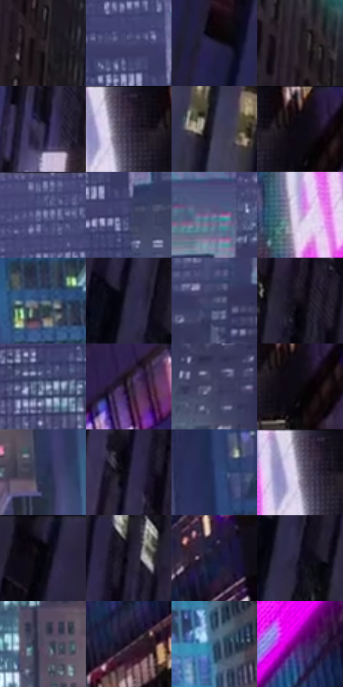

# 电影参考 545

- 状态：常规／活跃；来源世界：miles-home。
- 视角：low-angle；景别：environment-wide；场景：city。
- 时段：night-appearance（外观依据，中置信度；具体时间／晨昏未知）；光照：night-mixed。
- 材质候选：glass, stone, metal, sky, screen（帧级，不是像素分割）。
- 明暗组：dark；L* P5/P50/P95：2.83665 / 21.74772 / 58.04755。
- 资格门禁：无附加门禁。
- 原截图 SHA-256：`1345fd193043364e387634727440f4b52b79eebdf3d3fbf74db0257545332eea`；尺寸：2880 × 1208。
- sRGB 像素 SHA-256：`aa0545a38e414756bb1e179e685a5a164925a82624dce8ed36e96e7bf7b07a06`。

## 观察与迁移

蓝色夜城、楼体正侧面与窗组节奏，发光窗不是满铺LED。

城市峡谷：左黑楼压边、右粉色广告局部高彩、中心蓝紫远楼受空气遮蔽；窗纹退后，广告图案不是透过玻璃的人。

本公开版保存32个128×128原像素色卡上下文；图集格子并非原场景相邻位置。原rect、图集tile和像素SHA见 `data/palette-crops.json`。上下文不足时不得批准替色，不能以小样推断完整构图。

## 实测色卡

颜色比例分母为保留采样像素，不是材料面积；全部 32 色参与全库匹配。表内四舍五入仅用于阅读，原精度在 JSON。

| ID | HEX | Lab | 原图 xy | 像素数 | 比例 | 明度角色 |
| --- | --- | --- | --- | ---: | ---: | --- |
| 545-S01 | #2C2429 | [15.261867, 4.875533, -1.910585] | [904, 508] | 9766 | 5.051048% | deep-shadow |
| 545-S02 | #464A75 | [32.883442, 10.087776, -25.153948] | [1600, 312] | 9405 | 4.864336% | shadow |
| 545-S03 | #29244C | [16.771494, 14.067943, -24.075306] | [56, 648] | 8465 | 4.378161% | deep-shadow |
| 545-S04 | #20191F | [9.808233, 4.878073, -2.86321] | [868, 356] | 8401 | 4.345060% | deep-shadow |
| 545-S05 | #36324E | [22.357003, 9.114868, -16.541039] | [692, 760] | 8367 | 4.327475% | shadow |
| 545-S06 | #2C233A | [15.71133, 10.066962, -13.272474] | [2384, 60] | 7882 | 4.076629% | deep-shadow |
| 545-S07 | #403D52 | [26.83875, 6.439258, -12.19315] | [336, 944] | 7608 | 3.934915% | shadow |
| 545-S08 | #0F0B15 | [3.568388, 3.134397, -4.742561] | [2472, 48] | 7539 | 3.899227% | deep-shadow |
| 545-S09 | #3E426F | [29.583106, 11.119366, -26.611703] | [1484, 52] | 7330 | 3.791131% | shadow |
| 545-S10 | #363A62 | [25.838432, 9.93759, -24.235414] | [1656, 400] | 7200 | 3.723894% | shadow |
| 545-S11 | #806B9B | [48.848185, 18.24592, -22.963327] | [1340, 276] | 7140 | 3.692862% | midtone |
| 545-S12 | #CAADDE | [74.646639, 19.48062, -20.759936] | [2204, 332] | 6969 | 3.604419% | light |
| 545-S13 | #4F6585 | [42.25008, 0.519747, -20.364946] | [1952, 772] | 6695 | 3.462704% | midtone |
| 545-S14 | #2E2C44 | [19.222233, 7.42183, -14.722046] | [216, 144] | 6498 | 3.360814% | deep-shadow |
| 545-S15 | #4D5276 | [35.82981, 7.381957, -21.138947] | [1152, 364] | 6321 | 3.269269% | shadow |
| 545-S16 | #15101A | [5.461243, 4.354732, -5.673633] | [540, 404] | 6245 | 3.229961% | deep-shadow |
| 545-S17 | #808CAD | [58.378774, 3.227683, -18.781232] | [1460, 564] | 5959 | 3.082039% | midtone |
| 545-S18 | #372B3B | [19.456823, 9.100354, -8.105905] | [2760, 384] | 5876 | 3.039111% | deep-shadow |
| 545-S19 | #414361 | [29.414923, 7.066868, -17.932989] | [1088, 644] | 5579 | 2.885501% | shadow |
| 545-S20 | #0C090F | [2.782381, 1.75069, -2.262786] | [2484, 88] | 5309 | 2.745855% | deep-shadow |
| 545-S21 | #2C3553 | [22.674588, 5.349632, -19.437354] | [1836, 928] | 5309 | 2.745855% | shadow |
| 545-S22 | #1A162B | [8.720399, 8.193159, -13.541576] | [536, 108] | 5211 | 2.695168% | deep-shadow |
| 545-S23 | #2A3A6A | [25.438012, 9.58487, -30.084832] | [1864, 528] | 4849 | 2.507939% | shadow |
| 545-S24 | #615870 | [39.05447, 8.867382, -12.329182] | [2360, 36] | 4684 | 2.422600% | shadow |
| 545-S25 | #06050A | [1.52811, 0.956631, -1.799814] | [88, 56] | 4373 | 2.261748% | deep-shadow |
| 545-S26 | #231E2F | [12.551282, 6.92888, -10.421379] | [600, 68] | 4275 | 2.211062% | deep-shadow |
| 545-S27 | #1D1D3A | [12.256231, 9.208478, -18.808781] | [2420, 676] | 3893 | 2.013489% | deep-shadow |
| 545-S28 | #100D21 | [4.586789, 6.119621, -12.483685] | [244, 188] | 3801 | 1.965906% | deep-shadow |
| 545-S29 | #50485D | [32.10214, 8.07933, -11.132565] | [1660, 996] | 3796 | 1.963320% | shadow |
| 545-S30 | #26192A | [11.096139, 10.402809, -8.993949] | [2312, 812] | 3762 | 1.945735% | deep-shadow |
| 545-S31 | #2F526D | [33.440626, -4.036101, -19.392874] | [2020, 1088] | 3580 | 1.851603% | shadow |
| 545-S32 | #58176F | [23.119515, 42.936253, -36.746634] | [2292, 496] | 1259 | 0.651164% | shadow |

## 色阶与空间分布

- 采样 ROI：`[0.01, 0.02, 0.98, 0.94]`；步长：4；样本数：193346。
- 排除区：`[]`。
- 深暗、暗、中、亮、高光五段计数：`[89438, 77022, 18331, 5986, 2569]`。
- RGB 各 256 箱、L* 100 箱、13×5 色相明度表和 3×3 空间统计全部保存在 [总数据](../film-library.json)。
- [可视化档案](../../references/library.html)按需绘制直方图，不存 2,094 张重复图表图片。

## 纹理特征占比

**这是分块图像特征的面积占比，不是波点／排线／丝网／错版的精确语义覆盖率。** 窗格、发丝、织物也会产生方向或周期特征。
原图 ROI 像素 3104134；已测块覆盖 3104134（100.0000%）；未测 0。

| 特征 | 块覆盖像素 | 占已测面积 | 阈值敏感范围 |
| --- | ---: | ---: | --- |
| low-contrast | 0 | 0.0000% | 0.0000% ~ 0.0000% |
| directional-structure | 640256 | 20.6259% | 6.6925% ~ 32.9720% |
| periodic-structure | 2234502 | 71.9847% | 64.9168% ~ 75.5103% |
| mixed-detail | 229376 | 7.3894% | 2.1112% ~ 17.7972% |

阈值敏感范围不是统计置信区间。逐块坐标、尺度、对比、方向一致性、频谱集中度、频率与角度见 [全量特征记录](../texture-features.jsonl)，以帧号定位。
四种印刷层的真实像素覆盖仍标为 `null`，不能填 0，也不能拿上表代替。不得据这些代理测量删除唯一证据。

[测量方法与保留策略](../../references/library-retention.md) · [分类索引](../archive/README.md)
