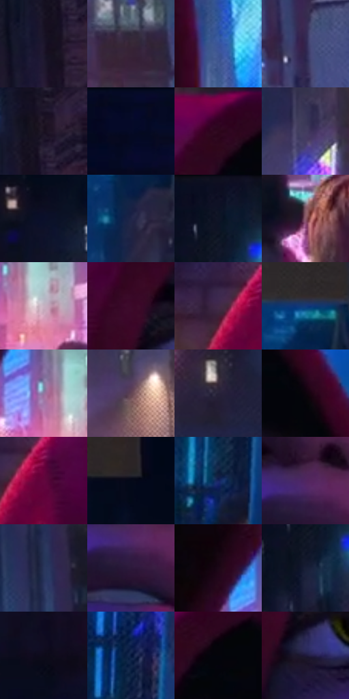

# 电影参考 546

- 状态：常规／活跃；来源世界：miles-home。
- 视角：low-angle；景别：close-up；场景：city。
- 时段：night-appearance（外观依据，中置信度；具体时间／晨昏未知）；光照：night-mixed。
- 材质候选：skin, fabric, glass, stone, metal, sky（帧级，不是像素分割）。
- 明暗组：very-dark；L* P5/P50/P95：2.22087 / 14.36118 / 54.59562。
- 资格门禁：无附加门禁。
- 原截图 SHA-256：`706d1e631b69e24195d84e60444b1e32edb589785e69594c83f242fa8f76b13b`；尺寸：2880 × 1212。
- sRGB 像素 SHA-256：`90057f18e0acb977d487509995a8180148c5b127c27498fb4e074b7b07b584ce`。

## 观察与迁移

夜城人物与玻璃立面；倾斜视角不授权更改原照建筑透视。

夜街人物：暖灯白芯和圆点晕可能比脸亮，红帽凭色相与轮廓突出；蓝色楼体与下方人群概括，脸部排线保留。

本公开版保存32个128×128原像素色卡上下文；图集格子并非原场景相邻位置。原rect、图集tile和像素SHA见 `data/palette-crops.json`。上下文不足时不得批准替色，不能以小样推断完整构图。

## 实测色卡

颜色比例分母为保留采样像素，不是材料面积；全部 32 色参与全库匹配。表内四舍五入仅用于阅读，原精度在 JSON。

| ID | HEX | Lab | 原图 xy | 像素数 | 比例 | 明度角色 |
| --- | --- | --- | --- | ---: | ---: | --- |
| 546-S01 | #1C162C | [9.012388, 9.266217, -13.806205] | [2784, 196] | 10193 | 5.252932% | deep-shadow |
| 546-S02 | #362736 | [17.926364, 10.230151, -6.970928] | [2632, 1016] | 9994 | 5.150378% | deep-shadow |
| 546-S03 | #395599 | [37.23564, 11.836172, -40.393557] | [1708, 676] | 8530 | 4.395910% | shadow |
| 546-S04 | #312550 | [18.166369, 17.083937, -24.51817] | [2764, 1056] | 8111 | 4.179980% | deep-shadow |
| 546-S05 | #1B1222 | [7.055807, 8.587748, -9.371237] | [2820, 108] | 7996 | 4.120715% | deep-shadow |
| 546-S06 | #050A22 | [3.295116, 4.629693, -15.299058] | [140, 28] | 7835 | 4.037744% | deep-shadow |
| 546-S07 | #2D071D | [7.214542, 21.915255, -5.014918] | [1224, 68] | 7269 | 3.746058% | deep-shadow |
| 546-S08 | #423B5E | [27.001463, 11.841754, -19.743502] | [1872, 520] | 7012 | 3.613613% | shadow |
| 546-S09 | #0B102A | [5.499495, 6.651594, -17.963459] | [2212, 272] | 6960 | 3.586815% | deep-shadow |
| 546-S10 | #1F2548 | [15.912555, 9.04974, -22.760173] | [1808, 312] | 6876 | 3.543526% | deep-shadow |
| 546-S11 | #0E0F22 | [4.972311, 4.807104, -12.679066] | [2472, 32] | 6834 | 3.521882% | deep-shadow |
| 546-S12 | #8B5B6A | [44.251159, 21.955081, -0.416238] | [2336, 1120] | 6243 | 3.217312% | midtone |
| 546-S13 | #C8B2C2 | [74.834918, 10.680987, -5.220937] | [1732, 1036] | 6183 | 3.186391% | light |
| 546-S14 | #3C0829 | [11.238102, 28.269156, -7.702981] | [1048, 344] | 6129 | 3.158562% | deep-shadow |
| 546-S15 | #412A48 | [21.009819, 16.926231, -14.4992] | [840, 212] | 6004 | 3.094144% | shadow |
| 546-S16 | #133A7B | [25.544923, 12.609432, -40.791738] | [1836, 120] | 5949 | 3.065800% | shadow |
| 546-S17 | #9476A0 | [53.804674, 19.62573, -18.11676] | [1680, 992] | 5855 | 3.017357% | midtone |
| 546-S18 | #634454 | [32.760663, 16.130331, -4.180406] | [2172, 932] | 5828 | 3.003443% | shadow |
| 546-S19 | #272239 | [14.793801, 8.609176, -14.039369] | [2184, 588] | 5717 | 2.946239% | deep-shadow |
| 546-S20 | #0D040C | [1.797146, 3.54938, -2.216688] | [1428, 160] | 5278 | 2.720002% | deep-shadow |
| 546-S21 | #63063E | [20.562746, 42.374495, -7.810119] | [900, 224] | 5153 | 2.655583% | shadow |
| 546-S22 | #040919 | [2.631659, 1.894181, -9.174552] | [2092, 120] | 5029 | 2.591680% | deep-shadow |
| 546-S23 | #172361 | [16.733067, 18.851655, -38.309448] | [496, 1060] | 4929 | 2.540146% | deep-shadow |
| 546-S24 | #4F2661 | [23.377236, 30.179292, -27.302823] | [1384, 584] | 4883 | 2.516440% | shadow |
| 546-S25 | #29365B | [23.219232, 6.608202, -23.872245] | [2528, 700] | 4561 | 2.350498% | shadow |
| 546-S26 | #2C183A | [12.571395, 17.788944, -18.197473] | [1384, 636] | 4465 | 2.301025% | deep-shadow |
| 546-S27 | #1C0717 | [4.161858, 11.125444, -5.153112] | [1604, 900] | 4284 | 2.207747% | deep-shadow |
| 546-S28 | #191F36 | [12.30536, 4.965401, -15.904764] | [2464, 148] | 4279 | 2.205170% | deep-shadow |
| 546-S29 | #0D0B1A | [3.608419, 3.783086, -8.480188] | [160, 572] | 4224 | 2.176826% | deep-shadow |
| 546-S30 | #06163A | [8.287667, 9.273732, -25.267346] | [508, 908] | 4135 | 2.130960% | deep-shadow |
| 546-S31 | #04040C | [1.257217, 1.12794, -3.069875] | [1268, 108] | 3957 | 2.039228% | deep-shadow |
| 546-S32 | #1E173A | [10.514712, 13.996485, -21.579792] | [1088, 440] | 3349 | 1.725897% | deep-shadow |

## 色阶与空间分布

- 采样 ROI：`[0.01, 0.02, 0.98, 0.94]`；步长：4；样本数：194044。
- 排除区：`[]`。
- 深暗、暗、中、亮、高光五段计数：`[128292, 47037, 11114, 5678, 1923]`。
- RGB 各 256 箱、L* 100 箱、13×5 色相明度表和 3×3 空间统计全部保存在 [总数据](../film-library.json)。
- [可视化档案](../../references/library.html)按需绘制直方图，不存 2,094 张重复图表图片。

## 纹理特征占比

**这是分块图像特征的面积占比，不是波点／排线／丝网／错版的精确语义覆盖率。** 窗格、发丝、织物也会产生方向或周期特征。
原图 ROI 像素 3115310；已测块覆盖 3115310（100.0000%）；未测 0。

| 特征 | 块覆盖像素 | 占已测面积 | 阈值敏感范围 |
| --- | ---: | ---: | --- |
| low-contrast | 278528 | 8.9406% | 8.4147% ~ 12.6221% |
| directional-structure | 572928 | 18.3907% | 8.2339% ~ 34.1477% |
| periodic-structure | 2121134 | 68.0874% | 56.9116% ~ 70.1623% |
| mixed-detail | 142720 | 4.5812% | 0.5259% ~ 8.9817% |

阈值敏感范围不是统计置信区间。逐块坐标、尺度、对比、方向一致性、频谱集中度、频率与角度见 [全量特征记录](../texture-features.jsonl)，以帧号定位。
四种印刷层的真实像素覆盖仍标为 `null`，不能填 0，也不能拿上表代替。不得据这些代理测量删除唯一证据。

[测量方法与保留策略](../../references/library-retention.md) · [分类索引](../archive/README.md)
