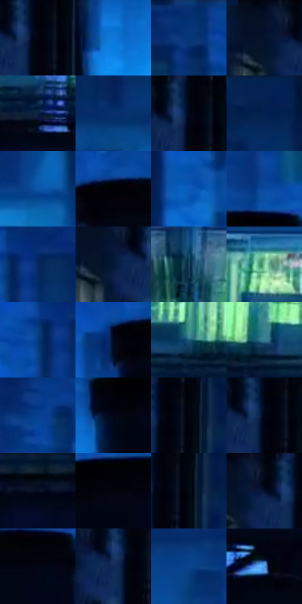

# 电影参考 547

- 状态：常规／活跃；来源世界：miles-home。
- 视角：near-level；景别：environment-wide；场景：city。
- 时段：night-appearance（外观依据，中置信度；具体时间／晨昏未知）；光照：night-mixed。
- 材质候选：glass, stone, metal, sky, screen（帧级，不是像素分割）。
- 明暗组：very-dark；L* P5/P50/P95：0.8506 / 15.74675 / 55.83459。
- 资格门禁：无附加门禁。
- 原截图 SHA-256：`4ff9a85904ec4ad16dec3318d60d77913ed21f3bd3edfc0e1b871b3e88ee1c31`；尺寸：2880 × 1148。
- sRGB 像素 SHA-256：`c6f85e091a4e6116e291f057b6404352f7891ef712342fd95a3e70df89042bcf`。

## 观察与迁移

蓝色夜城、楼体正侧面与窗组节奏，发光窗不是满铺LED。

高架列车：亮绿色水平带穿过冷蓝城市，近烟囱和轨道黑块稳住构图；车窗横拖影属于运动，不等于玻璃材质消失。

本公开版保存32个128×128原像素色卡上下文；图集格子并非原场景相邻位置。原rect、图集tile和像素SHA见 `data/palette-crops.json`。上下文不足时不得批准替色，不能以小样推断完整构图。

## 实测色卡

颜色比例分母为保留采样像素，不是材料面积；全部 32 色参与全库匹配。表内四舍五入仅用于阅读，原精度在 JSON。

| ID | HEX | Lab | 原图 xy | 像素数 | 比例 | 明度角色 |
| --- | --- | --- | --- | ---: | ---: | --- |
| 547-S01 | #010410 | [1.180402, 1.032878, -5.222667] | [192, 76] | 10609 | 5.757250% | deep-shadow |
| 547-S02 | #1077D8 | [49.80857, 9.715884, -57.036952] | [2428, 404] | 10350 | 5.616697% | midtone |
| 547-S03 | #07337A | [23.057816, 16.240814, -44.208479] | [2688, 44] | 8611 | 4.672983% | shadow |
| 547-S04 | #03102A | [5.031538, 4.552932, -18.732168] | [80, 52] | 8543 | 4.636081% | deep-shadow |
| 547-S05 | #0B2241 | [13.209766, 3.919359, -22.293997] | [1248, 732] | 8513 | 4.619801% | deep-shadow |
| 547-S06 | #06316D | [21.352975, 11.929764, -38.664382] | [1208, 204] | 8441 | 4.580728% | shadow |
| 547-S07 | #010614 | [1.690805, 1.06269, -6.91151] | [184, 28] | 8095 | 4.392963% | deep-shadow |
| 547-S08 | #042152 | [13.957342, 11.536261, -32.813182] | [1248, 24] | 7806 | 4.236129% | deep-shadow |
| 547-S09 | #0C55A8 | [36.744726, 12.296758, -50.239538] | [1252, 364] | 6364 | 3.453590% | shadow |
| 547-S10 | #010206 | [0.569186, 0.294641, -1.605767] | [2180, 280] | 6004 | 3.258227% | deep-shadow |
| 547-S11 | #0C5AB8 | [39.325509, 15.496085, -55.516826] | [1432, 244] | 5996 | 3.253886% | shadow |
| 547-S12 | #094A9C | [32.601015, 14.629148, -49.745226] | [2308, 224] | 5976 | 3.243032% | shadow |
| 547-S13 | #052862 | [17.604734, 13.604628, -37.58064] | [1528, 88] | 5482 | 2.974950% | deep-shadow |
| 547-S14 | #041736 | [8.171847, 6.17087, -22.57414] | [100, 88] | 5388 | 2.923939% | deep-shadow |
| 547-S15 | #1B3F5B | [25.390696, -2.811271, -20.51029] | [344, 588] | 5349 | 2.902774% | shadow |
| 547-S16 | #7ECBA1 | [75.896269, -33.038434, 13.564512] | [980, 584] | 5300 | 2.876183% | light |
| 547-S17 | #053B83 | [26.151401, 14.269332, -44.846308] | [1472, 104] | 5282 | 2.866415% | shadow |
| 547-S18 | #02091E | [2.727678, 2.8654, -13.037151] | [2116, 300] | 5171 | 2.806178% | deep-shadow |
| 547-S19 | #245E7D | [37.59032, -8.010576, -22.890554] | [1600, 664] | 5136 | 2.787184% | shadow |
| 547-S20 | #3B7D93 | [49.132908, -14.187776, -18.209708] | [728, 660] | 4989 | 2.707411% | midtone |
| 547-S21 | #074090 | [28.706547, 16.410685, -48.750788] | [2508, 92] | 4894 | 2.655857% | shadow |
| 547-S22 | #020718 | [2.084609, 1.90333, -9.199423] | [2556, 348] | 4545 | 2.466463% | deep-shadow |
| 547-S23 | #00040C | [1.023982, 0.081943, -3.438429] | [232, 24] | 4523 | 2.454524% | deep-shadow |
| 547-S24 | #000415 | [1.273171, 1.833018, -8.204178] | [184, 76] | 4471 | 2.426305% | deep-shadow |
| 547-S25 | #040E21 | [4.061537, 2.217595, -13.354161] | [452, 772] | 4390 | 2.382348% | deep-shadow |
| 547-S26 | #03040C | [1.198908, 0.866441, -3.162013] | [2628, 328] | 4228 | 2.294434% | deep-shadow |
| 547-S27 | #020712 | [1.883484, 0.490008, -5.352905] | [240, 80] | 4064 | 2.205435% | deep-shadow |
| 547-S28 | #000413 | [1.208833, 1.380906, -6.973705] | [128, 52] | 3866 | 2.097986% | deep-shadow |
| 547-S29 | #040514 | [1.669653, 2.247748, -6.921413] | [2308, 324] | 3673 | 1.993249% | deep-shadow |
| 547-S30 | #0E2A55 | [17.482598, 7.254977, -29.122331] | [160, 92] | 2987 | 1.620973% | deep-shadow |
| 547-S31 | #0A448E | [29.789578, 12.93643, -45.762644] | [880, 260] | 2644 | 1.434835% | shadow |
| 547-S32 | #3F90E0 | [58.397903, 1.680762, -47.767223] | [1436, 924] | 2582 | 1.401190% | midtone |

## 色阶与空间分布

- 采样 ROI：`[0.01, 0.02, 0.98, 0.94]`；步长：4；样本数：184272。
- 排除区：`[]`。
- 深暗、暗、中、亮、高光五段计数：`[105430, 50594, 21705, 4507, 2036]`。
- RGB 各 256 箱、L* 100 箱、13×5 色相明度表和 3×3 空间统计全部保存在 [总数据](../film-library.json)。
- [可视化档案](../../references/library.html)按需绘制直方图，不存 2,094 张重复图表图片。

## 纹理特征占比

**这是分块图像特征的面积占比，不是波点／排线／丝网／错版的精确语义覆盖率。** 窗格、发丝、织物也会产生方向或周期特征。
原图 ROI 像素 2953258；已测块覆盖 2953258（100.0000%）；未测 0。

| 特征 | 块覆盖像素 | 占已测面积 | 阈值敏感范围 |
| --- | ---: | ---: | --- |
| low-contrast | 332330 | 11.2530% | 11.2530% ~ 12.3626% |
| directional-structure | 865536 | 29.3078% | 18.7671% ~ 42.6225% |
| periodic-structure | 1739008 | 58.8844% | 46.1245% ~ 67.2060% |
| mixed-detail | 16384 | 0.5548% | 0.0000% ~ 1.6643% |

阈值敏感范围不是统计置信区间。逐块坐标、尺度、对比、方向一致性、频谱集中度、频率与角度见 [全量特征记录](../texture-features.jsonl)，以帧号定位。
四种印刷层的真实像素覆盖仍标为 `null`，不能填 0，也不能拿上表代替。不得据这些代理测量删除唯一证据。

[测量方法与保留策略](../../references/library-retention.md) · [分类索引](../archive/README.md)
