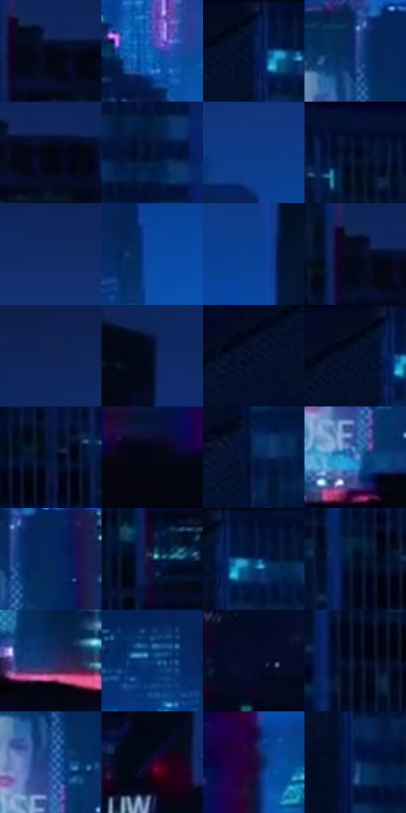

# 电影参考 548

- 状态：常规／活跃；来源世界：miles-home。
- 视角：near-level；景别：environment-wide；场景：city。
- 时段：night-appearance（外观依据，中置信度；具体时间／晨昏未知）；光照：night-mixed。
- 材质候选：glass, stone, metal, sky, screen（帧级，不是像素分割）。
- 明暗组：very-dark；L* P5/P50/P95：1.55141 / 9.02013 / 39.23192。
- 资格门禁：无附加门禁。
- 原截图 SHA-256：`b88ce30fd9749f39470658730bb86bb8dde62f9875669a410347e1fc672321e4`；尺寸：2880 × 1210。
- sRGB 像素 SHA-256：`a4c5c9675a0d94c4cf78cba85bb979ae4c5275773831df17bf164ed8289c6f69`。

## 观察与迁移

蓝色夜城、楼体正侧面与窗组节奏，发光窗不是满铺LED。

蓝夜天际线：近屋顶黑、主楼深蓝、远楼青蓝低对比、粉灯零星；窗列与空气网点分层，不把所有窗户点成等亮星点。

本公开版保存32个128×128原像素色卡上下文；图集格子并非原场景相邻位置。原rect、图集tile和像素SHA见 `data/palette-crops.json`。上下文不足时不得批准替色，不能以小样推断完整构图。

## 实测色卡

颜色比例分母为保留采样像素，不是材料面积；全部 32 色参与全库匹配。表内四舍五入仅用于阅读，原精度在 JSON。

| ID | HEX | Lab | 原图 xy | 像素数 | 比例 | 明度角色 |
| --- | --- | --- | --- | ---: | ---: | --- |
| 548-S01 | #020819 | [2.318964, 1.771743, -9.645147] | [2544, 136] | 9675 | 4.985983% | deep-shadow |
| 548-S02 | #135BB4 | [39.435446, 13.576778, -52.986313] | [580, 616] | 8959 | 4.616994% | shadow |
| 548-S03 | #051742 | [9.3058, 12.068959, -29.310694] | [1764, 64] | 8776 | 4.522686% | deep-shadow |
| 548-S04 | #193579 | [24.105343, 16.011815, -41.848219] | [1288, 792] | 8607 | 4.435592% | shadow |
| 548-S05 | #04040D | [1.279917, 1.287453, -3.504007] | [2588, 144] | 8470 | 4.364989% | deep-shadow |
| 548-S06 | #071836 | [8.693376, 5.965097, -21.725378] | [1864, 168] | 8204 | 4.227907% | deep-shadow |
| 548-S07 | #0D3B87 | [26.625848, 16.466927, -46.562495] | [1080, 268] | 7923 | 4.083095% | shadow |
| 548-S08 | #01102D | [5.116217, 5.444461, -20.857684] | [2388, 36] | 7889 | 4.065573% | deep-shadow |
| 548-S09 | #0F2B65 | [19.091551, 13.632342, -37.12133] | [1368, 92] | 7760 | 3.999093% | deep-shadow |
| 548-S10 | #094AA2 | [33.055461, 17.125005, -52.625866] | [1104, 388] | 7738 | 3.987755% | shadow |
| 548-S11 | #0A4093 | [28.99698, 17.830134, -50.117495] | [1436, 308] | 7573 | 3.902723% | shadow |
| 548-S12 | #060A1E | [3.156991, 3.510837, -12.367955] | [2516, 128] | 7552 | 3.891901% | deep-shadow |
| 548-S13 | #102458 | [15.881933, 13.333633, -33.715952] | [304, 72] | 7240 | 3.731113% | deep-shadow |
| 548-S14 | #040D27 | [4.1558, 5.028696, -17.826072] | [112, 172] | 6963 | 3.588361% | deep-shadow |
| 548-S15 | #07142F | [6.780269, 5.619434, -19.676653] | [1688, 96] | 6596 | 3.399229% | deep-shadow |
| 548-S16 | #030D21 | [3.766325, 2.440058, -13.810262] | [1732, 48] | 6556 | 3.378615% | deep-shadow |
| 548-S17 | #021339 | [6.990666, 10.321056, -26.661681] | [2288, 112] | 6301 | 3.247202% | deep-shadow |
| 548-S18 | #020612 | [1.687406, 0.890568, -5.639223] | [2616, 704] | 6104 | 3.145678% | deep-shadow |
| 548-S19 | #061F47 | [12.437855, 8.231801, -27.723217] | [1784, 316] | 6102 | 3.144648% | deep-shadow |
| 548-S20 | #467CC7 | [51.654434, 5.968272, -44.345662] | [1284, 964] | 5011 | 2.582404% | midtone |
| 548-S21 | #052859 | [16.848337, 9.523968, -32.837358] | [1340, 804] | 5003 | 2.578281% | deep-shadow |
| 548-S22 | #101D42 | [11.837684, 9.107699, -25.181237] | [2500, 248] | 4504 | 2.321123% | deep-shadow |
| 548-S23 | #040E31 | [5.072299, 9.320307, -23.894303] | [1812, 28] | 4492 | 2.314939% | deep-shadow |
| 548-S24 | #010F26 | [4.407743, 2.836356, -16.683131] | [2088, 104] | 4215 | 2.172188% | deep-shadow |
| 548-S25 | #1F2E69 | [21.074509, 15.419981, -36.48087] | [1508, 988] | 4177 | 2.152605% | shadow |
| 548-S26 | #073775 | [23.872785, 11.177829, -39.709136] | [1000, 380] | 4033 | 2.078395% | shadow |
| 548-S27 | #070D2B | [4.58295, 7.58559, -20.177495] | [156, 772] | 3785 | 1.950589% | deep-shadow |
| 548-S28 | #020924 | [3.031392, 4.999623, -17.273544] | [2104, 168] | 3620 | 1.865556% | deep-shadow |
| 548-S29 | #214F98 | [34.357273, 11.581399, -44.461976] | [1288, 876] | 3184 | 1.640865% | shadow |
| 548-S30 | #080A26 | [3.690779, 6.965328, -17.767245] | [56, 260] | 3154 | 1.625405% | deep-shadow |
| 548-S31 | #1C0A34 | [6.430139, 19.972338, -23.820105] | [2708, 600] | 2554 | 1.316196% | deep-shadow |
| 548-S32 | #0E295A | [17.539235, 10.199523, -32.37318] | [1784, 176] | 1324 | 0.682319% | deep-shadow |

## 色阶与空间分布

- 采样 ROI：`[0.01, 0.02, 0.98, 0.94]`；步长：4；样本数：194044。
- 排除区：`[]`。
- 深暗、暗、中、亮、高光五段计数：`[135774, 49546, 7763, 826, 135]`。
- RGB 各 256 箱、L* 100 箱、13×5 色相明度表和 3×3 空间统计全部保存在 [总数据](../film-library.json)。
- [可视化档案](../../references/library.html)按需绘制直方图，不存 2,094 张重复图表图片。

## 纹理特征占比

**这是分块图像特征的面积占比，不是波点／排线／丝网／错版的精确语义覆盖率。** 窗格、发丝、织物也会产生方向或周期特征。
原图 ROI 像素 3109722；已测块覆盖 3109722（100.0000%）；未测 0。

| 特征 | 块覆盖像素 | 占已测面积 | 阈值敏感范围 |
| --- | ---: | ---: | --- |
| low-contrast | 414592 | 13.3321% | 6.4829% ~ 18.4197% |
| directional-structure | 453760 | 14.5917% | 4.2149% ~ 27.3792% |
| periodic-structure | 1927130 | 61.9711% | 60.9598% ~ 63.4818% |
| mixed-detail | 314240 | 10.1051% | 5.1781% ~ 13.8837% |

阈值敏感范围不是统计置信区间。逐块坐标、尺度、对比、方向一致性、频谱集中度、频率与角度见 [全量特征记录](../texture-features.jsonl)，以帧号定位。
四种印刷层的真实像素覆盖仍标为 `null`，不能填 0，也不能拿上表代替。不得据这些代理测量删除唯一证据。

[测量方法与保留策略](../../references/library-retention.md) · [分类索引](../archive/README.md)
