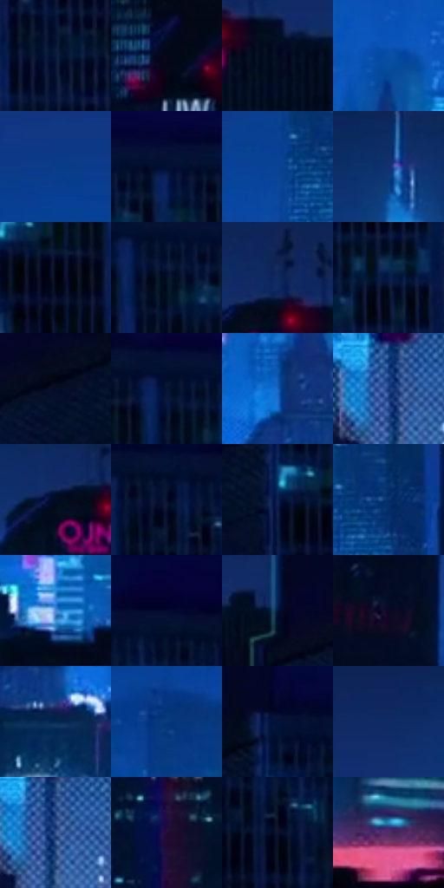

# 电影参考 549

- 状态：常规／活跃；来源世界：miles-home。
- 视角：near-level；景别：environment-wide；场景：city。
- 时段：night-appearance（外观依据，中置信度；具体时间／晨昏未知）；光照：night-mixed。
- 材质候选：glass, stone, metal, sky, screen（帧级，不是像素分割）。
- 明暗组：very-dark；L* P5/P50/P95：1.92064 / 9.72144 / 41.23586。
- 资格门禁：无附加门禁。
- 原截图 SHA-256：`29aa0462abdb10ee8b2536c45a061dbda5717ca6605179f3cf1d29f0d103960d`；尺寸：2880 × 1214。
- sRGB 像素 SHA-256：`505de30002cb90006c2645073980d07808b26141e56a838a559a2203760961fa`。

## 观察与迁移

蓝色夜城、楼体正侧面与窗组节奏，发光窗不是满铺LED。

天际线移镜：右近高楼大暗面，中心浅蓝空间分离楼群，亮楼冠局部明确；取景差异另列，远窗可并为短线色组。

本公开版保存32个128×128原像素色卡上下文；图集格子并非原场景相邻位置。原rect、图集tile和像素SHA见 `data/palette-crops.json`。上下文不足时不得批准替色，不能以小样推断完整构图。

## 实测色卡

颜色比例分母为保留采样像素，不是材料面积；全部 32 色参与全库匹配。表内四舍五入仅用于阅读，原精度在 JSON。

| ID | HEX | Lab | 原图 xy | 像素数 | 比例 | 明度角色 |
| --- | --- | --- | --- | ---: | ---: | --- |
| 549-S01 | #081A3B | [9.845146, 6.890105, -23.461123] | [2756, 480] | 10844 | 5.568393% | deep-shadow |
| 549-S02 | #040818 | [2.397305, 2.025768, -8.728828] | [116, 280] | 9605 | 4.932167% | deep-shadow |
| 549-S03 | #020921 | [2.872757, 3.884879, -15.179444] | [1832, 160] | 9535 | 4.896222% | deep-shadow |
| 549-S04 | #0A4EA7 | [34.603774, 16.510093, -53.109376] | [1340, 540] | 8858 | 4.548582% | shadow |
| 549-S05 | #093C89 | [27.003723, 16.365238, -47.194234] | [688, 308] | 8260 | 4.241509% | shadow |
| 549-S06 | #020F31 | [5.204721, 8.288554, -23.689081] | [2480, 120] | 8115 | 4.167052% | deep-shadow |
| 549-S07 | #094396 | [30.091629, 16.948434, -50.172763] | [1456, 328] | 7818 | 4.014542% | shadow |
| 549-S08 | #12306F | [21.54126, 14.593666, -39.632612] | [1508, 68] | 7784 | 3.997083% | shadow |
| 549-S09 | #01040F | [1.154028, 0.84755, -4.718276] | [2276, 228] | 7542 | 3.872816% | deep-shadow |
| 549-S10 | #011029 | [4.851068, 3.581239, -18.269252] | [2388, 164] | 7412 | 3.806061% | deep-shadow |
| 549-S11 | #10295D | [17.85498, 11.763477, -33.852841] | [1748, 84] | 7368 | 3.783467% | deep-shadow |
| 549-S12 | #061B46 | [11.025335, 10.904478, -29.316701] | [2424, 628] | 6973 | 3.580635% | deep-shadow |
| 549-S13 | #040E26 | [4.333629, 4.129608, -16.785097] | [2104, 160] | 6886 | 3.535960% | deep-shadow |
| 549-S14 | #061532 | [7.273507, 6.192693, -21.099204] | [2360, 132] | 6829 | 3.506691% | deep-shadow |
| 549-S15 | #1763BC | [42.360726, 11.798789, -52.943836] | [1300, 688] | 6805 | 3.494367% | midtone |
| 549-S16 | #15387C | [25.082801, 14.657893, -42.167416] | [1204, 920] | 6660 | 3.419909% | shadow |
| 549-S17 | #020C22 | [3.534428, 2.998963, -14.947455] | [1704, 124] | 5888 | 3.023487% | deep-shadow |
| 549-S18 | #06102C | [5.339027, 6.26896, -19.737777] | [2672, 156] | 5712 | 2.933112% | deep-shadow |
| 549-S19 | #11224F | [14.554481, 11.093028, -29.778977] | [2208, 196] | 5701 | 2.927463% | deep-shadow |
| 549-S20 | #06316A | [21.114691, 10.598072, -37.110601] | [1532, 308] | 4893 | 2.512555% | shadow |
| 549-S21 | #5189D5 | [56.527909, 4.912183, -44.527033] | [880, 900] | 4843 | 2.486880% | midtone |
| 549-S22 | #04092D | [3.708593, 9.461893, -23.078955] | [2768, 104] | 4797 | 2.463259% | deep-shadow |
| 549-S23 | #011538 | [7.480677, 8.138326, -25.147619] | [1960, 144] | 4625 | 2.374937% | deep-shadow |
| 549-S24 | #090924 | [3.439553, 6.830118, -16.60989] | [344, 492] | 4544 | 2.333344% | deep-shadow |
| 549-S25 | #062851 | [16.255805, 5.973273, -28.415127] | [1368, 788] | 4383 | 2.250670% | deep-shadow |
| 549-S26 | #083B7D | [25.741578, 11.868279, -41.746017] | [740, 432] | 4170 | 2.141295% | shadow |
| 549-S27 | #051237 | [6.68961, 10.586789, -25.691421] | [2220, 92] | 3955 | 2.030892% | deep-shadow |
| 549-S28 | #0F2A65 | [18.78543, 14.370772, -37.618355] | [1356, 80] | 3111 | 1.597498% | deep-shadow |
| 549-S29 | #3A5691 | [37.111978, 8.530495, -35.75673] | [1216, 932] | 3066 | 1.574391% | shadow |
| 549-S30 | #230D34 | [8.067176, 20.460263, -21.134277] | [1856, 824] | 2933 | 1.506095% | deep-shadow |
| 549-S31 | #0D132E | [6.761004, 7.349936, -18.945263] | [2712, 216] | 2606 | 1.338181% | deep-shadow |
| 549-S32 | #4D2F61 | [25.180102, 24.142652, -24.464229] | [1700, 1036] | 2221 | 1.140483% | shadow |

## 色阶与空间分布

- 采样 ROI：`[0.01, 0.02, 0.98, 0.94]`；步长：4；样本数：194742。
- 排除区：`[]`。
- 深暗、暗、中、亮、高光五段计数：`[131504, 52297, 9647, 1095, 199]`。
- RGB 各 256 箱、L* 100 箱、13×5 色相明度表和 3×3 空间统计全部保存在 [总数据](../film-library.json)。
- [可视化档案](../../references/library.html)按需绘制直方图，不存 2,094 张重复图表图片。

## 纹理特征占比

**这是分块图像特征的面积占比，不是波点／排线／丝网／错版的精确语义覆盖率。** 窗格、发丝、织物也会产生方向或周期特征。
原图 ROI 像素 3120898；已测块覆盖 3120898（100.0000%）；未测 0。

| 特征 | 块覆盖像素 | 占已测面积 | 阈值敏感范围 |
| --- | ---: | ---: | --- |
| low-contrast | 424448 | 13.6002% | 3.9127% ~ 19.9942% |
| directional-structure | 509442 | 16.3236% | 5.8322% ~ 30.4077% |
| periodic-structure | 1884672 | 60.3888% | 53.2237% ~ 60.9548% |
| mixed-detail | 302336 | 9.6875% | 4.7248% ~ 20.9499% |

阈值敏感范围不是统计置信区间。逐块坐标、尺度、对比、方向一致性、频谱集中度、频率与角度见 [全量特征记录](../texture-features.jsonl)，以帧号定位。
四种印刷层的真实像素覆盖仍标为 `null`，不能填 0，也不能拿上表代替。不得据这些代理测量删除唯一证据。

[测量方法与保留策略](../../references/library-retention.md) · [分类索引](../archive/README.md)
