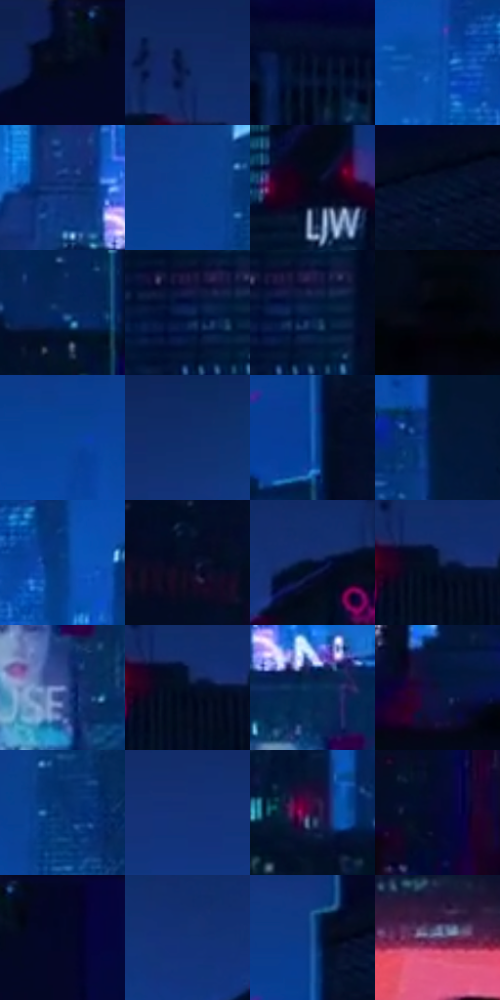

# 电影参考 550

- 状态：常规／活跃；来源世界：miles-home。
- 视角：near-level；景别：environment-wide；场景：city。
- 时段：night-appearance（外观依据，中置信度；具体时间／晨昏未知）；光照：night-mixed。
- 材质候选：glass, stone, metal, sky, screen（帧级，不是像素分割）。
- 明暗组：very-dark；L* P5/P50/P95：2.16791 / 15.00714 / 40.29707。
- 资格门禁：无附加门禁。
- 原截图 SHA-256：`d73cff49ade589f6906676dfac757099a339a761c9256a7d5834d3fecd763627`；尺寸：2880 × 1200。
- sRGB 像素 SHA-256：`a85f1ed265c37d139f8a81e68436cac0eb1e83b00fa6c066c097ade938079fd5`。

## 观察与迁移

蓝色夜城、楼体正侧面与窗组节奏，发光窗不是满铺LED。

宽阔蓝天与城市下部青色空气光：暗近楼框住远处体量；青窗与少量粉屏低面积，楼体内部允许大片不画窗纹。

本公开版保存32个128×128原像素色卡上下文；图集格子并非原场景相邻位置。原rect、图集tile和像素SHA见 `data/palette-crops.json`。上下文不足时不得批准替色，不能以小样推断完整构图。

## 实测色卡

颜色比例分母为保留采样像素，不是材料面积；全部 32 色参与全库匹配。表内四舍五入仅用于阅读，原精度在 JSON。

| ID | HEX | Lab | 原图 xy | 像素数 | 比例 | 明度角色 |
| --- | --- | --- | --- | ---: | ---: | --- |
| 550-S01 | #020A22 | [3.12019, 3.845196, -15.582368] | [2524, 36] | 10735 | 5.572339% | deep-shadow |
| 550-S02 | #12275C | [17.235491, 13.088736, -34.187975] | [1940, 100] | 10647 | 5.526660% | deep-shadow |
| 550-S03 | #05102A | [5.148155, 5.07593, -18.540606] | [2796, 228] | 10019 | 5.200677% | deep-shadow |
| 550-S04 | #094FAA | [35.104592, 17.025077, -54.087322] | [1420, 500] | 9960 | 5.170051% | shadow |
| 550-S05 | #183B80 | [26.389689, 14.532619, -42.560551] | [1408, 744] | 8224 | 4.268926% | shadow |
| 550-S06 | #0B3F90 | [28.482101, 17.323068, -49.112599] | [1388, 276] | 7903 | 4.102301% | shadow |
| 550-S07 | #04071A | [2.279178, 2.974101, -10.496312] | [224, 340] | 7880 | 4.090362% | deep-shadow |
| 550-S08 | #04142E | [6.533298, 4.329777, -19.340223] | [2448, 276] | 7758 | 4.027034% | deep-shadow |
| 550-S09 | #0A2C64 | [19.163606, 11.960579, -36.356766] | [2248, 760] | 7369 | 3.825111% | deep-shadow |
| 550-S10 | #0B224F | [14.284369, 10.225456, -30.228954] | [200, 472] | 7147 | 3.709875% | deep-shadow |
| 550-S11 | #041B42 | [10.578167, 8.727386, -27.24527] | [232, 472] | 7088 | 3.679249% | deep-shadow |
| 550-S12 | #03040C | [1.198908, 0.866441, -3.162013] | [76, 824] | 6839 | 3.549998% | deep-shadow |
| 550-S13 | #0A4499 | [30.634402, 17.558614, -51.117088] | [1264, 360] | 6817 | 3.538578% | shadow |
| 550-S14 | #122E6B | [20.61007, 14.346068, -38.56] | [1336, 108] | 6405 | 3.324717% | shadow |
| 550-S15 | #2362B8 | [42.079585, 11.871024, -51.050253] | [2296, 396] | 6262 | 3.250488% | midtone |
| 550-S16 | #041839 | [8.775766, 6.814098, -23.764091] | [1724, 504] | 6204 | 3.220381% | deep-shadow |
| 550-S17 | #073C84 | [26.568739, 14.112326, -44.791698] | [1536, 508] | 5997 | 3.112931% | shadow |
| 550-S18 | #090C26 | [4.163326, 6.380595, -17.02776] | [412, 508] | 5641 | 2.928138% | deep-shadow |
| 550-S19 | #020F30 | [5.129322, 7.758718, -23.06824] | [1828, 168] | 5503 | 2.856505% | deep-shadow |
| 550-S20 | #061634 | [7.771423, 6.421279, -21.760644] | [1984, 180] | 5242 | 2.721025% | deep-shadow |
| 550-S21 | #748ACD | [58.317018, 9.589378, -37.081402] | [1532, 980] | 4636 | 2.406462% | midtone |
| 550-S22 | #021025 | [4.669892, 2.159855, -15.507271] | [1984, 188] | 4458 | 2.314065% | deep-shadow |
| 550-S23 | #062B57 | [17.710256, 6.473222, -30.108338] | [1512, 824] | 4419 | 2.293821% | deep-shadow |
| 550-S24 | #0B1236 | [6.95523, 11.338104, -24.517692] | [844, 988] | 4064 | 2.109547% | deep-shadow |
| 550-S25 | #083674 | [23.50625, 11.533049, -39.664234] | [1460, 304] | 4028 | 2.090860% | shadow |
| 550-S26 | #153276 | [22.82022, 16.434108, -42.034692] | [1152, 184] | 4027 | 2.090341% | shadow |
| 550-S27 | #280F3A | [9.784502, 22.36615, -22.680136] | [2120, 744] | 3853 | 2.000021% | deep-shadow |
| 550-S28 | #060730 | [3.649199, 12.304874, -25.417013] | [428, 940] | 3246 | 1.684938% | deep-shadow |
| 550-S29 | #030726 | [2.811002, 6.859513, -19.157543] | [2608, 56] | 3141 | 1.630435% | deep-shadow |
| 550-S30 | #113276 | [22.680678, 16.016006, -42.267729] | [1700, 176] | 2856 | 1.482497% | shadow |
| 550-S31 | #235395 | [35.424966, 7.986394, -40.929237] | [2296, 288] | 2317 | 1.202712% | shadow |
| 550-S32 | #583E67 | [30.638764, 19.856722, -19.687966] | [2060, 1088] | 1963 | 1.018957% | shadow |

## 色阶与空间分布

- 采样 ROI：`[0.01, 0.02, 0.98, 0.94]`；步长：4；样本数：192648。
- 排除区：`[]`。
- 深暗、暗、中、亮、高光五段计数：`[120980, 61781, 8503, 1088, 296]`。
- RGB 各 256 箱、L* 100 箱、13×5 色相明度表和 3×3 空间统计全部保存在 [总数据](../film-library.json)。
- [可视化档案](../../references/library.html)按需绘制直方图，不存 2,094 张重复图表图片。

## 纹理特征占比

**这是分块图像特征的面积占比，不是波点／排线／丝网／错版的精确语义覆盖率。** 窗格、发丝、织物也会产生方向或周期特征。
原图 ROI 像素 3084576；已测块覆盖 3084576（100.0000%）；未测 0。

| 特征 | 块覆盖像素 | 占已测面积 | 阈值敏感范围 |
| --- | ---: | ---: | --- |
| low-contrast | 503040 | 16.3082% | 4.9132% ~ 24.6076% |
| directional-structure | 379136 | 12.2913% | 2.6558% ~ 26.0517% |
| periodic-structure | 1678112 | 54.4033% | 44.9836% ~ 62.1300% |
| mixed-detail | 524288 | 16.9971% | 6.9051% ~ 27.7531% |

阈值敏感范围不是统计置信区间。逐块坐标、尺度、对比、方向一致性、频谱集中度、频率与角度见 [全量特征记录](../texture-features.jsonl)，以帧号定位。
四种印刷层的真实像素覆盖仍标为 `null`，不能填 0，也不能拿上表代替。不得据这些代理测量删除唯一证据。

[测量方法与保留策略](../../references/library-retention.md) · [分类索引](../archive/README.md)
