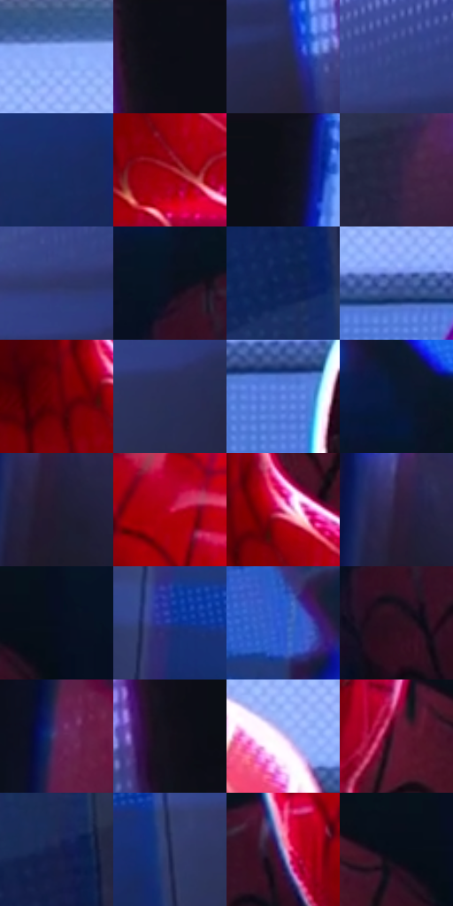

# 电影参考 551

- 状态：条件／活跃；来源世界：miles-home。
- 视角：near-level；景别：medium；场景：reflection。
- 时段：interior-time-unknown（外观依据，中置信度；具体时间／晨昏未知）；光照：cool-interior。
- 材质候选：skin, fabric, glass, metal（帧级，不是像素分割）。
- 明暗组：dark；L* P5/P50/P95：3.82926 / 20.14256 / 71.92773。
- 资格门禁：reflection。
- 原截图 SHA-256：`96972e05b96462690eba9b1fe65f6665fa8202a4f230b161f90e2fb1ee0f2df4`；尺寸：2878 × 1206。
- sRGB 像素 SHA-256：`b09d2e45296749b26b3f63e24a61aee9410b0986dc57fccfbb90f08301eedcfe`。

## 观察与迁移

展柜衣服与脸部映像重合，仍是不同光学层。

展柜：青白顶灯、红衣与黑框形成层次，人物面部映像叠在展品前；玻璃映像、透射、网纹、色边不可互换。

本公开版保存32个128×128原像素色卡上下文；图集格子并非原场景相邻位置。原rect、图集tile和像素SHA见 `data/palette-crops.json`。上下文不足时不得批准替色，不能以小样推断完整构图。

## 实测色卡

颜色比例分母为保留采样像素，不是材料面积；全部 32 色参与全库匹配。表内四舍五入仅用于阅读，原精度在 JSON。

| ID | HEX | Lab | 原图 xy | 像素数 | 比例 | 明度角色 |
| --- | --- | --- | --- | ---: | ---: | --- |
| 551-S01 | #8EACFA | [70.977836, 9.39726, -42.002769] | [988, 104] | 14646 | 7.575021% | light |
| 551-S02 | #0B0C15 | [3.50676, 1.466582, -4.865515] | [2636, 72] | 10339 | 5.347408% | deep-shadow |
| 551-S03 | #272A4B | [18.343339, 8.819014, -20.911493] | [2520, 408] | 9666 | 4.999328% | deep-shadow |
| 551-S04 | #38488B | [32.56604, 15.189704, -39.354423] | [2384, 304] | 9606 | 4.968295% | shadow |
| 551-S05 | #172C63 | [19.572999, 13.096729, -35.015016] | [2076, 552] | 8755 | 4.528152% | deep-shadow |
| 551-S06 | #980417 | [31.408145, 54.247458, 34.488571] | [1616, 996] | 8495 | 4.393678% | shadow |
| 551-S07 | #0D0E18 | [4.205475, 1.856365, -6.023723] | [212, 64] | 7696 | 3.980429% | deep-shadow |
| 551-S08 | #2B2243 | [15.813561, 13.16043, -19.396874] | [2292, 1092] | 7423 | 3.839231% | deep-shadow |
| 551-S09 | #2F3466 | [23.735087, 13.512608, -30.199604] | [2332, 372] | 7218 | 3.733204% | shadow |
| 551-S10 | #0B1020 | [4.931724, 2.661816, -11.215434] | [1080, 600] | 7182 | 3.714584% | deep-shadow |
| 551-S11 | #0D2056 | [14.345086, 15.101121, -34.875186] | [2124, 808] | 6973 | 3.606488% | deep-shadow |
| 551-S12 | #4B63A8 | [43.130812, 11.851028, -39.881388] | [1792, 256] | 6930 | 3.584248% | midtone |
| 551-S13 | #6B0009 | [20.621538, 42.481841, 27.775599] | [1532, 912] | 6799 | 3.516494% | shadow |
| 551-S14 | #292F57 | [20.798201, 10.085738, -25.067253] | [2368, 460] | 6675 | 3.452360% | shadow |
| 551-S15 | #678CEC | [59.610522, 14.924228, -52.404189] | [1156, 316] | 6584 | 3.405294% | midtone |
| 551-S16 | #0A1732 | [8.195811, 5.525789, -19.607455] | [1060, 500] | 6172 | 3.192205% | deep-shadow |
| 551-S17 | #211B31 | [11.476252, 8.995623, -13.556108] | [284, 536] | 5943 | 3.073764% | deep-shadow |
| 551-S18 | #CC0A39 | [43.291877, 67.970299, 30.173342] | [1348, 588] | 5451 | 2.819298% | midtone |
| 551-S19 | #CF5884 | [53.935758, 51.346495, -0.727237] | [1596, 888] | 5345 | 2.764474% | midtone |
| 551-S20 | #2B1C3E | [13.779274, 15.858048, -19.123995] | [268, 484] | 4828 | 2.497078% | deep-shadow |
| 551-S21 | #060D1D | [3.750765, 1.885994, -10.68838] | [1792, 632] | 4808 | 2.486734% | deep-shadow |
| 551-S22 | #1B3492 | [26.049677, 26.989362, -54.294686] | [720, 456] | 4694 | 2.427772% | shadow |
| 551-S23 | #2B5BCF | [41.997796, 26.057617, -64.502613] | [880, 352] | 4598 | 2.378120% | midtone |
| 551-S24 | #2B0E1F | [8.365327, 17.560589, -4.857262] | [1112, 704] | 4467 | 2.310366% | deep-shadow |
| 551-S25 | #592D60 | [26.289661, 28.974513, -21.955251] | [172, 1092] | 3481 | 1.800399% | shadow |
| 551-S26 | #130F19 | [4.970626, 3.759545, -5.633037] | [2620, 208] | 3401 | 1.759023% | deep-shadow |
| 551-S27 | #DECCF5 | [84.642116, 13.814388, -17.840435] | [1588, 212] | 3312 | 1.712991% | highlight |
| 551-S28 | #611734 | [21.589886, 35.459024, 0.640639] | [1616, 672] | 3125 | 1.616273% | shadow |
| 551-S29 | #17204B | [13.960586, 12.032071, -27.982554] | [2164, 1088] | 2715 | 1.404218% | deep-shadow |
| 551-S30 | #1F2853 | [17.613623, 11.075128, -27.518907] | [2164, 488] | 2666 | 1.378875% | deep-shadow |
| 551-S31 | #AC95CD | [65.493405, 19.571468, -25.612194] | [1228, 628] | 1930 | 0.998210% | light |
| 551-S32 | #060D18 | [3.545259, 0.441886, -7.038566] | [1732, 640] | 1423 | 0.735986% | deep-shadow |

## 色阶与空间分布

- 采样 ROI：`[0.01, 0.02, 0.98, 0.94]`；步长：4；样本数：193346。
- 排除区：`[]`。
- 深暗、暗、中、亮、高光五段计数：`[95805, 52820, 20546, 22593, 1582]`。
- RGB 各 256 箱、L* 100 箱、13×5 色相明度表和 3×3 空间统计全部保存在 [总数据](../film-library.json)。
- [可视化档案](../../references/library.html)按需绘制直方图，不存 2,094 张重复图表图片。

## 纹理特征占比

**这是分块图像特征的面积占比，不是波点／排线／丝网／错版的精确语义覆盖率。** 窗格、发丝、织物也会产生方向或周期特征。
原图 ROI 像素 3096328；已测块覆盖 3096328（100.0000%）；未测 0。

| 特征 | 块覆盖像素 | 占已测面积 | 阈值敏感范围 |
| --- | ---: | ---: | --- |
| low-contrast | 655880 | 21.1825% | 14.8328% ~ 25.7670% |
| directional-structure | 682496 | 22.0421% | 9.6982% ~ 35.2665% |
| periodic-structure | 1708928 | 55.1921% | 49.0201% ~ 60.6613% |
| mixed-detail | 49024 | 1.5833% | 0.8805% ~ 3.8735% |

阈值敏感范围不是统计置信区间。逐块坐标、尺度、对比、方向一致性、频谱集中度、频率与角度见 [全量特征记录](../texture-features.jsonl)，以帧号定位。
四种印刷层的真实像素覆盖仍标为 `null`，不能填 0，也不能拿上表代替。不得据这些代理测量删除唯一证据。

[测量方法与保留策略](../../references/library-retention.md) · [分类索引](../archive/README.md)
